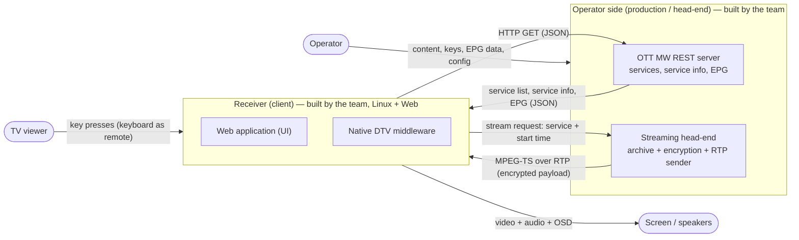

# M15 — Broadband Managed IPTV Receiver: Protected Rewind

## Technical Specification

| Item | Value |
|---|---|
| Course | Software in Digital Television (Softver u digitalnoj televiziji) |
| Group / task code | Group VII — M15 (group project, 3 students) |
| Team | Lazar Zubović (RA 13/2023), Smilja Krulj (RA 145/2023), Ivan Berenić (RA 59/2023) |
| Implementation variant | Linux + Web |
| Defense | 2026-12-03 |
| Document version | 0.1 (draft) |
| Status | Section 1 (user, goal, inputs, outputs, boundaries, user stories) — in progress |

### Document conventions

- **[TASK]** — stated explicitly in the assigned project task.
- **[COMMON]** — part of the common requirements that apply to all groups.
- **[ASSUMPTION A-xx]** — a decision made by the team where the task is not explicit. Each one is listed in Section 1.8 and must be confirmed by the team or the course staff before the requirements are frozen.
- **[PROPOSED]** — a concrete value (key binding, timeout, number) proposed by the team, open to change.
- Requirement IDs (`REQ-xx`) and test IDs (`TST-xx`) are introduced in later sections; user stories (`US-xx`) defined here are the source they trace back to.

---

## 1. User, Goal and System Boundaries

### 1.1 Source of requirements

Original task text (translated from Serbian):

> **Broadband Managed IPTV receiver: protected rewind.**
> Enable time-based selection of a previously broadcast protected program and its playback using a decryption key. Demonstrate operation with a correct and with an incorrect key.
>
> **Common requirements (mandatory for all):** Live TV zapper (selection of next/previous service, direct number entry and a service list), info dialog on service change, volume control and mute, EPG/TV guide, and keyboard control acting as a remote control (arrows, ENTER, digits; letters for dialogs).
>
> **Transport type — Broadband managed:** MPEG-TS over RTP on client request (with the server-side production part). PAT/PMT must be parsed from the received TS, while service information and EPG are obtained from an OTT MW REST server.
>
> **Expected results:** the specification must contain functional and non-functional requirements, components and interfaces, data flows, application behavior, error handling and a verification plan. Source code, run instructions and a demonstration are to be provided.

Additional sources: the course lecture notes (Modules 1–7) and the general project guidelines ("Instrukcije za izradu projekta").

### 1.2 Users

#### 1.2.1 Primary user — TV viewer (subscriber)

| Attribute | Description |
|---|---|
| Who | A subscriber of a managed IPTV service watching TV on a receiver connected to the operator's network (living-room scenario, Lecture 4). |
| Technical skill | Non-technical. Knows how to use a TV remote control; does not know anything about PIDs, RTP or encryption. |
| Interaction device | A PC keyboard acting as a remote control **[COMMON]**: arrow keys, ENTER, digits, letters for dialogs. No mouse is required for any function. |
| Viewing device | Screen and speakers (in the demo: projector over HDMI). |
| Main motivation | Watch live TV, switch between services quickly, find out what is on, and **watch a protected program that has already been broadcast** without waiting for a repeat. |
| Owns | A decryption key for protected content (see A-03). |

#### 1.2.2 Secondary user — Operator / content administrator

| Attribute | Description |
|---|---|
| Who | The IPTV operator who runs the head-end (production side) and the OTT middleware server. In the project, this role is played by the team. |
| Goals | Publish a list of services, provide EPG data, keep an archive of previously broadcast content, protect selected content by encryption and control which key unlocks it. |
| Interaction | Configuration files and command-line tools on the server side; no end-user UI is required. |

#### 1.2.3 Secondary user — Demonstrator / evaluator

| Attribute | Description |
|---|---|
| Who | A team member presenting the system at the defense, and the course staff evaluating it. |
| Goals | Start the complete system with a known, repeatable procedure; show both the correct-key and incorrect-key scenarios; see evidence (logs, status) of what the system is doing internally. |

### 1.3 Goal of the system

**Main goal [TASK]:**
Provide a managed IPTV receiver that lets the viewer choose a point in time in the past of a protected service, request the corresponding archived content from the operator's server, receive it as MPEG-TS over RTP, decrypt it with a decryption key and play it — and, when the key is wrong, detect that and inform the viewer instead of presenting corrupted content.

**Supporting goals:**

| ID | Goal | Source |
|---|---|---|
| G-01 | Watch live services delivered as MPEG-TS over RTP, requested on demand by the client. | [TASK] |
| G-02 | Select services by next/previous, by direct number entry and from a service list. | [COMMON] |
| G-03 | See basic information about the service and the current program on every service change. | [COMMON] |
| G-04 | Control volume and mute. | [COMMON] |
| G-05 | Browse the EPG (TV guide), including past programs that are available for rewind. | [COMMON] + [TASK] |
| G-06 | Select a previously broadcast moment/program of a protected service and play it from that moment. | [TASK] |
| G-07 | Provide the decryption key; play the content when the key is correct; get a clear error when the key is incorrect. | [TASK] |
| G-08 | Operate everything with the keyboard as a remote control. | [COMMON] |
| G-09 | Obtain service information and EPG from an OTT MW REST server; obtain stream structure (PAT/PMT) by parsing the received TS. | [TASK] |

### 1.4 System context

The receiver is split internally into a Web application (user interface) and a native DTV middleware process; this split is detailed in the architecture section and is only shown here to explain the boundary.

### 1.5 Inputs

#### 1.5.1 User inputs (keyboard as remote control)

Key bindings below are **[PROPOSED]**; the task only prescribes the categories (arrows, ENTER, digits, letters for dialogs).

| Key | Context: full-screen playback | Context: list / EPG / dialog |
|---|---|---|
| `↑` / `↓` | Next / previous service (zap) | Move selection up / down |
| `←` / `→` | Rewind / forward by a fixed step in the archive (A-07) | Move selection left / right (EPG time axis) |
| `ENTER` | Open the service list | Confirm the selection |
| `0`–`9` | Direct service number entry | Numeric input in dialogs |
| `L` | Open the service list | — |
| `E` | Open the EPG / TV guide | Close the EPG |
| `I` | Show the info dialog again | Close the info dialog |
| `R` | Open the rewind (time selection) dialog | — |
| `K` | Open the decryption key dialog | — |
| `M` | Mute / unmute | — |
| `+` / `-` | Volume up / down | — |
| `B` | Return to live (leave rewind) | — |
| `ESC` / `BACKSPACE` | — | Close dialog / go back / delete a character |
| `A`–`F` and digits | — | Hexadecimal characters when typing the decryption key |

#### 1.5.2 Data inputs to the receiver

| Input | Source | Format / protocol | Notes |
|---|---|---|---|
| Service list | OTT MW REST server | HTTP GET, JSON | Service number, name, identifier, protection flag. |
| Service info | OTT MW REST server | HTTP GET, JSON | Stream address (host, port / stream URL), archive availability. |
| EPG data | OTT MW REST server | HTTP GET, JSON | Events per service: start, duration, title, description. Includes past events. |
| Media stream | Streaming head-end | MPEG-TS over RTP over UDP (unicast) | Contains PAT, PMT (in the clear) and audio/video PES with encrypted payload for protected services (A-04). |
| Decryption key | Viewer (dialog) — A-03 | 128-bit key as 32 hexadecimal characters **[PROPOSED]** | Correct and incorrect key must both be demonstrable. |
| Receiver configuration | Local configuration file | Text/JSON | MW server URL, local ports, default volume, last service. |

#### 1.5.3 Inputs to the server side (operator)

| Input | Format | Notes |
|---|---|---|
| Source content per service | MPEG-TS files, H.264 video + AAC audio (A-09) | Prepared with FFmpeg; codecs must be playable in the browser. |
| Content keys | 128-bit keys per protected service | Used by the head-end to encrypt payloads. |
| Service and EPG definitions | JSON | Served by the OTT MW REST server; EPG must match the archive timeline. |
| Server configuration | Text/JSON | Ports, archive depth, mapping of files to services. |

### 1.6 Outputs

#### 1.6.1 Outputs to the viewer

| Output | Description |
|---|---|
| Video and audio | Decoded program of the selected service, live or from the archive, in full screen. |
| Info dialog (OSD) | Shown on every service change: service number and name, current program (title, time), live/archive indicator and position, protection status. |
| Service list (OSD) | List of services with numbers and names, the current one highlighted. |
| EPG / TV guide (OSD) | Programs per service on a time axis, with past programs that are available in the archive marked. |
| Rewind dialog / position indicator | Selected point in time, distance from live. |
| Key dialog | Masked entry of the decryption key. |
| Volume / mute indicator | Current volume level and mute state. |
| Status and error messages | e.g. "Incorrect decryption key", "Service unavailable", "No signal", "Server not reachable", "Invalid service number", "Content not available in archive". |

#### 1.6.2 Outputs to other systems

| Output | Destination | Format / protocol |
|---|---|---|
| Metadata requests | OTT MW REST server | HTTP GET |
| Stream control requests (start live / start at time T / stop) | Streaming head-end | Control protocol — A-06 |
| Logs / diagnostics | Local log files / console | Text; used as verification evidence |

### 1.7 System boundaries

#### 1.7.1 What the team builds, reuses and simulates

| Part | Built by the team | Reused (library / platform) | Simulated |
|---|---|---|---|
| Streaming head-end: archive, time-based start, encryption, RTP packetization | ✔ | Socket API, crypto library | The "broadcast" itself: a looping TS file mapped to wall-clock time stands in for a live channel and its archive (A-01, A-08). |
| OTT MW REST server: services, service info, EPG | ✔ | HTTP server framework | Operator back-end (static JSON data instead of a real database). |
| Native DTV middleware: RTP reception, TS synchronization, PAT/PMT parsing, PID filtering, decryption, key validation, service/session state, API to the UI | ✔ | Socket API, crypto library (e.g. OpenSSL), HTTP/WebSocket library | — |
| Web application (UI): zapper, service list, info, EPG, rewind, key dialog, volume, keyboard handling | ✔ | Browser, HTML/CSS/JS | Remote control is replaced by the PC keyboard. |
| Video/audio decoding and rendering | — | Browser media stack (MSE) and a JS TS player library (e.g. mpegts.js) | — |
| Managed network | — | Local loopback / LAN | One machine (or LAN) instead of an operator network. |

Note (from the general guidelines): the use of a ready-made player for decoding does **not** replace the team's own implementation of RTP reception, PAT/PMT parsing, PID selection, decryption and key validation. These must be done in the team's code.

#### 1.7.2 Explicitly out of scope

- Real RF reception (tuner, demodulator) and broadcast standards' physical layer.
- IP multicast and IGMP group management (the task specifies delivery on client request — A-05).
- Real commercial CAS/DRM systems (NAGRA, Widevine …), smart cards and secure hardware; a simplified, documented encryption scheme is used instead (A-04).
- Subscriber management, billing, user accounts and login (unless confirmed otherwise).
- Recording (PVR) on the client side, local timeshift buffer (A-01), adaptive bitrate streaming, subtitles, teletext, multiple audio languages.
- Video transcoding on the client side.

#### 1.7.3 External interfaces (crossing the system boundary)

| ID | Interface | Between | Direction |
|---|---|---|---|
| IF-EXT-01 | Keyboard events | Viewer → Web application | In |
| IF-EXT-02 | Video/audio/OSD output | Receiver → screen/speakers | Out |
| IF-EXT-03 | OTT MW REST API (HTTP/JSON) | Receiver ↔ OTT MW server | Request / response |
| IF-EXT-04 | Stream control | Receiver → streaming head-end | Request / response |
| IF-EXT-05 | MPEG-TS over RTP/UDP | Streaming head-end → receiver | In |
| IF-EXT-06 | Configuration and content files | Operator → server side; local config → receiver | In |

Internal interfaces (Web application ↔ native middleware, middleware ↔ player) are defined in the architecture section.

### 1.8 Assumptions and open questions

These items are not stated explicitly in the task. They are the team's working assumptions and **must be confirmed** (team decision or course staff) before the requirements are frozen.

| ID | Topic | Working assumption | Status |
|---|---|---|---|
| A-01 | Where "previously broadcast" content comes from | Server-side archive (network catch-up): the head-end keeps the past of each service and streams it from the requested time. No local timeshift buffer in the receiver. | Open |
| A-02 | How the time is selected | Two ways: (a) selecting a past program in the EPG, (b) a rewind dialog / fixed-step rewind relative to live. | Open |
| A-03 | Source of the decryption key | The viewer enters the key in a dialog (letters/digits, "letters for dialogs"). The last entered key may be remembered per service for the session. | Open |
| A-04 | Protection scheme | Only TS packet payloads of audio/video PIDs are encrypted (AES-128); TS headers, PAT and PMT stay in the clear; `transport_scrambling_control` is set and PMT carries a CA descriptor so the receiver can detect protection from the PMT. | Open |
| A-05 | Unicast vs multicast | Unicast RTP to the requesting client; no IGMP. | Open |
| A-06 | Stream control protocol | Minimal RTSP (SETUP / PLAY with time range / TEARDOWN), per Lecture 4; fallback: a simple HTTP control command. | Open |
| A-07 | Fixed rewind step | `←`/`→` move by a fixed step (e.g. 30 s or 1 min) **[PROPOSED]**. | Open |
| A-08 | Archive depth | e.g. the last 2 hours per service **[PROPOSED]**. | Open |
| A-09 | Test content | Prepared by the team with FFmpeg; H.264 + AAC; several services; at least one clear and at least one protected service. | Open |
| A-10 | Protected services in live | Protected services also require the key for live viewing (same key for live and archive). | Open |
| A-11 | Incorrect key behavior | The receiver detects the incorrect key and shows an error message; no corrupted picture is shown. | Open |
| A-12 | Demo environment | One Linux laptop runs servers and receiver; the browser in full-screen/kiosk mode; output over HDMI. | Open |

### 1.9 User stories

Format: *As a \<role\>, I want \<capability\>, so that \<benefit\>.* Each story has acceptance criteria (AC) in Given / When / Then form. Concrete numeric values marked **[PROPOSED]** become measurable requirements in Section 2.

#### Epic E1 — Start-up and service list

**US-01 — Service list on start-up** [TASK][COMMON]
As a viewer, I want the receiver to load the list of available services when it starts, so that I can start watching without any manual setup.
- AC1: Given the OTT MW server is reachable, when the receiver starts, then the service list (number, name, protection flag) is obtained from the REST API and the last watched (or first) service starts playing.
- AC2: Given the OTT MW server is not reachable, when the receiver starts, then a "Server not reachable" message is shown and the receiver retries without freezing the UI.
- AC3: Given the server returns malformed data, when the list is parsed, then invalid entries are ignored, the error is logged and the valid services are still shown.

#### Epic E2 — Live TV zapper

**US-02 — Next / previous service** [COMMON]
As a viewer, I want to switch to the next or previous service with the arrow keys, so that I can browse channels quickly.
- AC1: Given a service is playing, when I press `↑` (`↓`), then the next (previous) service in the list starts; the list wraps around at the ends.
- AC2: When I press the key several times quickly, then only the last selected service is started and earlier requests are cancelled.

**US-03 — Direct number entry** [COMMON]
As a viewer, I want to type a service number with the digit keys, so that I can jump straight to a known channel.
- AC1: When I type digits, then the typed number is shown on screen; the switch happens after `ENTER` or after a short timeout **[PROPOSED: 2 s]**.
- AC2: Given the number does not exist, then an "Invalid service number" message is shown and the current service keeps playing.

**US-04 — Service list** [COMMON]
As a viewer, I want to open a list of all services and choose one, so that I can see what is available and pick a service by name.
- AC1: When I press `ENTER` (or `L`) during playback, then the list opens with the current service highlighted.
- AC2: When I move with `↑`/`↓` and press `ENTER`, then the selected service starts and the list closes; `ESC` closes the list without changes.
- AC3: Protected services are visually marked in the list.

**US-05 — Live playback of a service** [TASK]
As a viewer, I want the selected service to start playing live, so that I can watch what is currently broadcast.
- AC1: When a service is selected, then the receiver requests its stream, receives MPEG-TS over RTP, finds the service's audio/video streams by parsing PAT and PMT, and presents video and audio.
- AC2: Given no stream data arrives within a timeout **[PROPOSED: 5 s]**, then a "No signal / service unavailable" message is shown.

#### Epic E3 — Information and audio

**US-06 — Info dialog on service change** [COMMON]
As a viewer, I want to see basic information every time the service changes, so that I know what I am watching.
- AC1: On every service change, an info dialog shows service number, service name, current program title and time, and whether the service is protected.
- AC2: When the content is from the archive, the dialog shows the archive indicator and the playback position (time).
- AC3: The dialog disappears automatically after a timeout **[PROPOSED: 5 s]** and can be reopened with `I`.

**US-07 — Volume control** [COMMON]
As a viewer, I want to raise and lower the volume, so that I can listen comfortably.
- AC1: `+`/`-` change the volume in steps **[PROPOSED: 10 % of range]**, within limits 0–100 %; a volume indicator is shown.
- AC2: The volume level is kept when the service changes.

**US-08 — Mute** [COMMON]
As a viewer, I want to mute and unmute the sound with one key, so that I can silence the TV instantly.
- AC1: `M` toggles mute; a mute indicator stays visible while muted.
- AC2: Unmuting restores the previous volume level; changing volume while muted unmutes.

#### Epic E4 — EPG / TV guide

**US-09 — Browse the EPG** [COMMON][TASK]
As a viewer, I want to open a TV guide with programs of all services, so that I can see what is on now, what comes next and what was on earlier.
- AC1: When I press `E`, then the EPG opens showing events obtained from the OTT MW REST server for the services in the list.
- AC2: I can move between services (`↑`/`↓`) and along the time axis (`←`/`→`); the selected event's title, time and description are shown.
- AC3: Given EPG data is not available for a service, then the guide shows "No information" for that service instead of failing.

**US-10 — See which past programs can be rewound to** [TASK]
As a viewer, I want past programs that are still in the archive to be marked in the EPG, so that I know what I can watch again.
- AC1: Past events that fall within the archive window are visually marked as "available"; older events are shown as unavailable.

#### Epic E5 — Protected rewind (core of M15)

**US-11 — Select a past program from the EPG** [TASK]
As a viewer, I want to select a program that has already been broadcast and start watching it from its beginning, so that I can catch up on something I missed.
- AC1: Given an available past event is selected in the EPG, when I press `ENTER`, then the receiver requests the archived stream of that service starting at the event start time and plays it.
- AC2: Given the event is outside the archive window, then a "Content not available in archive" message is shown and the current playback continues.

**US-12 — Rewind to a chosen moment** [TASK]
As a viewer, I want to move playback back in time on the current service, so that I can re-watch a moment I just missed.
- AC1: When I press `←` during playback, then the playback position moves back by the fixed step (A-07) and playback restarts from the new position; the position (distance from live) is shown.
- AC2: When I open the rewind dialog (`R`), I can choose a target time; the target is limited to the archive window.
- AC3: When I press several steps quickly, then only the final position is requested.

**US-13 — Return to live** [TASK]
As a viewer, I want to get back to the live broadcast with one key, so that I do not have to search for the current moment.
- AC1: When I press `B` (or `→` until the live point is reached), then live playback of the same service resumes and the archive indicator disappears.

**US-14 — Enter the decryption key** [TASK]
As a viewer, I want to enter my decryption key for a protected service, so that I can watch protected content.
- AC1: Given a protected service (live or archive) is selected and no key is known for it, then the key dialog opens automatically; it can also be opened with `K`.
- AC2: The dialog accepts only valid key characters and length (A-03), masks the input and allows correction with `BACKSPACE`; `ESC` cancels.
- AC3: After confirmation, playback of the protected content is (re)started using the entered key.

**US-15 — Playback with the correct key** [TASK]
As a viewer, I want protected content to play normally when my key is correct, so that I can watch what I am entitled to.
- AC1: Given the correct key, when the archived protected program is requested, then the content is decrypted and video and audio are presented without visible corruption.
- AC2: The info dialog shows that the content is protected and successfully decrypted.

**US-16 — Incorrect key is detected and reported** [TASK]
As a viewer, I want to be told clearly when my key is wrong, so that I understand why I cannot watch and can correct it.
- AC1: Given an incorrect key, when protected content is requested, then the receiver detects that decryption does not produce valid data and shows "Incorrect decryption key" within a bounded time **[PROPOSED: 3 s]**.
- AC2: No corrupted video/audio is presented (A-11); the key dialog can be reopened to enter another key.
- AC3: After entering the correct key, playback starts without restarting the application.

**US-17 — Clear services need no key**
As a viewer, I want unprotected services to play without asking for a key, so that normal viewing is not interrupted.
- AC1: Given a service whose PMT does not indicate protection, then it plays without opening the key dialog.

#### Epic E6 — Robustness

**US-18 — Changing my mind during an operation** [guidelines]
As a viewer, I want my latest action to win when I press keys before the previous operation has finished, so that the receiver always follows what I want now.
- AC1: Given a service start / rewind / key check is in progress, when a new service or position is requested, then the previous operation is cancelled, its resources are released, and only the latest request takes effect.

**US-19 — Loss of stream or server** [guidelines]
As a viewer, I want to be informed if the stream stops or a server becomes unavailable, so that I know the problem is not on my side.
- AC1: Given RTP data stops arriving during playback, then a "No signal" message is shown after a timeout **[PROPOSED: 3 s]** and playback resumes automatically when data returns.
- AC2: Given the OTT MW server is unavailable, then the last loaded service list remains usable and EPG shows "No information".

#### Epic E7 — Operator and demonstrator

**US-20 — Publish services and EPG** [TASK]
As an operator, I want to define services and EPG data that the OTT MW server publishes, so that receivers can present them.
- AC1: Services and EPG are defined in configuration/data files; after server start they are available through the REST API.
- AC2: EPG events are consistent with the archive timeline of the head-end.

**US-21 — Provide archived and protected streams** [TASK]
As an operator, I want the head-end to stream any service from a requested time in the past, with selected services encrypted, so that subscribers with the key can catch up on protected programs.
- AC1: Given a stream request with a start time inside the archive window, then the head-end sends MPEG-TS over RTP starting at that time.
- AC2: For protected services, audio/video payloads are encrypted with the configured key, while PAT/PMT remain readable.

**US-22 — Repeatable demonstration** [guidelines]
As a demonstrator, I want to start the whole system with a documented procedure and a known test data set, so that the defense demo is repeatable.
- AC1: A documented sequence of commands starts the OTT MW server, the head-end, the native middleware and the Web UI.
- AC2: The test data set (content files, checksums, correct and incorrect keys, expected services and EPG) is documented.
- AC3: Logs show the key internal events (stream request, PAT/PMT parsed with PIDs, protection detected, key accepted/rejected).

### 1.10 Traceability: goals → user stories

| Goal | User stories |
|---|---|
| G-01 Live services over RTP | US-01, US-05, US-21 |
| G-02 Zapper | US-02, US-03, US-04, US-18 |
| G-03 Info dialog | US-06 |
| G-04 Volume / mute | US-07, US-08 |
| G-05 EPG | US-09, US-10, US-20 |
| G-06 Time selection of past content | US-10, US-11, US-12, US-13, US-21 |
| G-07 Decryption key | US-14, US-15, US-16, US-17 |
| G-08 Keyboard as remote | all viewer stories (Section 1.5.1) |
| G-09 MW REST + PAT/PMT parsing | US-01, US-05, US-09, US-17, US-20 |
| Robustness / demo | US-18, US-19, US-22 |

---

## 2. Requirements

*To be written in the next step (high-level requirements, then detailed functional requirements `REQ-xx` and non-functional requirements, each with a verification method).*
