# M15 — Broadband Managed IPTV Receiver: Protected Rewind

## Technical Specification

| Item | Value |
|---|---|
| Course | Software in Digital Television (Softver u digitalnoj televiziji) |
| Group / task code | Group VII — M15 (group project, 3 students) |
| Team | Lazar Zubović (RA 13/2023), Smilja Krulj (RA 145/2023), Ivan Berenić (RA 59/2023) |
| Implementation variant | Linux + Web |
| Defense | 2026-12-03 |
| Document version | 1.3 — **frozen** (2026-11-28): scrambling bits `'01'` / `'11'` in REQ-50 (#10); `set_key` restarts an attempt only before a key is accepted and not for a clear stream (REQ-49, Section 3.6.2, T-25, T-33) (#22); `mw_status` to a new client once the reachability is known (#25); `session_state` `stopped` before the response to `stop` (#27). 1.2 (2026-11-27): resolution of the `spec` issues of the implementation phase — TST-301: the encrypted content files are checked only for what `ffprobe` can read (program, PIDs and stream types of the PMT) and for their size (#5); `INVALID_REQUEST` also on IF-EXT-03 (#6); TST-213 with the largest possible section of 4 098 bytes (#8); output file of `pal_dump` for a capture of a running stream (#9). 1.1 (2026-11-22): merge of two review rounds of version 1.0 — (a) Lazar: operator side in C++17 (team decision), TST-711 with unmasked WebSocket frames, PAT/PMT period 0.09 s, listening addresses `127.0.0.1`, playback position from the first picture, test corrections (TST-215, TST-607, TST-619, TST-625, TST-706), HLR-17 and the CDN; (b) Ivan: data path before the `/start` response, `stream_info` without `scrambled`, `playing_since` for the UI reconnect, segment bound 8 (the oldest segment is removed before a new one is written), keepalive loss = 3 failed keepalives, head-end expiry ≤ 16 s, archive pacing keeps the D-08 timeline, layering rule R1, Node.js test command, start commands of the processes, error body of IF-EXT-04; (c) at the merge: SRV-PKG moved to WP-APP (two D-04 implementations by different members), operator side built with the CMake project of `middleware/` into `build/bin/`, third-party sources in `third_party/`. 1.0 (2026-11-22): Sections 1 – 5 complete and confirmed by the team |
| Status | Frozen. Changes only on `main`, with the agreement of the owners concerned (rule 2 of Section 2.2.7), each with a new document version; only Section 5.9 (test results) is updated without a version change |

### Document conventions

- **[TASK]** — stated explicitly in the assigned project task.
- **[COMMON]** — part of the common requirements that apply to all groups.
- **[GUIDELINES]** — derived from the general project guidelines of the course.
- **[D-xx]** — a scope decision made by the team where the task is not explicit. All decisions are listed in Section 1.8 and are binding for the rest of this specification.
- Requirement IDs (`REQ-xx`) and test IDs (`TST-xx`) are introduced in later sections; user stories (`US-xx`) defined here are the source they trace back to.

---

## 1. User, Goal and System Boundaries

### 1.1 Source of requirements

Original task text (translated from Serbian):

> **Broadband Managed IPTV receiver: protected rewind.**
> Enable time-based selection of a previously broadcast protected program and its playback using a decryption key. Demonstrate operation with a correct and with an incorrect key.
>
> **Common requirements (mandatory for all):** Live TV zapper (selection of next/previous service, direct number entry and a service list), info dialog on service change, volume control and mute, EPG/TV guide, and keyboard control acting as a remote control (arrows, ENTER, digits; letters for dialogs).
>
> **Transport type — Broadband managed:** MPEG-TS over RTP on client request (with the server-side production part). PAT/PMT must be parsed from the received TS, while service information and EPG are obtained from an OTT MW REST server.
>
> **Expected results:** the specification must contain functional and non-functional requirements, components and interfaces, data flows, application behavior, error handling and a verification plan. Source code, run instructions and a demonstration are to be provided.

Additional sources: the course lecture notes (Modules 1–7) and the general project guidelines ("Instrukcije za izradu projekta").

### 1.2 Users

#### 1.2.1 Primary user — TV viewer (subscriber)

| Attribute | Description |
|---|---|
| Who | A subscriber of a managed IPTV service watching TV on a receiver connected to the operator's network (living-room scenario, Lecture 4). |
| Technical skill | Non-technical. Knows how to use a TV remote control; does not know anything about PIDs, RTP or encryption. |
| Interaction device | A PC keyboard acting as a remote control [COMMON]: arrow keys, ENTER, digits, letters for dialogs. No mouse is required for any function. |
| Viewing device | Screen and speakers (in the demo: projector over HDMI). |
| Main motivation | Watch live TV, switch between services quickly, find out what is on, and **watch a protected program that has already been broadcast** without waiting for a repeat. |
| Owns | The decryption key of each protected service the viewer is entitled to, as a 32-character hexadecimal string [D-03]. |

#### 1.2.2 Secondary user — Operator / content administrator

| Attribute | Description |
|---|---|
| Who | The IPTV operator who runs the head-end (production side) and the OTT middleware server. In the project, this role is played by the team. |
| Goals | Publish a list of services, provide EPG data, keep an archive of previously broadcast content, protect selected services by encryption and control which key unlocks them. |
| Interaction | Configuration files and command-line tools on the server side; no end-user UI is required. |

#### 1.2.3 Secondary user — Demonstrator / evaluator

| Attribute | Description |
|---|---|
| Who | A team member presenting the system at the defense, and the course staff evaluating it. |
| Goals | Start the complete system with a known, repeatable procedure; show both the correct-key and incorrect-key scenarios; see evidence (logs, status) of what the system is doing internally. |

### 1.3 Goal of the system

**Main goal [TASK]:**
Provide a managed IPTV receiver that lets the viewer choose a point in time in the past of a protected service, request the corresponding archived content from the operator's server, receive it as MPEG-TS over RTP, decrypt it with the decryption key and play it — and, when the key is wrong, detect that and inform the viewer instead of presenting corrupted content.

**Supporting goals:**

| ID | Goal | Source |
|---|---|---|
| G-01 | Watch live services delivered as MPEG-TS over RTP, requested on demand by the client. | [TASK] |
| G-02 | Select services by next/previous, by direct number entry and from a service list. | [COMMON] |
| G-03 | See basic information about the service and the current program on every service change. | [COMMON] |
| G-04 | Control volume and mute. | [COMMON] |
| G-05 | Browse the EPG (TV guide), including past programs that are available in the archive. | [COMMON] + [TASK] |
| G-06 | Select a previously broadcast program or moment of a service and play it from that moment. | [TASK] |
| G-07 | Enter the decryption key; play protected content when the key is correct; get a clear error when the key is incorrect. | [TASK] |
| G-08 | Operate everything with the keyboard as a remote control. | [COMMON] |
| G-09 | Obtain service information and EPG from an OTT MW REST server; obtain the stream structure (PAT/PMT) by parsing the received TS. | [TASK] |

### 1.4 System context

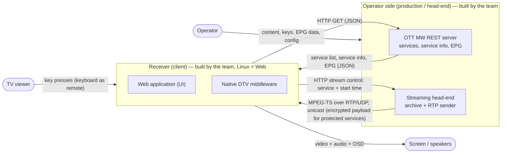

The receiver is split internally into a Web application (the "application" of the course model) and a native DTV middleware process, which contains the application layer (AL, DTV middleware core) on top of the platform layer (PAL). The layering is defined in Section 2.2.3 and is only shown here to explain the boundary.

### 1.5 Inputs

#### 1.5.1 User inputs (keyboard as remote control)

The task prescribes the key categories (arrows, ENTER, digits, letters for dialogs); the concrete bindings below are fixed by the team.

| Key | Full-screen playback | Number entry | Service list | EPG | Key dialog |
|---|---|---|---|---|---|
| `↑` / `↓` | Next / previous service (zap) | — | Move the highlight up / down | Move to the previous / next service | — |
| `←` / `→` | Move playback position 30 s back / forward in the archive [D-02] | — | — | Move to the previous / next event (time axis) | — |
| `ENTER` | Open the service list | Commit the typed number | Start the highlighted service live | Play the selected event if it is available | Confirm the key |
| `0`–`9` | Start number entry with this digit | Add a digit (at most 3) | — | — | Key characters |
| `A`–`F` | — | — | — | — | Key characters |
| `L` | Open the service list | — | — | — | Not a hexadecimal character — ignored |
| `E` | Open the EPG / TV guide | — | — | Close the EPG | Key character |
| `I` | Show the info dialog | — | — | — | — |
| `K` | Open the key dialog for the current service | — | — | — | — |
| `M` | Mute / unmute | — | — | — | — |
| `+` / `-` | Volume up / down | — | — | — | — |
| `B` | Return to live [D-02] | — | — | — | Key character |
| `ESC` | Close the info dialog | Cancel the entry without a change | Close the list without a change | Close the EPG without a change | Cancel the dialog |
| `BACKSPACE` | — | Delete the last digit; deleting the only digit ends the entry | — | — | Delete the last character |

"—" means that the key has no function in that context and is ignored (REQ-60). **Number entry** is the context that starts with the first digit typed in full-screen playback and ends when the number is committed (`ENTER` or 2 s after the last digit) or cancelled (`ESC`, or `BACKSPACE` on the only digit). In the key dialog all letter and digit keys are treated as text input; the playback shortcuts (`E`, `B`, `M`, …) are not active while the dialog is open.

#### 1.5.2 Data inputs to the receiver

| Input | Source | Format / protocol | Notes |
|---|---|---|---|
| Service list | OTT MW REST server | HTTP GET, JSON | Service number, name, identifier, protection flag (used for display only). |
| Service info | OTT MW REST server | HTTP GET, JSON | Head-end control address, archive window. |
| EPG data | OTT MW REST server | HTTP GET, JSON | Events per service: start, duration, title, description. Includes past events. |
| Media stream | Streaming head-end | MPEG-TS over RTP over UDP, unicast [D-05] | One program per stream (SPTS); PAT and PMT in the clear; audio/video payload encrypted for protected services [D-04]. |
| Decryption key | Viewer, through the key dialog [D-03] | 128-bit AES key as 32 hexadecimal characters | Kept in memory for the running session only. |
| Receiver configuration | Local configuration file of the middleware | JSON | MW server URL, local ports, file paths, timeouts (Section 4.2.5). |

#### 1.5.3 Inputs to the server side (operator)

| Input | Format | Notes |
|---|---|---|
| Source content per service | MPEG-TS files, H.264 video + AAC audio [D-09] | Generated with FFmpeg by the team. |
| Content keys | One fixed 128-bit AES key per protected service [D-04] | Used by the team's packaging tool to encrypt the content file once, before streaming. |
| Service and EPG definitions | JSON | Served by the OTT MW REST server; EPG follows the same cyclic timeline as the archive [D-08]. |
| Server configuration | JSON | Ports, archive depth, mapping of content files to services. |

### 1.6 Outputs

#### 1.6.1 Outputs to the viewer

| Output | Description |
|---|---|
| Video and audio | Decoded program of the selected service, live or from the archive, in full screen. |
| Info dialog (OSD) | Shown on every service change: service number and name, current program (title, start–end time), LIVE or ARCHIVE indicator with the playback time, protection status ("Clear", "Protected – key OK", "Protected – key required"). |
| Service list (OSD) | List of services with numbers and names, protected services marked, the current one highlighted. |
| EPG / TV guide (OSD) | Programs per service on a time axis; past programs inside the archive window marked as available; "No information" for a service without EPG data. |
| Playback position indicator | In ARCHIVE mode: the playback time and the distance from live (e.g. "−01:30"). |
| Key dialog | Masked entry of the decryption key with a character counter (n/32), titled "Enter the decryption key" or "Incorrect decryption key". |
| Volume / mute indicator | Current volume level and mute state. |
| Status and error messages | "Incorrect decryption key", "No signal", "Server not reachable", "Invalid service number", "Content not available in archive", "Protected service – press K to enter the key". |

#### 1.6.2 Outputs to other systems

| Output | Destination | Format / protocol |
|---|---|---|
| Metadata requests | OTT MW REST server | HTTP GET |
| Stream control requests (start live / start at time T / stop) | Streaming head-end | HTTP POST, JSON [D-06] |
| Logs / diagnostics | Local log files / console | Text; used as verification evidence |

### 1.7 System boundaries

#### 1.7.1 What the team builds, reuses and simulates

| Part | Built by the team | Reused (library / platform) | Simulated |
|---|---|---|---|
| Packaging tool: encryption of content files | ✔ | Crypto library | — |
| Streaming head-end: archive timeline, time-based start, RTP packetization, HTTP stream control | ✔ | Socket API, HTTP server library | The "broadcast" itself: a looping content file mapped to wall-clock time stands in for a live channel and its archive [D-08]. |
| OTT MW REST server: services, service info, EPG | ✔ | HTTP server library | Operator back-end (JSON files instead of a database). |
| Native receiver process: DTV middleware (AL: PAT/PMT parsing, protection detection, key management and validation, session state, HLS packaging, API to the UI), DTV SDK (PAL) and software tuner, demultiplexer and descrambler (HAL: RTP reception, TS synchronization, PID filtering, decryption) | ✔ | Socket API, crypto library (OpenSSL), HTTP/WebSocket library | The tuner, demultiplexer and descrambler hardware blocks of a DTV receiver are implemented in software (HAL). |
| Web application (UI): zapper, service list, info, EPG, archive navigation, key dialog, volume, keyboard handling | ✔ | Browser, HTML/CSS/JS | Remote control is replaced by the PC keyboard. |
| Video/audio decoding and rendering | — | Browser media stack (Media Source Extensions) and the hls.js player library [D-13] | — |
| Managed network | — | Loopback interface | One machine instead of an operator network [D-12]. |

Note [GUIDELINES]: the use of a ready-made player for decoding does **not** replace the team's own implementation of RTP reception, PAT/PMT parsing, PID selection, protection detection, decryption and key validation. These are done in the team's code; the player receives an already decrypted single-program transport stream.

#### 1.7.2 Explicitly out of scope

- Real RF reception (tuner, demodulator) and the physical layer of broadcast standards.
- IP multicast and IGMP group management [D-05].
- Real commercial CAS/DRM systems (NAGRA, Widevine …), smart cards and secure hardware; the documented scheme of D-04 is used instead.
- Key rotation and the CAS key hierarchy (control words, ECM, EMM, service and user keys); one fixed key per protected service is used [D-04].
- Obtaining keys from a server, subscriber management, billing, user accounts and login [D-03].
- Local timeshift buffer and recording (PVR) in the receiver [D-01]; the short-lived HLS segments of D-13 are an output buffer for the browser, not a timeshift buffer.
- A free time-entry dialog for rewind; time is selected through the EPG and the fixed-step keys [D-02].
- Adaptive bitrate streaming (the HLS output of D-13 has one quality level only), subtitles, teletext, multiple audio languages, multi-program transport streams (MPTS).
- Video transcoding on the client side.

#### 1.7.3 External interfaces (crossing the system boundary)

| ID | Interface | Between | Direction |
|---|---|---|---|
| IF-EXT-01 | Keyboard events | Viewer → Web application | In |
| IF-EXT-02 | Video/audio/OSD output | Receiver → screen/speakers | Out |
| IF-EXT-03 | OTT MW REST API (HTTP/JSON) | Receiver ↔ OTT MW server | Request / response |
| IF-EXT-04 | Stream control API (HTTP/JSON) | Receiver ↔ streaming head-end | Request / response |
| IF-EXT-05 | MPEG-TS over RTP/UDP | Streaming head-end → receiver | In |
| IF-EXT-06 | Configuration and content files | Operator → server side; local config → receiver | In |

Internal interfaces (Web application ↔ native middleware, middleware ↔ player) are defined in Sections 2.2.5 and 3.

### 1.8 Scope decisions

Where the task does not prescribe a solution, the team fixed the variant that is the simplest to implement and integrate while still fulfilling the task. These decisions are binding for the rest of the specification.

| ID | Topic | Decision | Rationale |
|---|---|---|---|
| D-01 | Source of previously broadcast content | **Server-side archive (network catch-up).** The head-end can stream every service from any moment inside the archive window. The receiver has no local timeshift buffer and no storage. | The task asks for a *previously broadcast* program, which a local buffer cannot contain if the receiver was not on at that time. Rewind becomes just a new stream request with a start time; the receiver needs no disk buffer or index, and still parses PAT/PMT, decrypts and validates the key for every rewind. Confirmed as a valid solution by course staff. |
| D-02 | How the viewer selects a time | (a) **EPG:** selecting an available past program and pressing `ENTER` starts it from the program's start time. (b) **Step keys:** `←` / `→` move the playback position by **30 s** back / forward, relative to the current position. `B` returns to live. Moving forward past the live point switches to live. Moving back past the start of the archive window stops at the window start (precisely 5 s after it, so that the request is still inside the window when it reaches the head-end; REQ-41). | Both methods reuse the same "start at time T" request; no separate time-entry dialog is needed. |
| D-03 | Source of the decryption key | **The viewer enters the key** in the key dialog: exactly 32 hexadecimal characters (`0–9`, `A–F`), representing a 128-bit key. The key is kept by the middleware in memory, per service, for the running session; it is not written to disk. | Correct and incorrect key are demonstrated simply by typing two different keys; no authorization logic on the server; uses "letters for dialogs" from the task. |
| D-04 | Protection scheme | **One fixed AES-128 key per protected service**, the same for live and archive, never changing. **Encrypted:** the payload of TS packets carrying the audio and video PIDs. **Mode:** AES-128-CBC, IV = 16 zero bytes, restarted for every TS packet; the largest multiple of 16 bytes from the payload start is encrypted, the remaining bytes (fewer than 16) stay in the clear. **In the clear:** TS headers, adaptation fields (including PCR), PAT and PMT. **Signalling:** encrypted packets have `transport_scrambling_control = '10'`, all others `'00'`. The receiver detects protection from these bits; no CA descriptor, ECM or EMM is used. Content files are encrypted once, offline, by the team's packaging tool. | Fixed key as confirmed by course staff; per-packet encryption with the header in the clear follows the scrambling model of Lecture 3 (headers and PSI readable, payload protected); offline encryption keeps the head-end a plain file streamer. |
| D-05 | Unicast vs multicast | **Unicast** RTP over UDP to the requesting receiver; no IP multicast, no IGMP. RTP payload: MPEG-2 TS as in RFC 2250 (payload type 33), **7 TS packets (1316 bytes) per RTP packet**. | "On client request" delivery from the task is naturally one-to-one; unicast works on loopback without any network configuration. |
| D-06 | Stream control protocol | **HTTP POST with JSON** to the head-end: *start* (service, start time or "live", receiver UDP port, RTP SSRC chosen by the receiver) returns a session identifier; *keepalive* (session identifier) every 5 s keeps the session alive; *stop* (session identifier) ends the stream. Starting a new session for the same receiver stops the previous one; a session without keepalive for 15 s is stopped by the head-end, so a receiver that stops or crashes does not leave a stream running. | Same technology as the MW REST API, so one HTTP client is used in the receiver; simpler than implementing an RTSP server and client. |
| D-07 | Rewind step | **30 s** per key press (see D-02). | Large enough to see a visible jump in the demo, small enough to re-watch a moment. |
| D-08 | Archive depth and timeline | **Archive window: the last 2 hours.** Each service's content file is played in an endless loop on a timeline bound to wall-clock time: playback position = (UNIX time in seconds) mod (file duration). The EPG is generated on the same cycle, so the program shown at time T in the EPG is exactly the content streamed for time T. | Any moment of the last 2 hours exists without storing 2 hours of content; the server can be restarted without losing the archive; EPG and content always match. |
| D-09 | Test content | **4 services**, each a separate single-program transport stream (SPTS) generated with FFmpeg: H.264 video 1280×720, 25 fps; AAC-LC stereo audio, 48 kHz; **10-minute file = 2 programs of 5 minutes**. Each picture shows burned-in text with the service name, program title and the content time code, so the correct service and position can be verified visually. Services 1 and 2 are clear; services 3 and 4 are protected with two different keys. | Codecs playable in the browser via MSE; known content makes the expected result of every test exact; two protected services with different keys show that a key is bound to its service. |
| D-10 | Protected services in live | Protected services are **protected in live and in the archive** with the same key (D-04); the key dialog appears for both. | The same encrypted file serves live and archive; no extra logic. |
| D-11 | Incorrect key behavior | The receiver **detects** the incorrect key and shows the message "Incorrect decryption key"; **no corrupted data is passed to the player**. Detection: after decryption, a TS packet of the video PID with `payload_unit_start_indicator = 1` must begin with the PES start code `00 00 01`; if it does not, the key is rejected. | Deterministic, measurable result for the test; a browser decoder fed with garbage would not show a "corrupted picture" reliably, but would stall or report an error. |
| D-12 | Demo environment | **One Linux laptop** (Ubuntu 24.04 LTS) runs the OTT MW server, the head-end, the native middleware and the browser; all communication over the loopback interface. The Web application runs in Chromium in full-screen kiosk mode; the screen is mirrored to the projector over HDMI. | No network setup at the defense; one start procedure. |
| D-13 | Playback in the browser | The native middleware packages the **decrypted** single-program TS of the current session as an **HLS live stream** (RFC 8216): TS segments of about 1 s, each starting with PAT, PMT and a video key frame, and a sliding-window playlist `index.m3u8`, written to a temporary directory. The middleware's existing HTTP server (the one that serves the Web application) serves these files; **no additional server** is used. The Web application plays the playlist with **hls.js** (MSE). The content loop boundary of D-08 is signalled with `#EXT-X-DISCONTINUITY`. Volume and mute are controlled on the HTML video element. | Suggested by course staff; HLS is part of the course material (Lecture 4). Browsers cannot receive RTP or play TS natively; hls.js plays HLS with TS segments through MSE. The discontinuity tag lets the player handle the timestamp jump at the loop boundary without rewriting timestamps. Live, zap and rewind all use the same path. |
| D-14 | Playback position while waiting for a key | The receiver remembers the **requested start point** of the current request: either "live" or the archive time T selected by the viewer (EPG event start or step position). When the stream of a protected service is stopped because no key or an incorrect key is known, this start point is kept. After a correct key is entered, playback is requested again **from the same start point**: archive content continues from time T (not from the moment the key was accepted); a live request continues at the current live point. The start point is discarded only when the viewer selects another service, another time, or returns to live. | Confirmed by course staff: playback continues from where it was started. Because the team's own head-end can start any service at any time T (D-01, D-06), resuming is just a repeated start request with the stored T. |

### 1.9 User stories

Format: *As a \<role\>, I want \<capability\>, so that \<benefit\>.* Each story has acceptance criteria (AC) in Given / When / Then form. The numeric values in the criteria are fixed by the team and become measurable requirements in Section 2.

#### Epic E1 — Start-up and service list

**US-01 — Service list on start-up** [TASK][COMMON]
As a viewer, I want the receiver to load the list of available services when it starts, so that I can start watching without any manual setup.
- AC1: Given the OTT MW server is reachable, when the receiver starts, then the service list (number, name, protection flag) is obtained from the REST API and service number 1 starts playing live.
- AC2: Given the OTT MW server is not reachable, when the receiver starts, then the message "Server not reachable" is shown and the receiver retries every 5 s without blocking the UI.
- AC3: Given the server returns an entry with missing or invalid fields, when the list is parsed, then that entry is ignored, the error is logged and the valid services are still shown.

#### Epic E2 — Live TV zapper

**US-02 — Next / previous service** [COMMON]
As a viewer, I want to switch to the next or previous service with the arrow keys, so that I can browse channels quickly.
- AC1: Given a service is playing, when I press `↑` (`↓`), then the next (previous) service in the list starts live; the list wraps around at the ends.
- AC2: When I press the key several times quickly, then only the last selected service is started and the earlier requests are cancelled.

**US-03 — Direct number entry** [COMMON]
As a viewer, I want to type a service number with the digit keys, so that I can jump straight to a known channel.
- AC1: When I type digits, then the typed number is shown on screen; the switch happens after `ENTER` or 2 s after the last digit.
- AC2: Given the number does not exist, then "Invalid service number" is shown and the current service keeps playing.

**US-04 — Service list** [COMMON]
As a viewer, I want to open a list of all services and choose one, so that I can see what is available and pick a service by name.
- AC1: When I press `ENTER` or `L` during playback, then the list opens with the current service highlighted.
- AC2: When I move with `↑`/`↓` and press `ENTER`, then the selected service starts live and the list closes; `ESC` closes the list without changes.
- AC3: Protected services are marked in the list.

**US-05 — Live playback of a service** [TASK]
As a viewer, I want the selected service to start playing live, so that I can watch what is currently broadcast.
- AC1: When a service is selected, then the receiver requests its stream from the head-end, receives MPEG-TS over RTP, finds the audio and video PIDs by parsing PAT and PMT, and presents video and audio.
- AC2: Given no stream data arrives within 5 s after the head-end has accepted the request, then "No signal" is shown.

#### Epic E3 — Information and audio

**US-06 — Info dialog on service change** [COMMON]
As a viewer, I want to see basic information every time the service changes, so that I know what I am watching.
- AC1: On every service change, the info dialog shows service number, service name, current program title and start–end time, and the protection status.
- AC2: When the content is from the archive, the dialog shows "ARCHIVE" and the playback time instead of "LIVE".
- AC3: The dialog disappears automatically after 5 s and can be shown again with `I`.

**US-07 — Volume control** [COMMON]
As a viewer, I want to raise and lower the volume, so that I can listen comfortably.
- AC1: `+`/`-` change the volume in steps of 10 %, within 0–100 %; a volume indicator is shown for 2 s.
- AC2: The volume level is kept when the service changes.

**US-08 — Mute** [COMMON]
As a viewer, I want to mute and unmute the sound with one key, so that I can silence the TV instantly.
- AC1: `M` toggles mute; a mute indicator stays visible while muted.
- AC2: Unmuting restores the previous volume level; pressing `+` or `-` while muted unmutes.

#### Epic E4 — EPG / TV guide

**US-09 — Browse the EPG** [COMMON][TASK]
As a viewer, I want to open a TV guide with programs of all services, so that I can see what is on now, what comes next and what was on earlier.
- AC1: When I press `E`, then the EPG opens with the events obtained from the OTT MW REST server for all services, centered on the current time.
- AC2: I can move between services (`↑`/`↓`) and between events (`←`/`→`); the selected event's title, start–end time and description are shown.
- AC3: Given EPG data is not available for a service, then the guide shows "No information" for that service instead of failing.

**US-10 — See which past programs are available** [TASK]
As a viewer, I want past programs that are still in the archive to be marked in the EPG, so that I know what I can watch again.
- AC1: Past events that start inside the 2-hour archive window are marked as available; older events are shown as not available.

#### Epic E5 — Protected rewind (core of M15)

**US-11 — Select a past program from the EPG** [TASK]
As a viewer, I want to select a program that has already been broadcast and start watching it from its beginning, so that I can catch up on something I missed.
- AC1: Given an available past event is selected in the EPG, when I press `ENTER`, then the receiver requests the stream of that service starting at the event start time, the EPG closes and the program plays from its beginning in ARCHIVE mode. (If the beginning of the event has left the archive window in the meantime, playback starts at the oldest moment still in the archive, AC3 of US-12.)
- AC2: Given the selected event is not available, then "Content not available in archive" is shown and the current playback continues.
- AC3: Given the selected event is the one currently running, then playback starts from its start time (in the archive), not from live.

**US-12 — Step back and forward in time** [TASK]
As a viewer, I want to move playback back in time on the current service, so that I can re-watch a moment I just missed.
- AC1: When I press `←` during playback, then the playback position moves 30 s back from the current position and playback restarts from there in ARCHIVE mode; the playback time and the distance from live are shown.
- AC2: When I press `→` in ARCHIVE mode, then the position moves 30 s forward; if that reaches the live point, playback switches to LIVE.
- AC3: Given the new position would be before the start of the archive window, then the position is set to the window start (5 s after it, D-02).
- AC4: When I press `←`/`→` several times quickly, then only the final position is requested from the head-end.

**US-13 — Return to live** [TASK]
As a viewer, I want to get back to the live broadcast with one key, so that I do not have to search for the current moment.
- AC1: When I press `B` in ARCHIVE mode, then live playback of the same service resumes and "LIVE" is shown.

**US-14 — Enter the decryption key** [TASK]
As a viewer, I want to enter my decryption key for a protected service, so that I can watch protected content.
- AC1: Given a service is started (live or archive) whose audio/video packets are scrambled, and no key is stored for it in this session, then playback does not start, the requested start point is kept (D-14) and the key dialog opens automatically.
- AC2: The key dialog can also be opened with `K` for the current service.
- AC3: The dialog accepts only `0–9` and `A–F`, at most 32 characters, masks the input and shows the count (n/32); `BACKSPACE` deletes, `ESC` cancels; `ENTER` is accepted only when exactly 32 characters have been typed.
- AC4: After confirmation, the key is applied and playback of the protected content starts from the kept start point: from the selected archive time T for an archive request, or at the live point for a live request.
- AC5: Given the dialog is cancelled with `ESC`, then no protected content is played, the message "Protected service – press K to enter the key" is shown and the start point is still kept; entering the correct key later with `K` starts playback from that start point.

**US-15 — Playback with the correct key** [TASK]
As a viewer, I want protected content to play normally when my key is correct, so that I can watch what I am entitled to.
- AC1: Given the correct key, when a past program of a protected service is selected, then the content is decrypted and video and audio are presented without visible corruption; the burned-in time code matches the selected time.
- AC2: The info dialog shows the status "Protected – key OK".
- AC3: Given the key was accepted once, then further zaps to that service and rewinds on it in the same session do not ask for the key again.

**US-16 — Incorrect key is detected and reported** [TASK]
As a viewer, I want to be told clearly when my key is wrong, so that I understand why I cannot watch and can correct it.
- AC1: Given an incorrect key, when protected content is requested, then the receiver detects within 3 s after the stream data arrives that decryption does not produce valid data and shows "Incorrect decryption key".
- AC2: No video or audio of the protected service is presented; the stream session is stopped, the incorrect key is discarded and the key dialog opens again.
- AC3: After entering the correct key, playback starts without restarting the application, from the same start point that was requested before the incorrect key (D-14): for an archive request, the burned-in time code shows the originally selected time T, regardless of how long the key entry took.
- AC4: The key of one protected service does not unlock the other protected service (services 3 and 4 have different keys).

**US-17 — Clear services need no key**
As a viewer, I want unprotected services to play without asking for a key, so that normal viewing is not interrupted.
- AC1: Given a service whose audio/video packets are not scrambled (`transport_scrambling_control = '00'`), then it plays without opening the key dialog.

#### Epic E6 — Robustness

**US-18 — Changing my mind during an operation** [GUIDELINES]
As a viewer, I want my latest action to win when I press keys before the previous operation has finished, so that the receiver always follows what I want now.
- AC1: Given a service start, a rewind or a key check is in progress, when a new service or position is requested, then the previous stream session is stopped, its resources are released, and only the latest request takes effect.

**US-19 — Loss of stream or server** [GUIDELINES]
As a viewer, I want to be informed if the stream stops or a server becomes unavailable, so that I know the problem is not on my side.
- AC1: Given RTP data stops arriving during playback, then "No signal" is shown after 3 s and playback resumes automatically when data returns.
- AC2: Given the OTT MW server becomes unavailable after start-up, then the already loaded service list remains usable and the EPG shows "No information".
- AC3: Given the head-end stops during playback, then "No signal" is shown; after the head-end is started again, selecting a service plays it without restarting the receiver.

#### Epic E7 — Operator and demonstrator

**US-20 — Publish services and EPG** [TASK]
As an operator, I want to define services and EPG data that the OTT MW server publishes, so that receivers can present them.
- AC1: Services and program titles are defined in JSON files; after server start they are available through the REST API.
- AC2: EPG events follow the archive timeline of the head-end (D-08).

**US-21 — Provide archived and protected streams** [TASK]
As an operator, I want the head-end to stream any service from a requested time in the past, with selected services encrypted, so that subscribers with the key can catch up on protected programs.
- AC1: Given a start request with a time inside the archive window, then the head-end sends MPEG-TS over RTP starting at the content position that corresponds to that time.
- AC2: For protected services, audio/video payloads are encrypted with the service key (D-04), while PAT and PMT remain readable.
- AC3: Given a start time outside the archive window or an unknown service, then the head-end rejects the request with an error response and sends no stream.
- AC4: Given the receiver stops or crashes during a session, then the head-end stops sending that stream at most 16 s after the receiver stopped (15 s without keepalive, checked every second).

**US-22 — Repeatable demonstration** [GUIDELINES]
As a demonstrator, I want to start the whole system with a documented procedure and a known test data set, so that the defense demo is repeatable.
- AC1: A documented sequence of commands starts the OTT MW server, the head-end, the native middleware and the Web application.
- AC2: The test data set (content files with checksums, the correct keys of services 3 and 4, an incorrect key, the expected services and EPG) is documented.
- AC3: Logs show the key internal events: stream request, PAT/PMT parsed with PIDs, protection detected, key accepted / rejected.

### 1.10 Traceability: goals → user stories

| Goal | User stories |
|---|---|
| G-01 Live services over RTP | US-01, US-05, US-21 |
| G-02 Zapper | US-02, US-03, US-04, US-18 |
| G-03 Info dialog | US-06 |
| G-04 Volume / mute | US-07, US-08 |
| G-05 EPG | US-09, US-10, US-20 |
| G-06 Time selection of past content | US-10, US-11, US-12, US-13, US-21 |
| G-07 Decryption key | US-14, US-15, US-16, US-17 |
| G-08 Keyboard as remote | all viewer stories (Section 1.5.1) |
| G-09 MW REST + PAT/PMT parsing | US-01, US-05, US-09, US-17, US-20 |
| Robustness / demo | US-18, US-19, US-22 |

---

## 2. Requirements

Structure of this section:

- **2.1 High-level requirements** (`HLR-xx`) — derived from (1) user goals, (2) system boundaries, (3) technical constraints of the development and runtime environment.
- **2.2 Technical postulates** — standards and formats, signal path, software layering, key interfaces, modules and design patterns.
- **2.3 Detailed functional requirements** (`REQ-xx`) — mandatory functionality, refined from the HLRs.
- **2.4 Non-functional requirements** (`NFR-xx`).
- **2.5 Possible extensions** (`EXT-xx`) — not part of the mandatory scope.

**Verification methods** used in this section:

| Code | Method | Meaning |
|---|---|---|
| T | Test | Executed test with a measurable expected result (unit, integration or acceptance test, Section 5). |
| D | Demonstration | Observed behavior in the target environment, without measurement beyond pass/fail. |
| I | Inspection | Review of source code, configuration, documentation or logs. |
| A | Analysis | Reasoning from design documents, captured traffic or measurements. |

A high-level requirement is considered fulfilled when all detailed requirements refined from it (Section 2.3, 2.4) are verified.

### 2.1 High-level requirements

#### 2.1.1 Requirements derived from user goals

| ID | Requirement | Source | Verification |
|---|---|---|---|
| HLR-01 | The receiver shall play live services of a managed IPTV network, delivered as MPEG-TS over RTP on the receiver's request. | G-01; US-05 | T, D |
| HLR-02 | The receiver shall let the viewer change the service by next/previous selection, by direct number entry and by choosing from a service list. | G-02; US-02 – US-04 | T, D |
| HLR-03 | The receiver shall show an info dialog with service and program information on every service change and on request. | G-03; US-06 | T, D |
| HLR-04 | The receiver shall let the viewer change the volume and mute/unmute the sound. | G-04; US-07, US-08 | T, D |
| HLR-05 | The receiver shall present an EPG (TV guide) with the programs of all services, marking past programs that are available in the archive. | G-05; US-09, US-10 | T, D |
| HLR-06 | The receiver shall let the viewer play a service from a moment in the past, selected through the EPG or by fixed time steps, and return to live. | G-06; US-11 – US-13; D-02 | T, D |
| HLR-07 | The receiver shall play protected content only after the viewer has entered a key, shall play it when the key is correct, and shall detect and report an incorrect key without presenting the protected content; after a correct key, playback shall start from the originally requested point. | G-07; US-14 – US-17; D-03, D-11, D-14 | T, D |
| HLR-08 | Every viewer function shall be operable with the keyboard alone, acting as a remote control. | G-08; Section 1.5.1 | T, D |
| HLR-09 | The receiver shall inform the viewer about every error that prevents the requested function (server not reachable, no signal, invalid service number, content not in archive, incorrect key) and shall stay operable afterwards. | US-01, US-03, US-11, US-16, US-19 | T |
| HLR-10 | When a new request arrives before the previous one has completed, the receiver shall cancel the previous one and execute only the latest. | US-02, US-12, US-18 | T |

#### 2.1.2 Requirements derived from system boundaries

| ID | Requirement | Source | Verification |
|---|---|---|---|
| HLR-11 | The receiver shall obtain the service list, service information and EPG only from the OTT MW REST server (HTTP, JSON). | [TASK]; IF-EXT-03 | I, T |
| HLR-12 | The receiver shall determine the stream structure (program number, PMT PID, PCR PID, audio and video PIDs and stream types) only by parsing PAT and PMT from the received transport stream, with the team's own parser. | [TASK]; G-09 | I, T |
| HLR-13 | RTP reception, TS packet synchronization, PID selection, protection detection, decryption and key validation shall be implemented in the team's own code in the receiver; the playback library shall receive only already decrypted HLS segments of a single-program transport stream. | [GUIDELINES]; Section 1.7.1; D-13 | I |
| HLR-14 | The system shall include the operator (production) side built by the team: a packaging tool that encrypts content, a streaming head-end and an OTT MW REST server. | [TASK]; Section 1.7.1 | I, D |
| HLR-15 | The head-end shall deliver any configured service, live or from any moment of the archive window, as a unicast MPEG-TS over RTP stream, started and stopped on the receiver's request. | [TASK]; D-01, D-05, D-06, D-08 | T |
| HLR-16 | Protected content shall leave the operator side only in encrypted form; the decryption key shall never be sent to or from the operator side; inside the receiver it travels only from the Web application to the DTV middleware (IF-INT-01) and from the AL to the DTV SDK (IF-INT-04). | D-03, D-04 | I, A |
| HLR-17 | The receiver shall communicate with the outside world only through the external interfaces IF-EXT-01 … IF-EXT-06 and, for the Web application, the download of the player library from the CDN (HLR-21); it shall not store content, keys or archive data persistently. The only content written to disk are the temporary HLS files of the current session (D-13): at most 8 segment files at a time (including the one being written), deleted when the session ends and at start-up. | Section 1.7.3; D-01, D-03, D-13 | I, T |

#### 2.1.3 Requirements derived from technical constraints

| ID | Requirement | Source | Verification |
|---|---|---|---|
| HLR-18 | The receiver shall follow the Linux + Web variant: the user interface is a Web application (HTML, CSS, JavaScript) running in a browser; the DTV logic runs in a separate native process on Linux, implemented in C++17 and built with CMake. | Team choice of variant; [GUIDELINES] | I |
| HLR-19 | The server side (packaging tool, head-end, OTT MW REST server) shall be implemented in C++17 and built with CMake in the same project as the receiver; only the content generator is a shell script that calls FFmpeg. | Team decision (2026-11-22): everything that can be done in C/C++ is done in C/C++ | I |
| HLR-20 | The complete system shall run on one laptop with Ubuntu 24.04 LTS, using only the loopback network interface, with the Web application in Chromium in full-screen kiosk mode. | D-12 | D |
| HLR-21 | The Web application shall load the browser player library (hls.js) from a public CDN with an exact, pinned version number; Internet access is available in the runtime environment. All other system components (servers, native middleware, test content) shall run locally without Internet access. | D-12, D-13 | I, D |
| HLR-22 | The system shall use the standards and formats defined in Section 2.2 (MPEG-TS, PSI, RTP, H.264, AAC, AES-128, HTTP/JSON, WebSocket, HLS). | [TASK]; D-04, D-05, D-09, D-13 | I, A |
| HLR-23 | The complete system shall be started by one documented script and stopped by one documented script; all components shall write logs that serve as verification evidence. | US-22; [GUIDELINES] | D, I |
| HLR-24 | The source code, specification and test data shall be kept in one Git repository, with run instructions in the repository. | [TASK]; [GUIDELINES] | I |
| HLR-25 | The receiver shall contain, as separate software blocks in the layers of Section 2.2.3, a DTV middleware (AL), a DTV SDK (PAL) and a software demultiplexer (HAL), with a tuner block as the input of the transport stream. | Course staff (lecture: mandatory blocks DTV MW, DTV SDK, SW DMX) | I |

#### 2.1.4 Traceability: high-level requirements → user stories

| User story | High-level requirements |
|---|---|
| US-01 | HLR-09, HLR-11 |
| US-02, US-03, US-04 | HLR-02, HLR-08, HLR-09, HLR-10 |
| US-05 | HLR-01, HLR-12, HLR-13, HLR-15 |
| US-06 | HLR-03 |
| US-07, US-08 | HLR-04 |
| US-09, US-10 | HLR-05, HLR-11 |
| US-11, US-12, US-13 | HLR-06, HLR-10, HLR-15 |
| US-14, US-15, US-16, US-17 | HLR-07, HLR-12, HLR-13, HLR-16 |
| US-18 | HLR-10 |
| US-19 | HLR-09 |
| US-20, US-21 | HLR-14, HLR-15, HLR-16 |
| US-22 | HLR-20, HLR-21, HLR-23, HLR-24, HLR-25 |

### 2.2 Technical postulates

This section fixes the technical foundations of the system. The work is divided **by software layers** of the course model (application, application layer / DTV middleware, platform layer — Lecture 5 and the general project guidelines), one layer per team member, and the three layers are developed **in parallel on separate Git branches** (Section 2.2.7). Everything that crosses a layer boundary — formats, time base, ports, interfaces — is fixed here and may only be changed by agreement of the owners concerned.

#### 2.2.1 Standards and formats

| Layer | Standard / format | Used for | Parameters fixed by the team |
|---|---|---|---|
| Container | MPEG-2 Transport Stream, ISO/IEC 13818-1 | Media transport from head-end to receiver and from middleware to the player | 188-byte packets, sync byte `0x47`, 13-bit PID; one program per stream (SPTS) [D-09]. |
| Container | PES, ISO/IEC 13818-1 | Audio and video elementary streams inside TS | PTS on every PES; PES start code `00 00 01` used for key validation [D-11]. |
| Metadata in stream | PSI: PAT (`table_id 0x00`, PID 0) and PMT (`table_id 0x02`), ISO/IEC 13818-1 | Stream structure parsed by the receiver | Sections validated with CRC-32; PAT/PMT repeated at least every 100 ms in the content. |
| Timing | PCR in the adaptation field, ISO/IEC 13818-1 | Head-end pacing and seek position; A/V synchronization in the player | PCR carried in the video PID; adaptation field never encrypted [D-04]. |
| Video | H.264 / AVC, ITU-T H.264 (PMT `stream_type 0x1B`) | Video of all services | 1280×720, 25 fps, High profile, **closed GOP of 25 frames (1 s)**, so that playback started at any second reaches a key frame within 1 s. |
| Audio | AAC-LC in ADTS, ISO/IEC 14496-3 (PMT `stream_type 0x0F`) | Audio of all services | 48 kHz, stereo. |
| Protection | AES-128, FIPS-197; CBC mode, NIST SP 800-38A | Encryption of protected services [D-04] | 128-bit key, IV = 16 zero bytes per TS packet, residual < 16 bytes in clear; `transport_scrambling_control = '10'` on encrypted packets. |
| Network | IPv4, UDP (RFC 768) | RTP media delivery | Unicast over loopback [D-05, D-12]. |
| Real-time transport | RTP, RFC 3550; MPEG-TS payload, RFC 2250 | Head-end → middleware | Version 2, payload type 33, 90 kHz timestamp, sequence number used for loss detection, **7 TS packets (1316 bytes) per RTP packet**. |
| Request/response | HTTP/1.1 (RFC 9112) with JSON (RFC 8259), UTF-8 | MW REST API, stream control API | Responses `200` on success, `4xx` with a JSON error object on invalid requests [D-06]. |
| Receiver ↔ UI, control | WebSocket, RFC 6455 | Control messages (JSON text frames) between middleware and Web application (IF-INT-01) | — |
| Receiver ↔ UI, media | HTTP Live Streaming (HLS), RFC 8216, over HTTP/1.1 | Decrypted content from middleware to the browser player (IF-INT-02) | Playlist version 3, live sliding window, MPEG-TS segments of about 1 s (at most 2 s), one quality level, `#EXT-X-DISCONTINUITY` at the content loop boundary. |
| Time base | UNIX time in whole seconds, UTC | All times on all interfaces (EPG, start points, archive window) | The Web application converts to local time only for display. |

#### 2.2.2 Signal path

The system implements the **managed IPTV, unicast, on-request** signal path of Lecture 4, with a software reception chain on the receiver side as in the Internet TV consumption path of Lecture 2 (Stream RX → decryption → software demux → decoders → composition). The receiver has no DTV hardware, so the hardware blocks of Lecture 2 — tuner, demultiplexer, descrambler — are implemented **in software in the HAL** and accessed by the DTV middleware only through the team's **DTV SDK** in the PAL, in the same way as Nexus or the Android Tuner SDK of Lecture 6. Decoding and composition run in the browser.

Three kinds of paths are distinguished:

- **Media path** (content data) — solid arrows, numbered 1–12 in the order in which content data moves for one playback,
- **Metadata path** (service list, EPG, PSI) — dotted arrows, M1–M4,
- **Control path** (commands and events) — thick arrows, C1–C9.

```mermaid
flowchart LR
    subgraph OP["Operator side — head-end and OTT MW (WP-PAL); packaging tool (WP-APP)"]
        SRC[("Clear TS files")] -->|"1 · TS (offline)"| PKG["Packaging tool<br/>AES-128 encryption"]
        PKG -->|"2 · encrypted TS files"| HE["Head-end<br/>archive timeline + RTP sender"]
        MWS["OTT MW REST server<br/>services · EPG"]
    end

    subgraph HAL["Receiver — HAL: software tuner, demux, descrambler (WP-PAL)"]
        TUN["IP tuner<br/>UDP + RTP · lock status"]
        DMX["SW demux<br/>sync · PID filters · sections"]
        DSC["Descrambler<br/>AES-128-CBC per D-04"]
    end

    subgraph PAL["Receiver — PAL: OS + DTV SDK (WP-PAL)"]
        SDK["DTV SDK<br/>ITuner · IDemux"]
        HTTPC["HTTP client"]
        WSS["HTTP / WebSocket server"]
        HLSF[("HLS files<br/>temporary directory")]
    end

    subgraph AL["Receiver — AL: DTV middleware (WP-AL)"]
        PSI["PSI parser<br/>PAT · PMT"]
        KEY["Key manager +<br/>key validator"]
        OUT["HLS packager<br/>(HLS server)"]
        SES["Session controller<br/>state machine"]
        SVC["Service & metadata<br/>manager"]
        FAC["UI API facade"]
    end

    subgraph WEB["Browser — application (WP-APP)"]
        PLY["hls.js<br/>TS demux + MSE"] -->|"11 · decoded frames / samples"| VID["video element"]
        OSD["OSD views<br/>info · list · EPG · dialogs"]
        VID -->|"12 · composition: OSD layers over video"| SCR(["Screen / speakers"])
        OSD --> SCR
        PRES["Presenters + key input router"]
    end

    HE -->|"3 · MPEG-TS over RTP / UDP"| TUN
    TUN -->|"4 · TS packets"| DMX
    DMX -->|"5 · A/V packets (scrambled)"| DSC
    DSC -->|"6 · A/V packets (decrypted)"| SDK
    SDK -->|"7 · TS filter data (IDemux)"| KEY
    KEY -->|"8 · validated A/V packets"| OUT
    OUT -->|"9 · HLS segments + playlist (IHlsStore)"| HLSF
    HLSF -->|"10 · served by"| WSS
    WSS -->|"10 · HLS over HTTP GET"| PLY

    MWS -.->|"M1 · services, EPG (HTTP/JSON)"| HTTPC
    HTTPC -.->|"M1 · IHttpClient"| SVC
    SVC -.->|"M2 · services, EPG, program info"| FAC
    FAC -.->|"M2 · metadata messages (IUiChannel)"| WSS
    WSS -.->|"M2 · WebSocket JSON"| PRES
    PRES -.-> OSD
    DMX -.->|"M3 · PAT/PMT sections"| SDK
    SDK -.->|"M3 · section filter data (IDemux)"| PSI
    PSI -.->|"M4 · PIDs, stream types"| SES

    PRES ==>|"C1 · commands (zap, seek, key, …)"| WSS
    WSS ==>|"C2 · IUiChannel"| FAC
    FAC ==>|"C3"| SES
    SES ==>|"C4 · start / keepalive / stop (IHttpClient)"| HTTPC
    HTTPC ==>|"C4 · HTTP/JSON"| HE
    SES ==>|"C5 · tune, open / start / close filters"| SDK
    KEY ==>|"C6 · set key"| SDK
    SDK ==>|"C7 · configure tuner, PID filters, key"| HAL
    TUN ==>|"C8 · Locked / Unlocked"| SDK
    SES ==>|"C9 · events (playing, key required, …) → UI"| FAC
```

The arrows between the AL and the PAL are calls and callbacks through the DTV SDK and platform interfaces of IF-INT-04 (named on the arrows). The HAL is reached by the AL only through the DTV SDK. The browser's composition of HTML OSD layers above the `<video>` element corresponds to the GPU composition and layering block of Lecture 2.

#### 2.2.3 Software layering

The receiver follows the host-software layering of Lecture 5. Each layer answers its own question. The course staff named three blocks that every solution must contain — **DTV middleware, DTV SDK and a software demultiplexer** — and placed them in the AL, the PAL and the HAL respectively (HLR-25).

- **Application** — *what does the viewer see and press?* Presentation and user interaction only; no protocol, parsing or decryption logic.
- **Application layer (AL) — DTV middleware** — *what does the viewer want?* (zap, rewind, unlock). Service model, session control, PAT/PMT parsing, protection detection, key management and validation, HLS packaging of the output (the "HLS server" of the middleware).
- **Platform layer (PAL) — OS and DTV SDK** — *what does the programmer want?* Tune, open a PID filter, set a descrambling key, write a file, send an HTTP request, talk to the UI, start a timer — as objects with a defined lifecycle, on top of the OS and common libraries.
- **HAL** — *what can the hardware do?* Receive a transport stream (tuner), filter PIDs and assemble sections (demultiplexer), decrypt packets with a key (descrambler). Because the receiver has no DTV hardware, these blocks are implemented in software; like hardware drivers on the kernel, they run on the OS and the common libraries (sockets, OpenSSL libcrypto), which are a reused base and not a layer of the team's call hierarchy (rule R1 of Section 4.1.4).

| Layer (Lecture 5) | In this system | Built / reused / simulated | Work package |
|---|---|---|---|
| Application | Web application: views, presenters, model, keyboard handling (Model-View-Presenter, Section 2.2.6) | Built | **WP-APP** |
| Middleware / AL — DTV middleware | DTV middleware library `dtvcore` (AL-xx modules, Section 2.2.4) and the middleware process entry point | Built | **WP-AL** |
| Middleware / AL — media player | hls.js in the browser, integrated by the application | Reused | (WP-APP integrates) |
| Middleware / AL — application runtime | Chromium in kiosk mode | Reused | — |
| Platform / PAL — DTV SDK | `ITuner` and `IDemux` (IF-INT-04): tuning, filters, descrambler keys over the HAL | Built | **WP-PAL** |
| Platform / PAL — other platform services | `IHttpClient`, `IUiChannel` (HTTP/WebSocket server), `IHlsStore`, `IClock`, `ILogger` | Built (over reused libraries) | **WP-PAL** |
| Platform / PAL — OS and common libraries | Linux, sockets, C++17 threads, OpenSSL libcrypto, Mongoose, nlohmann/json; browser MSE. Also the base on which the software HAL blocks run (HAL-TUN: sockets, HAL-DSC: OpenSSL). | Reused | — |
| HAL — tuner, demux, descrambler | IP tuner (RTP/UDP reception), software demultiplexer, software descrambler | Built — **software simulation of hardware blocks** | **WP-PAL** |
| HAL — drivers | Linux network stack (loopback), GPU/audio drivers used by the browser | Reused, not modified; the operator network is simulated by loopback | — |

**Operator side.** The head-end, the OTT MW REST server and the packaging tool are not layers of the receiver; they are the production / distribution side of the signal path. They are implemented by **WP-PAL**, which is responsible for the whole path up to "filter data enters the DTV middleware" — the role of the front-end in the broadcast receiver of Lecture 2 — except the offline packaging tool SRV-PKG, which **WP-APP** writes, so that the two implementations of D-04 (SRV-PKG and HAL-DSC) come from different members (Section 5.1.7, rule 6). The operator side is layered internally into a **domain layer** (archive timeline, EPG generation, session management, encryption) and an **I/O layer** (HTTP handlers, UDP sending, file access).

**Portability rule.** The AL library `dtvcore` depends only on the C++17 standard library, nlohmann/json and the DTV SDK and platform interface headers of IF-INT-04 — never on HAL code, Mongoose, OpenSSL or socket calls. This is verifiable by inspection of its CMake target (no link dependency on `hal`, `ssl`, `crypto` or `mongoose`). Platform-dependent code lives only in the libraries `pal` and `hal`. This is the same role as the DTV SDK wrappers of Lecture 6 and the glue layer (Comedia CHAL) of Lecture 7: the AL can be unit-tested with a fake DTV SDK and moved to another platform by replacing the PAL and HAL.

#### 2.2.4 Components and modules

| Work package (layer) | Module | ID | Responsibility |
|---|---|---|---|
| WP-APP (Application) | Middleware client | APP-MWC | Control WebSocket connection: sends commands with request ids, receives responses, events and metadata (IF-INT-01). |
| WP-APP | Application model | APP-MOD | Application state: services, current service, mode (LIVE / ARCHIVE), position, EPG, volume, mute, open dialog. |
| WP-APP | Key input router | APP-KEY | Maps keyboard events to remote-control commands depending on the active context (Section 1.5.1). |
| WP-APP | Presenters | APP-PRS | One presenter per view; react to commands and model changes; call the middleware client. |
| WP-APP | Views | APP-VIEW | Player view (video element + hls.js on IF-INT-02, volume and mute), info bar, service list, number entry, EPG grid, key dialog, volume/mute indicator, message toast. |
| WP-AL (AL) | UI API facade | AL-API | Decodes IF-INT-01 commands received through `IUiChannel`, dispatches them to the AL modules, encodes responses and events. Owns the semantics of IF-INT-01. |
| WP-AL | Service & metadata manager | AL-SVC | Client logic of the MW REST API (IF-EXT-03) over `IHttpClient`; service list and service-info cache; EPG requests validated and passed through without a cache; maps service numbers to service identifiers. |
| WP-AL | Session controller | AL-SES | Playback session state machine; tunes the tuner and opens / closes demux filters through the DTV SDK; reacts to tuner lock status; keeps the requested start point (D-14); cancels superseded requests; timeouts via `IClock`; emits events. |
| WP-AL | Head-end client | AL-HEC | Builds and sends start, keepalive and stop requests (IF-EXT-04) over `IHttpClient`; interprets responses. |
| WP-AL | PSI parser | AL-PSI | Opens section filters for PAT and PMT through `IDemux`; checks CRC-32 and parses the sections; produces the stream description (PMT PID, PCR PID, A/V PIDs, stream types). |
| WP-AL | Key manager & validator | AL-DSC | Decides protection from the `scrambled` flag of the filter data; keeps keys per service for the session; sets them on the descrambler through `IDemux`; validates the key on the decrypted video packets (D-11); holds the output during validation. |
| WP-AL | HLS packager | AL-OUT | The "HLS server" of the DTV middleware: builds the output stream (clear PAT/PMT + decrypted A/V packets), cuts it into HLS segments, maintains the live playlist and removes old segments, through `IHlsStore` (IF-INT-02). |
| WP-AL | Process entry point | AL-MAIN | `main()` of the middleware process: reads the configuration, creates the platform (PAL and HAL), injects the interfaces into the AL modules (composition root), starts and stops the process. |
| WP-PAL (PAL) | DTV SDK | PAL-SDK | `ITuner` and `IDemux` over the HAL: tuning, filter handles and their lifecycle (open → start → stop → close), section and TS filter callbacks, descrambler keys per PID, statistics. |
| WP-PAL | HTTP client | PAL-HTTP | `IHttpClient`: asynchronous HTTP GET/POST with JSON body, timeout, result callback (Mongoose). |
| WP-PAL | HTTP / WebSocket server | PAL-WS | Serves the Web application files (IF-INT-03) and the HLS files of the HLS file store under `/hls/` (IF-INT-02); `IUiChannel` on the control WebSocket (Mongoose). |
| WP-PAL | HLS file store | PAL-FS | `IHlsStore`: per-session directory in the temporary HLS directory; atomic file writes (write to a temporary name, then rename); file removal; directory removal at session end and clean-up at start-up. |
| WP-PAL | Clock and timers | PAL-CLK | `IClock`: wall-clock UNIX time, monotonic time, one-shot timers. |
| WP-PAL | Logger | PAL-LOG | `ILogger`: timestamped log lines with module tag and level, to console and file. |
| WP-PAL (HAL) | IP tuner | HAL-TUN | UDP socket on the tuned port, RTP header check (version, payload type 33, tuned SSRC), sequence-number loss counting, extraction of the TS packets, lock status, receive thread. |
| WP-PAL (HAL) | Software demultiplexer | HAL-DMX | TS sync check, continuity counter check, PID filtering, assembly of PSI sections (also over several TS packets), routing of packets to the descrambler and to the filters. |
| WP-PAL (HAL) | Software descrambler | HAL-DSC | Decryption of the packets of PIDs with a key set, according to D-04 (OpenSSL libcrypto); clears the scrambling bits. |
| WP-PAL (operator side) | Content generator | SRV-GEN | FFmpeg script that generates the four clear content files according to D-09 and Section 2.2.1. |
| WP-APP (operator side, offline tool) | Packaging tool | SRV-PKG | Command-line tool: reads a clear TS file and a key, writes the encrypted TS file according to D-04. Written by WP-APP, not by the author of HAL-DSC (Section 5.1.7, rule 6). |
| WP-PAL (operator side) | Head-end — control API | SRV-HEC | HTTP stream control API (IF-EXT-04): validates requests, creates, keeps alive and stops sessions; stops sessions without keepalive. |
| WP-PAL (operator side) | Head-end — archive timeline | SRV-ARC | Maps a requested UNIX time to a file position (D-08), using a PCR index built when the file is loaded; checks the archive window. |
| WP-PAL (operator side) | Head-end — RTP sender | SRV-RTP | Per session: sends PAT/PMT first, then TS packets from the computed position, paced by PCR, packed 7 per RTP packet with the session's SSRC (IF-EXT-05). |
| WP-PAL (operator side) | OTT MW REST server | SRV-MW | Serves services, service info and EPG (IF-EXT-03); generates EPG events from the program titles on the archive cycle. |

#### 2.2.5 Key interfaces

These interfaces are the **contracts between layers and work packages**. Their exact formats (JSON messages, C++ headers) are specified in Section 3 and frozen before parallel implementation starts.

| ID | Interface | Provider → consumer (modules) | Contract between | Transport | Purpose | Default endpoint |
|---|---|---|---|---|---|---|
| IF-INT-01 | UI control API | AL-API ↔ APP-MWC (transport by PAL-WS) | **WP-AL ↔ WP-APP** | WebSocket, JSON text frames | UI → AL: commands (get services, get EPG, play live, play at time, set key, …), each with a request id. AL → UI: responses and asynchronous events (session state changes, key required, key rejected, no signal, …). | `ws://127.0.0.1:8090/ws/control` |
| IF-INT-02 | UI media stream (HLS) | AL-OUT → APP-VIEW / hls.js (files through PAL-FS, served by PAL-WS) | **WP-AL ↔ WP-APP** | HLS (RFC 8216) over HTTP GET | Live playlist and TS segments of the decrypted SPTS of the current session only. | `http://127.0.0.1:8090/hls/<session>/index.m3u8` |
| IF-INT-03 | Web application files | PAL-WS → browser | WP-PAL ↔ WP-APP | HTTP GET | Static HTML/CSS/JS of the Web application, from the same origin as IF-INT-01/02, so no CORS rules are needed. | `http://127.0.0.1:8090/` |
| IF-INT-04 | DTV SDK and platform interfaces | PAL-xx → AL-xx | **WP-PAL ↔ WP-AL** | C++ abstract classes (headers in `middleware/include/pal/`) | DTV SDK: `ITuner`, `IDemux` (filters and descrambler key); platform: `IHttpClient`, `IUiChannel`, `IHlsStore`, `IClock`, `ILogger`: operations, callbacks, threading rules, buffer ownership. | — |
| IF-EXT-03 | OTT MW REST API | SRV-MW → AL-SVC (via PAL-HTTP) | **WP-PAL ↔ WP-AL** | HTTP GET, JSON | Service list, service info (head-end control URL, archive window), EPG events for a time range. | `http://127.0.0.1:8080` |
| IF-EXT-04 | Stream control API | SRV-HEC → AL-HEC (via PAL-HTTP) | **WP-PAL ↔ WP-AL** | HTTP POST, JSON | `start` (service, start point "live" or UNIX time, receiver UDP port, SSRC) → session id; `keepalive` (session id) every 5 s; `stop` (session id). | `http://127.0.0.1:8081` |
| IF-EXT-05 | Media stream | SRV-RTP → HAL-TUN; TS content → AL-PSI, AL-DSC, AL-OUT | **WP-PAL ↔ WP-AL** (TS content rules of Section 3.4; the RTP layer is within WP-PAL) | RTP/UDP, RFC 2250 | MPEG-TS of one service, encrypted per D-04 for protected services. | UDP `127.0.0.1:5004` |
| IF-INT-05 | Content configuration and files | SRV-PKG → SRV-ARC / SRV-RTP, SRV-MW | WP-APP (SRV-PKG) ↔ WP-PAL; files only, no frozen code interface | Files + JSON content configuration | Encrypted TS files and the mapping service → file → protection. | `content/` directory |

Ports are defaults; every component reads them from its configuration file. The interfaces marked in bold are the ones that must be frozen at milestone I-1, because two different team members implement their two sides.

#### 2.2.6 Design patterns

| Pattern | Problem it solves | Where it appears |
|---|---|---|
| Layered architecture (Lecture 5) | Separates what the viewer sees (application), what the viewer wants (AL) and what the platform provides (PAL), so that each layer can be developed and tested independently — by a different team member. | Section 2.2.3; one work package per layer. |
| Producer–consumer with bounded queues | The network delivers packets at its own rate, the AL and the browser consume at theirs; a slow consumer must not stall reception. Each stage owns its buffers; queues have a fixed capacity and a defined overflow policy. | HAL-TUN receive thread (producer) → HAL-DMX / HAL-DSC → DTV SDK filter callbacks → AL queue → AL-PSI / AL-DSC / AL-OUT (consumer and producer) → HLS segments in the file store (bounded to 8 segment files) → browser fetching them with hls.js (consumer); on the operator side, SRV-ARC reading the file and SRV-RTP sending paced RTP. |
| State machine | Playback depends on the current state (starting, waiting for PSI, waiting for a key, validating a key, playing, no signal); an event that is valid in one state must be ignored or handled differently in another. | AL-SES session state machine; context handling in APP-KEY. Specified as a state diagram and a transition table in Section 4. |
| Asynchronous command / event with "latest request wins" | Starting a stream takes time; the viewer may press a new key before the previous request completes. Acceptance of a command is separated from its completion; every session carries a generation number, and events or data of an older generation are discarded. | IF-INT-01 (request id → response, later events); AL-SES stops the previous session before starting a new one; APP-PRS ignores events of superseded requests. |
| Adapter / wrapper (DTV SDK and glue layer, Lectures 6–7) | Keeps the AL independent of the HAL blocks, Mongoose, OpenSSL and the socket API, so that it is portable and can be unit-tested with fakes while the PAL and HAL are still being written. The DTV SDK plays the role of Nexus / the Android Tuner SDK: it turns the tuner, demux and descrambler into objects with a tune / open filter / start / event lifecycle. | IF-INT-04: interfaces used by the AL, implementations in the PAL (over the HAL), fake implementations in the AL tests. |
| Dependency injection (composition root) | The AL must not create platform objects itself, otherwise it would depend on them. | AL-MAIN creates the PAL objects and passes them to the AL modules as interface references. |
| Observer | Lower layers must notify upper layers without depending on them. | PAL → AL callbacks (`ITuner` status, `IDemux` filter data, `IHttpClient`, `IUiChannel`); AL-SES → AL-API events; APP-MOD → views. |
| Model-View-Presenter | Keeps rendering (views) free of logic and logic free of DOM code, so the presenters can be tested without a browser and the views changed without touching logic. | Application: APP-MOD (model), APP-VIEW (views), APP-PRS (presenters). |

#### 2.2.7 Parallel development

The system is developed by three team members in parallel, **one layer per member, each on its own Git branch**.

| Work package | Layer | Branch | Directories | Modules | Stand-ins for the neighboring layers during development |
|---|---|---|---|---|---|
| WP-APP | Application (and the offline packaging tool of the operator side) | `app` | `webui/`, `server/package/` | APP-MWC, APP-MOD, APP-KEY, APP-PRS, APP-VIEW, SRV-PKG | Mock middleware script (`webui/mock/`) that serves the Web application files, answers IF-INT-01 commands with the JSON examples of Section 3, emits scripted events (including "key required" and "key rejected") and serves an HLS live stream made from a clear content file with `ffmpeg -re -i <file>.ts -c copy -f hls -hls_time 1 -hls_list_size 6 -hls_flags delete_segments` as IF-INT-02. |
| WP-AL | Application layer — DTV middleware | `al` | `middleware/core/`, `middleware/main/` | AL-API, AL-SVC, AL-SES, AL-HEC, AL-PSI, AL-DSC, AL-OUT, AL-MAIN | Fake DTV SDK and platform implementations in the unit tests (`middleware/core/tests/fakes/`): tuner and demux fed from a clear or encrypted TS file (lock event, section and TS filter callbacks, descrambling by a reference implementation of D-04), HTTP client returning the JSON examples of Section 3, scripted UI channel, HLS store writing to a temporary directory (playlist and segments checked with `ffprobe` / `ffplay`), controllable clock. No network is needed to test the AL. |
| WP-PAL | Platform layer (DTV SDK) + HAL + operator side | `pal` | `middleware/pal/`, `middleware/hal/`, `server/` (except `server/package/`), `content/` | PAL-SDK, PAL-HTTP, PAL-WS, PAL-FS, PAL-CLK, PAL-LOG, HAL-TUN, HAL-DMX, HAL-DSC, SRV-GEN, SRV-HEC, SRV-ARC, SRV-RTP, SRV-MW | Small test programs (`middleware/pal/tools/`), e.g. tune → open a section filter on PID 0 → print PAT sections; tune → TS filter → write a TS file → `ffprobe`; until the own head-end works, RTP is produced with `ffmpeg -re -i <file>.ts -c copy -f rtp_mpegts rtp://127.0.0.1:5004`. Server side checked with `curl`, `ffprobe` and `ffplay`. |

Shared files, changed only on `main` and merged into all branches: `SPECIFICATION.md`, the platform interface headers `middleware/include/pal/` (IF-INT-04), the top-level `middleware/CMakeLists.txt` (which also adds `server/` as a subdirectory, Section 4.7), the reused third-party sources in `third_party/` (Mongoose, nlohmann/json; used by the receiver and the operator side), `scripts/` (start/stop scripts), `README.md`.

**Rules:**

1. **Contract first.** The interface specification of Section 3 (IF-INT-01, IF-INT-02, IF-INT-04, IF-EXT-03, IF-EXT-04, IF-EXT-05) and the platform interface headers are written and merged into `main` before parallel implementation starts. Each layer is implemented against the contract, not against the other member's code.
2. **Contract changes** are made only on `main`, with the agreement of both sides of the interface, and are merged into all branches immediately.
3. Each member merges `main` into their branch at least once a day; finished, tested increments are merged from the branch into `main` through a pull request reviewed by one other member.
4. Every layer ships its own stand-ins for its neighbors (column above), so that it can be developed and tested without waiting for the others.
5. Each layer keeps unit tests for its modules; integration tests run on `main`.

**Integration milestones:**

| Milestone | Date | Done when |
|---|---|---|
| I-1 Contracts frozen | 2026-11-21 | Section 3 interface specification and the IF-INT-04 headers merged into `main`. |
| I-2 Clear live end-to-end | 2026-11-25 | A clear service travels head-end → PAL → AL → browser and plays; service list shown. |
| I-3 Protected rewind end-to-end | 2026-11-28 | Archive start at time T, correct key plays, incorrect key reported, resume from T. |
| I-4 Feature complete | 2026-12-01 | All mandatory requirements implemented; acceptance tests executed and results recorded. |
| I-5 Demo rehearsal | 2026-12-02 | Full demo scenario run from the start script, on the defense laptop, over HDMI. |

**Defense presentation.** The three content slides follow the same division: application (WP-APP), application layer / DTV middleware (WP-AL), platform layer (DTV SDK), HAL and operator side (WP-PAL); each member presents the layer they implemented.

#### 2.2.8 Reused components and versions

| Component | Version | Used by | Purpose |
|---|---|---|---|
| Ubuntu | 24.04 LTS | All | Development and runtime OS |
| GCC (g++) | 13.3 | WP-AL, WP-PAL | C++17 compiler |
| CMake | 3.28 | WP-AL, WP-PAL | Build system |
| OpenSSL (libcrypto) | 3.0.13 | WP-PAL (HAL-DSC), WP-APP (SRV-PKG): two separate implementations by different members, rule R5 | AES-128-CBC decryption (HAL-DSC) and encryption (SRV-PKG) |
| Mongoose | 7.23 | WP-PAL (PAL-HTTP, PAL-WS; SRV-HEC, SRV-MW) | HTTP client, HTTP server, WebSocket server (single source file) |
| nlohmann/json | 3.12.0 | WP-AL; WP-PAL (operator side) | JSON parsing and generation |
| Python | 3.12 | Verification and development stand-ins only | Test tools of `tests/tools/` and `tests/acceptance/` and the mock middleware of WP-APP (`webui/mock/`, Section 2.2.7), standard library only; no component of the system is written in Python (HLR-19) |
| FFmpeg / ffprobe | 6.1.1 | WP-PAL (SRV-GEN), all (verification) | Content generation; independent inspection of TS files |
| Chromium | Ubuntu 24.04 package | WP-APP | Runtime of the Web application (kiosk mode) |
| hls.js | 1.7.4, loaded from jsDelivr | WP-APP | HLS playback (TS demux in JavaScript, playback through MSE) [HLR-21] |
| Node.js | 18.19 (Ubuntu 24.04 package `nodejs`) | WP-APP (tests only) | Runs the unit tests of the presenters and the model (`node --test webui/tests/*.test.js`, Section 4.4.6; the file list is expanded by the shell, so the command also works with Node.js 21 and later, which no longer accept a directory); not used at run time |
| GoogleTest | 1.14.0 (Ubuntu 24.04 package `libgtest-dev`) | WP-AL, WP-PAL (tests only) | Unit-test framework of the C++ tests, registered with `ctest` through CMake `gtest_discover_tests` (Section 5.1.1); not linked into `dtv-middleware` |
| tcpdump | 4.99.4 (Ubuntu 24.04 package) | Verification only | Loopback packet capture for the analysis of IF-EXT-05 and NFR-08 (Section 5.1.6) |
| xdotool | 3.20160805.1 (Ubuntu 24.04 package) | Verification only | Sends a fixed key sequence to the Chromium window in the random-key test (Section 5.6) |
| curl | 8.5.0 (Ubuntu 24.04 package) | Verification, `scripts/start.sh` | Requests to the HTTP interfaces in tests; port and `GET /` checks of the start script |

### 2.3 Detailed functional requirements

All requirements in this section are **mandatory**. Each requirement names the layer that implements it (**APP**, **AL**, **PAL**, **HAL**, or **SRV** for the operator side; PAL, HAL and SRV are implemented by WP-PAL, except SRV-PKG (REQ-63), which WP-APP implements), its source and its verification method (Section 2, legend). Test cases (`TST-xx`) that verify each requirement are defined in Section 5. Where a requirement involves two layers, the layer named first owns the behavior and the other one only provides what the interfaces of Section 3 define.

#### 2.3.1 Start-up and service list

| ID | Requirement | Layer | Source | Verif. |
|---|---|---|---|---|
| REQ-01 | At start-up the AL shall request the service list (`GET /services`, IF-EXT-03). If the request fails, the AL shall repeat it every 5 s until it succeeds, and shall send `mw_status` with `reachable: false` after the first failure and `reachable: true` after the first success. | AL | US-01; HLR-11 | T |
| REQ-02 | The AL shall validate every service entry (`service_id` non-empty string, `number` integer 1–999 and unique, `name` non-empty string, `protected` boolean). Invalid entries shall be discarded and logged; valid entries shall still be used. | AL | US-01 AC3 | T |
| REQ-03 | After connecting to IF-INT-01, the APP shall request the service list (`get_services`) and, when it is received, start service number 1 live. | APP | US-01 AC1 | T |
| REQ-04 | While the service list is not available and `mw_status.reachable` is `false`, the APP shall show the message "Server not reachable" and shall keep processing keys; when the list becomes available it shall continue as in REQ-03. | APP | US-01 AC2; HLR-09 | T |
| REQ-05 | When the OTT MW server becomes unreachable after the service list was loaded, the AL shall keep answering `get_services` with the last valid list. | AL | US-19 AC2 | T |

#### 2.3.2 Live TV zapper

| ID | Requirement | Layer | Source | Verif. |
|---|---|---|---|---|
| REQ-06 | In full-screen playback, `↑` shall select the service with the next higher number and `↓` the next lower number, wrapping from the highest to the lowest number and vice versa. | APP | US-02 AC1 | T |
| REQ-07 | On every zap key the APP shall immediately show the newly selected service number and name, and shall send `play` with `start: "live"` only when no further zap key has been pressed for 300 ms, so that a series of quick presses results in one `play` for the last selected service. | APP | US-02 AC2; HLR-10 | T |
| REQ-08 | Digit keys in full-screen playback shall build a service number of at most 3 digits, displayed on screen; `BACKSPACE` deletes the last digit and `ESC` cancels the entry without a change (number-entry context, Section 1.5.1). The number is committed with `ENTER` or 2 s after the last digit. | APP | US-03 AC1 | T |
| REQ-09 | If a committed number does not belong to any service, the APP shall show "Invalid service number" for 3 s and the current playback shall continue unchanged. | APP | US-03 AC2 | T |
| REQ-10 | `ENTER` or `L` in full-screen playback shall open the service list with all services (number, name, lock symbol for `protected: true`) and the current service highlighted; `↑`/`↓` move the highlight, `ENTER` starts the highlighted service live and closes the list, `ESC` closes the list without changes. | APP | US-04 | T |
| REQ-11 | Every service change (REQ-06 – REQ-10) shall start the selected service live. | APP | US-02 AC1; US-04 AC2 | T |

#### 2.3.3 Stream session and reception

| ID | Requirement | Layer | Source | Verif. |
|---|---|---|---|---|
| REQ-12 | On `play`, the AL shall obtain the service info of the service (`GET /services/{id}`, cached after the first success), choose a new random SSRC for the session, tune the tuner (`ITuner::tune`) to the configured receiver UDP port and that SSRC, and then send `POST /start` with the port and the SSRC to the service's `stream_control_url`; the session shall be in state `starting` until the response arrives and in `waiting_stream` after a successful response (or in the state already reached by stream data that arrived before the response, Section 4.3.1, rule 3). | AL | US-05 AC1; HLR-15 | T |
| REQ-13 | The tuner shall receive RTP datagrams on the tuned UDP port and accept only datagrams with `V = 2`, `PT = 33`, the tuned SSRC and a payload of 1–7 whole TS packets; it shall count dropped datagrams and sequence-number gaps, pass the TS packets to the demux, report `Locked` at the first accepted datagram after tuning, `Unlocked` after 3 s without accepted datagrams, and `Locked` again when they return. | HAL | IF-EXT-05; HLR-13; HLR-25 | T |
| REQ-14 | Before starting a new session, the AL shall close all demux filters of the previous session and re-tune the tuner with the new SSRC, so that no data of an older session can reach the AL (IF-INT-04, rule 4). | AL | HLR-10; US-18 | T |
| REQ-15 | The demux shall check the sync byte `0x47` of every TS packet and discard packets without it; it shall check continuity counters per PID and count discontinuities without stopping. | HAL | HLR-12; HLR-25 | T |
| REQ-16 | The AL shall open a section filter on PID 0 (`table_id 0x00`) through `IDemux` and parse the PAT: verify `table_id`, section length and CRC-32, take the first program with `program_number ≠ 0` and its PMT PID. Sections with an invalid CRC shall be discarded. | AL | HLR-12 | T |
| REQ-17 | The AL shall open a section filter on the PMT PID (`table_id 0x02`) and parse the PMT: verify `table_id`, section length and CRC-32, read the PCR PID and select the first elementary stream with `stream_type 0x1B` as video and the first with `stream_type 0x0F` as audio. If no video stream is found, the session shall go to state `error` with `INVALID_STREAM`; a stream without audio is played as video only. | AL | HLR-12 | T |
| REQ-18 | When PAT and PMT have been parsed, the AL shall send `stream_info` once per session (not again when the session is restarted after `set_key`, REQ-49) and log the program number, PMT PID, PCR PID, video PID and audio PID at every PMT parsing. | AL | HLR-12; US-22 AC3 | T |
| REQ-19 | After PMT parsing, the AL shall open TS filters only for PID 0, the PMT PID, the video PID and the audio PID if present (for the output stream), in addition to the section filters of REQ-16 and REQ-17; the demux shall deliver to each filter only the packets of its PID, one TS packet per callback. | AL, HAL | HLR-12; HLR-25 | T |
| REQ-20 | If the tuner does not report `Locked` within 5 s after `waiting_stream` was entered, the AL shall set state `no_signal` (`reason: "no_data_at_start"`); if the tuner reports `Unlocked` while `playing`, it shall set `no_signal` (`reason: "data_lost"`); when the tuner reports `Locked` again it shall return to the previous state. The APP shall show "No signal" while the state is `no_signal`. | AL, APP | US-05 AC2; US-19 AC1 | T |
| REQ-21 | If the head-end is not reachable or answers `POST /start` with an error, the AL shall set state `error` with the corresponding error code (Section 3.10); the APP shall show the message of Section 3.10 for that code. | AL, APP | HLR-09 | T |

#### 2.3.4 Output to the player and presentation

| ID | Requirement | Layer | Source | Verif. |
|---|---|---|---|---|
| REQ-22 | The AL shall build the output stream of the current session from the filtered packets (REQ-19) in the received order, with `transport_scrambling_control = '00'` and decrypted payloads, and package it as an HLS live stream as defined in IF-INT-02, through `IHlsStore`. | AL | HLR-13; D-13 | T |
| REQ-23 | The AL shall cut segments as defined in IF-INT-02: every segment starts with one PAT, one PMT and a video PES that starts a key frame; a segment is closed at the first such key-frame start after at least 1 s of content (by PCR). A segment file shall be complete before it is listed in the playlist; the playlist shall list the last 6 segments; before a new segment is written, the segment that will then be 3 positions older than the first listed segment shall be removed (the 2 most recently unlisted segments are kept, so that a player still loading one of them is served), so that at most 8 segment files exist at any time, including the one being written. | AL | IF-INT-02; HLR-17 | T |
| REQ-24 | At the loop boundary of the content (D-08) — the PCR of the PCR PID decreases, or increases by more than 1 s between two consecutive PCRs — the AL shall close the current segment and mark the next segment in the playlist with `#EXT-X-DISCONTINUITY`, keeping `#EXT-X-DISCONTINUITY-SEQUENCE` correct when marked segments leave the playlist. Timestamps are not rewritten. | AL | D-08; D-13; NFR-06 | T |
| REQ-25 | When the APP receives the **first** `session_state` with `state: "playing"` of its current session, it shall destroy the previous hls.js player and create a new one on `/hls/<n>/index.m3u8`, attached to the `<video>` element, starting with the first segment of the playlist (not at the live edge), so that playback begins at the requested start point. When the same session later returns to `playing` from `no_signal`, the APP shall keep the existing player. | APP | D-13; D-14; IF-INT-02 | T |
| REQ-26 | The APP shall ignore every event whose `session` is not the session number returned by its last `play`. | APP | HLR-10; US-18 | T |

#### 2.3.5 Info dialog

| ID | Requirement | Layer | Source | Verif. |
|---|---|---|---|---|
| REQ-27 | After every service change and after every new start point on the same service (rewind, return to live), the APP shall show the info dialog with: service number and name; title and start–end time (local `HH:MM`) of the EPG event that contains the playback position; `LIVE`, or `ARCHIVE` with the playback time (`HH:MM:SS`); protection status `Clear`, `Protected – key OK` or `Protected – key required` as soon as it is known (no protection line while protection is undecided or a key is being checked, Section 4.4.2). | APP | US-06 AC1, AC2 | T |
| REQ-28 | The info dialog shall update its content when `stream_info` or `session_state` of the current session arrives, shall disappear 5 s after it was shown, and shall be shown again with `I`; `ESC` hides it. | APP | US-06 AC3 | T |

#### 2.3.6 Volume and mute

| ID | Requirement | Layer | Source | Verif. |
|---|---|---|---|---|
| REQ-29 | `+` and `-` shall change the volume of the `<video>` element in steps of 10 % within 0–100 % (initial value 50 %) and show a volume indicator for 2 s. | APP | US-07 AC1 | T |
| REQ-30 | `M` shall toggle mute; while muted, a mute indicator shall stay visible. Unmuting shall restore the volume set before muting; `+` or `-` while muted shall unmute and then change the volume. | APP | US-08 | T |
| REQ-31 | Volume and mute state shall be kept across service changes, start-point changes and player re-creation (REQ-25). | APP | US-07 AC2 | T |

#### 2.3.7 EPG

| ID | Requirement | Layer | Source | Verif. |
|---|---|---|---|---|
| REQ-32 | On `get_epg`, the AL shall request `GET /epg` for the given range (IF-EXT-03), validate the response (sorted, non-overlapping events with all fields of Section 3.2.3; invalid events discarded and logged) and return it; if the server is not reachable, it shall return `MW_UNREACHABLE`. | AL | US-09 AC1, AC3; HLR-11 | T |
| REQ-33 | `E` in full-screen playback shall open the EPG for the range from 2 hours before to 2 hours after the current time, for all services, with the current service and the event that contains the playback position selected. `E` or `ESC` closes it. | APP | US-09 AC1 | T |
| REQ-34 | In the EPG, `↑`/`↓` shall move between services and `←`/`→` between the events of the selected service; the title, start–end time, description and availability of the selected event shall be shown. | APP | US-09 AC2 | T |
| REQ-35 | Events with `in_archive: true` shall be marked "available"; past events with `in_archive: false` shall be marked "not available"; future events have no mark. | APP | US-10 | T |
| REQ-36 | A service without events shall be shown with "No information"; if `get_epg` fails, all services shall be shown with "No information". | APP | US-09 AC3; US-19 AC2 | T |

#### 2.3.8 Archive navigation (protected rewind)

| ID | Requirement | Layer | Source | Verif. |
|---|---|---|---|---|
| REQ-37 | `ENTER` on an event marked "available" (including the event currently running) shall send `play` with `start` = the event's `start` and close the EPG. If that start has left the archive window since the EPG was loaded, the AL clamps it (REQ-41) and the program plays from the oldest moment in the archive. | APP | US-11 AC1, AC3 | T |
| REQ-38 | `ENTER` on an event marked "not available" shall show "Content not available in archive" for 3 s and keep the EPG open and the current playback unchanged; `ENTER` on a future event shall have no effect. | APP | US-11 AC2 | T |
| REQ-39 | `←` in full-screen playback shall set the target to the playback position minus 30 s (from LIVE: current time minus 30 s); `→` in ARCHIVE mode shall set it to the playback position plus 30 s; `→` in LIVE mode has no effect unless a target set by `←` is pending, in which case it adds 30 s to that target. Repeated presses accumulate on the target; the APP shall send one `play` with the final target when no `←`/`→` has been pressed for 500 ms, and `"live"` if the final target is not earlier than the current time. | APP | US-12 AC1, AC2, AC4; D-02, D-07 | T |
| REQ-40 | `B` in ARCHIVE mode shall send `play` with `start: "live"` for the current service; in LIVE mode it has no effect. | APP | US-13 | T |
| REQ-41 | On `play` with a time `T`, the AL shall use `max(T, now − 7200 + 5)` as start point (5 s after the window start, so that the request is still inside the window when it reaches the head-end) and shall play `"live"` if `T ≥ now`; the effective start point shall be reported in `session_state.start`. | AL | US-12 AC2, AC3 | T |
| REQ-42 | The head-end shall start the content at the position that corresponds to the requested time `T` (position = `T mod D`, `D` = file duration), beginning at the TS packet with the largest PCR not later than that position, so that the presented content corresponds to `T` within ±1 s. | SRV | US-21 AC1; D-08 | T |
| REQ-43 | In ARCHIVE mode the APP shall show the playback time (`HH:MM:SS`) and the distance from live (`−MM:SS`), updated every second; in LIVE mode it shall show `LIVE`. | APP | US-12 AC1; US-13 | T |

#### 2.3.9 Protection, decryption and keys

| ID | Requirement | Layer | Source | Verif. |
|---|---|---|---|---|
| REQ-44 | The AL shall decide that a stream is protected when the first packet delivered by the video TS filter that carries a payload of at least 16 bytes after the TS header and the adaptation field has the `scrambled` flag set (it was received with `transport_scrambling_control ≠ '00'`), and clear otherwise. Packets with a shorter payload or without a payload are never encrypted (D-04, Section 4.7.3) and are not used for the decision. A clear stream goes to `playing` without key handling. | AL | US-17; D-04 | T |
| REQ-45 | For a protected stream without a stored key for the service, the AL shall stop the head-end session, keep the start point (D-14) and set state `key_required` with `reason: "no_key"`. No HLS segment of the session shall be written. | AL | US-14 AC1; D-14 | T |
| REQ-46 | On `key_required` of its current session, the APP shall open the key dialog automatically, titled "Enter the decryption key" for `no_key` and "Incorrect decryption key" for `key_rejected`. | APP | US-14 AC1; US-16 AC1, AC2 | T |
| REQ-47 | The key dialog shall accept only `0–9` and `A–F` (letters case-insensitive), at most 32 characters, display each typed character masked (`•`) with a counter `n/32`, delete with `BACKSPACE`, cancel with `ESC`, and accept `ENTER` only when 32 characters have been typed; on `ENTER` the APP sends `set_key`. While the dialog is open, no playback shortcut is active. | APP | US-14 AC3 | T |
| REQ-48 | When the key dialog is cancelled while the state is `key_required`, the APP shall show "Protected service – press K to enter the key" until the state changes; `K` in full-screen playback shall open the key dialog for the current service in every session state. | APP | US-14 AC2, AC5 | T |
| REQ-49 | On `set_key`, the AL shall validate the format and store the key for the service in memory only. Whenever a session of a service with a stored key reaches PMT parsing, the AL shall set that key on the descrambler for the video and audio PIDs (`IDemux::set_key`) before starting the TS filters. If the current session of that service is in `key_required`, or has already parsed its PMT without a key or with the previous key, has not found the stream clear and has not yet accepted a key (Section 4.3, T-33), the AL shall restart it from the kept start point with the same `start` (D-14), entering `validating_key` once the stream is protected. | AL | US-14 AC4; US-16 AC3; D-14 | T |
| REQ-50 | The descrambler shall decrypt every packet of a PID with a key set and `transport_scrambling_control = '10'` as defined in D-04 (payload after the header and adaptation field; the largest multiple of 16 bytes decrypted with AES-128-CBC, IV = 16 zero bytes; the remaining bytes unchanged), set its scrambling bits to `'00'` and deliver it with `scrambled = true`. A packet with `transport_scrambling_control = '10'` of a PID without a key is delivered unchanged (bits `'10'`) with `scrambled = true`; a packet with `'00'` is delivered unchanged with `scrambled = false`. A packet with `transport_scrambling_control` `'01'` or `'11'` (not used by D-04) is delivered unchanged with `scrambled = true`, also for a PID with a key. | HAL | D-04; HLR-13; HLR-25 | T |
| REQ-51 | In `validating_key`, the AL shall check the first 3 packets of the video TS filter with `payload_unit_start_indicator = 1` and `scrambled = true` (packets whose payload was too short to be encrypted are skipped, Section 4.7.3): the decrypted payload must begin with `00 00 01`. If all 3 pass, the key is accepted and the state becomes `playing` when the first segment is listed (Section 4.3, T-16, T-18); if any fails, the key is rejected. The decision shall be made within 3 s after the tuner reported `Locked`. | AL | US-16 AC1; D-11 | T |
| REQ-52 | During `validating_key`, the AL shall hold the decrypted output in memory and write the first HLS segment only after the key is accepted, so that the first segment begins at the requested start point. | AL | D-14; US-16 AC3 | T |
| REQ-53 | On key rejection, the AL shall discard the key of the service, clear it from the descrambler (`IDemux::clear_keys`), discard the held output, stop the head-end session, keep the start point and set `key_required` with `reason: "key_rejected"`. | AL | US-16 AC2 | T |
| REQ-54 | Keys shall be stored per `service_id`: a key stored for one service shall never be used for another. An accepted key shall be reused for later sessions of the same service in the same run of the middleware, without opening the key dialog. | AL | US-15 AC3; US-16 AC4 | T |
| REQ-55 | No layer of the receiver shall write a key to disk or to a log; log lines that refer to a key shall show at most its first 4 characters followed by `…`. | AL, PAL, HAL | HLR-16 | I, T |

#### 2.3.10 Session control and concurrency

| ID | Requirement | Layer | Source | Verif. |
|---|---|---|---|---|
| REQ-56 | On every `play`, the AL shall end the current session before starting the new one: cancel its pending HTTP requests and timers, send `POST /stop` for its head-end session, close its demux filters and clear the descrambler keys (`IDemux::close_filter`, `IDemux::clear_keys`), discard its held data, remove its HLS directory (`IHlsStore::close_session`), and send `session_state` with `state: "stopped"` for it. After that, no other event of the old session shall be sent. | AL | HLR-10; US-18 | T |
| REQ-57 | If the control WebSocket is closed, the APP shall reconnect every 2 s; after reconnecting it shall request `get_status` and `get_services` and restore its state from the answers; a session that was already playing is requested again from its current playback position (Section 4.4.4). The AL session shall continue independently of the UI connection. | APP, AL | HLR-09 | T |
| REQ-58 | Invalid input on any interface (malformed JSON, unknown commands, invalid TS packets, invalid PSI sections, invalid RTP datagrams) shall be rejected as defined in Section 3 and logged, and shall never terminate a component. | AL, PAL, SRV | HLR-09 | T |
| REQ-59 | The AL shall log with a timestamp: every `play` (service, start), every head-end session (session id, SSRC, start time), PAT/PMT results, protection decision, key accepted / rejected, every state change and every error. | AL | US-22 AC3; HLR-23 | I |

#### 2.3.11 Keyboard handling

| ID | Requirement | Layer | Source | Verif. |
|---|---|---|---|---|
| REQ-60 | The APP shall implement the key bindings of Section 1.5.1 for each context (full-screen playback, number entry, service list, EPG, key dialog). Keys without a binding in the active context shall be ignored. A held key (auto-repeat) shall act as repeated presses. | APP | HLR-08 | T |
| REQ-61 | Every viewer function shall be reachable without a mouse; the Web application shall hide the mouse cursor in kiosk mode. | APP | HLR-08 | D |

#### 2.3.12 Operator side

| ID | Requirement | Layer | Source | Verif. |
|---|---|---|---|---|
| REQ-62 | The content generator shall produce the four clear content files of D-09: H.264 1280×720 at 25 fps with a closed GOP of 25 frames, AAC-LC 48 kHz stereo, duration 600 s (±0.1 s), two programs of 300 s, PAT/PMT at least every 100 ms, a total transport-stream bitrate of at most 4 Mbit/s (Section 4.5), with service name, program title and content time code (`MM:SS` within the file) burned into the picture. | SRV | D-09; Section 2.2.1 | T |
| REQ-63 | The packaging tool shall encrypt a clear file according to D-04 (only video/audio PIDs; headers and adaptation fields unchanged; scrambling bits `'10'`) and produce a file of exactly the same size. Decrypting the output with the same key shall reproduce the input byte for byte, except for the scrambling bits. | SRV | D-04; US-21 AC2 | T |
| REQ-64 | The OTT MW server shall implement IF-EXT-03 as specified in Section 3.2, generating the EPG on the same cycle as the head-end (event starts at multiples of 300 s, titles from `services.json`). | SRV | US-20 | T |
| REQ-65 | The head-end shall implement IF-EXT-04 as specified in Section 3.3, including validation, error codes and the rule "one session per receiver endpoint". | SRV | US-21 AC3; D-06 | T |
| REQ-66 | The head-end shall send each session as specified in Section 3.4, in real time paced by PCR (average bitrate over 10 s within ±5 % of the content bitrate), and at the end of the file shall continue seamlessly with the beginning of the file without interrupting the RTP stream. | SRV | US-21; D-08 | T |

#### 2.3.13 Failure of the head-end or the receiver

| ID | Requirement | Layer | Source | Verif. |
|---|---|---|---|---|
| REQ-67 | While a session has a head-end session, the AL shall send `POST /keepalive` for it every 5 s (IF-EXT-04). | AL | US-21 AC4; D-06 | T |
| REQ-68 | The head-end shall stop a session that has received neither its start request nor a keepalive for 15 s, at the latest 16 s after the last of them, and shall log the reason. | SRV | US-21 AC4; D-06 | T |
| REQ-69 | If a keepalive is answered with `SESSION_NOT_FOUND`, or three consecutive keepalives fail (no answer or another error; 15 s at the interval of REQ-67), the AL shall close the filters of the session, untune the tuner and set state `error` with `HEADEND_UNREACHABLE`; the APP shows "No signal". A new `play` shall start a new head-end session without restarting the receiver. | AL, APP | US-19 AC3; NFR-07 | T |
| REQ-70 | When the middleware process is stopped in an orderly way, the AL shall send `POST /stop` for its current head-end session before terminating. | AL | US-21 AC4; HLR-23 | T |

#### 2.3.14 Traceability: high-level requirements → detailed requirements

| HLR | Detailed requirements |
|---|---|
| HLR-01 Live playback | REQ-12 – REQ-25, NFR-01, NFR-06 |
| HLR-02 Zapper | REQ-06 – REQ-11, NFR-01 |
| HLR-03 Info dialog | REQ-27, REQ-28 |
| HLR-04 Volume / mute | REQ-29 – REQ-31 |
| HLR-05 EPG | REQ-32 – REQ-36 |
| HLR-06 Archive navigation | REQ-37 – REQ-43, NFR-04 |
| HLR-07 Protection and keys | REQ-44 – REQ-55, NFR-02, NFR-03 |
| HLR-08 Keyboard | REQ-60, REQ-61, NFR-05 |
| HLR-09 Error reporting | REQ-04, REQ-09, REQ-20, REQ-21, REQ-36, REQ-38, REQ-57, REQ-58, REQ-67 – REQ-70, NFR-07 |
| HLR-10 Latest request wins | REQ-07, REQ-14, REQ-26, REQ-39, REQ-56 |
| HLR-11 Metadata from MW | REQ-01 – REQ-05, REQ-32 |
| HLR-12 PAT/PMT parsing | REQ-15 – REQ-19 |
| HLR-13 Own DTV processing | REQ-13, REQ-15, REQ-22, REQ-50, NFR-09 |
| HLR-14 Operator side | REQ-62 – REQ-66 |
| HLR-15 Head-end streaming | REQ-12, REQ-42, REQ-65, REQ-66, REQ-67, REQ-68 |
| HLR-16 Key never transmitted | REQ-55, NFR-08 |
| HLR-17 Interfaces only, no persistence | REQ-23, REQ-55, NFR-06, NFR-08 |
| HLR-18 – HLR-24 Technical constraints | NFR-09 – NFR-17; REQ-59 (logs, HLR-23) |
| HLR-25 DTV MW, DTV SDK, SW demux | REQ-13, REQ-15, REQ-19, REQ-50, NFR-09 |

### 2.4 Non-functional requirements

Measured values refer to the demo laptop (D-12) with all components running.

| ID | Category | Requirement | Verif. |
|---|---|---|---|
| NFR-01 | Performance — zap time | For a clear service, the time from sending `play` to the `session_state` `playing` event shall be at most 3 s, and the first picture shall be visible at most 6 s after the key press, in at least 19 of 20 consecutive zaps. | T |
| NFR-02 | Performance — protected start | For a protected service with a stored correct key, the time from `play` to `playing` shall be at most 4 s, and the first picture shall be visible at most 7 s after the key press. | T |
| NFR-03 | Performance — incorrect key | An incorrect key shall be reported (`key_required`, `key_rejected`) at most 3 s after the first RTP data that the receiver accepts after the key was entered (the first `Locked` of the restarted attempt, REQ-51). | T |
| NFR-04 | Accuracy — rewind position | The burned-in time code of the first presented picture shall differ from the requested position (`T mod 600`) by at most 1 s. | T |
| NFR-05 | Responsiveness | Every key press shall produce a visible reaction of the OSD (indicator, dialog, list, number) within 200 ms. | T |
| NFR-06 | Stability | The system shall play live for 30 minutes (at least 3 loop boundaries of the content) without a component terminating, without an interruption of the picture longer than 1 s at a loop boundary, with a growth of the middleware's resident memory of at most 20 MB, and with at most 8 segment files in the HLS directory at any time (REQ-23). | T |
| NFR-07 | Robustness | No component shall terminate when: malformed JSON or random bytes are sent to its interfaces; random datagrams are sent to the RTP port; the OTT MW server or the head-end is stopped and restarted during playback. After the restart, playback of a newly selected service shall work without restarting the receiver. When the middleware process is stopped, the head-end shall stop sending its stream within 3 s for an orderly stop (`POST /stop`, REQ-70, Section 4.2.5) and at most 16 s after the stop when the process is killed (REQ-68). | T |
| NFR-08 | Security of keys | No component of the system shall write a key to a log file or any other file, or send it in any network traffic other than the local control WebSocket (IF-INT-01). The test keys appear only in the test data documentation (Section 5.2.2, NFR-17) and in the test code and scripts that use them. Verified by inspection of the code, by searching the log files for the test keys, and by searching a loopback packet capture of a full demo run for the key bytes outside IF-INT-01. | I, A |
| NFR-09 | Portability | The AL library `dtvcore` shall build and pass its unit tests without OpenSSL, Mongoose, socket or HAL headers, using only the C++17 standard library, nlohmann/json and the IF-INT-04 headers (DTV SDK and platform interfaces). | I, T |
| NFR-10 | Testability | Unit tests shall exist at least for AL-PSI, AL-DSC, AL-OUT and AL-SES (with a fake DTV SDK), for HAL-TUN, HAL-DMX and HAL-DSC, for each PAL module, and for SRV-PKG (encryption round trip) and SRV-ARC (time → position). Native tests of the receiver and of the operator side shall run with one `ctest` command, Web application tests with one documented command. | I, T |
| NFR-11 | Code quality | C++ code shall compile with `-Wall -Wextra` without warnings; the Python test tools shall use only the standard library; the Web application shall be plain ES2020 modules without a build step. | I |
| NFR-12 | Operability | One script (`scripts/start.sh`) shall start the OTT MW server, the head-end, the middleware and Chromium in kiosk mode within 15 s, checking that each component has opened its port and stopping with an error message naming the component that failed; one script (`scripts/stop.sh`) shall stop all components. | D |
| NFR-13 | Logging | Every component shall write timestamped log lines (`<ISO time> <LEVEL> [<module>] <message>`, ISO 8601 local time with milliseconds, e.g. `2026-12-03T10:15:42.317`) to `logs/<component>.log`; the logs of a demo run shall contain the evidence listed in REQ-59. | I |
| NFR-14 | Usability | The OSD shall be readable on the projector: text at least 28 px high at 1920×1080, light text on a dark semi-transparent background; all texts in English. | D |
| NFR-15 | Resource usage | During playback, the middleware process shall use on average at most 25 % of one CPU core. | T |
| NFR-16 | Configurability | Ports, URLs, file paths and timeouts shall be read from configuration files; values in the code are only defaults. | I |
| NFR-17 | Reproducibility | The repository shall contain run instructions (`README.md`) and the test data documentation: SHA-256 checksums of the content files, the correct keys of services 3 and 4, an incorrect key and the expected services and EPG. | I |

### 2.5 Possible extensions

The following extensions are **not** part of the mandatory scope. They may be implemented only after all mandatory requirements are verified, and only if they do not change the interfaces of Section 3 in an incompatible way.

| ID | Extension | Relation to the course material |
|---|---|---|
| EXT-01 | Rotating control words delivered in ECM, service keys in EMM, protected by the viewer's key. | Lecture 3: CAS key hierarchy. |
| EXT-02 | Key delivery from the OTT MW server after viewer authentication (login), instead of manual entry. | Lecture 4: access management server. |
| EXT-03 | Live delivery over IP multicast with IGMP group join. | Lecture 4: managed IPTV streaming stack. |
| EXT-04 | RTSP (SETUP / PLAY with range / TEARDOWN) instead of the HTTP stream control API. | Lecture 4: RTP/RTSP. |
| EXT-05 | Pause and local timeshift buffer in the receiver. | Lecture 2: timeshift use case. |
| EXT-06 | Dialog for entering an arbitrary time inside the archive window. | — |
| EXT-07 | Several audio languages and subtitles (DVB subtitles or WebVTT). | Lectures 3–4. |
| EXT-08 | Several services in one transport stream (MPTS), selected by program number. | Lecture 3: PAT program loop. |
| EXT-09 | SDT and EIT parsing from the transport stream as a second source of service names and EPG. | Lecture 3: DVB-SI. |
| EXT-10 | Remembering the last service and the stored keys across restarts (persistent setup module). | Lecture 7: setup module. |
| EXT-11 | RTP packet reordering and loss concealment. | Lecture 4: RTP. |
---

## 3. Interface Specification

This section is the **contract between the three layers** (Section 2.2.5). It is frozen at milestone I-1; after that, changes follow rule 2 of Section 2.2.7. Each interface is described from the point of view of both sides: what the provider guarantees and what the consumer may rely on. The JSON examples in this section are normative: the stand-ins of Section 2.2.7 (mock middleware, fake HTTP client) return exactly these examples.

The rest of the document: **Section 4** — design (module behavior, state machines, sequence diagrams, error handling), **Section 5** — verification plan (tests, test data, traceability, demonstration scenario, results).

### 3.1 Common conventions

| Topic | Convention |
|---|---|
| Character encoding | UTF-8 everywhere. |
| JSON | Field names in `snake_case`. Unknown fields must be ignored by the receiver of a message (forward compatibility). Missing mandatory fields make the message invalid. |
| Time | Integer UNIX time in seconds, UTC (`int64`). Durations in seconds (`int`) unless the name ends in `_ms`. |
| Service identifier | `service_id`: string `svc-<n>`, e.g. `svc-3`; stable, used on all interfaces. `number`: integer channel number shown to the viewer (1–4). |
| Start point | `start`: either the string `"live"` or an integer UNIX time `T` in the past (archive). |
| Key | `key`: string of exactly 32 hexadecimal characters, case-insensitive (`[0-9A-Fa-f]{32}`). Keys travel only on IF-INT-01 (UI → AL, same machine) and IF-INT-04 (AL → DTV SDK, `IDemux::set_key`); never over HTTP to any server [HLR-16]. |
| Archive window | Time `T` is inside the archive window if `now − 7200 ≤ T < now` (D-08). |
| Error object | Every error on IF-EXT-03, IF-EXT-04 and IF-INT-01 has the form `{"code": "<ERROR_CODE>", "message": "<text for logs>"}`. Error codes are listed in Section 3.10. |

### 3.2 IF-EXT-03 — OTT MW REST API

Provider: SRV-MW (WP-PAL). Consumer: AL-SVC through PAL-HTTP (WP-AL). Base URL: `http://127.0.0.1:8080/api/v1`. All responses are `Content-Type: application/json`. Successful responses have status `200`; errors have `400` or `404` and the body `{"error": {...}}`. An unknown path is answered with `404 INVALID_REQUEST`, a method other than `GET` with `400 INVALID_REQUEST`.

#### 3.2.1 `GET /services` — service list

Response `200`:

```json
{
  "services": [
    { "service_id": "svc-1", "number": 1, "name": "Demo One",   "protected": false },
    { "service_id": "svc-2", "number": 2, "name": "Demo Two",   "protected": false },
    { "service_id": "svc-3", "number": 3, "name": "Premium One", "protected": true },
    { "service_id": "svc-4", "number": 4, "name": "Premium Two", "protected": true }
  ]
}
```

- Sorted by `number`, numbers unique.
- `protected` is informative (used to mark services in the list); the receiver decides about protection from the stream (D-04, US-17).

#### 3.2.2 `GET /services/{service_id}` — service info

Response `200`:

```json
{
  "service_id": "svc-3",
  "number": 3,
  "name": "Premium One",
  "protected": true,
  "description": "Protected demo service",
  "stream_control_url": "http://127.0.0.1:8081/api/v1/stream",
  "archive_window_s": 7200
}
```

Errors: `404 SERVICE_NOT_FOUND`.

#### 3.2.3 `GET /epg?from=<T1>&to=<T2>[&service_id=<id>]` — EPG

Returns every event that overlaps the interval `[from, to)`, for all services or for one service. Constraints: `from < to`, `to − from ≤ 86400`.

Response `200`:

```json
{
  "server_time": 1795000000,
  "from": 1794993000,
  "to": 1795003000,
  "services": [
    {
      "service_id": "svc-3",
      "events": [
        {
          "event_id": "svc-3-1794999600",
          "start": 1794999600,
          "duration": 300,
          "title": "Premium Morning",
          "description": "First program of the protected demo service.",
          "in_archive": true
        }
      ]
    }
  ]
}
```

- Events of a service are sorted by `start` and do not overlap; `start` is a multiple of 300 (D-08, D-09).
- `event_id` = `<service_id>-<start>`, unique.
- `in_archive` is `true` when `server_time − 7200 ≤ start ≤ server_time` (the event has started and its beginning is still in the archive).
- `server_time` is the server's current UNIX time at the moment of the response.

Errors: `400 INVALID_RANGE` (missing, non-integer or too large range), `404 SERVICE_NOT_FOUND`.

### 3.3 IF-EXT-04 — Stream control API

Provider: SRV-HEC (WP-PAL). Consumer: AL-HEC through PAL-HTTP (WP-AL). Base URL: the `stream_control_url` from the service info (default `http://127.0.0.1:8081/api/v1/stream`). Requests and responses are JSON. Error responses have the status and code given in the tables below and, as in Section 3.2, the body `{"error": {"code": "<ERROR_CODE>", "message": "<text for logs>"}}`.

#### 3.3.1 `POST /start` — start a stream session

Request:

```json
{ "service_id": "svc-3", "start": 1794999600, "client_host": "127.0.0.1", "client_port": 5004, "ssrc": 3054235519 }
```

or, for live:

```json
{ "service_id": "svc-1", "start": "live", "client_host": "127.0.0.1", "client_port": 5004, "ssrc": 1180331842 }
```

Response `200`:

```json
{
  "session_id": "hs-000017",
  "service_id": "svc-3",
  "start_time": 1794999600,
  "ssrc": 3054235519,
  "payload_type": 33
}
```

Provider guarantees:

- `start_time` is the UNIX time of the first content sent: the requested `T`, or the server's current time for `"live"`.
- If a session already exists for the same `client_host:client_port`, it is stopped **before** the new one is created; after the response, no packet of the old session is sent (D-06).
- The RTP packets of the session carry the `ssrc` given in the request (chosen by the receiver, so that the receiver can tune to it before the first packet arrives); the response repeats it.
- The session is stopped by the head-end when no `POST /start`, `POST /keepalive` for it has been received for 15 s (Section 3.3.3).
- The first RTP packets of a session carry PAT and PMT, then the TS packets from the content position of `start_time` (Section 3.4).
- After the start time, the session continues in real time without end (an archive session becomes "delayed live") until it is stopped.

Errors:

| Status | Code | When |
|---|---|---|
| 400 | `INVALID_REQUEST` | Missing or malformed field (including `ssrc` not an unsigned 32-bit integer). |
| 400 | `OUT_OF_ARCHIVE` | `T < now − 7200`. |
| 400 | `FUTURE_TIME` | `T ≥ now` (the consumer must use `"live"`). |
| 404 | `SERVICE_NOT_FOUND` | Unknown `service_id`. |

#### 3.3.2 `POST /stop` — stop a stream session

Request: `{ "session_id": "hs-000017" }` → response `200`: `{ "stopped": true }`. After the response, no packet of that session is sent.
Errors: `404 SESSION_NOT_FOUND` (also for an already stopped session; the consumer treats it as success).

#### 3.3.3 `POST /keepalive` — keep a stream session alive

Request: `{ "session_id": "hs-000017" }` → response `200`: `{ "expires_in_s": 15 }`.

- The receiver sends a keepalive for its current session every 5 s while the session is running (REQ-67).
- A session that has received neither its start nor a keepalive for 15 s is stopped by the head-end, at the latest 16 s after the last of them (checked every second, REQ-68).
- The receiver treats three consecutive failed keepalives (15 s) as the loss of the head-end (REQ-69).
- Errors: `404 SESSION_NOT_FOUND` — the session was stopped or expired, or the head-end was restarted; the receiver treats the stream as lost (REQ-69).

### 3.4 IF-EXT-05 — RTP media stream

Provider: SRV-RTP (WP-PAL). Consumer: HAL-TUN (WP-PAL). The content of the packets is consumed by the AL, so the TS-level rules below are also a contract with WP-AL.

| Item | Specification |
|---|---|
| Transport | UDP unicast to `client_host:client_port` from the start request. |
| RTP header (RFC 3550) | 12 bytes, no CSRC, no extension, no padding: `V = 2`, `P = 0`, `X = 0`, `CC = 0`, `M = 0`, `PT = 33`. |
| Sequence number | Random initial value per session, incremented by 1 per packet (wraps at 65535). |
| Timestamp | 90 kHz clock derived from the PCR of the content (RFC 2250). |
| SSRC | Value given by the receiver in `POST /start`; constant during the session. |
| Payload | 1 to 7 complete TS packets of 188 bytes (normally 7 = 1316 bytes). |
| Pacing | Real time, paced by the PCR of the content. |
| Start of session | The first TS packets of a session are one PAT and one PMT; then packets from the TS packet with the largest PCR not later than the requested position. |
| Loop boundary | At the end of the content file the session continues with the beginning of the file without interruption (D-08). At that point PCR, PTS and DTS jump back by the file duration and continuity counters may be discontinuous; the receiver must tolerate this (REQ-24). |
| TS content | One program (SPTS): PID 0 (PAT), PMT PID, video PID (H.264, also PCR PID), audio PID (AAC). PID values are **not** fixed by this contract; the receiver must take them from PAT/PMT [HLR-12]. |
| Protection | For protected services, packets of the video and audio PIDs have `transport_scrambling_control = '10'` and an encrypted payload according to D-04; all other packets and all adaptation fields are in the clear. |

### 3.5 IF-INT-05 — Content configuration (operator side)

Between the operator-side modules (SRV-ARC, SRV-RTP, SRV-MW of WP-PAL and the packaging tool SRV-PKG of WP-APP); documented because the start scripts and the test data set (US-22) depend on it. File `content/services.json`:

```json
{
  "archive_window_s": 7200,
  "services": [
    {
      "service_id": "svc-3",
      "number": 3,
      "name": "Premium One",
      "description": "Protected demo service",
      "protected": true,
      "file": "svc-3.enc.ts",
      "programs": [
        { "title": "Premium Morning", "description": "First program of the protected demo service.", "duration": 300 },
        { "title": "Premium Evening", "description": "Second program of the protected demo service.", "duration": 300 }
      ]
    }
  ]
}
```

- The sum of `programs[].duration` equals the duration of `file` (600 s, D-09); SRV-MW generates the EPG cyclically from this list, SRV-ARC uses the same cycle.
- Keys are **not** stored in `services.json`. The packaging tool reads the key from standard input (Section 4.7.3); the test keys are listed in the test data documentation (US-22).

### 3.6 IF-INT-01 — UI control API (WebSocket, JSON)

Provider of the semantics: AL-API (WP-AL). Consumer: APP-MWC (WP-APP). Transport: PAL-WS. URL: `ws://127.0.0.1:8090/ws/control`. Every WebSocket text frame contains exactly one JSON message.

#### 3.6.1 Message envelopes

| Direction | Envelope |
|---|---|
| UI → AL, command | `{"type": "command", "id": <int>, "name": "<command>", "params": {...}}` — `id` chosen by the UI, unique per connection. |
| AL → UI, response | `{"type": "response", "id": <same id>, "ok": true, "result": {...}}` or `{"type": "response", "id": <same id>, "ok": false, "error": {"code": "...", "message": "..."}}` |
| AL → UI, event | `{"type": "event", "name": "<event>", "data": {...}}` — sent to all connected UI clients. |

Rules:

- Every command gets exactly one response. A response means the command was **accepted** (or rejected); for `play` and `set_key` the **completion** is reported later by events (asynchronous command, Section 2.2.6).
- The AL responds within 1 s to every command (all commands are non-blocking).
- A message that is not valid JSON or has an unknown `type`/`name` gets an error response `INVALID_COMMAND` (if `id` is readable) and is otherwise ignored.

#### 3.6.2 Commands

| Command | `params` | `result` (on `ok: true`) | Errors |
|---|---|---|---|
| `get_services` | `{}` | `{"services": [ … ]}` — same objects as in 3.2.1 | `MW_UNREACHABLE` |
| `get_epg` | `{"from": T1, "to": T2}` | `{"server_time": …, "services": [ … ]}` — same objects as in 3.2.3 | `MW_UNREACHABLE`, `INVALID_RANGE` |
| `play` | `{"service_id": "svc-3", "start": "live" \| T}` | `{"session": <int>}` — the new session number | `SERVICE_NOT_FOUND`, `INVALID_COMMAND` |
| `set_key` | `{"service_id": "svc-3", "key": "<32 hex>"}` | `{}` | `INVALID_KEY_FORMAT`, `SERVICE_NOT_FOUND` |
| `stop` | `{}` | `{}` | — |
| `get_status` | `{}` | The last `session_state` event data (3.6.3), or `{"state": "idle"}` | — |

Behavior that the UI may rely on:

- **`play`** stops the current session (if any), creates a new session with a number higher than every previous one and returns it immediately. If `start` is a time `T`: `T` earlier than 5 s after the window start is moved to `now − 7195` (REQ-41); `T ≥ now` is played as `"live"` (US-12 AC2, AC3). The effective start point is reported in the `session_state` events.
- **`set_key`** stores the key for `service_id` for the running session of the middleware process (D-03). If the current session is of that service and waits for a key (`key_required`), or has already parsed its PMT, has not been found clear and has not yet accepted a key (the previous key, or no key, is already applied to the descrambler), it is restarted from the kept start point (D-14), with the same session number. A correct format does not mean a correct key: correctness is reported by `session_state` (`playing` or `key_required` with `reason: "key_rejected"`).
- **`stop`** ends the current session (T-02). If a session exists in an active state, `key_required` or `error`, its `session_state` `stopped` is sent before the response, as for `play` (T-01); otherwise only the response is sent.
- **Session numbers** let the UI ignore late events: the UI only reacts to events whose `session` equals the number returned by its last `play` (latest request wins).

#### 3.6.3 Events

**`session_state`** — sent on every state change of the current session. When stream data arrived before the head-end's `/start` response, the state changes it causes are applied together at that response, and only the resulting state is sent (Section 4.3.1, rule 3).

```json
{
  "type": "event",
  "name": "session_state",
  "data": {
    "session": 12,
    "service_id": "svc-3",
    "state": "playing",
    "reason": null,
    "start": 1794999600,
    "start_time": 1794999600,
    "playing_since": 1795000002,
    "protected": true,
    "error": null
  }
}
```

| Field | Meaning |
|---|---|
| `session` | Session number from `play`. |
| `state` | One of the states below. |
| `reason` | Additional reason for `key_required` and `no_signal`, otherwise `null`. |
| `start` | Requested start point after clamping: `"live"` or `T`. |
| `start_time` | UNIX time of the first content of the stream (from IF-EXT-04), `null` until known. The UI computes the playback position as `start_time + (now − time at which the player showed the first picture of the session)`, taking that time from the `playing` event of the `<video>` element and not from the `session_state` event, because the HLS player shows the first picture 1 – 2 s after the first segment is listed. The head-end keeps the content timeline of D-08 in real time, also during `no_signal` (Section 4.7.5), so the formula stays valid after a return from `no_signal` (up to the restart delay of the player after the gap). |
| `playing_since` | UNIX time at which the session first entered `playing` (the first segment was listed), `null` before. `start_time + (now − playing_since)` is the content time that the session has reached (a player started at that moment shows it 1 – 2 s later); the UI uses it when it has no player of a running session, after a reconnect (Section 4.4.4). |
| `protected` | `true` when scrambled A/V packets were detected, `false` for a clear stream, `null` until decided (REQ-44; again `null` after a restart by `set_key`). |
| `error` | Error object for state `error`, otherwise `null`. |

| `state` | Meaning | HLS stream on IF-INT-02 |
|---|---|---|
| `idle` | No session has been started since the middleware process started. Reported only by `get_status`; never sent as an event. | no |
| `starting` | Start request sent to the head-end. | no |
| `waiting_stream` | Head-end accepted; waiting for RTP data and for PAT/PMT. | no |
| `key_required` | Stream is protected and no key is stored (`reason: "no_key"`) or the stored key was rejected (`reason: "key_rejected"`). The head-end session is stopped; the start point is kept (D-14). | no |
| `validating_key` | A key is stored; the first PES starts are being checked (D-11). | no |
| `playing` | Content is decrypted (if protected); the first HLS segment of the session is listed in its playlist. | **yes** |
| `no_signal` | No RTP data within 5 s after the head-end accepted the request (`reason: "no_data_at_start"`), or no RTP data for 3 s while `playing` (`reason: "data_lost"`). The session continues and returns to the state it had before (`waiting_stream` for `no_data_at_start`, `playing` for `data_lost`) when data arrives again (US-05, US-19, REQ-20). | no (for `data_lost` the files of the session stay; no new segment is written) |
| `stopped` | Session ended by `stop` or replaced by a newer `play`. | no |
| `error` | Session failed (e.g. `HEADEND_UNREACHABLE`, `OUT_OF_ARCHIVE`); see `error`. | no |

**`stream_info`** — sent once per session, when PAT and PMT have been parsed for the first time (evidence of HLR-12; data for the info dialog); not sent again after a restart by `set_key` (REQ-18). `audio` is `null` for a stream without audio. Protection is not part of `stream_info`, because it is decided later, from the first video packet (REQ-44); it is reported by `session_state.protected`.

```json
{
  "type": "event",
  "name": "stream_info",
  "data": {
    "session": 12,
    "service_id": "svc-3",
    "program_number": 1,
    "pmt_pid": 4096,
    "pcr_pid": 256,
    "video": { "pid": 256, "stream_type": 27, "codec": "H.264" },
    "audio": { "pid": 257, "stream_type": 15, "codec": "AAC" }
  }
}
```

**`mw_status`** — sent when the reachability of the OTT MW server changes, and once to every newly connected UI client once the reachability is known; a client that connects before the first result of `GET /services` receives the first broadcast instead.

```json
{ "type": "event", "name": "mw_status", "data": { "reachable": false } }
```

### 3.7 IF-INT-02 — UI media stream (HLS)

Provider: AL-OUT (WP-AL), which writes the files through `IHlsStore` (PAL-FS); PAL-WS serves them. Consumer: APP-VIEW with hls.js (WP-APP). Standard: HTTP Live Streaming, RFC 8216.

| Item | Specification |
|---|---|
| URLs | Playlist: `http://127.0.0.1:8090/hls/<session>/index.m3u8`; segments: `http://127.0.0.1:8090/hls/<session>/seg-<sequence>.ts`, where `<sequence>` starts at 0 for every session. Same origin as the Web application, so no CORS rules are needed. |
| HTTP | `Content-Type: application/vnd.apple.mpegurl` for the playlist and `video/mp2t` for segments; `Cache-Control: no-cache` for the playlist. Unknown session or file: `404`. |
| Playlist | Live media playlist, `#EXT-X-VERSION:3`, `#EXT-X-TARGETDURATION:2`, `#EXT-X-MEDIA-SEQUENCE:<sequence of the first listed segment>`, `#EXT-X-DISCONTINUITY-SEQUENCE` when needed, one `#EXTINF:<duration with 3 decimals>,` per segment, at most the last 6 segments, no `#EXT-X-ENDLIST`. The playlist file is replaced atomically. |
| Segments | MPEG-TS of session `n` only: PAT, PMT, video and audio PIDs; `transport_scrambling_control = '00'` on all packets; payloads decrypted. Every segment starts with one PAT, one PMT and the start of a video key frame, and contains about 1 s of content (at most 2 s). A segment is listed only after its file is complete. |
| Loop boundary | The first segment after the content loop boundary is preceded by `#EXT-X-DISCONTINUITY` in the playlist (REQ-24); timestamps inside the segments are not changed. |
| Example | `#EXTM3U` / `#EXT-X-VERSION:3` / `#EXT-X-TARGETDURATION:2` / `#EXT-X-MEDIA-SEQUENCE:41` / `#EXTINF:1.000,` / `seg-41.ts` / `#EXTINF:1.000,` / `seg-42.ts` / `#EXT-X-DISCONTINUITY` / `#EXTINF:1.000,` / `seg-43.ts` (one line each). |
| When to load | The playlist of session `n` exists from the moment `session_state` reports `state: "playing"` for session `n` (the first segment is already listed). The UI creates a new hls.js player at the **first** `playing` of session `n` and destroys the previous one; when session `n` returns to `playing` from `no_signal`, the existing player is kept (REQ-25). |
| Start position | The player starts with the **first** segment listed in the playlist, not at the live edge (hls.js configuration `startPosition: 0`), so that playback begins at the requested start point (D-14, NFR-04). |
| End | The directory of session `n` exists from the start of a stream attempt (step S3, Section 4.2.4) until the attempt is released: when the session goes to `stopped`, `key_required` or `error`, or a newer session starts (RELEASE, Section 4.3.1). Requests for it then return `404`. A restart of session `n` after `set_key` (same number `n`) creates the directory again, with sequence numbers from 0; no player of session `n` exists at that moment, because `key_required` can only be reached before the first `playing`. |
| Volume | Not part of the stream: volume and mute are set on the `<video>` element by the UI (D-13). |

### 3.8 IF-INT-03 — Web application files

Provider: PAL-WS (WP-PAL). Consumer: browser (WP-APP). `GET http://127.0.0.1:8090/<path>` serves the files of the directory `webui/` (configured as `webui_dir`); `/` serves `index.html`. Paths under `/hls/` are reserved for IF-INT-02. The Web application loads hls.js from `https://cdn.jsdelivr.net/npm/hls.js@1.7.4/dist/hls.min.js` (HLR-21).

### 3.9 IF-INT-04 — DTV SDK and platform interfaces (C++ headers)

Provider: WP-PAL (implementations in `middleware/pal/` over the HAL in `middleware/hal/`). Consumer: WP-AL (`middleware/core/`). The headers below are placed in `middleware/include/pal/` on `main` and are the normative form of this contract. The HAL has no interface towards the AL; it is reached only through the DTV SDK (`ITuner`, `IDemux`).

The DTV SDK follows the object lifecycle of the DTV SDKs of Lecture 6 (Nexus, Android Tuner SDK): *tune* the frontend, *open* a filter on a PID, *start* it, receive *filter events* with data, *stop* and *close* it. Mapping to the Android table-parsing flow of Lecture 6: `Tuner.openFilter` → `IDemux::open_filter`, `Filter.start` → `start_filter`, `onFilterEvent` + `Filter.read` → `DataCallback` (data delivered with the event).

#### 3.9.1 Rules common to all interfaces

1. **Threads.** The PAL and HAL run their own threads: one event-loop thread (HTTP client, HTTP/WebSocket server, timers) and one tuner receive thread, on which the demux, the descrambler and the filter callbacks also run. Callbacks into the AL are called **on these threads**. The AL must not block in a callback for more than 10 ms; it hands the work to its own thread.
2. **Thread safety.** All interface methods may be called from any thread.
3. **Buffer ownership.** Pointers passed to a callback are valid only during the callback; the AL copies what it needs. Data passed to an interface method is copied before the method returns.
4. **Cancellation.** After `untune()`, `close_filter()`, `cancel()`, `cancel_timer()` or `Platform::stop()` returns, the corresponding callbacks are never called again.
5. **Errors.** Interface methods do not throw exceptions; failures are reported by return values or by the result object passed to the callback.

#### 3.9.2 Headers

```cpp
// middleware/include/pal/platform.hpp — IF-INT-04, frozen at I-1
#pragma once
#include <cstddef>
#include <cstdint>
#include <functional>
#include <memory>
#include <string>

namespace pal {

constexpr std::size_t kTsPacketSize = 188;

// ================================================================ DTV SDK

// ---------------------------------------------------------------- Tuner (HAL-TUN)
// IP tuner: receives MPEG-TS over RTP/UDP (IF-EXT-05) and feeds the demux.
struct TuneParams {
    std::uint16_t udp_port;   // receiver UDP port
    std::uint32_t ssrc;       // only RTP packets with this SSRC are accepted
};

enum class TunerStatus { Unlocked, Locked };

class ITuner {
public:
    struct Stats {
        std::uint64_t rtp_packets;   // accepted RTP packets
        std::uint64_t rtp_lost;      // gaps detected in sequence numbers
        std::uint64_t rtp_invalid;   // datagrams dropped (bad header, PT != 33, other SSRC, payload not 1-7 x 188 bytes)
    };
    using StatusCallback = std::function<void(TunerStatus status)>;

    virtual ~ITuner() = default;
    // Must be called before Platform::start().
    virtual void set_status_handler(StatusCallback on_status) = 0;
    // Starts reception; replaces any previous tuning. The status is Unlocked after tune();
    // it becomes Locked at the first accepted packet, Unlocked after 3 s without accepted packets,
    // and Locked again when they return. Returns false if the port cannot be opened.
    virtual bool tune(const TuneParams& params) = 0;
    // Stops reception; no status callback and no demux data after it returns.
    virtual void untune() = 0;
    virtual Stats stats() const = 0;
};

// ---------------------------------------------------------------- Demux + descrambler (HAL-DMX, HAL-DSC)
enum class FilterType {
    Section,   // delivers complete PSI sections (table_id … CRC_32; the CRC is not checked by the demux)
    Ts         // delivers whole TS packets of the PID, one packet per callback
};

struct FilterConfig {
    FilterType type;
    std::uint16_t pid;
    int table_id = -1;   // Section filters only: deliver only sections with this table_id; -1 = all
};
// Several filters (of any type) may be open on the same PID at the same time; each receives its own copy.

class IDemux {
public:
    using FilterId = std::uint32_t;   // 0 = invalid
    struct FilterData {
        FilterId filter;
        const std::uint8_t* data;   // section or one TS packet (188 bytes), valid only during the callback
        std::size_t len;
        bool scrambled;             // Ts filters: the packet was received with transport_scrambling_control != '00'
                                    // (if a key is set for the PID, `data` is already decrypted and its bits are '00')
    };
    using DataCallback = std::function<void(const FilterData& data)>;
    struct Stats {
        std::uint64_t ts_packets;    // packets received from the tuner
        std::uint64_t sync_errors;   // packets dropped because the sync byte is not 0x47
        std::uint64_t cc_errors;     // continuity counter discontinuities
    };

    virtual ~IDemux() = default;
    // Creates a stopped filter; returns 0 if it cannot be created.
    virtual FilterId open_filter(const FilterConfig& config, DataCallback on_data) = 0;
    virtual bool start_filter(FilterId id) = 0;
    virtual void stop_filter(FilterId id) = 0;
    // Destroys the filter; no callback for it after return.
    virtual void close_filter(FilterId id) = 0;
    // Descrambler: AES-128 key (16 bytes) for the given PIDs, applied according to D-04.
    virtual void set_key(const std::uint16_t* pids, std::size_t pid_count, const std::uint8_t key[16]) = 0;
    // Removes all descrambler keys.
    virtual void clear_keys() = 0;
    virtual Stats stats() const = 0;
};

// ================================================================ Other platform services

// ---------------------------------------------------------------- HTTP client
struct HttpResponse {
    bool transport_ok;     // false: connection failed or timeout (status is then 0)
    int status;            // HTTP status code
    std::string body;      // response body
    std::string error;     // transport error text when transport_ok == false
};

class IHttpClient {
public:
    using RequestId = std::uint64_t;
    using Callback = std::function<void(const HttpResponse&)>;

    virtual ~IHttpClient() = default;
    // Asynchronous requests; the callback is called exactly once, unless the request is cancelled.
    virtual RequestId get(const std::string& url, int timeout_ms, Callback on_done) = 0;
    virtual RequestId post_json(const std::string& url, const std::string& json_body,
                                int timeout_ms, Callback on_done) = 0;
    virtual void cancel(RequestId id) = 0;
};

// ---------------------------------------------------------------- UI control channel (IF-INT-01 transport)
class IUiChannel {
public:
    using ClientId = std::uint64_t;
    using MessageCallback = std::function<void(ClientId client, const std::string& text)>;
    using ConnectionCallback = std::function<void(ClientId client, bool connected)>;

    virtual ~IUiChannel() = default;
    // Must be called before Platform::start().
    virtual void set_handlers(MessageCallback on_message, ConnectionCallback on_connection) = 0;
    virtual void send(ClientId client, const std::string& text) = 0;  // one WebSocket text frame
    virtual void broadcast(const std::string& text) = 0;              // to all connected clients
};

// ---------------------------------------------------------------- HLS file store (IF-INT-02 storage)
// Files of one session live in <hls_dir>/<session>/ and are served under /hls/<session>/.
class IHlsStore {
public:
    using SessionId = std::uint64_t;

    virtual ~IHlsStore() = default;
    // Creates the empty directory of `session`. Returns false on a file-system error.
    virtual bool open_session(SessionId session) = 0;
    // Writes a complete file atomically (temporary name, then rename), replacing an existing one.
    // `name` is a plain file name such as "seg-17.ts" or "index.m3u8". Returns false on error.
    virtual bool write_file(SessionId session, const std::string& name,
                            const std::uint8_t* data, std::size_t len) = 0;
    // Removes one file of `session`; removing a missing file is not an error.
    virtual bool remove_file(SessionId session, const std::string& name) = 0;
    // Removes the directory of `session` with all its files.
    virtual void close_session(SessionId session) = 0;
};

// ---------------------------------------------------------------- Clock and timers
class IClock {
public:
    using TimerId = std::uint64_t;
    using TimerCallback = std::function<void()>;

    virtual ~IClock() = default;
    virtual std::int64_t unix_time_s() const = 0;    // wall clock, UTC
    virtual std::int64_t monotonic_ms() const = 0;   // for timeouts and durations
    virtual TimerId start_timer(int delay_ms, TimerCallback on_expired) = 0;  // one-shot
    virtual void cancel_timer(TimerId id) = 0;
};

// ---------------------------------------------------------------- Logger
enum class LogLevel { Debug, Info, Warn, Error };

class ILogger {
public:
    virtual ~ILogger() = default;
    // Thread-safe. Line format: "<ISO time> <LEVEL> [<module>] <message>"
    virtual void log(LogLevel level, const char* module, const std::string& message) = 0;
};

// ================================================================ Platform (factory)
struct PlatformConfig {
    std::uint16_t ui_http_port = 8090;      // IF-INT-01/02/03
    std::string webui_dir = "webui";        // IF-INT-03
    std::string hls_dir = "/tmp/m15-hls";   // IF-INT-02; served under /hls/, emptied at start()
    std::string log_file = "logs/middleware.log";
};

class Platform {
public:
    virtual ~Platform() = default;
    // DTV SDK
    virtual ITuner& tuner() = 0;
    virtual IDemux& demux() = 0;
    // Other platform services
    virtual IHttpClient& http() = 0;
    virtual IUiChannel& ui() = 0;
    virtual IHlsStore& hls() = 0;
    virtual IClock& clock() = 0;
    virtual ILogger& logger() = 0;
    // Empties hls_dir, starts the event-loop thread and the HTTP/WebSocket server.
    // Returns false if the port cannot be opened or hls_dir cannot be created.
    virtual bool start() = 0;
    // Stops all PAL and HAL threads; no callback is called after it returns.
    virtual void stop() = 0;
};

// Implemented by WP-PAL (Linux: sockets, OpenSSL, Mongoose; HAL in software).
std::unique_ptr<Platform> create_platform(const PlatformConfig& config);

}  // namespace pal
```

### 3.10 Error codes

| Code | Interface | Meaning | Shown to the viewer as |
|---|---|---|---|
| `INVALID_REQUEST` | IF-EXT-03, IF-EXT-04 | Malformed request to the OTT MW server or the head-end (unknown path or method, malformed field). | — (logged; programming error) |
| `INVALID_RANGE` | IF-EXT-03, IF-INT-01 | Invalid EPG time range. | — (logged) |
| `SERVICE_NOT_FOUND` | IF-EXT-03, IF-EXT-04, IF-INT-01 | Unknown `service_id`. | "Invalid service number" |
| `OUT_OF_ARCHIVE` | IF-EXT-04, IF-INT-01 (`error` state) | Requested time before the archive window. | "Content not available in archive" |
| `FUTURE_TIME` | IF-EXT-04 | Requested time not in the past. | — (the AL sends `"live"` instead) |
| `SESSION_NOT_FOUND` | IF-EXT-04 | Unknown, stopped or expired head-end session. | — on stop (treated as success); "No signal" on keepalive (REQ-69) |
| `MW_UNREACHABLE` | IF-INT-01 | OTT MW REST server not reachable or returned invalid data. | "Server not reachable" |
| `HEADEND_UNREACHABLE` | IF-INT-01 (`error` state) | Head-end not reachable or returned an error. | "No signal" |
| `INVALID_COMMAND` | IF-INT-01 | Malformed or unknown command. | — (logged; programming error) |
| `INVALID_KEY_FORMAT` | IF-INT-01 | Key is not 32 hexadecimal characters. | Key dialog stays open (cannot happen with the dialog of US-14 AC3) |
| `INVALID_STREAM` | IF-INT-01 (`error` state) | The received stream cannot be played: PMT without a video stream, or no protection / key decision within 3 s after the first RTP data (stream deadline, Section 4.3). | "No signal" |
| `RECEIVER_ERROR` | IF-INT-01 (`error` state) | Local failure in the receiver: the tuner cannot open its UDP port, or an HLS file cannot be written. | "No signal" |

---

## 4. Design

This section maps the requirements of Section 2 to blocks, interfaces, states and signal paths [GUIDELINES]. It uses only the modules of Section 2.2.4 and the interfaces of Section 3; names of commands, events, states and C++ calls are the ones defined there.

Structure:

- **4.1 Architecture** — processes, block diagram over HAL, PAL, AL and application, module table with requirements, dependency rules.
- **4.2 AL internal design** — threading model, data structures, module collaboration.
- **4.3 AL-SES session state machine** — state diagram and transition table.
- **4.4 Application design** — MVP structure, UI contexts, timers.
- **4.5 Producer–consumer and buffers** — threads, queues, buffer ownership.
- **4.6 Sequence diagrams** of the key operations.
- **4.7 Operator-side design** — archive timeline, pacing, packaging, EPG generation.
- **4.8 Error handling** — error matrix.

Marking used in this section: **built** — implemented by the team; **reused** — existing library or platform component, not modified; **simulated** — implemented by the team in software in place of a hardware block or of the operator's real infrastructure.

### 4.1 Architecture

#### 4.1.1 Processes

At run time the system consists of four processes on the demo laptop (D-12), plus two operator tools that run once, offline, before the demo.

| Process | Executable | Language | Modules | Listens on | Connects to |
|---|---|---|---|---|---|
| P1 Browser | Chromium in kiosk mode, page `http://127.0.0.1:8090/` | HTML, CSS, JavaScript | APP-KEY, APP-MOD, APP-PRS, APP-VIEW, APP-MWC; hls.js (reused) | — | P2: IF-INT-01, IF-INT-02, IF-INT-03 |
| P2 DTV middleware | `dtv-middleware` (built from `middleware/main/`, linked with the libraries `dtvcore`, `pal`, `hal`) | C++17 | AL-API, AL-SVC, AL-SES, AL-HEC, AL-PSI, AL-DSC, AL-OUT, AL-MAIN; PAL-SDK, PAL-HTTP, PAL-WS, PAL-FS, PAL-CLK, PAL-LOG; HAL-TUN, HAL-DMX, HAL-DSC | TCP 8090 (HTTP + WebSocket), UDP 5004 (RTP) | P3: IF-EXT-04; P4: IF-EXT-03 |
| P3 Head-end | `headend` (built from `server/headend/`) | C++17 | SRV-HEC, SRV-ARC, SRV-RTP | TCP 8081 (HTTP) | P2: IF-EXT-05 (UDP 5004) |
| P4 OTT MW server | `mw_server` (built from `server/mw/`) | C++17 | SRV-MW | TCP 8080 (HTTP) | — |
| Offline tool | `content/generate.sh` | Shell + FFmpeg | SRV-GEN | — | — |
| Offline tool | `package_ts` (built from `server/package/`) | C++17 | SRV-PKG | — | — |

P3 and P4 read `content/services.json` (IF-INT-05); P3 additionally reads the encrypted and clear content files listed there. The start order of `scripts/start.sh` is P4, P3, P2, P1 (NFR-12): every process only connects to processes started before it, except that P2 tolerates P4 not yet being reachable (REQ-01). All processes are started with the repository root as working directory; relative paths in the configuration files (`webui_dir`, `log_file`, `services_file`, `content_dir`, `log_dir`) refer to it. All executables are built into `build/bin/` (`cmake -S middleware -B build`); P2 is started as `build/bin/dtv-middleware --config <file>` (Section 4.2.5), P3 and P4 as `build/bin/headend --config <file>` and `build/bin/mw_server --config <file>` (default `server/config.json`, Section 4.7.1).

#### 4.1.2 Architecture block diagram

The diagram shows every module of Section 2.2.4 in its layer of Section 2.2.3, the reused components it is built on and the interfaces between them. Solid boxes are built, grey boxes are reused, dashed boxes are simulated. Edge labels name the interface of Section 3 or the internal interface of Section 4.1.4.

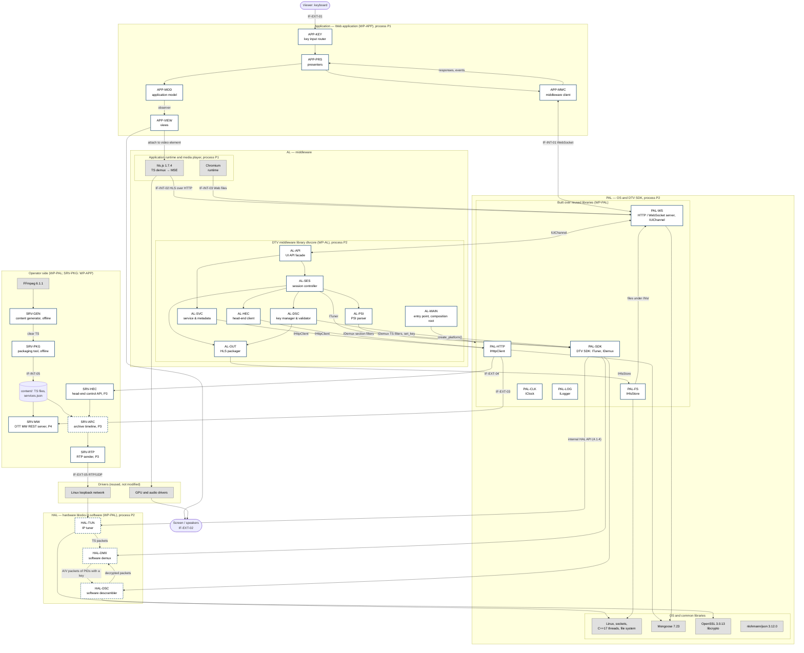

Notes on the diagram:

- **OS and common libraries** are drawn inside the PAL, as in Lecture 5. The software HAL blocks also run on them (`TUN → OS`, `DSCR → SSL`), like hardware drivers on the kernel; these edges are uses of a reused base, not calls from the HAL into a module of an upper layer (rule R1, Section 4.1.4).
- **PAL-CLK and PAL-LOG** are used by every AL module; their edges are left out for readability. **nlohmann/json** is used by AL-API, AL-SVC and AL-HEC (portability rule, Section 2.2.3).
- **SRV-ARC is marked simulated** because the looping content file on the wall-clock timeline (D-08) stands in for a real live channel and its recorded archive; the other operator-side modules are built as real (simplified) operator software.
- The **descrambler** sits inside the demux path: the demux passes packets of PIDs that have a key to the descrambler and continues with the decrypted packet (filter delivery, REQ-19, REQ-50). The AL never calls the HAL directly (HLR-25).
- **Two processes share the AL layer.** The DTV middleware (P2) and the browser runtime with the media player (P1) both belong to the middleware / AL layer of Lecture 5. They communicate only through IF-INT-01 and IF-INT-02, which PAL-WS carries.

#### 4.1.3 Modules, realization and requirements

| Module | Layer | Realization | Process | Directory | Provides | Uses | Main requirements |
|---|---|---|---|---|---|---|---|
| APP-KEY | Application | Built | P1 | `webui/` | Remote-control commands per UI context | IF-EXT-01 (DOM key events) | REQ-47, REQ-60, REQ-61 |
| APP-MOD | Application | Built | P1 | `webui/` | Application state, change notifications | — | REQ-26, REQ-31, REQ-43 |
| APP-PRS | Application | Built | P1 | `webui/` | Reactions to commands, events and timers | APP-MOD, APP-MWC | REQ-03, REQ-04, REQ-06 – REQ-11, REQ-27, REQ-28, REQ-30, REQ-33 – REQ-40, REQ-46, REQ-48 |
| APP-VIEW | Application | Built | P1 | `webui/` | DOM views, `<video>` element, hls.js player | hls.js, IF-INT-02 | REQ-25, REQ-29, REQ-61; NFR-05, NFR-14 |
| APP-MWC | Application | Built | P1 | `webui/` | Command calls with request ids, event dispatch | IF-INT-01 | REQ-57 |
| hls.js | AL (media player) | Reused | P1 | CDN (HLR-21) | HLS playback through MSE | IF-INT-02 | — |
| AL-API | AL | Built | P2 | `middleware/core/` | Semantics of IF-INT-01 | `IUiChannel`, AL-SVC, AL-SES | REQ-58 (IF-INT-01 part); Section 3.6 |
| AL-SVC | AL | Built | P2 | `middleware/core/` | Service list and service-info cache; EPG requests without a cache | `IHttpClient`, IF-EXT-03 | REQ-01, REQ-02, REQ-05, REQ-32 |
| AL-SES | AL | Built | P2 | `middleware/core/` | Session state machine (Section 4.3) | `ITuner`, `IClock`, AL-HEC, AL-PSI, AL-DSC, AL-OUT | REQ-12, REQ-14, REQ-20, REQ-21, REQ-41, REQ-56, REQ-59, REQ-69 |
| AL-HEC | AL | Built | P2 | `middleware/core/` | `start` / `keepalive` / `stop` of IF-EXT-04 | `IHttpClient` | REQ-12, REQ-67, REQ-70 |
| AL-PSI | AL | Built | P2 | `middleware/core/` | PAT / PMT parsing, stream description | `IDemux` section filters | REQ-16 – REQ-19 |
| AL-DSC | AL | Built | P2 | `middleware/core/` | Protection decision, key store, key validation, validation hold buffer | `IDemux` TS filters, `set_key`, `clear_keys` | REQ-44, REQ-45, REQ-49, REQ-51 – REQ-55 |
| AL-OUT | AL | Built | P2 | `middleware/core/` | Output SPTS, HLS segments and playlist | `IHlsStore` | REQ-22 – REQ-24, REQ-52 |
| AL-MAIN | AL | Built | P2 | `middleware/main/` | `main()`, configuration, composition root, orderly stop | `create_platform()`, all AL modules | REQ-70; NFR-09, NFR-16 |
| PAL-SDK | PAL (DTV SDK) | Built | P2 | `middleware/pal/` | `ITuner`, `IDemux` | HAL-TUN, HAL-DMX, HAL-DSC | REQ-19, REQ-50 (through the HAL); Section 3.9 |
| PAL-HTTP | PAL | Built over Mongoose | P2 | `middleware/pal/` | `IHttpClient` | Mongoose | Section 3.9 |
| PAL-WS | PAL | Built over Mongoose | P2 | `middleware/pal/` | `IUiChannel`, IF-INT-02 and IF-INT-03 serving | Mongoose, HLS directory | Sections 3.6 – 3.8 |
| PAL-FS | PAL | Built over the file system | P2 | `middleware/pal/` | `IHlsStore` | Linux file system | REQ-23 (atomic files); HLR-17 |
| PAL-CLK | PAL | Built over C++17 `<chrono>` and the event loop | P2 | `middleware/pal/` | `IClock` | — | Timeouts of REQ-01, REQ-20, REQ-51, REQ-67 |
| PAL-LOG | PAL | Built | P2 | `middleware/pal/` | `ILogger` | file system | REQ-55; NFR-13 |
| HAL-TUN | HAL | Simulated (software IP tuner) | P2 | `middleware/hal/` | RTP reception, lock status | sockets | REQ-13 |
| HAL-DMX | HAL | Simulated (software demux) | P2 | `middleware/hal/` | Sync and CC check, PID filters, section assembly | HAL-DSC | REQ-15, REQ-19 |
| HAL-DSC | HAL | Simulated (software descrambler) | P2 | `middleware/hal/` | AES-128-CBC per D-04 | OpenSSL libcrypto | REQ-50, REQ-55 |
| SRV-GEN | Operator side | Built over FFmpeg | offline | `content/` | Clear content files | FFmpeg | REQ-62 |
| SRV-PKG | Operator side | Built | offline | `server/package/` | Encrypted content files | OpenSSL libcrypto (own code, not shared with HAL-DSC, R5) | REQ-63 |
| SRV-HEC | Operator side | Built | P3 | `server/` | IF-EXT-04 | SRV-ARC, SRV-RTP | REQ-65, REQ-68 |
| SRV-ARC | Operator side | Simulated (archive timeline, D-08) | P3 | `server/` | Time → file position | content files | REQ-42 |
| SRV-RTP | Operator side | Built | P3 | `server/` | IF-EXT-05 | sockets | REQ-66 |
| SRV-MW | Operator side | Built | P4 | `server/` | IF-EXT-03 | `services.json` | REQ-64 |

Requirements that are not tied to one module are realized by the whole system: REQ-58 by every module that reads an interface, NFR-01 – NFR-07 and NFR-15 by the complete signal path, NFR-12 and NFR-17 by `scripts/` and `README.md`.

#### 4.1.4 Dependency rules and internal interfaces

| Rule | Meaning | Checked by |
|---|---|---|
| R1 — calls go down, notifications go up | A module of the team calls only modules of its own layer or of the layer directly below; a lower layer reaches an upper one only through callbacks registered by the upper one (Observer, Section 2.2.6). The OS and the common libraries of Section 2.2.3 (system calls, sockets, C++17 standard library, OpenSSL, Mongoose, nlohmann/json) are a reused base outside this hierarchy: the AL may use the C++17 standard library and nlohmann/json (R3), the PAL modules use all of them, and the software HAL blocks run on the socket API (HAL-TUN) and OpenSSL libcrypto (HAL-DSC), as hardware drivers run on the kernel. No HAL block calls a PAL module of the team. | Inspection of includes / imports |
| R2 — application only through IF-INT-01/02/03 | The Web application talks to the middleware only through the control WebSocket and HTTP GET of HLS and Web files. | Inspection of `webui/` |
| R3 — AL only through IF-INT-04 | `dtvcore` includes only `middleware/include/pal/platform.hpp`, the C++17 standard library and nlohmann/json (portability rule, NFR-09). | CMake target of `dtvcore`; build of the AL unit tests with the fake DTV SDK |
| R4 — HAL only through the DTV SDK | Only PAL-SDK calls the HAL. Other PAL modules do not use the HAL. | Inspection of `middleware/pal/` |
| R5 — no shared code between receiver and operator side | The receiver and the operator side meet only at IF-EXT-03, IF-EXT-04 and IF-EXT-05 and share no team code (the reused third-party sources of `third_party/` are not team code); the packaging tool (WP-APP) and the HAL descrambler (WP-PAL) implement D-04 independently, so that the round-trip test of REQ-63 and the decryption in the receiver are independent checks [GUIDELINES]. | Inspection of `server/` and `middleware/hal/` |

**Internal HAL API (PAL-SDK → HAL).** Inside WP-PAL, PAL-SDK uses three C++ classes in `middleware/hal/`; this API is not a contract between work packages and is therefore not frozen in Section 3:

| Class | Module | Operations used by PAL-SDK | Calls back to PAL-SDK |
|---|---|---|---|
| `hal::IpTuner` | HAL-TUN | open the UDP port and set the SSRC, close, statistics | TS packets (one RTP payload at a time), lock status changes |
| `hal::Demux` | HAL-DMX | add / remove a PID filter (section or TS), feed TS packets, statistics | complete sections and TS packets per filter |
| `hal::Descrambler` | HAL-DSC | set a key for a list of PIDs, clear all keys, decrypt one TS packet in place (through an internal AES-128-CBC function with the IV as a parameter, called with 16 zero bytes per D-04 and with the NIST vectors in TST-215) | — (synchronous call from `hal::Demux`) |

PAL-SDK maps the `FilterId` values of `IDemux` to the HAL filters, starts and stops delivery, and converts the HAL callbacks into `IDemux::DataCallback` and `ITuner::StatusCallback` calls (Section 3.9.1, rules 1, 3 and 4).

### 4.2 AL internal design

This section describes the inside of the DTV middleware library `dtvcore` (WP-AL): on which thread its code runs, which data it keeps and how its modules work together. The behavior of a session over time is specified by the state machine of Section 4.3; the capacities of the queues and buffers by Section 4.5.

#### 4.2.1 Threading model

The AL has **one thread of its own, the AL worker**. All AL state is read and changed only on this thread; therefore the AL needs no locks except inside the task queue.

| Thread | Owner | Runs | AL code on this thread |
|---|---|---|---|
| PAL event loop | PAL (Section 3.9.1, rule 1) | HTTP client, HTTP / WebSocket server, timers | Only the callback bodies registered by the AL, which do nothing but post a task (4.2.2). |
| Tuner receive | PAL / HAL (Section 3.9.1, rule 1) | HAL-TUN, HAL-DMX, HAL-DSC, PAL-SDK filter and status callbacks | Only the callback bodies registered by the AL, which copy the data and post a task. |
| **AL worker** | AL (`dtvcore`, created by AL-MAIN) | Task queue loop | All AL modules: AL-API, AL-SVC, AL-SES, AL-HEC, AL-PSI, AL-DSC, AL-OUT. |
| Main | AL-MAIN | `main()`: start-up, waiting for a stop signal, orderly stop | No module logic (4.2.5). |

Rules:

1. **T1 — callbacks only post.** Every callback the AL registers on an IF-INT-04 interface copies its arguments (Section 3.9.1, rule 3) into a task and posts it to the AL task queue. It never calls an AL module directly. This keeps every callback far below the 10 ms limit of Section 3.9.1, rule 1.
2. **T2 — AL calls PAL from the worker.** The AL calls interface methods (`tune`, `open_filter`, `post_json`, `write_file`, …) only from the worker thread. The methods are thread-safe (Section 3.9.1, rule 2), so no further synchronization is needed.
3. **T3 — one queue keeps the order.** Filter data of all filters is posted to the same queue in the order in which the tuner thread delivered it, so the AL sees the TS packets of the PAT, PMT, video and audio PIDs in the received order (REQ-22).
4. **T4 — no blocking on the worker.** A task never waits for I/O: HTTP requests, timers and file writes either return at once (`write_file` of one segment of about 1 s, written to the local temporary directory) or complete later as a new task.
5. **T5 — tests without threads.** The task queue has a test mode in which tasks are executed by an explicit `run_pending()` call of the test, so that the AL unit tests with the fake DTV SDK are deterministic (NFR-10).

#### 4.2.2 Task queue and generation filtering

**Task queue.** `TaskQueue` is a FIFO of tasks (`std::function<void()>`), protected by a mutex and a condition variable; `post()` may be called from any thread, `run()` executes tasks one after the other on the AL worker until `close()`. Tasks are of two kinds:

| Kind | Posted by | Examples | Overflow |
|---|---|---|---|
| Control task | UI channel, HTTP client, timers, tuner status | `play` command, `/start` response, 5 s no-data timer, `Locked` | Never dropped. |
| Data task | Section and TS filter callbacks | One PSI section or one TS packet (copied) | Bounded; overflow policy in Section 4.5. |

**Generation number.** Every *stream attempt* has an internal **generation** number: a 64-bit counter of AL-SES that is incremented on every `play` and on every restart of the same session after `set_key` (REQ-49, transitions T-24 and T-33 of Section 4.3). The session number returned by `play` (IF-INT-01) is what the UI sees; it does not change on a restart, so the UI keeps following the same session, while the generation separates the data of the first attempt from that of the restart. Every callback the AL registers captures the generation of that moment; the task it posts carries this number. When the worker executes the task, AL-SES compares it with the generation of the current attempt and **discards the task if it differs** (latest request wins, Section 2.2.6; REQ-56). Cancellation by the PAL (Section 3.9.1, rule 4) stops new callbacks; the generation check removes the tasks of the old session that were already in the queue.

| Callback | How it gets its generation |
|---|---|
| Section / TS filter data | Captured in the lambda passed to `IDemux::open_filter` for generation `g`. |
| HTTP response (`/start`, `/keepalive`, `/stop`) | Captured in the lambda passed to `IHttpClient::post_json`. |
| Session timers (no data, validation, keepalive) | Captured in the lambda passed to `IClock::start_timer`. |
| Tuner status | The status handler is set once at start-up (`ITuner::set_status_handler`), so it cannot capture a session. It reads an atomic variable `tuned_generation`. AL-SES sets it in this order: `untune()` → `tuned_generation = g` → `tune()`. A status of the old tuning can only be delivered before `untune()` returns (rule 4) and is therefore posted with the old number. |
| Service list and EPG responses, UI messages | Not session-specific; no generation check. |

#### 4.2.3 Main data structures

All structures live on the AL worker and are owned by the module named in the table. Times are `std::int64_t` UNIX seconds or monotonic milliseconds (`_ms`).

| Structure | Owner | Content |
|---|---|---|
| `ServiceEntry` | AL-SVC | `service_id`, `number`, `name`, `protected` — one validated entry of `GET /services` (REQ-02). |
| `ServiceList` | AL-SVC | Vector of `ServiceEntry` sorted by `number`, map `service_id` → index, flag `loaded`. Replaced only by a complete, successfully validated response; kept when the server becomes unreachable (REQ-05). |
| `ServiceInfo` cache | AL-SVC | Map `service_id` → (`stream_control_url`, `archive_window_s`), filled at the first successful `GET /services/{id}` (REQ-12). |
| `StartPoint` | AL-SES | Either `live` or an archive time `T` (after clamping, REQ-41). The **kept start point** of D-14 is the `StartPoint` of the current session. |
| `StreamDescription` | AL-PSI | `program_number`, `pmt_pid`, `pcr_pid`, `video_pid`, `video_stream_type`, `audio_pid`, `audio_stream_type`; `audio_pid` is optional (a stream without audio plays video only). |
| `Session` | AL-SES | `number` (session number of IF-INT-01); `generation` (current stream attempt); `service_id`; `start` (`StartPoint`); `ssrc`; `headend_session_id` (empty when no head-end session exists); `start_time` (from `/start`, optional); `state`, `reason`, `error` (Section 3.6.3); `protected` (optional); `StreamDescription` (optional); ids of the open filters; ids of pending HTTP requests and running timers; data-path flags `locked`, `protection` (`unknown` / `clear` / `protected`), `key_result` (`pending` / `accepted` / `rejected`), `first_segment_listed` (Section 4.3.1); `locked_ms`; `playing_since` (UNIX time of the first `playing`, Section 3.6.3); `keepalive_failures` (consecutive failed keepalives, REQ-69); `stream_info_sent`. Exactly one `Session` object exists at a time; it is replaced on every `play`; a restart after `set_key` keeps the object, the number, the start point and `stream_info_sent` (REQ-18) and resets everything else. |
| `KeyStore` | AL-DSC | Map `service_id` → 16-byte key. Only `set_key` adds, only key rejection (REQ-53) removes. Key bytes are overwritten with zeros when an entry is removed and when the process stops. Never logged in full (REQ-55). |
| `KeyValidation` | AL-DSC | Number of video PES starts checked (0 – 3) and the result (`pending`, `accepted`, `rejected`) of the current session (REQ-51). |
| `HlsState` | AL-OUT | Last PAT packet and last PMT packet seen; bytes of the segment being built; PCR at its start; sequence number of the next segment; list of the listed segments (name, duration, discontinuity flag); `#EXT-X-DISCONTINUITY-SEQUENCE`; last PCR; flag `write_enabled`; complete segments held while `write_enabled` is false. |
| Last `session_state` data | AL-API | Copy of the data of the last `session_state` event, returned by `get_status` (`{"state": "idle"}` before the first session). |
| MW reachability | AL-SVC | `reachable` flag, unknown until the first result of `GET /services`; sent as `mw_status` when it changes and to every new UI client once it is known. |

#### 4.2.4 Module collaboration

Each AL module is one C++ class. Only AL-SES knows the order of the steps of a session; the other modules do their own part when AL-SES asks and report the result back to AL-SES. The class names are internal to WP-AL and not part of the contract.

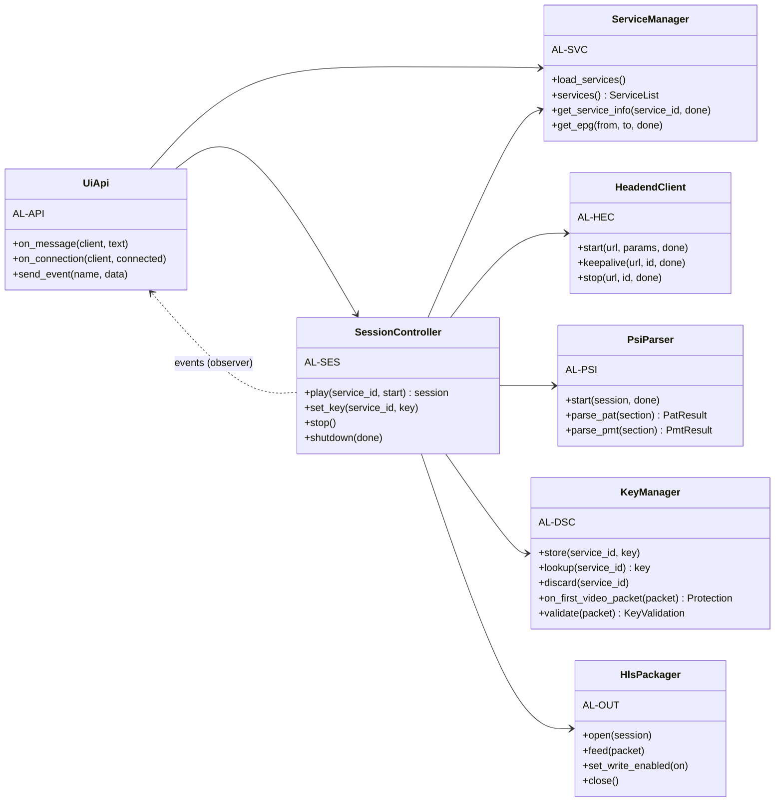

All classes receive the IF-INT-04 interfaces they use (`ITuner`, `IDemux`, `IHttpClient`, `IUiChannel`, `IHlsStore`, `IClock`, `ILogger`) as references in their constructor (dependency injection, Section 2.2.6). The parsing and checking functions (`parse_pat`, `parse_pmt`, CRC-32, PES start check, PCR and random-access extraction, playlist text generation) are free functions without platform dependencies, so they are unit-tested directly with byte arrays.

**Steps of one session as executed by AL-SES.** The numbering is used again in the sequence diagrams of Section 4.6; the reactions to errors, timeouts and new commands in each step are given by the transition table of Section 4.3.

| Step | Trigger | AL-SES action and collaborating module |
|---|---|---|
| S1 | `play` (from AL-API) | End the current session (REQ-56). Clamp the start point (REQ-41). Create the new `Session` with the next number and a random SSRC; AL-API returns `{"session": n}`. State `starting`. |
| S2 | — | AL-SVC `get_service_info` (from the cache, or `GET /services/{id}`). |
| S3 | Service info known | `untune()`, `tuned_generation = g`, `tune(udp_port, ssrc)`. AL-OUT `open(n)` (`IHlsStore::open_session`), `write_enabled = false`. AL-PSI opens and starts the PAT section filter (PID 0, `table_id 0x00`). All of this happens **before** the start request, so that the first PAT of the session (Section 3.4) is not missed. |
| S4 | — | AL-HEC `POST /start` with service, start point, port and SSRC. |
| S5 | `/start` response `200` | Store `headend_session_id` and `start_time`; start the keepalive timer (5 s, REQ-67) and, unless the tuner is already `Locked`, the no-data timer (5 s, REQ-20). State `waiting_stream`. Data-path steps S6 – S12 may already have happened in `starting`, because the head-end may send the first RTP packets before its response is processed; their state changes take effect here (Section 4.3.1, rule 3). |
| S6 | Tuner `Locked` | Cancel the no-data timer. At the first `Locked` of the attempt: store `locked_ms = monotonic_ms()` and start the **stream deadline** timer of 3 s (REQ-51, NFR-03), which must see a protection decision and, for a protected stream with a key, a key decision. |
| S7 | PAT parsed (AL-PSI) | AL-PSI opens and starts the PMT section filter (`table_id 0x02`) on the PMT PID. |
| S8 | PMT parsed (AL-PSI) | Store the `StreamDescription`; send `stream_info` unless `stream_info_sent` (REQ-18). If AL-DSC has a key for the service: `IDemux::set_key` for the video and audio PIDs (REQ-49). Open and start the TS filters on PID 0, the PMT PID, the video PID and the audio PID if present (REQ-19). |
| S9 | First packet of the video TS filter with a payload of at least 16 bytes | AL-DSC decides protection from `scrambled` (REQ-44). **Clear:** `write_enabled = true`. **Protected, no key:** REQ-45 → `key_required` (`no_key`). **Protected, key set:** state `validating_key`; the stream deadline keeps running. |
| S10 | Video packets with `payload_unit_start_indicator = 1` while `validating_key` | AL-DSC checks the decrypted payload (REQ-51). 3 passes → key accepted, `write_enabled = true` (held segments are written, REQ-52). A failure → REQ-53 → `key_required` (`key_rejected`). |
| S11 | Every TS filter packet | AL-OUT `feed(packet)` (REQ-22 – REQ-24); while `write_enabled` is false, complete segments are held in memory. |
| S12 | First segment listed in the playlist (AL-OUT) | `playing_since = unix_time_s()`; state `playing`. |

**Internal behavior of the other modules:**

| Module | Behavior |
|---|---|
| AL-API | Parses the envelope of Section 3.6.1 with nlohmann/json; unknown `type` / `name` or invalid `params` → `INVALID_COMMAND` (REQ-58). `get_services` is answered from `ServiceList` (`MW_UNREACHABLE` while it is not loaded). `get_epg` is answered when AL-SVC completes. `play`, `set_key` and `stop` are answered immediately after AL-SES has accepted them. On a new UI connection it sends `mw_status` to that client once the reachability is known (Section 3.6.3). Events are sent with `IUiChannel::broadcast`. |
| AL-SVC | `load_services` sends `GET /services`; on failure it starts a 5 s retry timer (REQ-01). Validation per REQ-02 and REQ-32. Requests made on behalf of a UI command (`get_epg`, `GET /services/{id}` during `play`) use a timeout of 800 ms, so that the response to `get_epg` stays within the 1 s of Section 3.6.1. |
| AL-HEC | Builds the JSON bodies of Section 3.3 and interprets the responses: `200` → result; `4xx` with an error object → that error code; transport failure, timeout or an invalid body → `HEADEND_UNREACHABLE`. `SESSION_NOT_FOUND` on `/stop` is reported as success (Section 3.3.2). Timeout 2000 ms for all head-end requests. |
| AL-PSI | Parses only until the first valid PAT and PMT of the session; later sections (repetitions every 100 ms) are ignored. A change of `version_number` during a session is logged as a warning and ignored (the content of D-09 never changes its PSI). |
| AL-DSC | Converts the 32 hexadecimal characters into 16 bytes. The PES start check takes the payload after the TS header and the adaptation field (`adaptation_field_control` `'11'`: skip `1 + adaptation_field_length` bytes). |
| AL-OUT | **Segment cut:** a video TS packet with `payload_unit_start_indicator = 1` and `random_access_indicator = 1` in its adaptation field is a key-frame start (set by FFmpeg for every IDR frame; with the closed GOP of 25 frames once per second, Section 2.2.1). The first segment begins at the first key-frame start after `open`; earlier A/V packets are dropped. A segment is closed at the first key-frame start at which `PCR − PCR at segment start ≥ 1 s` (REQ-23); its duration is this PCR difference. **Segment start:** the stored last PAT and last PMT packets are written first, then the key-frame packet. **Loop boundary:** REQ-24 on the PCR of the PCR PID. **Writing:** first `remove_file` of the segment that will be 3 positions older than the first listed one once segment `k` is listed (REQ-23, B7 of Section 4.5), then `write_file(seg-<k>.ts)`, then the playlist text and `write_file(index.m3u8)`. Removing before writing keeps the number of segment files at 8 or less also while `seg-<k>.ts` is being written. |

#### 4.2.5 Configuration and process lifecycle (AL-MAIN)

**Configuration file.** `dtv-middleware --config <file>`; `scripts/start.sh` passes `middleware/main/middleware.json`. Every value has the default shown, which is also the value in this file (NFR-16):

| Key | Default | Used by |
|---|---|---|
| `mw_base_url` | `http://127.0.0.1:8080/api/v1` | AL-SVC (IF-EXT-03) |
| `rtp_port` | `5004` | AL-SES (`TuneParams.udp_port`, `client_port`) |
| `client_host` | `127.0.0.1` | AL-HEC (`client_host` of `/start`) |
| `ui_http_port` | `8090` | `PlatformConfig.ui_http_port` |
| `webui_dir` | `webui` | `PlatformConfig.webui_dir` |
| `hls_dir` | `/tmp/m15-hls` | `PlatformConfig.hls_dir` |
| `log_file` | `logs/middleware.log` | `PlatformConfig.log_file` |
| `mw_timeout_ms` | `800` | AL-SVC |
| `headend_timeout_ms` | `2000` | AL-HEC |
| `mw_retry_s` | `5` | AL-SVC (REQ-01) |
| `keepalive_interval_s` | `5` | AL-SES (REQ-67) |
| `keepalive_loss_s` | `15` | AL-SES (REQ-69: `keepalive_loss_s / keepalive_interval_s` = 3 consecutive failed keepalives) |
| `no_data_timeout_s` | `5` | AL-SES (REQ-20) |
| `stream_deadline_s` | `3` | AL-SES (REQ-51, stream deadline of Section 4.3) |

The timing values of IF-EXT-04 (5 s keepalive, 15 s expiry) are part of the contract; the configuration only allows them to be read from one place, not to be changed independently of the head-end.

**Listening addresses (HLR-20).** Every socket on which P2 listens is bound to `127.0.0.1`, never to all interfaces: PAL-WS listens on `http://127.0.0.1:<ui_http_port>`, and HAL-TUN binds its UDP socket to `127.0.0.1:<rtp_port>`. The address is fixed in the PAL and HAL, not configurable, so `PlatformConfig` (Section 3.9.2) is unchanged.

**Start-up** (in this order): read the configuration (invalid file → error message, exit code 1); `create_platform()`; create the AL objects with the interfaces; register the UI and tuner handlers (they must be set before `Platform::start()`, Section 3.9.2); start the AL worker thread; `Platform::start()` (failure → log, exit code 1); post the task "load services" (REQ-01).

**Orderly stop** (on `SIGINT` or `SIGTERM`, REQ-70): the signal handler only sets a flag that the main thread waits for. The main thread posts the task "shutdown"; AL-SES ends the current session as on `play` (REQ-56), including `POST /stop`, and reports completion when the `/stop` response has arrived or its 2000 ms timeout has expired. Then the main thread calls `Platform::stop()` (no more callbacks), closes the task queue, joins the AL worker, overwrites the keys with zeros and exits with code 0. The whole stop takes at most 3 s.

### 4.3 AL-SES session state machine

The playback session is the main state-dependent operation of the system [GUIDELINES]. Its states are the `state` values of IF-INT-01 (Section 3.6.3); every change of state is sent as a `session_state` event of the current session (with `reason`, `start`, `start_time`, `protected` and `error` as defined there). The machine runs on the AL worker (Section 4.2.1); the steps S1 – S12 it executes are those of Section 4.2.4.

#### 4.3.1 Rules

1. **One current session.** Exactly one session is current. `play` always creates a new session; only `set_key` restarts the current one (T-24, T-33).
2. **Generation check first.** A task whose generation is not the current one is discarded before the table is consulted (Section 4.2.2). Events that the table does not list for a state are ignored and logged at level `Debug`.
3. **Data path in `starting`.** The head-end may send RTP before AL-SES has processed its `/start` response. `EV-LOCKED`, `EV-PAT`, `EV-PMT` and `EV-PMT-NOVIDEO` are listed for `starting` in the table (T-09, T-11 – T-13). `EV-VIDEO1`, `EV-KEY-OK`, `EV-KEY-BAD` and `EV-SEG1` are also accepted in `starting`: there they execute only the data-path actions of the transition they would take after the response — the PES checks (T-15), setting `write_enabled` (T-16, T-19), output to AL-OUT, and cancelling the stream deadline as soon as the decisions it waits for are made (T-16, T-19; in `starting` also at `EV-VIDEO1` without a key and at `EV-KEY-BAD`, so that a late `/start` response, at most 2000 ms, cannot turn a decided rejection into `INVALID_STREAM`) — and record their result in the flags `protection`, `key_result` and `first_segment_listed` (`locked` is set by T-09). The rest of these transitions — setting `protected`, the change of state, RELEASE and discarding a rejected key (T-14, T-17) — is deferred and applied by T-06 when `EV-START-OK` arrives; only the resulting state is sent as `session_state`. If `/start` fails instead (T-08), the flags are dropped with the attempt; a key that is rejected only in a flag stays stored.
4. **RELEASE.** Leaving the active part of the machine (to `key_required`, `error` or `stopped`) always executes the procedure RELEASE, in this order: cancel all timers and pending HTTP requests of the attempt; close all its demux filters (`IDemux::close_filter`) and clear the descrambler keys (`IDemux::clear_keys`); `untune()`; AL-OUT `close()` (held data discarded, `IHlsStore::close_session`); if a head-end session exists, `POST /stop` for it (its response is only logged) and forget its id. RELEASE keeps the session number and the start point (D-14).
5. **Active states** are `starting`, `waiting_stream`, `validating_key`, `playing` and `no_signal`; only they own PAL resources. `idle`, `key_required`, `error` and `stopped` own none (after RELEASE), so no data, timer or keepalive event can reach them except through rule 2.

#### 4.3.2 Events

| Event | Source | Meaning |
|---|---|---|
| `EV-PLAY` | AL-API (`play`) | New service / start point requested (validated: known `service_id`, `start` = `"live"` or integer). |
| `EV-STOP` | AL-API (`stop`) | The UI ends playback. |
| `EV-SETKEY` | AL-API (`set_key`) | A key in the correct format for `service_id`; already stored by AL-DSC when the event reaches AL-SES. |
| `EV-INFO-OK` / `EV-INFO-ERR` | AL-SVC | Service info available / not available (`MW_UNREACHABLE` or `SERVICE_NOT_FOUND`). |
| `EV-TUNE-FAIL` | `ITuner::tune` returned `false` | The UDP port cannot be opened. |
| `EV-START-OK` | AL-HEC | `/start` answered `200` (`session_id`, `start_time`). |
| `EV-START-ERR` | AL-HEC | `/start` answered with an error code, or failed (`HEADEND_UNREACHABLE`). |
| `EV-LOCKED` / `EV-UNLOCKED` | Tuner status (REQ-13) | First accepted RTP data / 3 s without accepted RTP data. |
| `EV-PAT` | AL-PSI | First valid PAT of the attempt (REQ-16). |
| `EV-PMT` | AL-PSI | First valid PMT of the attempt; `EV-PMT-NOVIDEO` if it has no `stream_type 0x1B` (REQ-17). |
| `EV-VIDEO1` | AL-DSC | First packet of the video TS filter with a payload of at least 16 bytes: protection decided as `clear`, `protected-no-key` or `protected-key` (REQ-44); `protected-key` means that a key was set on the descrambler at T-12 of this attempt. |
| `EV-KEY-OK` / `EV-KEY-BAD` | AL-DSC | Three PES starts passed / a PES start failed the check (REQ-51). |
| `EV-SEG1` | AL-OUT | The first segment of the attempt is listed in the playlist. |
| `EV-OUT-ERR` | AL-OUT | `IHlsStore::open_session` or `write_file` returned `false`. |
| `EV-T-NODATA` | Timer, 5 s after entering `waiting_stream` without `Locked` | REQ-20, `no_data_at_start`. |
| `EV-T-DEADLINE` | Timer, 3 s after the first `Locked` of the attempt | Stream deadline (Section 4.2.4, S6). |
| `EV-T-KA` | Timer, every 5 s after `EV-START-OK` | Time to send a keepalive (REQ-67). |
| `EV-KA-OK` / `EV-KA-NOTFOUND` / `EV-KA-FAIL` | AL-HEC | Keepalive answered `200` / `SESSION_NOT_FOUND` / no answer within 2000 ms or another error. |
| `EV-SHUTDOWN` | AL-MAIN | Orderly stop of the process (Section 4.2.5). |

#### 4.3.3 State diagram

Shown without the rule "`EV-PLAY` in any state → old session `stopped`, new session `starting`" (T-01), without `EV-STOP` from every active state, `key_required` and `error` to `stopped` (T-02) and without `EV-SHUTDOWN` from every active state to `stopped` (T-31). Transitions without a change of state (T-09, T-11, T-12, T-16, T-19, T-25 – T-27, T-32) are not drawn.

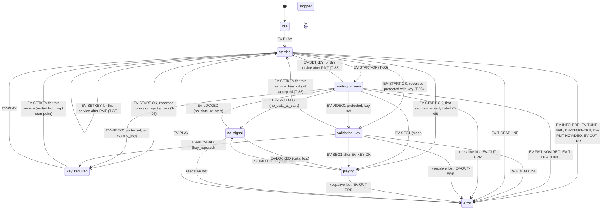

#### 4.3.4 Transition table

"Emit" lists events in addition to the `session_state` that is sent on every change of state. `n` is the session number, `g` the generation.

| ID | State | Event [guard] | Actions | Next state | Emit |
|---|---|---|---|---|---|
| T-01 | any | `EV-PLAY` | If a session exists in an active state, `key_required` or `error`: RELEASE it and send its `session_state` `stopped` (REQ-56). Clamp the start point (REQ-41). New session: `n + 1`, `g + 1`, random SSRC, flags reset. Respond `{"session": n}`. Request the service info (S2). | `starting` | — |
| T-02 | active, `key_required`, `error` | `EV-STOP` | RELEASE (nothing left to release in `key_required` and `error`); then respond `{}` (Section 3.6.2). | `stopped` | — |
| T-03 | `starting` | `EV-INFO-OK` | S3: `untune()`, `tuned_generation = g`, `tune()`; AL-OUT `open(n)`; open and start the PAT filter. S4: `POST /start`. | `starting` | — |
| T-04 | `starting` | `EV-TUNE-FAIL` | RELEASE. | `error` (`RECEIVER_ERROR`) | — |
| T-05 | `starting` | `EV-INFO-ERR` | RELEASE. | `error` (`MW_UNREACHABLE` / `SERVICE_NOT_FOUND`) | — |
| T-06 | `starting` | `EV-START-OK` | Store `headend_session_id`, `start_time`; `keepalive_failures = 0`; start the keepalive timer; if not `locked`, start the no-data timer. Then apply the deferred part of the recorded flags (rule 3) in this order: `protection = clear` → `protected = false` (the rest of T-19 was already done); `protection = protected` without key → as T-14; `protection = protected` with key → `protected = true`, state `validating_key` (T-15), then `key_result = rejected` → as T-17, or `key_result = accepted` (T-16 already done); `first_segment_listed` → as T-18. Only the resulting state is sent as `session_state`. | `waiting_stream`, or the state reached by the recorded flags | — |
| T-07 | `starting` | `EV-START-ERR` [`FUTURE_TIME`] | Start point becomes `"live"`; send `POST /start` again (Section 3.10). | `starting` | — |
| T-08 | `starting` | `EV-START-ERR` [other code] | RELEASE. | `error` (code from the head-end, or `HEADEND_UNREACHABLE` on transport failure) | — |
| T-09 | `starting`, `waiting_stream` | `EV-LOCKED` [first of the attempt] | S6: cancel the no-data timer; `locked = true`, `locked_ms = now`; start the stream deadline (3 s). | unchanged | — |
| T-10 | `no_signal` [`no_data_at_start`] | `EV-LOCKED` | As T-09. | `waiting_stream` | — |
| T-11 | `starting`, `waiting_stream` | `EV-PAT` | S7: open and start the PMT section filter. | unchanged | — |
| T-12 | `starting`, `waiting_stream` | `EV-PMT` | S8: store the stream description; set the key if stored (REQ-49); open and start the TS filters (REQ-19). | unchanged | `stream_info`, only if not `stream_info_sent` (then `stream_info_sent = true`, REQ-18) |
| T-13 | `starting`, `waiting_stream` | `EV-PMT-NOVIDEO` | RELEASE. | `error` (`INVALID_STREAM`) | — |
| T-14 | `waiting_stream` | `EV-VIDEO1` [protected, no key set at T-12] | `protected = true`; RELEASE (REQ-45: no segment written). | `key_required` (`no_key`) | — |
| T-15 | `waiting_stream` | `EV-VIDEO1` [protected, key set at T-12] | `protected = true`; AL-DSC starts checking PES starts (S10). | `validating_key` | — |
| T-16 | `validating_key` | `EV-KEY-OK` | Cancel the stream deadline; `key_result = accepted`; AL-OUT `write_enabled = true` (held segments written, REQ-52). | `validating_key` | — |
| T-17 | `validating_key` | `EV-KEY-BAD` | AL-DSC discards the key of the service; RELEASE (includes `clear_keys`, REQ-53). | `key_required` (`key_rejected`) | — |
| T-18 | `waiting_stream` [clear], `validating_key` [`key_result = accepted`] | `EV-SEG1` | `playing_since = unix_time_s()` (S12). | `playing` | — |
| T-19 | `waiting_stream` | `EV-VIDEO1` [clear] | `protected = false`; cancel the stream deadline; AL-OUT `write_enabled = true`. | `waiting_stream` | — |
| T-20 | `waiting_stream` | `EV-T-NODATA` | — (session continues, keepalives continue). | `no_signal` (`no_data_at_start`) | — |
| T-21 | `starting`, `waiting_stream`, `validating_key` | `EV-T-DEADLINE` | RELEASE. The stored key is kept. | `error` (`INVALID_STREAM`) | — |
| T-22 | `playing` | `EV-UNLOCKED` | — (player and HLS files of the session are kept). | `no_signal` (`data_lost`) | — |
| T-23 | `no_signal` [`data_lost`] | `EV-LOCKED` | — (AL-OUT continues with the next key-frame start). | `playing` | — |
| T-24 | `key_required` | `EV-SETKEY` [same `service_id`] | Restart (REQ-49, D-14): same `n`, same start point, `g + 1`, new random SSRC, flags reset; request the service info (S2). | `starting` | — |
| T-25 | any | `EV-SETKEY` [other service; or same service in `starting` / `waiting_stream` before `EV-PMT`; or same service with `protection = clear`; or same service with `key_result = accepted`; or state `playing`, `no_signal`, `error`, `stopped`] | None besides the storing by AL-DSC; the key is used at the next PMT of that service (T-12). | unchanged | — |
| T-26 | `waiting_stream`, `validating_key`, `playing`, `no_signal` | `EV-T-KA` | `POST /keepalive`; restart the keepalive timer. | unchanged | — |
| T-27 | same as T-26 | `EV-KA-OK` | `keepalive_failures = 0`. | unchanged | — |
| T-28 | same as T-26 | `EV-KA-NOTFOUND` | Forget the head-end session id (no `/stop`); RELEASE (REQ-69). | `error` (`HEADEND_UNREACHABLE`) | — |
| T-29 | same as T-26 | `EV-KA-FAIL` | `keepalive_failures + 1`. At the third consecutive failure (15 s, REQ-69): RELEASE. Below three: nothing more; the next keepalive is sent by T-26. | `error` (`HEADEND_UNREACHABLE`) at the third failure, otherwise unchanged | — |
| T-30 | `starting`, `waiting_stream`, `validating_key`, `playing` | `EV-OUT-ERR` | RELEASE. | `error` (`RECEIVER_ERROR`) | — |
| T-31 | active | `EV-SHUTDOWN` | RELEASE; AL-MAIN waits for the `/stop` response or its timeout (Section 4.2.5). | `stopped` | — |
| T-32 | `starting`, `waiting_stream`, `validating_key`, `no_signal` [`no_data_at_start`] | `EV-UNLOCKED` | Ignored: the stream deadline or the no-data timer decides (T-20, T-21). | unchanged | — |
| T-33 | `starting`, `waiting_stream`, `validating_key` | `EV-SETKEY` [same `service_id`, after `EV-PMT` of the attempt, `protection ≠ clear`, `key_result ≠ accepted`] | The TS filters of the attempt were started at T-12 with the previous key or without a key, and the new key is only applied at a PMT, so the attempt is restarted with the new one (latest request wins): RELEASE (the stored key — now the new one — is kept), then as T-24. Without this restart, a rejection of the previous key (T-17) would discard the newer key, and an attempt without a key would end in `key_required` although a key is stored. | `starting` | — |

#### 4.3.5 Requirement coverage

| Requirement | Transitions |
|---|---|
| REQ-12 (start sequence, states `starting` → `waiting_stream`) | T-01, T-03, T-06 |
| REQ-14, REQ-56 (old session ended before the new one) | T-01, rule 4 |
| REQ-17 (no video → `error`) | T-13 |
| REQ-20 (`no_signal`) | T-10, T-20, T-22, T-23 |
| REQ-21 (head-end error → `error`) | T-07, T-08 |
| REQ-41 (clamping) | T-01, T-07 |
| REQ-44, REQ-45 (protection decision, no key) | T-14, T-15, T-19 |
| REQ-49, D-14 (restart from the kept start point) | T-24, T-33, T-12 |
| REQ-51 – REQ-53 (validation, hold, rejection) | T-15 – T-18, T-21 |
| REQ-67 – REQ-69 (keepalive) | T-26 – T-29 |
| REQ-70 (orderly stop) | T-31 |
| US-18 (latest request wins) | T-01, rule 2 |

The concurrency cases required by the guidelines are handled as follows: a new `play` during any step → T-01 with the generation check of rule 2; `set_key` during an ongoing start (before PMT) → T-25, and the key is applied at T-12 of the same attempt; `set_key` after PMT parsing while the previous key is still being validated or not yet decided → T-33 (the attempt is restarted with the new key); `set_key` after the key of the attempt was accepted → T-25 (the new key is stored and used at the next PMT of the service); a late `/start` response or filter data of a released attempt → discarded by rule 2.

### 4.4 Application design

This section describes the Web application (WP-APP): its Model-View-Presenter structure, the UI contexts that decide what a key does, the reaction to the events of IF-INT-01 and the timers. All requirement numbers refer to Section 2.3; the key bindings are those of Section 1.5.1.

#### 4.4.1 Structure and files

The application is a set of plain ES2020 modules without a build step (NFR-11), loaded by `webui/index.html`. hls.js is loaded by a `<script>` tag from the CDN URL of Section 3.8 and used through the global `Hls`.

| File | Module | Content | Uses the DOM |
|---|---|---|---|
| `webui/index.html` | — | Page skeleton: `<video>` element, one container per view, script tags | — |
| `webui/css/style.css` | APP-VIEW | Layout and OSD style (NFR-14), `cursor: none` on the whole page (REQ-61) | — |
| `webui/js/main.js` | composition | Creates the model, the middleware client, the presenters and the views and connects them; registers the `keydown` handler | yes (only to find the containers) |
| `webui/js/mwc.js` | APP-MWC | WebSocket connection, request ids, `call(name, params) → Promise`, event dispatch, reconnect (REQ-57) | no (uses `WebSocket`) |
| `webui/js/model.js` | APP-MOD | Application state (4.4.2) and change notification (`subscribe(listener)`) | no |
| `webui/js/keys.js` | APP-KEY | Maps a `KeyboardEvent` to a remote-control key and passes it to the presenter of the active context (4.4.3) | no |
| `webui/js/presenters/*.js` | APP-PRS | `playback.js`, `number_entry.js`, `service_list.js`, `epg.js`, `key_dialog.js`, `session.js` (reaction to IF-INT-01 events) | no |
| `webui/js/views/*.js` | APP-VIEW | `player.js` (`<video>` + hls.js), `info_bar.js`, `zap_banner.js`, `number_entry.js`, `service_list.js`, `epg_grid.js`, `key_dialog.js`, `volume.js`, `status.js` (persistent status message and toasts) | yes |
| `webui/package.json` | — | Only `{"type": "module"}`, so that Node.js loads the ES2020 modules of `webui/js/` in the unit tests; no dependencies, no scripts, no build step (NFR-11) | — |
| `webui/tests/*.test.js` | tests | Unit tests of model, key mapping and presenters with a fake middleware client and a fake clock | no |

Rules of the MVP structure:

- **Presenters** receive remote-control keys from APP-KEY and events from APP-MWC, change the model and call APP-MWC. They never touch the DOM, so they run in Node.js for the unit tests (4.4.6).
- **Views** subscribe to the model and render it. They contain no logic beyond formatting (local time `HH:MM`, `HH:MM:SS`, `−MM:SS`).
- **Timers** are created through a small clock object (`now()`, `setTimeout`, `clearTimeout`) passed to the presenters, which the tests replace with a fake clock.

#### 4.4.2 Application model (APP-MOD)

| Field | Type / values | Set by |
|---|---|---|
| `connected` | boolean | APP-MWC |
| `mwReachable` | boolean | `mw_status` |
| `services` | array of `{service_id, number, name, protected}` sorted by `number`; empty until loaded | `get_services` |
| `currentServiceId` | string or `null` | every `play` |
| `lastPlayId` | request id of the last `play` command | session presenter |
| `session` | `{number, serviceId, state, reason, start, startTime, playingSince, protected, error}` of the session of the last `play`, or `null` | `play` response, `session_state`, `get_status` |
| `playerSession` | session number for which the current hls.js player was created, or `null` when no player exists | session presenter |
| `firstPictureAt` | `now()` of the APP at the first `playing` event of the `<video>` element after the player of the current session was created (first picture shown), or `null` | player view |
| `streamInfo` | data of the last `stream_info` of the current session, or `null` | `stream_info` |
| `epg` | `{from, to, serverTime, services}` of the last successful `get_epg`, or `null` | EPG presenter |
| `volume` | integer 0 – 100, initial 50 | playback presenter |
| `muted` | boolean, initial `false` | playback presenter |
| `context` | `PLAYBACK`, `NUMBER_ENTRY`, `SERVICE_LIST`, `EPG`, `KEY_DIALOG` (4.4.3) | presenters |
| `zapTarget` | service id shown in the zap banner while the 300 ms debounce runs, or `null` | playback presenter |
| `seekTarget` | UNIX time accumulated by `←` / `→` while the 500 ms timer runs, or `null` | playback presenter |
| `numberBuffer` | string of 1 – 3 digits | number-entry presenter |
| `listIndex`, `epgService`, `epgEvent` | selection in the service list and the EPG | list / EPG presenters |
| `keyBuffer` | typed key characters (0 – 32), `keyDialogTitle` | key-dialog presenter |
| `keyDialogCancelled` | `true` after `ESC` in the key dialog while the session is `key_required` (REQ-48) | key-dialog presenter |
| `overlays` | `{info, volume, banner}` visibility flags; `toast` text or `null` | presenters and timers |

**Derived values** (computed, not stored):

- **Mode:** `ARCHIVE` if `session.start` is an integer, otherwise `LIVE`.
- **Playback position** (REQ-43, Section 3.6.3): `startTime + (now − firstPictureAt)` in ARCHIVE mode (`startTime` while `firstPictureAt` is `null`), `now` in LIVE mode; the distance from live is `now − position`. `firstPictureAt`, and not the time of the first `session_state` `playing` (`playingSince`), is used, because the picture appears 1 – 2 s after that event (the player first loads and buffers the segment); otherwise the shown time would run ahead of the burned-in time code (NFR-04).
- **Protection status** of the info dialog (REQ-27): `Clear` if `session.protected === false`; `Protected – key OK` if `protected === true` and the state is `playing` or `no_signal`; `Protected – key required` if the state is `key_required`; no protection line in every other case (`protected === null`, or `protected === true` in another state, for example while a key is being checked in `validating_key`).
- **Persistent status message** (shown until the condition ends, highest priority first): "No signal" while `connected` is `false` (ER-34, Section 4.8); "Server not reachable" while `services` is empty and `mwReachable` is `false` (REQ-04); "No signal" while the state is `no_signal` (REQ-20); the message of Section 3.10 for `session.error.code` while the state is `error`, "No signal" for codes without a message (REQ-21); "Protected service – press K to enter the key" while the state is `key_required` and `keyDialogCancelled` is `true` (REQ-48).

#### 4.4.3 UI contexts

The context decides which presenter receives a key. Overlays (info dialog, zap banner, volume / mute indicator, toast, status message) are not contexts: they never take keys.

**Key mapping (APP-KEY).** `KeyboardEvent.key` is mapped to a remote-control key: `ArrowUp`, `ArrowDown`, `ArrowLeft`, `ArrowRight`, `Enter`, `Escape`, `Backspace`, the digits, `+` and `-` (also from the numeric keypad), and letters converted to upper case. Auto-repeated events (`event.repeat`) are handled as normal presses (REQ-60). For every mapped key `preventDefault()` is called, so that the browser does not scroll or navigate. Other keys are ignored.

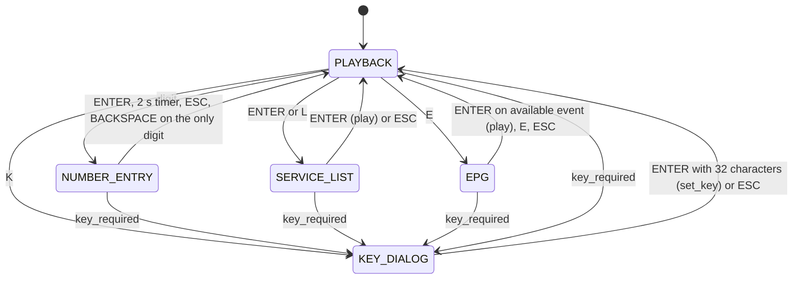

| Context | Key | Action | Next context | Req. |
|---|---|---|---|---|
| `PLAYBACK` | `↑` / `↓` | `zapTarget` = next higher / lower number from `zapTarget` (or the current service), with wrap-around; show the zap banner; (re)start the 300 ms zap timer | `PLAYBACK` | REQ-06, REQ-07 |
| `PLAYBACK` | `←` | `seekTarget` = (`seekTarget` or the playback position) − 30 s; show it in the position indicator; (re)start the 500 ms seek timer | `PLAYBACK` | REQ-39 |
| `PLAYBACK` | `→` | Only in ARCHIVE mode or while `seekTarget` is set: `seekTarget` = (`seekTarget` or the position) + 30 s; (re)start the 500 ms seek timer | `PLAYBACK` | REQ-39 |
| `PLAYBACK` | `B` | Only in ARCHIVE mode: `play` with `"live"` | `PLAYBACK` | REQ-40 |
| `PLAYBACK` | digit | `numberBuffer` = digit; show it; start the 2 s commit timer | `NUMBER_ENTRY` | REQ-08 |
| `PLAYBACK` | `ENTER`, `L` | `listIndex` = current service | `SERVICE_LIST` | REQ-10 |
| `PLAYBACK` | `E` | `get_epg` for now ± 2 h; selection = current service and the event containing the playback position | `EPG` | REQ-33 |
| `PLAYBACK` | `I` / `ESC` | Show / hide the info dialog | `PLAYBACK` | REQ-28 |
| `PLAYBACK` | `K` | Open the key dialog for the current service, title "Enter the decryption key" | `KEY_DIALOG` | REQ-48 |
| `PLAYBACK` | `M`, `+`, `-` | Mute toggle / volume ± 10 (unmute first if muted); show the volume indicator for 2 s | `PLAYBACK` | REQ-29, REQ-30 |
| `NUMBER_ENTRY` | digit | Append if fewer than 3 digits; restart the 2 s timer | `NUMBER_ENTRY` | REQ-08 |
| `NUMBER_ENTRY` | `BACKSPACE` | Remove the last digit; if the buffer becomes empty, end the entry | `NUMBER_ENTRY` / `PLAYBACK` | REQ-08 |
| `NUMBER_ENTRY` | `ENTER` or 2 s timer | Commit: existing number → `play` live for that service; otherwise toast "Invalid service number" (3 s) and no change | `PLAYBACK` | REQ-08, REQ-09 |
| `NUMBER_ENTRY` | `ESC` | Discard the buffer | `PLAYBACK` | REQ-08 |
| `SERVICE_LIST` | `↑` / `↓` | Move `listIndex` (no wrap-around) | `SERVICE_LIST` | REQ-10 |
| `SERVICE_LIST` | `ENTER` | `play` live for the highlighted service | `PLAYBACK` | REQ-10, REQ-11 |
| `SERVICE_LIST` | `ESC` | — | `PLAYBACK` | REQ-10 |
| `EPG` | `↑` / `↓` | Previous / next service; selected event = the one containing the same time | `EPG` | REQ-34 |
| `EPG` | `←` / `→` | Previous / next event of the selected service | `EPG` | REQ-34 |
| `EPG` | `ENTER` | Available event → `play` with its `start`; not available → toast "Content not available in archive" (3 s), stay; future event → nothing | `PLAYBACK` / `EPG` | REQ-37, REQ-38 |
| `EPG` | `E`, `ESC` | — | `PLAYBACK` | REQ-33 |
| `KEY_DIALOG` | `0`–`9`, `A`–`F` | Append if fewer than 32 characters | `KEY_DIALOG` | REQ-47 |
| `KEY_DIALOG` | `BACKSPACE` | Remove the last character | `KEY_DIALOG` | REQ-47 |
| `KEY_DIALOG` | `ENTER` | Only with 32 characters: `set_key` for the current service; clear `keyBuffer`; `keyDialogCancelled = false` | `PLAYBACK` | REQ-47, REQ-49 |
| `KEY_DIALOG` | `ESC` | Clear `keyBuffer`; `keyDialogCancelled = true` if the state is `key_required` | `PLAYBACK` | REQ-48 |
| any except `KEY_DIALOG` | `session_state` `key_required` of the current session | Cancel number entry, zap and seek timers; open the key dialog with the title of REQ-46 | `KEY_DIALOG` | REQ-46 |

Keys not listed for a context are ignored (REQ-60). The key dialog shows `keyBuffer` masked (`•`) with the counter `n/32` (REQ-47). Every key that changes the model is rendered in the same animation frame, which is the basis for NFR-05.

#### 4.4.4 Reaction to the middleware (APP-PRS `session.js`)

**Sending `play`.** Every `play` stores its request id in `lastPlayId`, sets `currentServiceId`, clears `seekTarget`, `zapTarget`, `keyDialogCancelled`, sets `session = null` and shows the info dialog (REQ-27). When the response arrives and its id equals `lastPlayId`, `session = {number: result.session, state: "starting", …}`; a response to an older `play` is ignored. AL-API sends the response to `play` before the first event of the new session (T-01, Section 4.3.4), so no event of the new session can arrive before its number is known.

| Message | Condition | Reaction |
|---|---|---|
| `session_state` | `data.session ≠ session.number` | Ignored (REQ-26). |
| `session_state` | `playing`, `playerSession ≠ data.session` (first `playing` of the session) | `playerSession = n`; the player view destroys the old hls.js instance and creates a new one on `/hls/<n>/index.m3u8` with `startPosition: 0` (REQ-25); volume and mute are applied to the `<video>` element (REQ-31); `firstPictureAt = null`, and at the first `playing` event of the `<video>` element of the new player `firstPictureAt = now()` (playback position, 4.4.2). The info dialog is updated (REQ-28). |
| `session_state` | `playing`, `playerSession = data.session` (return from `no_signal`) | Model updated only; the player is kept (REQ-25). |
| `session_state` | `key_required` | Open the key dialog (4.4.3, last row); the player view destroys the hls.js instance if one exists, `playerSession = null` (the HLS directory is removed by the AL, Section 3.7). |
| `session_state` | `error`, `stopped` | Destroy the hls.js instance, `playerSession = null`; the status message follows from the model (4.4.2). |
| `session_state` | other states | Model updated; the view shows the status message derived in 4.4.2. |
| `stream_info` | `data.session = session.number` | `streamInfo` stored; info dialog updated (REQ-28). |
| `mw_status` | — | `mwReachable` stored; if `true` and `services` is empty, send `get_services` (REQ-04). |
| `get_services` response | `ok` | `services` stored; if no session has been started yet, `play` live for number 1 (REQ-03). |
| `get_services` response | `MW_UNREACHABLE` | Nothing; the next `mw_status` with `reachable: true` triggers a new request. |
| `get_epg` response | `ok` / error | `epg` stored / `epg = null` → "No information" for all services (REQ-36). |
| `play` response | `ok: false`, id = `lastPlayId` | The AL kept its current session (ER-07). Toast "Invalid service number" (3 s) for `SERVICE_NOT_FOUND`, no toast for other codes; then `get_status`, and the returned session is adopted (below); its player, which still exists, is kept. |
| `set_key` response | `ok: false` | `INVALID_KEY_FORMAT`: open the key dialog again with the title "Enter the decryption key" (ER-32). `SERVICE_NOT_FOUND`: toast "Invalid service number" (3 s). |

**EPG data outside the EPG view.** The info dialog needs the event that contains the playback position (REQ-27). The APP therefore also sends `get_epg` for now ± 2 h after the service list is loaded and then every 300 s (the event grid of D-08); the EPG view uses the same `epg` object and refreshes it when it opens (REQ-33).

**Connection loss (REQ-57).** When the WebSocket closes, `connected = false`, all pending calls are rejected and APP-MWC reconnects every 2 s. After reconnecting, the APP sends `get_status` and `get_services` and adopts the returned session.

**Adopting a session** (after a reconnect, and after a rejected `play`). If `get_status` returns `idle`, the APP starts service number 1 as in REQ-03. Otherwise the returned data become `session`, `currentServiceId` is its `service_id` and `lastPlayId` is cleared; then:

- if a player of this session exists (`playerSession = session.number`), it is kept;
- otherwise, if the session has already been playing (`playing_since ≠ null`, state `playing` or `no_signal`), the APP sends `play` for the same service from the current playback position: `"live"` for a live session, otherwise `start_time + (now − playing_since)`. A player created in the middle of a session would begin with the oldest listed segment, not at the position of the viewer (REQ-25), so the session is requested again from that position;
- otherwise the APP reacts as to a `session_state` event with these data (table above): `key_required` opens the key dialog, `error` and `stopped` show the status message, and in `starting`, `waiting_stream` or `validating_key` the APP waits for the first `playing`, which creates the player.

**Player (APP-VIEW `player.js`).** hls.js is created with `{ startPosition: 0 }` and attached with `attachMedia(video)` and `loadSource(url)`; `video.play()` is called on `MANIFEST_PARSED`. Chromium is started with `--autoplay-policy=no-user-gesture-required`, so that playback with sound starts without a click (D-12, REQ-61). Fatal hls.js errors are handled in Section 4.8.

#### 4.4.5 Timers

| Timer | Duration | Started / restarted by | Cancelled by | On expiry | Req. |
|---|---|---|---|---|---|
| Zap debounce | 300 ms | every `↑` / `↓` in `PLAYBACK` | context change, `key_required` | `play` live for `zapTarget`; `zapTarget = null` | REQ-07 |
| Seek accumulation | 500 ms | every effective `←` / `→` in `PLAYBACK` | zap, number commit, `key_required` | `play` with `seekTarget`, or `"live"` if `seekTarget ≥ now`; `seekTarget = null` | REQ-39 |
| Number commit | 2 s | every digit in `NUMBER_ENTRY` | `ENTER`, `ESC`, empty buffer, `key_required` | commit (4.4.3) | REQ-08 |
| Info dialog | 5 s | every display of the info dialog (service change, new start point, `I`, update by REQ-28 does not restart it) | `ESC` | hide the info dialog | REQ-28 |
| Volume indicator | 2 s | every `+` / `-` / `M` | — | hide the volume level (the mute indicator stays while muted) | REQ-29, REQ-30 |
| Toast | 3 s | "Invalid service number", "Content not available in archive" | a newer toast | hide the toast | REQ-09, REQ-38 |
| Position update | 1 s, periodic | first `playing` of a session | end of the session | re-render the position indicator | REQ-43 |
| EPG refresh | 300 s, periodic | service list loaded | — | `get_epg` for now ± 2 h | REQ-27 |
| Reconnect | 2 s | WebSocket closed or connection failed | connection opened | new connection attempt | REQ-57 |

#### 4.4.6 Testability of the application

- The model, APP-KEY and all presenters are tested with `node --test webui/tests/*.test.js` (NFR-10), with a fake middleware client that returns the JSON examples of Section 3.6 and a fake clock that advances the timers of 4.4.5 explicitly.
- The views and hls.js are tested in Chromium against the mock middleware of Section 2.2.7 (acceptance level, Section 5).
- **Diagnostics mode.** When the page is opened with the URL parameter `?diag=1`, APP-VIEW writes the marks `key`, `osd`, `frame`, `frag`, `wait` and `resume` of Section 5.1.8 with `console.info`. The mode changes no behavior and is off by default; it exists only for the measurements and checks of NFR-01, NFR-02, NFR-04, NFR-05 and NFR-06 (Sections 5.4, 5.6).

### 4.5 Producer–consumer and buffers

This section fixes which thread produces and which consumes the media and metadata of the signal path (Section 2.2.2), where data waits between them, how much may wait, what happens when a buffer is full and who allocates and frees each buffer [GUIDELINES].

#### 4.5.1 Design basis

| Quantity | Value | Source |
|---|---|---|
| Transport-stream bitrate of a service | at most 4 Mbit/s ≈ 2 660 TS packets/s ≈ 380 RTP packets/s | REQ-62 |
| Duration of one HLS segment | about 1 s, at most 2 s; size at most 2 s × 4 Mbit/s = 1 MB | IF-INT-02 |
| Sessions at the same time | one in the receiver; one per receiver endpoint in the head-end | D-06, Section 4.3.1 |
| Repetition of PAT / PMT | at least every 100 ms | REQ-62 |

All capacities below are derived from these values, so that every buffer is bounded and the resident memory of the middleware cannot grow during playback (NFR-06).

#### 4.5.2 Threads

| Process | Thread | Produces | Consumes | Blocks on |
|---|---|---|---|---|
| P3 head-end | HTTP event loop (Mongoose, one thread) | Session table entries | IF-EXT-04 requests | socket |
| P3 head-end | **Session sender** (one per head-end session) | RTP datagrams (IF-EXT-05) | Content file, PCR index | Pacing sleep (Section 4.7) |
| P3 head-end | Keepalive watchdog (one) | Stop of expired sessions (REQ-68) | Session table | 1 s sleep |
| P4 OTT MW | HTTP event loop (Mongoose, one thread) | IF-EXT-03 responses | `services.json` (read once at start) | socket |
| P2 middleware | **Tuner receive** (HAL / PAL) | Filter callbacks (TS packets, sections), tuner status | UDP socket | `recv` with a 100 ms timeout (used for the 3 s `Unlocked` check, REQ-13) |
| P2 middleware | **PAL event loop** (Mongoose `mg_mgr_poll`, 10 ms) | HTTP responses, UI messages, timer expiries; HTTP responses with HLS files | PAL command queue, sockets, HLS files on disk | `poll` |
| P2 middleware | **AL worker** | Calls into the PAL, HLS segments and playlist | AL task queue | condition variable of the task queue |
| P2 middleware | Main | — | stop signal | waiting for the stop flag (Section 4.2.5) |
| P1 browser | Page main thread | hls.js requests, MSE appends, DOM | WebSocket messages, HLS files | — (event loop of the browser) |

**PAL command queue.** Mongoose is single-threaded: only the PAL event-loop thread may use its connections. Interface methods called from the AL worker (`get`, `post_json`, `send`, `broadcast`, `start_timer`, …) therefore copy their arguments (Section 3.9.1, rule 3) into a mutex-protected command queue of the PAL and wake the event loop with `mg_wakeup`; the event loop executes them in its next iteration. The queue carries only control traffic (a few messages per second) and is not bounded.

**Filter table.** HAL-DMX keeps the PID filters in a table protected by a mutex. The tuner receive thread holds this mutex while it delivers one TS packet to the filters of its PID; `open_filter`, `close_filter`, `set_key` and `clear_keys` take the same mutex. Because AL callbacks only post a task (Section 4.2.1, T1), the mutex is held for microseconds, and `close_filter` returning after the mutex has been released guarantees rule 4 of Section 3.9.1 (no callback after return).

#### 4.5.3 Media path through the receiver

```mermaid
flowchart LR
    HE["P3 session sender"] -->|"RTP datagrams"| KB[("B1 kernel UDP<br/>receive buffer")]
    KB --> RX["Tuner receive thread:<br/>HAL-TUN → HAL-DMX → HAL-DSC"]
    RX -->|"B2 datagram buffer<br/>(in place)"| CB["filter callbacks<br/>(copy, post)"]
    CB -->|"data tasks"| Q[("B4 AL task queue")]
    Q --> W["AL worker:<br/>AL-PSI · AL-DSC · AL-OUT"]
    W -->|"B5 segment buffer,<br/>B6 held segments"| FS[("B7 HLS directory")]
    FS --> EL["PAL event loop:<br/>HTTP file serving"]
    EL -->|"HTTP"| BR["hls.js → B8 MSE buffer"]
```

#### 4.5.4 Buffers

| ID | Buffer | Producer → consumer | Capacity | When full | Allocated by | Freed by |
|---|---|---|---|---|---|---|
| B1 | Kernel UDP receive buffer of the tuner socket | Kernel (head-end datagrams) → tuner receive thread | HAL-TUN requests 1 MiB with `SO_RCVBUF`; the kernel limits it by `net.core.rmem_max` (Ubuntu default: about 416 KiB effective ≈ 0.8 s at 4 Mbit/s). The system setting is not changed. | Kernel drops datagrams; HAL-TUN counts the gap in the RTP sequence numbers (`rtp_lost`, REQ-13). | HAL-TUN at `tune()` | HAL-TUN at `untune()` |
| B2 | Datagram buffer | Tuner receive thread (one `recv`) → demux, descrambler and filter callbacks of the same thread | One buffer of 2 048 bytes, reused for every datagram | — (one datagram at a time) | HAL-TUN at `tune()` | HAL-TUN at `untune()` |
| B3 | Section assembly buffer | HAL-DMX → section filter callback | 4 096 bytes per section filter (larger than every PAT / PMT section of the content, at most 1 024 bytes) | The section is discarded and counted; assembly restarts at the next `payload_unit_start_indicator = 1`. | HAL-DMX at `open_filter` | HAL-DMX at `close_filter` |
| B4 | AL task queue | All AL callbacks → AL worker | Control tasks: unbounded (a few per second). **Data tasks: at most 8 192** (≈ 3 s of the TS packets of one session; ≈ 2 MiB). | A new data task is dropped by the posting callback and counted; a warning with the count is logged at most once per second. Control tasks are always queued. The tuner thread never waits for the AL. | Posting callback (copy of one TS packet in a fixed 188-byte array, or of one section) | AL worker after executing the task, or at `close()` of the queue |
| B5 | Segment being built | AL-OUT → `IHlsStore::write_file` | 1 MiB reserved once per session (2 s at 4 Mbit/s) | If 2 s of content (by PCR) have passed without a key-frame start, the segment is discarded with a warning and AL-OUT waits for the next key-frame start (IF-INT-02: at most 2 s). | AL-OUT at `open(n)` | AL-OUT at `close()` |
| B6 | Held segments during key validation | AL-OUT → `write_file` after `EV-KEY-OK` | At most 4 complete segments (the stream deadline of 3 s ends validation, Section 4.3) | The oldest held segment is dropped (cannot happen within the 3 s deadline with segments of at least 1 s). Normally B6 stays empty: validation ends after three PES starts (about 120 ms), before the first segment is complete (Section 4.6.5). | AL-OUT | AL-OUT: written at `EV-KEY-OK`, discarded by RELEASE |
| B7 | HLS directory of the session | AL-OUT (through PAL-FS) → PAL-WS file serving → hls.js | Playlist with the last 6 segments; before a new segment is written, the segment that will then be 3 positions older than the first listed one is removed, so at most 6 + 2 = 8 segment files exist at any time: the 6 listed and the 2 most recently unlisted ones, and while a new segment is being written (temporary name, then rename) it takes the place of the one removed just before (REQ-23, HLR-17, NFR-06) | — (removal is part of every segment write) | PAL-FS (`open_session`, `write_file`) | PAL-FS (`remove_file`, `close_session`; whole directory at `Platform::start()`) |
| B8 | MSE source buffers | hls.js → browser decoders | hls.js defaults (`maxBufferLength` 30 s), not changed | hls.js stops loading segments until the buffer drains. | Browser | Browser (hls.js `destroy()`) |
| B9 | Web socket and HTTP send buffers | PAL event loop → browser | Mongoose connection buffers | Mongoose keeps the data until the socket accepts it (control traffic only, files are streamed in chunks). | Mongoose | Mongoose |
| B10 | Head-end send path | Session sender → UDP socket | One datagram of 12 + 1 316 bytes at a time; content read from the file in blocks of 7 TS packets | — (`sendto` on loopback does not block for this rate) | Session sender thread | Session sender thread at its end |

Notes:

- **Copy points.** Media data is copied exactly twice inside the middleware: from B2 into a data task of B4 (Section 3.9.1, rule 3), and from the task into B5. The descrambler works in place in B2 before delivery, so every filter of a PID receives the same decrypted bytes; the "own copy" of Section 3.9.2 is the data task created by each callback.
- **Removal while serving.** A segment removed by `remove_file` while PAL-WS is still sending it stays readable through the open file descriptor (Linux semantics), so a slow player request never receives a truncated file; the atomic rename of `write_file` guarantees that a listed file is always complete.
- **Overflow is visible.** Every drop (B1 sequence gaps, B3 discarded sections, B4 dropped data tasks, B5 discarded segments) is counted and logged, so a defect in the producer–consumer chain shows in the logs (US-22 AC3) instead of only as a damaged picture.
- **Old sessions.** Tasks of an older generation in B4 are discarded unprocessed (Section 4.2.2), so after a zap the queue drains within the time needed to discard at most 8 192 small tasks.

#### 4.5.5 Ownership of resources per session

| Resource | Created at (Section 4.3) | Owner | Released at |
|---|---|---|---|
| Tuning (UDP port, SSRC, B1, B2) | T-03 | AL-SES through `ITuner` | RELEASE (`untune`), or the next T-03 |
| Section and TS filters (B3) | T-03, T-11, T-12 | AL-PSI, AL-DSC through `IDemux` | RELEASE (`close_filter`) |
| Descrambler key of the attempt | T-12 | AL-DSC through `IDemux` | RELEASE (`clear_keys`) |
| HLS session directory (B5 – B7) | T-03 (`open(n)`) | AL-OUT through `IHlsStore` | RELEASE (`close_session`) |
| Head-end session (B10 on the operator side) | T-06 | AL-SES through AL-HEC | RELEASE (`POST /stop`), head-end expiry after 15 s (REQ-68) |
| hls.js instance and MSE buffers (B8) | First `playing` of the session | APP-VIEW | Next first `playing`, `key_required`, `error`, `stopped` (Section 4.4.4) |

### 4.6 Sequence diagrams

The diagrams show the key operations of the system. For the application and the AL they are at **implementation level**: the messages are the commands and events of IF-INT-01, the calls of IF-INT-04 and the transitions `T-xx` of Section 4.3. For the PAL, the HAL and the operator side they are at **demonstration level**: they show the order of the steps, not every internal call. Callbacks from PAL threads into the AL are drawn as one arrow; according to Section 4.2.1 each of them is a posted task executed later on the AL worker.

Values in the examples (session numbers, `hs-` ids, PIDs, times) are those of the JSON examples of Section 3.

#### 4.6.1 Start-up and service list

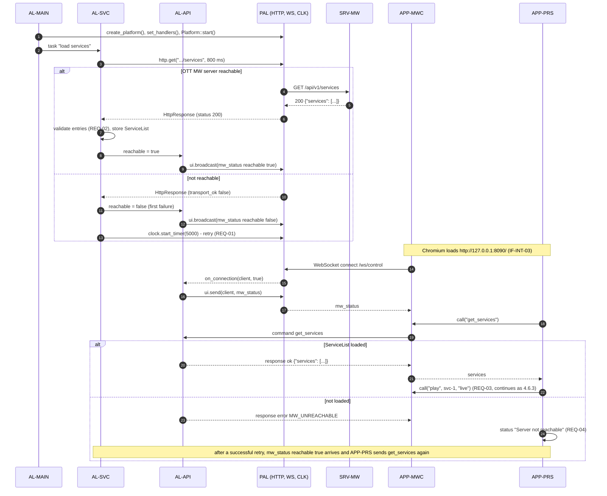

#### 4.6.2 PSI acquisition through the DTV SDK

The table-parsing flow of Lecture 6 (open filter → configure PID → start → event → read → parse) with the DTV SDK of IF-INT-04. Steps S3, S7 and S8 of Section 4.2.4; transitions T-03, T-09, T-11 and T-12.

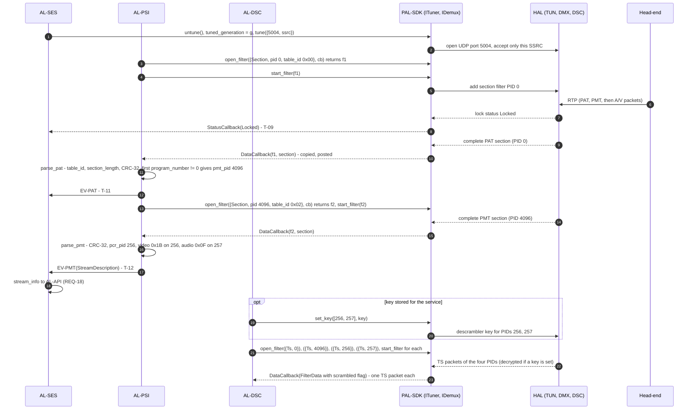

Mapping to the Android Tuner SDK of Lecture 6: `Tuner.openFilter` → `open_filter`, `Filter.start` → `start_filter`, `onFilterEvent` + `Filter.read` → `DataCallback` (the data is delivered with the event).

#### 4.6.3 Live zap to a clear service

Transitions T-01, T-03, T-06, T-09, T-12, T-19, T-18 and T-26.

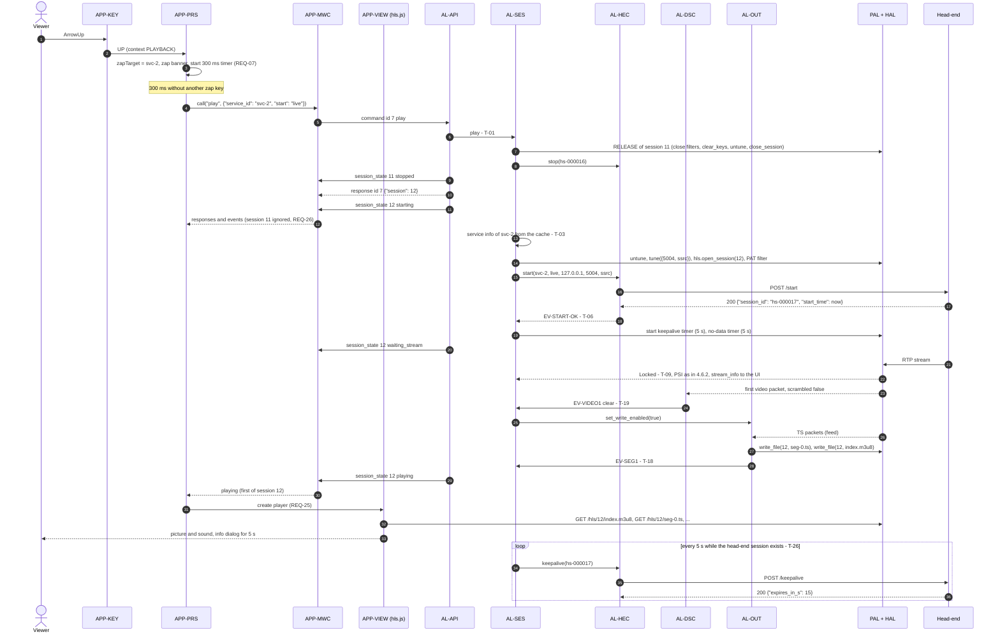

#### 4.6.4 Archive playback from the EPG

Transitions T-01 and following, as in 4.6.3; only the differences are shown.

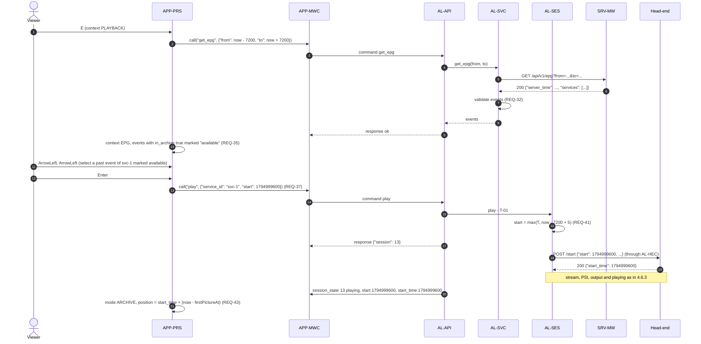

#### 4.6.5 Protected archive: no key, incorrect key, correct key, playback from the same T

The core scenario of M15 (US-14 – US-16, D-11, D-14). Transitions T-14, T-24, T-15, T-17, T-16 and T-18.

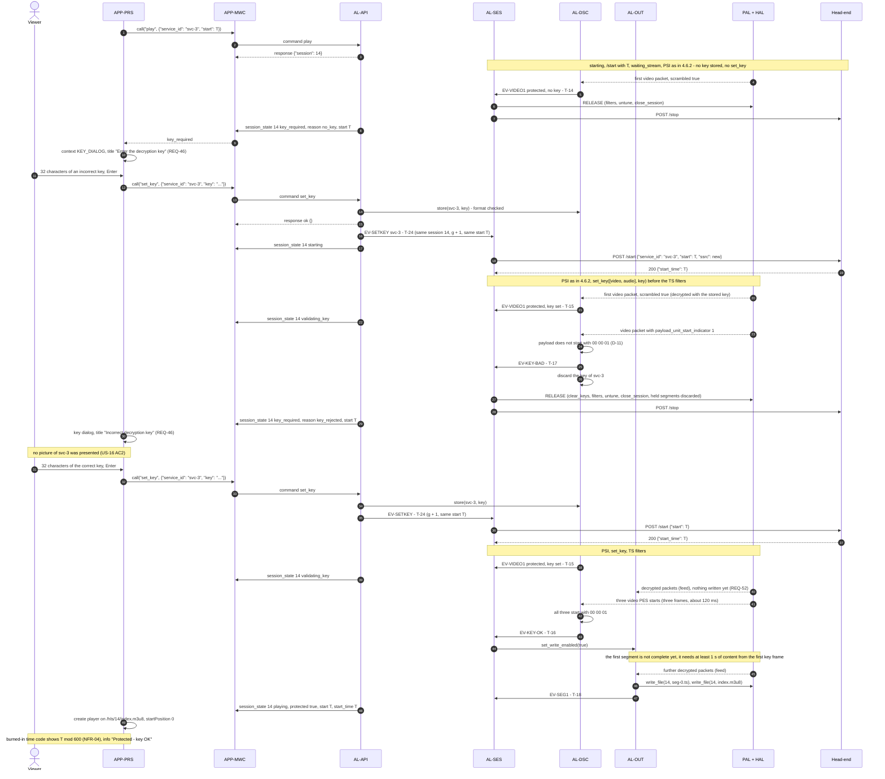

#### 4.6.6 Rapid zapping — latest request wins

Two cases: key presses faster than the zap debounce, and a new `play` while the previous start is still in progress (US-18, HLR-10).

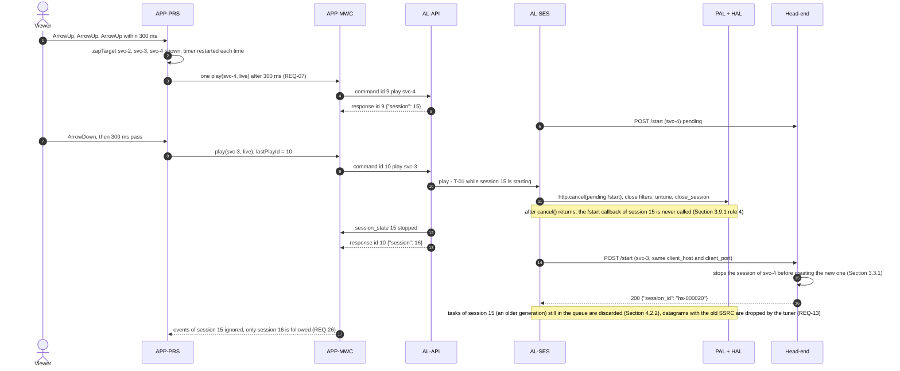

#### 4.6.7 Time steps and return to live

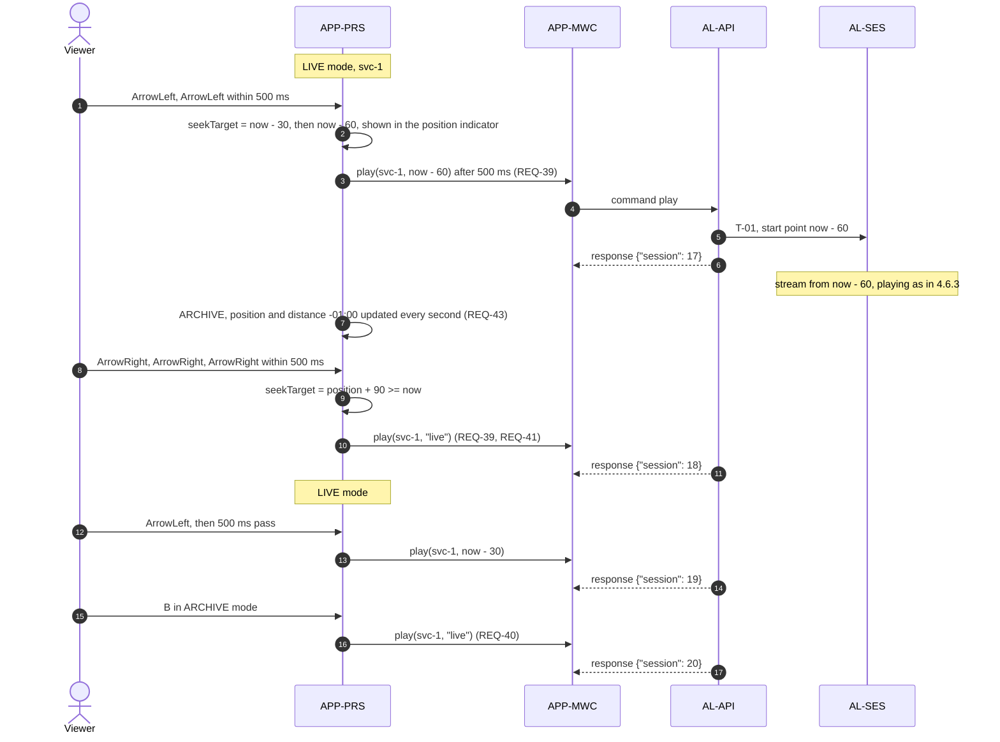

#### 4.6.8 Head-end lost during playback

Transitions T-22, T-26, T-29 (head-end stays down: three failed keepalives) and T-28 (head-end restarted before the third keepalive); REQ-69, US-19 AC3.

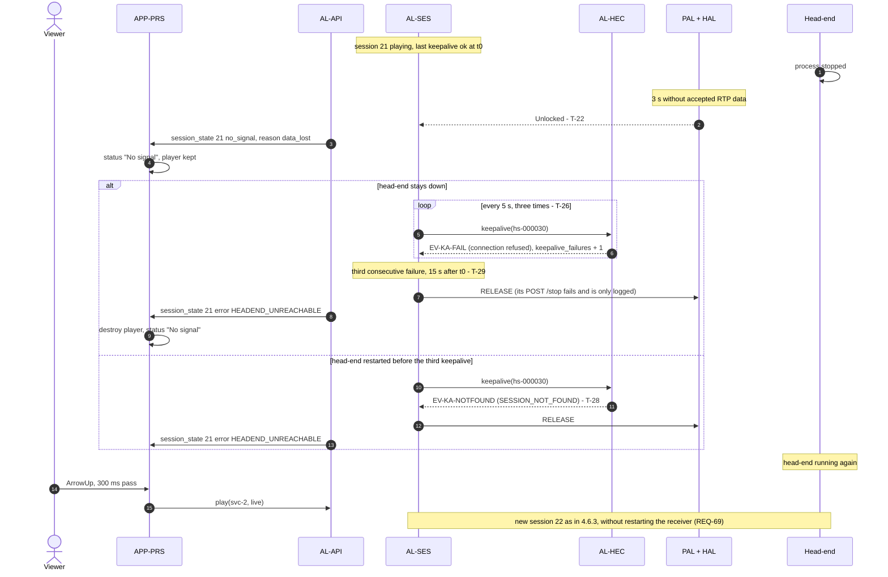

#### 4.6.9 Operator side: head-end start of an archive session

Demonstration level; the algorithms are specified in Section 4.7.

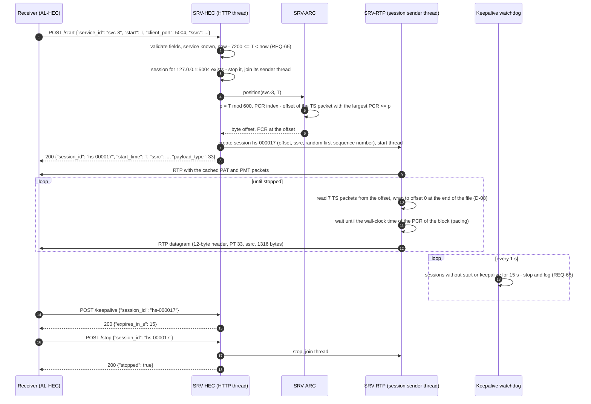

### 4.7 Operator-side design

This section specifies the algorithms of the operator side (WP-PAL; SRV-PKG by WP-APP): content generation, packaging, the archive timeline, RTP pacing, session management of the head-end and EPG generation. All operator-side programs are C++17 (HLR-19), built by the CMake project of `middleware/CMakeLists.txt`, which adds `server/` as a subdirectory, as the targets `headend`, `mw_server` and `package_ts` (executables in `build/bin/`, unit tests in the target `server_tests`), with Mongoose (HTTP), nlohmann/json, OpenSSL libcrypto (SRV-PKG only) and POSIX sockets and threads — the libraries the receiver already uses (Section 2.2.8); only SRV-GEN is a shell script that calls FFmpeg. Their common helpers (configuration, logging, HTTP and JSON helpers, injected clock) are in `server/common/`; the operator side links nothing of `middleware/` and shares no code with the receiver (rule R5, Section 4.1.4). The pacing of SRV-RTP uses `std::chrono::steady_clock` and `std::this_thread::sleep_until`. Every operator-side module reads the time only through clock functions passed to it at construction (defaults `std::chrono::system_clock` and `std::chrono::steady_clock`), so that its unit tests can use a fixed or advancing time (Section 5.3).

#### 4.7.1 Files and configuration

| File | Content | Used by |
|---|---|---|
| `content/generate.sh` | SRV-GEN script (4.7.2) | team, once |
| `content/svc-1.ts`, `svc-2.ts` | Clear content of the clear services | SRV-ARC, SRV-RTP |
| `content/svc-3.ts`, `svc-4.ts` | Clear content of the protected services; input of SRV-PKG only, never streamed | SRV-PKG |
| `content/svc-3.enc.ts`, `svc-4.enc.ts` | Encrypted content (D-04) | SRV-ARC, SRV-RTP |
| `content/services.json` | IF-INT-05 (Section 3.5); `file` = `svc-n.ts` for services 1, 2 and `svc-n.enc.ts` for services 3, 4 | SRV-MW, SRV-ARC |
| `content/test/` | Test set of Section 5.2.1 (`novideo.ts`, `*.altpid.ts`, `svc-4.altpid.enc.ts`) and `services.test.json` | Tests only |
| `content/SHA256SUMS` | Checksums of all content files (Section 5.2.1) | Acceptance runs |
| `server/config.test.json` | As `server/config.json`, with `services_file` `content/test/services.test.json` | Tests only |
| `server/package/` → `package_ts` | SRV-PKG (4.7.3) | team, once |
| `server/headend/` → `headend` | P3: SRV-HEC, SRV-ARC, SRV-RTP | `scripts/start.sh` |
| `server/mw/` → `mw_server` | P4: SRV-MW | `scripts/start.sh` |
| `server/config.json` | `mw_port` 8080, `headend_port` 8081, `headend_url` `http://127.0.0.1:8081/api/v1/stream`, `services_file` `content/services.json`, `content_dir` `content`, `log_dir` `logs` (NFR-16). P3 and P4 bind their HTTP servers to `127.0.0.1` only (HLR-20). | P3, P4 |

#### 4.7.2 Content generation (SRV-GEN)

`content/generate.sh` runs one FFmpeg command per service `n` (1 – 4), with the service name and the two program titles of `services.json`:

| Part | FFmpeg setting | Requirement |
|---|---|---|
| Video source | `testsrc2=size=1280x720:rate=25` (moving test pattern) | D-09 |
| Burned-in text | `drawtext` with `fontfile=/usr/share/fonts/truetype/dejavu/DejaVuSans-Bold.ttf`: service name; program title 1 with `enable='lt(t,300)'` and program title 2 with `enable='gte(t,300)'`; content time code `%{eif:floor(t/60):d:2}:%{eif:mod(floor(t),60):d:2}` (`MM:SS`), 48 px, white on a black box | REQ-62, NFR-04 |
| Audio source | `sine=frequency=<220·(n+1)>:sample_rate=48000`, stereo (a different tone per service) | D-09 |
| Video encoding | `-c:v libx264 -profile:v high -preset veryfast -b:v 2500k -maxrate 2500k -bufsize 2500k -g 25 -keyint_min 25 -sc_threshold 0 -flags +cgop` | closed GOP of 25 frames (Section 2.2.1) |
| Audio encoding | `-c:a aac -b:a 128k -ar 48000 -ac 2` | AAC-LC, 48 kHz, stereo |
| Multiplex | `-f mpegts -muxrate 3500k -mpegts_service_id 1 -pat_period 0.09 -t 600` | CBR 3.5 Mbit/s ≤ 4 Mbit/s (REQ-62); PAT/PMT at least every 100 ms (see the note below the table); 600 s |

With these settings FFmpeg 6.1.1 uses program number 1, PMT PID 4096, video PID 256 (also the PCR PID) and audio PID 257 — the values of the `stream_info` example of Section 3.6.3 — and sets `random_access_indicator` on every key-frame start, which AL-OUT uses (Section 4.2.4). The receiver does not rely on these PID values (HLR-12); the verification plan uses additional test files with other PIDs and without video, generated by the same script (Section 5.2.1). The constant mux rate (null packets, PID `0x1FFF`, fill the difference) makes the byte offset proportional to the content time, which keeps pacing (4.7.5) and the position mapping (4.7.4) simple.

**PAT/PMT period 0.09 s instead of 0.1 s.** FFmpeg inserts PAT and PMT at the first packet it writes after the period has passed, never earlier, so the real distance is always slightly longer than `-pat_period`. Measured with FFmpeg 6.1.1 and the settings above (2026-11-22, distance = byte distance × 8 / 3 500 000 as in TST-302): `-pat_period 0.1` gives up to **0.101 s** within 60 s of content, which violates "at least every 100 ms" (Section 2.2.1, REQ-62) and would fail TST-302; `-pat_period 0.09` gives at most **0.091 s** over a complete 600 s file. The cost is about 2 more PSI packets per second (≈ 3 kbit/s), which replace null packets of the constant mux rate, so file size and bit rate do not change. The same measurement confirmed the other assumptions of this section: PIDs 4096 / 256 / 257, `random_access_indicator` on all 600 key frames, PCR every 20 ms, duration 600.02 s, bit rate 3 499 806 bit/s; it also showed about 8 PCR-only video packets per second, the reason for the 16-byte rule of REQ-44.

#### 4.7.3 Packaging tool (SRV-PKG)

`build/bin/package_ts --in content/svc-3.ts --out content/svc-3.enc.ts` reads the key (32 hexadecimal characters) from standard input without echo, so that it does not appear in the shell history or the process list. It shares no code with the receiver (rule R5, Section 4.1.4).

Algorithm:

1. Parse the PAT (PID 0) and the PMT of the input with the tool's own parser (CRC-32 checked) and take the PIDs of all elementary streams with `stream_type 0x1B` and `0x0F` as the **A/V PIDs**.
2. For every 188-byte packet (the sync byte `0x47` is checked; a packet without it stops the tool with an error):
   - If its PID is not an A/V PID, or `adaptation_field_control` is `'10'` (adaptation field only) or `'00'`, copy it unchanged.
   - Otherwise compute the payload offset: `o = 4` for `'01'`, `o = 5 + adaptation_field_length` for `'11'`. Let `n = ⌊(188 − o) / 16⌋ · 16`.
   - If `n = 0`, copy the packet unchanged (`transport_scrambling_control` stays `'00'`).
   - If `n > 0`, replace bytes `o … o + n − 1` with their AES-128-CBC encryption (key from standard input, IV = 16 zero bytes, a new cipher context for every packet, no padding), keep bytes `o + n … 187` unchanged and set the two `transport_scrambling_control` bits (bits 7–6 of byte 3) to `'10'`.
3. Write the output; its size equals the input size (REQ-63).

The tool logs the number of packets encrypted and copied per PID, and the first 4 characters of the key followed by `…` (REQ-55). Because packets with a payload of fewer than 16 bytes stay clear and are not marked, the receiver checks only video PES starts received with `scrambled = true` (REQ-51).

#### 4.7.4 Archive timeline (SRV-ARC)

**Load (at head-end start, per service):**

1. Read the content file once from start to end and build the **PCR index**: for every packet of the PCR PID with a PCR, the pair (byte offset, `PCR_base` in 90 kHz units). With a PCR every 20 ms (FFmpeg default) a 600 s file gives about 30 000 entries.
2. Keep a copy of the first PAT packet and the first PMT packet of the file (for the start of every session, 4.7.5).
3. Compute the content time of each entry, `c = (PCR_base − PCR_base of the first entry) / 90 000` s, and the file duration `D` as the sum of `programs[].duration` from `services.json` (600 s). If the measured duration (last `c` + one PCR interval) differs from `D` by more than 0.1 s, the head-end refuses to start and logs the service (REQ-62 is then violated).

The file itself is not kept in memory (Section 4.5, B10); only the index (≈ 30 000 × 2 integers) and the two PSI packets are.

**Time → position (REQ-42):** for a start time `T` (the server time for `"live"`):

- `p = T mod D` — the content position of `T` on the wall-clock timeline (D-08);
- the start entry is the index entry with the largest `c ≤ p` (binary search); the stream starts at its byte offset, which is a packet boundary;
- `start_time` in the response is `T` (Section 3.3.1); the content sent at the start entry is at most one PCR interval (20 ms) earlier than `T`, well within ±1 s.

**Archive window:** a request is valid if `now − 7200 ≤ T < now` (Section 3.1); otherwise `OUT_OF_ARCHIVE` or `FUTURE_TIME`.

#### 4.7.5 RTP sender and pacing (SRV-RTP)

One sender thread per head-end session. State: file offset, loop counter `L`, RTP sequence number (random 16-bit start), RTP timestamp base (random 32-bit), monotonic start time `w0`, content time of the start entry `c0`.

1. **First datagram:** the cached PAT and PMT packets (2 TS packets, Section 3.4 "Start of session").
2. **Blocks:** then read 7 TS packets from the offset; a block does not cross the end of the file, so the last block of a pass can have 1 – 6 packets (allowed by IF-EXT-05). At the end of the file the offset becomes 0 and `L` is incremented (D-08); the stream continues without a pause.
3. **Content time of a block:** `c = c_entry + (offset − offset_entry) / (bytes per second between the two index entries around the offset)`, i.e. linear interpolation between the PCR index entries (exact enough with CBR multiplexing); the total content time is `C = L · D + c`.
4. **Pacing:** the block is sent at monotonic time `w0 + (C − c0)`; the thread sleeps until then. If the thread is more than 1 s late (for example after the head-end process was suspended), it neither sends the missed content in a burst nor shifts the timeline: it computes the content time that belongs to the current monotonic time, `C' = c0 + (now − w0)`, sets `L = ⌊C' / D⌋`, takes the index entry with the largest `c ≤ C' mod D` (as in 4.7.4) and continues from its offset; a warning is logged. The receiver sees a forward PCR jump, which it handles like a loop boundary (REQ-24). Over 10 s the average bitrate therefore equals the multiplex rate (REQ-66).
5. **RTP header:** `V = 2`, `PT = 33`, `M = 0`, sequence number + 1 per datagram, timestamp `base + round(C · 90 000) mod 2³²`, SSRC from the start request (Section 3.4).
6. **Stop:** the thread checks a stop flag before every block; a stop therefore takes at most one block interval (about 3 ms at 3.5 Mbit/s) plus the current sleep, and `POST /stop` returns only after the thread has ended (Section 3.3.2).

Because the session keeps sending in real time from `T` and step 4 never shifts the timeline, an archive session is "delayed live": the content sent at wall time `t` is always the content of `T + (t − t_start)`, and the burned-in time code of the receiver advances with the clock (NFR-04). This is the property on which the position formula of the UI relies (`playing_since`, Section 3.6.3). At the start, at every loop boundary and after a skip of step 4 the continuity counters of the receiver see a discontinuity, which the receiver tolerates (REQ-15, REQ-24).

#### 4.7.6 Head-end control (SRV-HEC)

- **Session table:** a dictionary `session_id → session` and a dictionary `client_host:client_port → session_id`, protected by one lock. Session ids are `hs-` followed by a 6-digit counter that starts at 1 for every head-end start, so the ids of a previous run are unknown after a restart (`SESSION_NOT_FOUND`, REQ-69).
- **`POST /start`:** validate the body (Section 3.3.1, `INVALID_REQUEST` for a missing or malformed field) → service known (`SERVICE_NOT_FOUND`) → archive window (`OUT_OF_ARCHIVE`, `FUTURE_TIME`) → stop the existing session of the same endpoint and wait for its thread → compute the position (4.7.4) → create the session with `last_seen = now` and start its thread → respond `200`. The steps after validation run under the lock, so two concurrent start requests from the same endpoint cannot both create a session.
- **`POST /keepalive`:** set `last_seen = now`; unknown id → `SESSION_NOT_FOUND`.
- **`POST /stop`:** stop the thread, remove the session; unknown id → `SESSION_NOT_FOUND`.
- **Watchdog:** every 1 s, stop every session with `now − last_seen ≥ 15 s` and log `session expired` with its id (REQ-68). A receiver that stops sending keepalives therefore loses its stream 15 – 16 s after its last keepalive (REQ-68, NFR-07, US-21 AC4).
- **Invalid input:** malformed JSON, unknown paths and methods are answered with `400` / `404` and an error object, and logged; no exception reaches the HTTP server loop (REQ-58).

#### 4.7.7 OTT MW server and EPG generation (SRV-MW)

- **`GET /services`** and **`GET /services/{id}`** are built from `services.json` (fields of Sections 3.2.1, 3.2.2); `stream_control_url` is `headend_url` from `server/config.json`, `archive_window_s` from `services.json`.
- **EPG cycle:** for a service with programs `P0 … Pm−1` (durations `d0 … dm−1`, `D = Σ di`), the program offsets in the cycle are `oi = d0 + … + di−1`. The events are, for every integer cycle number `k`, `start = k · D + oi`, `duration = di`, `title` and `description` of `Pi`. Because `D = 600` and `di = 300`, every `start` is a multiple of 300 (Section 3.2.3), and the event at time `t` is the program that SRV-ARC streams for `t` (D-08, US-20 AC2).
- **`GET /epg?from&to`:** for every requested service, enumerate `k` from `⌊from / D⌋ − 1` to `⌊to / D⌋` and return the events with `start < to` and `start + duration > from`, sorted by `start`; `event_id = <service_id>-<start>`; `in_archive = (server_time − 7200 ≤ start ≤ server_time)`; `server_time` is read once per request, so all events of one response use the same value.
- **Validation:** `from`, `to` integers, `from < to`, `to − from ≤ 86 400` (`INVALID_RANGE`); unknown `service_id` (`SERVICE_NOT_FOUND`).
- The server is stateless after loading `services.json`; a restart changes nothing for the receiver (US-19 AC2).

### 4.8 Error handling

#### 4.8.1 Principles

1. **One owner per error.** Every error is detected and decided by exactly one module (column "Detected by"); other layers only learn about it through the interfaces of Section 3 (error object, `session_state` with `error`, `mw_status`).
2. **No termination on bad input.** Invalid input on any interface is rejected, counted or logged, and never terminates a component (REQ-58, NFR-07). Only a missing or invalid configuration or content file at start-up stops a process, with an error message naming the file (ER-37 – ER-40).
3. **Viewer messages come from the APP only.** The AL never sends display texts; the APP derives the message from the state, the error code (Section 3.10) or its own checks (Section 4.4.2). All messages are those of Section 1.6.1.
4. **Logged with evidence.** Every error is logged by the module that detects it, with module tag, session number and generation where applicable (NFR-13, REQ-59); counters (`rtp_lost`, `rtp_invalid`, `sync_errors`, `cc_errors`, dropped data tasks, discarded sections and segments) are logged every 10 s while a session runs.

#### 4.8.2 Error matrix

| ID | Error | Detected by (layer) | Reaction | Shown to the viewer | Recovery | Source |
|---|---|---|---|---|---|---|
| **Start-up and metadata** | | | | | | |
| ER-01 | OTT MW server not reachable at start-up | AL-SVC (AL) | `mw_status` `reachable: false`; retry every 5 s; `get_services` → `MW_UNREACHABLE` | "Server not reachable" | Automatic: first successful retry → `mw_status` `true` → APP requests the list and starts service 1 | US-01 AC2; REQ-01, REQ-04 |
| ER-02 | OTT MW server lost after the list was loaded | AL-SVC (AL) | Service list kept (REQ-05); `get_epg` → `MW_UNREACHABLE`; `mw_status` `false` | EPG: "No information" for all services; playback unaffected | Next `get_epg` after the server returns | US-19 AC2; REQ-05, REQ-36 |
| ER-03 | Service entry with missing or invalid fields | AL-SVC (AL) | Entry discarded and logged; valid entries used | — | — | US-01 AC3; REQ-02 |
| ER-04 | Invalid EPG event, or EPG / service-list response that is not valid JSON | AL-SVC (AL) | Invalid event discarded and logged; an invalid whole response is treated as `MW_UNREACHABLE` | "No information" for the affected services | Next request | US-09 AC3; REQ-32 |
| ER-05 | `INVALID_RANGE` | SRV-MW (SRV), AL-API (AL) | Error response, logged as a programming error | — | — | Section 3.10 |
| **Service selection** | | | | | | |
| ER-06 | Typed service number does not exist | APP-PRS (APP) | No `play`; current playback continues | "Invalid service number" for 3 s | — | US-03 AC2; REQ-09 |
| ER-07 | `SERVICE_NOT_FOUND` in response to `play` or `set_key` | AL-API (AL) | Command rejected before T-01; the current session continues unchanged | "Invalid service number" for 3 s | — | Section 3.10 |
| ER-08 | `SERVICE_NOT_FOUND` from `GET /services/{id}` or `POST /start` (service removed on the server) | AL-SVC / AL-HEC (AL) | T-05 / T-08 → `error` | "Invalid service number" | New `play` | Section 3.10 |
| **Archive** | | | | | | |
| ER-09 | Selected EPG event not in the archive | APP-PRS (APP) | No `play`; EPG stays open | "Content not available in archive" for 3 s | — | US-11 AC2; REQ-38 |
| ER-10 | `OUT_OF_ARCHIVE` from the head-end (start point left the window between clamping and the request) | AL-HEC (AL) | T-08 → `error` (`OUT_OF_ARCHIVE`) | "Content not available in archive" | New `play` (for example `B` for live, or another event) | US-21 AC3; Section 3.10 |
| ER-11 | `FUTURE_TIME` from the head-end | AL-HEC (AL) | T-07: `/start` repeated with `"live"` | — | Automatic | Section 3.10 |
| **Stream control** | | | | | | |
| ER-12 | Head-end not reachable or no answer to `POST /start` within 2000 ms | AL-HEC (AL) | T-08 → `error` (`HEADEND_UNREACHABLE`) | "No signal" | New `play` once the head-end runs | HLR-09; REQ-21 |
| ER-13 | `INVALID_REQUEST` from the head-end | AL-HEC (AL) | T-08 → `error` (`INVALID_REQUEST`), logged as a programming error | "No signal" | New `play` | Section 3.10 |
| ER-14 | Keepalive answered with `SESSION_NOT_FOUND` (head-end restarted or session expired) | AL-HEC (AL) | T-28 → `error` (`HEADEND_UNREACHABLE`) | "No signal" | New `play` starts a new head-end session | US-19 AC3; REQ-69 |
| ER-15 | Three consecutive keepalives fail (15 s) | AL-SES (AL) | T-29 → `error` (`HEADEND_UNREACHABLE`) | "No signal" | New `play` | US-19 AC3; REQ-69 |
| ER-16 | `SESSION_NOT_FOUND` in response to `POST /stop` | AL-HEC (AL) | Treated as success | — | — | Section 3.3.2 |
| ER-17 | Receiver stops or crashes during a session | SRV-HEC watchdog (SRV) | Session stopped 15 – 16 s after its last keepalive, logged | — | — | US-21 AC4; REQ-68 |
| ER-18 | Invalid request to the head-end or the OTT MW server (malformed JSON, random bytes, unknown path) | SRV-HEC / SRV-MW (SRV) | `400` / `404` with an error object, logged | — | — | REQ-58; NFR-07 |
| **Reception** | | | | | | |
| ER-19 | No RTP data within 5 s after the head-end accepted | AL-SES (AL), tuner status (HAL) | T-20 → `no_signal` (`no_data_at_start`); keepalives continue | "No signal" | Automatic at `Locked` (T-10) | US-05 AC2; REQ-20 |
| ER-20 | RTP data stops for 3 s during playback | HAL-TUN (HAL) → AL-SES | T-22 → `no_signal` (`data_lost`); player kept | "No signal" | Automatic at `Locked` (T-23) | US-19 AC1; REQ-20 |
| ER-21 | Invalid RTP datagram (version, payload type, other SSRC, size not 1 – 7 × 188 bytes) | HAL-TUN (HAL) | Datagram dropped, `rtp_invalid` counted | — | — | REQ-13; NFR-07 |
| ER-22 | RTP sequence gap (lost datagrams) | HAL-TUN (HAL) | `rtp_lost` counted; packets passed on; no reordering (EXT-11) | Possibly a short picture disturbance | — | REQ-13 |
| ER-23 | TS packet without sync byte; continuity counter discontinuity | HAL-DMX (HAL) | Packet dropped / passed on; `sync_errors` / `cc_errors` counted | — | — | REQ-15 |
| ER-24 | PSI section with invalid CRC-32, wrong `table_id` or length; section longer than 4 096 bytes | AL-PSI (AL), HAL-DMX (HAL) | Section discarded and logged; the next repetition (≤ 100 ms) is used | — | Automatic; if no valid PAT / PMT arrives, ER-25 | REQ-16, REQ-17 |
| ER-25 | PMT without a video stream, or no protection / key decision within 3 s after `Locked` | AL-PSI / AL-SES (AL) | T-13 / T-21 → `error` (`INVALID_STREAM`); a stored key is kept | "No signal" | New `play` | REQ-17; REQ-51 |
| ER-26 | Tuner cannot open the UDP port; HLS file cannot be written | PAL-SDK / PAL-FS (PAL) → AL-SES | T-04 / T-30 → `error` (`RECEIVER_ERROR`) | "No signal" | New `play` | Section 3.10 |
| ER-27 | AL task queue full (data tasks) | AL callback (AL) | New data tasks dropped and counted, warning at most once per second; no state change | Possibly a short picture disturbance | Automatic when the worker catches up | Section 4.5, B4 |
| ER-28 | No key-frame start within 2 s of content | AL-OUT (AL) | Segment discarded with a warning; next key-frame start used | Possibly a short freeze | Automatic | Section 4.5, B5 |
| **Protection and keys** | | | | | | |
| ER-29 | Protected stream, no key stored | AL-DSC (AL) | T-14 → `key_required` (`no_key`); head-end session stopped; start point kept | Key dialog "Enter the decryption key" | `set_key` → T-24 (restart from the kept start point) | US-14 AC1; REQ-45, REQ-46 |
| ER-30 | Incorrect key | AL-DSC (AL) | T-17 → `key_required` (`key_rejected`); key discarded; nothing passed to the player | Key dialog "Incorrect decryption key" | Correct key → T-24, playback from the same start point | US-16; REQ-51, REQ-53, D-11, D-14 |
| ER-31 | Key dialog cancelled while `key_required` | APP-PRS (APP) | No command | "Protected service – press K to enter the key" | `K` → key dialog | US-14 AC5; REQ-48 |
| ER-32 | `INVALID_KEY_FORMAT` | AL-API (AL) | Command rejected; nothing stored | The key dialog is opened again with title "Enter the decryption key" (cannot happen with the input rules of REQ-47) | New entry | Section 3.10 |
| **User interface** | | | | | | |
| ER-33 | Malformed message on the control WebSocket (`INVALID_COMMAND`) | AL-API (AL) | Error response if the `id` is readable, otherwise ignored; logged | — | — | Section 3.6.1; REQ-58 |
| ER-34 | Control WebSocket closed (middleware stopped or restarted) | APP-MWC (APP) | Pending calls rejected; reconnect every 2 s; after reconnect `get_status`, `get_services` (Section 4.4.4) | "No signal" while disconnected | Automatic at reconnect | REQ-57 |
| ER-35 | Fatal hls.js error | APP-VIEW (APP) | Only errors of the player of the current session (`playerSession = session.number`) are handled; errors of the player of a superseded session, whose HLS directory the AL has already removed, are ignored until it is replaced (REQ-25). `MEDIA_ERROR`: `hls.recoverMediaError()` once. Any further fatal error: destroy the player and create it once more on the same playlist. A third fatal error in the same session: destroy the player | Third error: "No signal" until the next `play` | New `play` | REQ-25 |
| ER-36 | Viewer changes the choice before the previous operation has finished | APP-PRS, AL-SES | Not an error: debounce (REQ-07, REQ-39) and T-01 with generation check (Section 4.6.6) | — | — | US-18; [GUIDELINES] |
| **Configuration and content files** | | | | | | |
| ER-37 | Missing or invalid configuration file (`middleware.json`, `server/config.json`) or `services.json` | AL-MAIN, P3, P4 | Process exits with code 1 and a message naming the file; `scripts/start.sh` stops and names the component (NFR-12) | — (system does not start) | Fix the file, run `scripts/start.sh` again | [GUIDELINES] (missing input file) |
| ER-38 | Missing content file, or duration differs from `services.json` by more than 0.1 s | SRV-ARC (SRV) | Head-end does not start; message names the service and the file | — (system does not start) | Regenerate / repackage the content (Section 4.7) | [GUIDELINES]; REQ-62 |
| ER-39 | Packaging tool: input file missing, no sync byte, no PAT / PMT, key not 32 hexadecimal characters | SRV-PKG (SRV) | Tool exits with code 1 and a message; no output file is written | — | Correct the input | REQ-63 |
| ER-40 | Web application files missing (`webui_dir`) | PAL-WS (PAL) | `404` for the page; `scripts/start.sh` checks `GET /` before starting Chromium and stops with an error | — (system does not start) | Fix the installation | NFR-12 |

#### 4.8.3 Coverage

- **Error codes of Section 3.10:** `INVALID_REQUEST` ER-13, ER-18; `INVALID_RANGE` ER-05; `SERVICE_NOT_FOUND` ER-07, ER-08; `OUT_OF_ARCHIVE` ER-10; `FUTURE_TIME` ER-11; `SESSION_NOT_FOUND` ER-14, ER-16; `MW_UNREACHABLE` ER-01, ER-02, ER-04; `HEADEND_UNREACHABLE` ER-12, ER-14, ER-15; `INVALID_COMMAND` ER-33; `INVALID_KEY_FORMAT` ER-32; `INVALID_STREAM` ER-25; `RECEIVER_ERROR` ER-26.
- **Negative acceptance criteria of the user stories:** US-01 AC2, AC3 (ER-01, ER-03); US-03 AC2 (ER-06); US-05 AC2 (ER-19); US-09 AC3 (ER-02, ER-04); US-11 AC2 (ER-09); US-14 AC1, AC5 (ER-29, ER-31); US-16 AC1 – AC4 (ER-30); US-18 (ER-36); US-19 AC1 – AC3 (ER-20, ER-02, ER-12 – ER-15); US-21 AC3, AC4 (ER-10, ER-17, ER-18).
- **Guideline cases:** missing input file (ER-37 – ER-40), invalid data (ER-03, ER-04, ER-18, ER-21 – ER-24, ER-33, ER-39), change of choice before completion (ER-36).

---

## 5. Verification Plan

This section specifies how every requirement of Section 2 is verified [GUIDELINES]: on which level, with which test data, by which steps, with which measurable expected result and with which evidence. It uses the requirement IDs of Section 2 and the design IDs of Section 4 as test anchors: transitions `T-xx` (state-machine tests), errors `ER-xx` (negative tests), buffers `B1` – `B10` (bound and overflow tests) and the sequence diagrams of Section 4.6 (integration tests).

Structure:

- **5.1 Approach** — test levels, environments, test case format, IDs, status values, evidence and rules for valid evidence.
- **5.2 Test data set** — content files, keys, expected services and EPG.
- **5.3 Unit tests** — per module of every work package.
- **5.4 Integration tests** — pairs of parts over the real interfaces of Section 3.
- **5.5 Acceptance tests** — user stories in the target environment.
- **5.6 Non-functional, robustness and concurrency tests.**
- **5.7 Traceability** — every REQ and NFR to its tests.
- **5.8 Defense demonstration scenario.**
- **5.9 Test results** — actual result, evidence and status of every test.

### 5.1 Approach

#### 5.1.1 Test levels

| Level | Object under test | Neighbours replaced by | Environment (5.1.2) | Tool / command | Written by | Run |
|---|---|---|---|---|---|---|
| **Unit** | One module, or the free functions of one module (Section 4.2.4): AL modules with the fake DTV SDK and fake platform (Section 2.2.7); HAL and PAL modules with byte arrays and loopback sockets; SRV modules with temporary files; APP model, key mapping and presenters with a fake middleware client and a fake clock (Section 4.4.6). | Fakes and stand-ins of Section 2.2.7 | E1 | C++ (receiver and operator side): `ctest --test-dir build --output-on-failure` (GoogleTest); Web: `node --test webui/tests/*.test.js` | The work package that owns the module | Before every pull request (rule 3 of Section 2.2.7); all must pass before the merge |
| **Integration** | Two neighbouring parts of the system connected over a real interface of Section 3 (IF-EXT-03, IF-EXT-04, IF-EXT-05, IF-INT-01, IF-INT-02, IF-INT-04), and the operations of the sequence diagrams of Section 4.6. | The remaining parts: stand-ins of Section 2.2.7 or test tools (5.1.6) | E2 | Scripts in `tests/integration/` | Both owners of the interface; reviewed by both | After every merge into `main` that changes one of the two sides |
| **Acceptance** | The complete system started with `scripts/start.sh`: user stories (Section 1.9) and non-functional requirements (Section 2.4). | Nothing | E3 | Written procedure plus measurement scripts in `tests/acceptance/` | From Sections 1 and 2 only, not from the code | At milestones I-3 (protected rewind subset), I-4 (complete) and I-5 (final run on the defense laptop) |

Negative cases, repeated selection changes and new requests that arrive before the previous asynchronous request has completed [GUIDELINES] are tested on all three levels: on the unit level against the transition table (Section 4.3.4) with the deterministic task queue (Section 4.2.1, T5), on the integration and acceptance levels with real timing (Section 5.6).

#### 5.1.2 Test environments

| ID | Environment | Description |
|---|---|---|
| E1 | Developer machine, unit tests | Ubuntu 24.04 with the components of Section 2.2.8. No running servers; tests need no network access. HAL and PAL unit tests may open loopback sockets on ports chosen by the operating system (port 0), so that unit tests can run in parallel and never collide with a running system. |
| E2 | Developer machine, integration tests | As E1. The components under test are started individually from the repository with their default configuration (default ports of Section 2.2.5); stand-ins and test tools replace the others. |
| E3 | Target environment | The demo laptop of D-12 with all components started by `scripts/start.sh`, Chromium in kiosk mode at 1920×1080, and — for the final run at I-5 — the projector connected over HDMI. All measurements of Section 2.4 are made in E3. |

#### 5.1.3 Test case format

Every test case is one row of a table in Sections 5.3 – 5.6, so that each test has exactly one definition and can be found by its ID. The columns are:

| Column | Content |
|---|---|
| ID | `TST-xxx` (5.1.4). |
| Verifies | The requirements (`REQ`, `NFR`) and, where useful, the user-story acceptance criterion (`US-xx ACn`). |
| Anchors | Design elements exercised by the test: `T-xx`, `ER-xx`, `Bx`, sequence diagram 4.6.x. |
| Preconditions and input | State of the system and test data (Section 5.2) before the first step. |
| Steps | Numbered actions of the tester or the test program. |
| Expected result | A measurable, observable result with a number or an exact value wherever the requirement has one. "Works" or "plays correctly" is never an expected result. |
| Evidence | What is recorded as proof (5.1.6). |

The **actual result**, the evidence reference and the **status** of each test are recorded in Section 5.9, not in the test definition, so that the definitions stay stable while the results change from run to run.

#### 5.1.4 Test IDs

Test IDs have three digits and are grouped in blocks, so that the three work packages can add tests in parallel without renumbering (Section 2.2.7) and the level and owner of a test are visible from its ID. Inside a block, IDs are assigned in order from `x01`; IDs are never reused.

| Block | Level | Owner | Section |
|---|---|---|---|
| `TST-1xx` | Unit | WP-AL (AL modules) | 5.3 |
| `TST-2xx` | Unit | WP-PAL (PAL and HAL modules of the receiver) | 5.3 |
| `TST-3xx` | Unit | WP-PAL (operator side, SRV modules); TST-304 – 306 (SRV-PKG): WP-APP | 5.3 |
| `TST-4xx` | Unit | WP-APP (Web application) | 5.3 |
| `TST-5xx` | Integration | Both owners of the interface | 5.4 |
| `TST-6xx` | Acceptance, functional (user stories) | Whole team | 5.5 |
| `TST-7xx` | Acceptance, non-functional, robustness and concurrency | Whole team | 5.6 |

#### 5.1.5 Status values

| Status | Meaning |
|---|---|
| **passed** | All steps were executed and every expected result was observed; the evidence is recorded. |
| **failed** | At least one expected result was not observed. A GitHub issue is opened with the test ID in its title; after the fix, the test is executed again and Section 5.9 records the new result. |
| **not executed** | The test has not been run yet in the current version (initial status of every test). |
| **not verifiable** | The test cannot be executed in the available environment; the reason is recorded. A requirement whose only tests are "not verifiable" counts as not verified. |

A requirement is **verified** when all tests listed for it in Section 5.7 have the status "passed" in the same version of the code.

#### 5.1.6 Evidence and test tools

| Evidence type | Content | Produced by |
|---|---|---|
| `TESTOUT` | Output of the test runner (`ctest`, `node --test`) with the names and results of the tests. | Unit and integration tests |
| `LOG` | Excerpt of `logs/<component>.log` (NFR-13) with the lines that prove the expected result. | All levels |
| `FFPROBE` | Output of `ffprobe -show_programs -show_streams` (and `-show_packets` where packets are counted) on a content file, a captured stream or an HLS segment. | Independent inspection of TS data |
| `CAPTURE` | Result of the analysis of a `tcpdump` capture on the loopback interface (counts, matches found or not found). The capture file itself is deleted after the analysis and never committed, because it contains IF-INT-01 traffic with test keys (NFR-08). | NFR-07, NFR-08, IF-EXT-05 checks |
| `MEASURE` | CSV file of a measurement script with one row per repetition and the computed limit check. | Timing and resource tests (Section 5.6) |
| `PHOTO` | Screenshot (or photo of the projector at I-5) showing the burned-in service name, program title and time code together with the OSD. | Acceptance tests |
| `NOTE` | Written observation of the executing member, signed with name and date. Used only for what cannot be recorded otherwise: audible sound, its level and the distinct tone of each service (Section 5.2.3). | Acceptance tests |

Evidence is stored in the repository under `tests/evidence/<TST-id>/`, with the date and the Git commit of the tested code in the file name.

Test tools used besides the components of the system (versions in Section 2.2.8): `ffprobe` (independent TS and HLS inspection), `tcpdump` (loopback capture), `curl` (HTTP interfaces), and the team's helper scripts in `tests/tools/` (Python 3.12, standard library only): an RTP test sender for IF-EXT-05 negative cases, a JSON and random-byte sender for IF-EXT-03, IF-EXT-04 and IF-INT-01, a WebSocket test client for IF-INT-01, an RTP receiver that checks the RTP headers and writes the TS payload to a file, an HLS checker that loads a playlist and its segments over HTTP and runs `ffprobe` on them, a contract checker that validates JSON messages against the formats of Section 3, and log-analysis scripts that compute the timing values of Section 2.4 (details in Section 5.4.2).

#### 5.1.7 Rules for valid evidence [GUIDELINES]

1. **A successful build is not evidence** of any requirement. Every requirement is verified by the execution of a test, an inspection or an analysis (Section 2, verification methods).
2. **A shown service list is not evidence of playback.** Playback is proven by a `PHOTO` with the burned-in service name and time code of the expected service and moment, and by `FFPROBE` of the HLS segments written by the middleware.
3. **One service playing is not evidence that all services work.** Tests of reception, protection and archive playback are executed for all four services of the test data set, or explicitly for both clear and both protected services.
4. **A ready-made player is not evidence of the team's implementation.** That hls.js plays a stream does not prove the team's RTP reception, PAT/PMT parsing, PID selection, decryption or key validation. These are proven by unit tests of AL-PSI, AL-DSC, HAL-TUN, HAL-DMX and HAL-DSC with hand-built byte arrays, by comparing `stream_info` with `FFPROBE` of the content, and by the content file with non-default PIDs of Section 5.2 (HLR-12).
5. **Expected values come from outside the code under test**: from Section 3 (JSON examples, formulas), from Section 4.7 (time-to-position and EPG formulas), from the standards (AES test vectors of FIPS-197 and NIST SP 800-38A, MPEG-2 CRC-32 of known sections) or from an independent tool (`ffprobe`). Output recorded from the team's own code is never used as the expected value ("golden file") of a test of the same code.
6. **Independent implementations check each other.** D-04 is implemented twice, by SRV-PKG (WP-APP) and by HAL-DSC (WP-PAL), as two separate C++ implementations written by different members and sharing no code (rule R5, Section 4.1.4); the receiver's decryption of the packaged files is the cross-check of both (Section 5.4).
7. **Tests written with an LLM** together with the code may share a wrong assumption [GUIDELINES]. Every such test is reviewed in its pull request by a member of another work package, who checks its expected values against this specification before the merge (rule 3 of Section 2.2.7).
8. **Acceptance tests are executed by a member who did not implement** the layer that owns the main requirement of the test (Section 2.3, column "Layer"), and the result is recorded by that member in Section 5.9.

#### 5.1.8 Time measurement

All components run on one machine, so all times are taken from one clock: the wall clock of the laptop in milliseconds.

- **Native and server components** write their log lines with an ISO 8601 time stamp with milliseconds (NFR-13); the log-analysis scripts compute intervals from these time stamps (for example `play` received → `session_state` `playing` sent, NFR-01).
- **Web application:** in the **diagnostics mode** (page `http://127.0.0.1:8090/?diag=1`, Section 4.4.6), APP-VIEW writes `console.info` lines `DIAG <epoch_ms> <mark> <details>` for these marks: `key` (a key was mapped by APP-KEY), `osd` (the change caused by the key was rendered, measured in the next `requestAnimationFrame` callback), `frame` (the first video frame of a new player, from the first `requestVideoFrameCallback` callback), `frag <sn>` (hls.js event `FRAG_CHANGED`: the media sequence number of the segment that starts playing), `wait` and `resume` (the `waiting` and `playing` events of the `<video>` element, i.e. the start and end of an interruption of the picture). For measurement runs Chromium is started with `--enable-logging=stderr`, and its standard error is written to `logs/chromium.log`. Without `?diag=1` no `DIAG` lines are written.
- A time limit of Section 2.4 is met only if every repetition required by the requirement is within the limit (for NFR-01: at least 19 of 20 zaps).

### 5.2 Test data set

This section is the **test data documentation** required by US-22 AC2 and NFR-17: the content files, the keys, the expected services, the expected EPG and the invalid inputs used by the tests of Sections 5.3 – 5.6. `README.md` refers to this section instead of repeating it.

#### 5.2.1 Content files

All files are generated by `content/generate.sh` (Section 4.7.2) and packaged by `package_ts` (Section 4.7.3). They are **not committed** to the repository (one 600 s file at 3.5 Mbit/s is about 262 MB, above the file-size limit of GitHub); `content/*.ts` and `content/test/*.ts` are listed in `.gitignore`. The reference set is the one generated on the defense laptop (E3).

**Reference set** — used by `content/services.json` and by every test unless the test names the test set:

| File | Service | Content | Protection | Program number | PMT PID | Video PID (also PCR PID) | Audio PID |
|---|---|---|---|---|---|---|---|
| `content/svc-1.ts` | `svc-1` | Clear, streamed | — | 1 | 4096 | 256 | 257 |
| `content/svc-2.ts` | `svc-2` | Clear, streamed | — | 1 | 4096 | 256 | 257 |
| `content/svc-3.ts` | `svc-3` | Clear, input of SRV-PKG only | — | 1 | 4096 | 256 | 257 |
| `content/svc-4.ts` | `svc-4` | Clear, input of SRV-PKG only | — | 1 | 4096 | 256 | 257 |
| `content/svc-3.enc.ts` | `svc-3` | Encrypted, streamed | key K3 | 1 | 4096 | 256 | 257 |
| `content/svc-4.enc.ts` | `svc-4` | Encrypted, streamed | key K4 | 1 | 4096 | 256 | 257 |

**Test set** — used only by the tests that prove that the receiver takes the stream structure from PAT/PMT (HLR-12) and that it rejects a stream without video (REQ-17, ER-25). `content/generate.sh` generates it in the same run as the reference set, with the same settings as Section 4.7.2 except the ones named here:

| File | Used as service | Difference from the reference file | Protection | Program number | PMT PID | Video PID (also PCR PID) | Audio PID |
|---|---|---|---|---|---|---|---|
| `content/test/novideo.ts` | `svc-1` | No video stream (`-vn`), therefore no burned-in text; the audio of `svc-1` is kept | — | 1 | 4096 | — (PCR on the audio PID 256) | 256 |
| `content/test/svc-2.altpid.ts` | `svc-2` | `-mpegts_service_id 2 -mpegts_pmt_start_pid 0x0300 -mpegts_start_pid 0x0401` | — | 2 | 768 | 1025 | 1026 |
| `content/test/svc-4.altpid.ts` | — | As `svc-2.altpid.ts`, with the text and tone of `svc-4`; input of SRV-PKG only | — | 2 | 768 | 1025 | 1026 |
| `content/test/svc-4.altpid.enc.ts` | `svc-4` | `svc-4.altpid.ts` packaged with K4 | key K4 | 2 | 768 | 1025 | 1026 |

The test set is served by the head-end and the OTT MW server started with `server/config.test.json`, which differs from `server/config.json` (Section 4.7.1) only in `services_file` = `content/test/services.test.json`. That file is `content/services.json` with the `file` entries `test/novideo.ts` (`svc-1`), `test/svc-2.altpid.ts` (`svc-2`), `svc-3.enc.ts` (`svc-3`) and `test/svc-4.altpid.enc.ts` (`svc-4`); services, numbers, names and programs are unchanged, so the EPG of 5.2.4 applies to both sets. The middleware is not changed for the test set.

**Expected properties** of every clear file (streamed files and inputs of SRV-PKG), checked independently with `ffprobe -show_programs -show_streams -show_format` (TST-301, SRV-GEN), with the PID values of the tables above:

| Property | Expected value |
|---|---|
| Programs | exactly 1, with the program number and PMT PID of the table |
| Video stream (all files except `novideo.ts`) | `codec_name h264`, `profile High`, `width 1280`, `height 720`, `r_frame_rate 25/1` |
| Audio stream | `codec_name aac`, `profile LC`, `sample_rate 48000`, `channels 2` |
| Duration | 600.0 s ± 0.1 s |
| Overall bitrate | 3 500 000 bit/s ± 1 % (CBR multiplex) |
| Burned-in text (all files except `novideo.ts`) | Service name, program title of 5.2.3, time code `MM:SS` equal to the content time (frame at 123 s shows `02:03`) |

D-04 encrypts the whole payload of the video and audio packets, PES headers and SPS included, so `ffprobe` reads only PAT and PMT of the encrypted files (`svc-3.enc.ts`, `svc-4.enc.ts`, `test/svc-4.altpid.enc.ts`); it reports no profile, resolution, duration or bitrate for them. Their checks are those of TST-301; their decoded properties are verified after decryption (TST-304, TST-216).

**Checksums.** After the reference and test sets have been generated and packaged, `sha256sum content/*.ts content/test/*.ts > content/SHA256SUMS` is run and `content/SHA256SUMS` is committed. Before every acceptance run, `sha256sum -c content/SHA256SUMS` must report `OK` for every file; otherwise the run is not started. If the content is generated again, the new `SHA256SUMS` is committed and the reason is noted in the commit message. FFmpeg output is not guaranteed to be identical across machines, so the checksums identify the files of one generation; they are not an expected value of SRV-GEN tests.

#### 5.2.2 Keys

| ID | Key (32 hexadecimal characters) | Use |
|---|---|---|
| K3 | `3A7F1C9E5B2D8046A1E3C5079B4D6F28` | Correct key of `svc-3` |
| K4 | `C04E92B7165FD83A2E7B0C9145D6A3F1` | Correct key of `svc-4` |
| KX | `00112233445566778899AABBCCDDEEFF` | Incorrect key for both protected services |
| K3L | `3a7f1c9e5b2d8046a1e3c5079b4d6f28` | K3 in lower case: must be accepted as K3 (Section 3.1, case-insensitive) |
| KF1 | `3A7F1C9E5B2D8046A1E3C5079B4D6F2` | Invalid format: 31 characters (`INVALID_KEY_FORMAT`) |
| KF2 | `3A7F1C9E5B2D8046A1E3C5079B4D6F2G` | Invalid format: non-hexadecimal character (`INVALID_KEY_FORMAT`) |

- **Key bound to its service** (US-16 AC4, REQ-54): K4 entered for `svc-3` and K3 entered for `svc-4` are incorrect keys and must be rejected.
- **Detection of KX.** With an incorrect key, a decrypted PES start begins with `00 00 01` by chance with probability 2⁻²⁴; three checked PES starts (REQ-51) make a false acceptance practically impossible (2⁻⁷²), so every test with KX, K3-for-`svc-4` or K4-for-`svc-3` has the exact expected result "rejected".
- **Search patterns for NFR-08:** for each of K3 and K4, the upper-case and lower-case hexadecimal strings and the 16 raw key bytes.
- **Known-answer vectors.** Besides these keys, the unit tests of HAL-DSC, AL-DSC and SRV-PKG use the AES-128 example vectors of FIPS-197 (Appendix C.1) and the CBC-AES128 vectors of NIST SP 800-38A (F.2.1, F.2.2), which do not depend on the team's code (Section 5.1.7, rule 5).

The test keys appear only in this section, in the test code and test scripts that use them, and on the standard input of `package_ts`; no component writes them anywhere (NFR-08).

#### 5.2.3 Expected services

`content/services.json` (IF-INT-05) contains exactly these services; `GET /services` must return the four entries of Section 3.2.1, and `GET /services/{id}` the fields of Section 3.2.2 with these values:

| `service_id` | `number` | `name` | `protected` | `description` | Program 1 (content 0 – 300 s) | Program 2 (content 300 – 600 s) | Tone |
|---|---|---|---|---|---|---|---|
| `svc-1` | 1 | Demo One | `false` | Clear demo service | News at Nine | Weather Today | 440 Hz |
| `svc-2` | 2 | Demo Two | `false` | Clear demo service | Science Hour | Nature Walk | 660 Hz |
| `svc-3` | 3 | Premium One | `true` | Protected demo service | Premium Morning | Premium Evening | 880 Hz |
| `svc-4` | 4 | Premium Two | `true` | Protected demo service | Cinema Classic | Late Movie | 1100 Hz |

Program descriptions are "First program of the \<description in lower case\>." and "Second program of the \<description in lower case\>." (for `svc-3` as in Section 3.5). Every service has `stream_control_url` `http://127.0.0.1:8081/api/v1/stream` and `archive_window_s` 7200. The tone is `220·(n+1)` Hz of Section 4.7.2.

#### 5.2.4 Expected EPG and archive positions

The expected values follow from the formulas of Sections 4.7.4 and 4.7.7 with `D = 600` s and two programs of 300 s; a test computes them from the wall-clock time of its own run with these rules, independently of SRV-MW and SRV-ARC:

| Quantity at UNIX time `t` | Expected value |
|---|---|
| Start of the event running at `t` | `t − (t mod 300)` |
| Program running at `t` | Program 1 if `t mod 600 < 300`, otherwise Program 2 (titles of 5.2.3) |
| Burned-in time code of the content of time `t` | `t mod 600` as `MM:SS` |
| Events in `GET /epg?from=t−7200&to=t+7200` | 48 per service if `t` is a multiple of 300, otherwise 49 (every event that overlaps the range) |
| `in_archive` | `true` exactly for events with `t − 7200 ≤ start ≤ t` |
| Effective start point of `play` with `T` (REQ-41) | `"live"` if `T ≥ now`; `now − 7195` if `T < now − 7195`; otherwise `T` |

**Worked example** (also usable as a fixed input for unit tests with a controllable clock): `t = 1795000000` (2026-11-18 11:06:40 UTC), so `t mod 600 = 400` and `t mod 300 = 100`.

| Check | Expected value at `t = 1795000000` |
|---|---|
| Running event of `svc-3` | `event_id` `svc-3-1794999900`, `start` 1794999900, `duration` 300, title "Premium Evening", `in_archive` `true` |
| Previous event of `svc-3` | `svc-3-1794999600`, title "Premium Morning" (the event of the example of Section 3.2.3) |
| Burned-in time code of live content | `06:40` |
| Archive start at the previous event (`T = 1794999600`) | Time code of the first picture `00:00` (NFR-04: ±1 s) |
| Two steps back from live (`T = t − 60`) | Time code `05:40` |
| Oldest available event | `start` 1794993000 (the first multiple of 300 not earlier than `t − 7200` = 1794992800), `in_archive` `true`; the event starting at 1794992700 overlaps the range but has `in_archive` `false` |
| Events per service in `GET /epg?from=t−7200&to=t+7200` | 49 (from 1794992700 to 1795007100) |

#### 5.2.5 Invalid inputs

The negative tests use these inputs. They are produced by the helper scripts of `tests/tools/` (Section 5.1.6) or built as byte arrays in the unit tests; none of them is stored as a file in `content/`.

| ID | Interface | Input | Expected handling |
|---|---|---|---|
| IN-01 | IF-EXT-03, IF-EXT-04 (HTTP) | Body `{"service_id": ` (truncated JSON); body of 4 096 random bytes; unknown path `/api/v1/xyz`; method `DELETE` | `400` / `404` with an error object; server keeps running (ER-18) |
| IN-02 | IF-EXT-04 | `/start` without `ssrc`; `ssrc` = `-1`, `4294967296`, `"abc"`; `start` = `"yesterday"`; `client_port` = `70000` | `400 INVALID_REQUEST` |
| IN-03 | IF-EXT-04 | `/start` with `T = now − 7201`; with `T = now`; with `service_id` `svc-9` | `400 OUT_OF_ARCHIVE`; `400 FUTURE_TIME`; `404 SERVICE_NOT_FOUND` |
| IN-04 | IF-EXT-03 | `GET /epg` without `to`; `from = to`; `to − from = 86 401`; `from = abc`; `service_id = svc-9` | `400 INVALID_RANGE` (first four); `404 SERVICE_NOT_FOUND` |
| IN-05 | IF-EXT-03 (stand-in of SRV-MW) | Service list with: empty `service_id`; `number` 0, 1000 and a duplicate number; `name` missing; `protected` = `"yes"`; plus one valid entry | Only the valid entry is used, every other entry is logged (REQ-02, ER-03) |
| IN-06 | IF-EXT-03 (stand-in) | EPG with an event without `title`, two overlapping events and unsorted events; a response that is not JSON | Invalid events discarded (REQ-32); a non-JSON response → `MW_UNREACHABLE` (ER-04) |
| IN-07 | IF-INT-01 | Text frame `not json`; `{"type": "command", "id": 5, "name": "fly", "params": {}}`; `play` without `service_id`; `play` with `start` = `-5.5`; a binary frame of 1 000 random bytes | `INVALID_COMMAND` response where the `id` is readable, otherwise ignored; middleware keeps running (ER-33) |
| IN-08 | IF-EXT-05 (UDP port 5004) | Datagrams with `V = 1`; `PT = 96`; an SSRC other than the tuned one; payloads of 100 bytes, 0 bytes and 8 × 188 bytes; 1 000 datagrams of random bytes | Dropped and counted in `rtp_invalid` (REQ-13, ER-21) |
| IN-09 | IF-EXT-05 | A valid stream of `svc-1` in which every 50th RTP packet is not sent | `rtp_lost` counts the gaps (ER-22) |
| IN-10 | TS (inside valid RTP) | TS packets with sync byte `0x46`; continuity counters skipped on the video PID; a PAT section with one changed CRC byte; a PMT section with `section_length` larger than the data | Dropped / counted / discarded (REQ-15 – REQ-17, ER-23, ER-24); the next valid PAT and PMT are used |
| IN-11 | Configuration | `middleware.json`, `server/config.json` and `services.json`: file missing; file with invalid JSON; `services.json` naming a missing content file; a content file with a programs sum of 590 s | Process exits with code 1 and a message naming the file (ER-37, ER-38) |
| IN-12 | SRV-PKG | Missing input file; input file with a packet without sync byte; input without PAT; key KF1, KF2 | Exit code 1, no output file (ER-39) |

### 5.3 Unit tests

#### 5.3.1 Common rules

| Topic | Rule |
|---|---|
| Location | AL: `middleware/core/tests/`; PAL: `middleware/pal/tests/`; HAL: `middleware/hal/tests/`; operator side: `server/tests/`; Web application: `webui/tests/`. |
| Names | Every test function carries its test ID, so that `TESTOUT` maps to Section 5.9: GoogleTest `TEST(Tst101, ParsePatValid)` (operator side `TEST(Tst301, …)`), Node `test("TST-401 …")`. One ID may have several test functions. |
| AL fakes | The fakes of Section 2.2.7 (`middleware/core/tests/fakes/`): fake tuner (status events on request), fake demux (filters fed from byte arrays or from a content file; descrambling with a reference implementation of D-04 written in the test code), fake HTTP client (scripted response per URL, by default the JSON examples of Section 3), fake UI channel (records sent frames), HLS store on a temporary directory, controllable clock (`advance(ms)`), fake logger (records lines). The task queue runs in test mode (`run_pending()`, Section 4.2.1, T5). |
| Operator-side fakes | Fixed or advancing clock functions (Section 4.7), temporary directories, a UDP socket of the test on an ephemeral port as RTP receiver. |
| APP fakes | Fake middleware client (scripted responses and events, JSON of Section 3.6), fake clock (4.4.6), fake player view that records create / destroy / URL / options. |
| Test helpers | TS packets and PSI sections are built in the test code by a helper that is not part of the code under test. Its MPEG-2 CRC-32 is checked against the standard check value: CRC-32/MPEG-2 of the ASCII string `123456789` is `0x0376E6E7`. |
| Content files | Tests marked "content" in the preconditions need the files of Section 5.2.1. If a file is missing, the test **fails** with the message "content missing: run content/generate.sh"; it is never skipped silently. |
| Evidence | `TESTOUT` of the runner for all unit tests; additional evidence is named in the table. |

#### 5.3.2 AL — WP-AL (`TST-1xx`)

**AL-PSI**

| ID | Verifies | Anchors | Preconditions and input | Steps | Expected result | Evidence |
|---|---|---|---|---|---|---|
| TST-101 | REQ-16 | — | PAT sections built by the helper: (a) one program 1 → PMT PID 4096; (b) program 0 (NIT, PID 16) first, then program 2 → PID 768 | 1. `parse_pat` on (a) and (b) | (a) program 1, PMT PID 4096; (b) program 2, PMT PID 768 (program 0 skipped) | TESTOUT |
| TST-102 | REQ-16; ER-24 | — | Valid PAT (a) of TST-101 and three invalid variants: one CRC byte changed, `table_id 0x02`, `section_length` larger than the data (IN-10) | 1. Feed the three invalid sections, then the valid one, through the fake demux on the PAT filter | No `EV-PAT` for the invalid sections, one warning per section in the log; `EV-PAT` with PMT PID 4096 for the valid one | TESTOUT |
| TST-103 | REQ-17; HLR-12 | — | PMT sections: (a) PCR 256, `0x1B` on 256, `0x0F` on 257; (b) program 2, PCR 1025, `0x1B` on 1025, `0x0F` on 1026; (c) streams in the order `0x06` (with a descriptor), `0x0F` on 300, `0x1B` on 301 | 1. `parse_pmt` on each | (a) and (b) exactly the PIDs given; (c) video 301, audio 300, stream `0x06` ignored | TESTOUT |
| TST-104 | REQ-17 | T-13 | PMT (d) with only `0x0F`; PMT (e) with only `0x1B`; PMT (a) with one CRC byte changed | 1. `parse_pmt` on each | (d) `EV-PMT-NOVIDEO`; (e) video only, audio absent, stream accepted; changed CRC: section discarded, no event | TESTOUT |
| TST-105 | REQ-16, REQ-17, REQ-19 | 4.6.2; T-11, T-12 | Content: `svc-1.ts` and `test/svc-2.altpid.ts` fed into the fake demux | 1. Start a session per file; 2. record the `open_filter` / `start_filter` calls | Order: section filter PID 0 `table_id 0x00`; section filter on the PMT PID `table_id 0x02`; TS filters on exactly PID 0, the PMT PID, the video and the audio PID (4096 / 256 / 257 resp. 768 / 1025 / 1026); later PAT/PMT repetitions cause no further filter call | TESTOUT |
| TST-106 | REQ-18, REQ-59 | — | As TST-105; `ffprobe -show_programs -show_streams` of both files | 1. Run the sessions; 2. compare `stream_info` and the log with `ffprobe` | Exactly one `stream_info` per session; `program_number`, `pmt_pid`, `pcr_pid`, video and audio PID and `stream_type` equal to the `ffprobe` values; one log line with the same values | TESTOUT, FFPROBE |

**AL-DSC**

| ID | Verifies | Anchors | Preconditions and input | Steps | Expected result | Evidence |
|---|---|---|---|---|---|---|
| TST-111 | REQ-44 | T-14, T-15, T-19 | Video TS packets built by the helper: (a) all `scrambled = false`; (b) first an adaptation-only packet and a packet with 10 payload bytes, both `scrambled = false`, then a packet with 184 payload bytes `scrambled = true` | 1. Feed (a), (b) as the video TS filter | (a) protection `clear`; (b) protection `protected`: the first two packets are not used for the decision | TESTOUT |
| TST-112 | REQ-49; ER-32 | — | Keys K3, K3L, KF1, KF2 (Section 5.2.2) | 1. `set_key` with each | K3 and K3L stored as the same 16 bytes `3A 7F … 28`; KF1, KF2 rejected with `INVALID_KEY_FORMAT`, nothing stored | TESTOUT |
| TST-113 | REQ-51; D-11 | T-15, T-16 | Content: `svc-3.enc.ts` through the fake demux with K3 | 1. Play `svc-3` with K3 stored; 2. count the checked PES starts | `EV-KEY-OK` after exactly 3 checked video PES starts received with `scrambled = true`; PES starts with a payload shorter than 16 bytes are not counted | TESTOUT |
| TST-114 | REQ-51, REQ-53, REQ-54; US-16 AC4 | T-17 | Content: `svc-3.enc.ts` with KX; with K4 | 1. Play with KX; 2. play with K4 stored for `svc-3` | `EV-KEY-BAD` at the first checked PES start in both cases; the key of `svc-3` is removed from the key store; `clear_keys` is called | TESTOUT |
| TST-115 | REQ-54 | — | K3 stored for `svc-3` | 1. Look up the key of `svc-4`; 2. reject the key of `svc-4` after storing K4; 3. look up `svc-3` | 1: no key; 2: only the `svc-4` entry removed, its 16 bytes overwritten with zeros (test hook of the key store); 3: K3 still stored | TESTOUT |
| TST-116 | REQ-55 | — | K3, K4; the complete fake-logger output of TST-112 – TST-115 and TST-139 – TST-141 | 1. Search all recorded log lines for the patterns of Section 5.2.2 | No full key in any line; lines that refer to a key contain `3A7F…` or `C04E…` only | TESTOUT |

**AL-OUT**

| ID | Verifies | Anchors | Preconditions and input | Steps | Expected result | Evidence |
|---|---|---|---|---|---|---|
| TST-121 | REQ-22, REQ-23 | B5 | Content: first 12 s of `svc-1.ts` fed as TS filter packets; `write_enabled = true` | 1. Feed; 2. run `ffprobe -show_streams -show_frames` on every written segment | Every segment starts with one PAT packet, one PMT packet and a video packet with `payload_unit_start_indicator = 1` and `random_access_indicator = 1`; `ffprobe` reads every segment on its own, its first video frame has `key_frame=1`; every `#EXTINF` is between 1.000 and 2.000 | TESTOUT, FFPROBE |
| TST-122 | REQ-22 | — | Output of TST-121 | 1. Scan all packets of all segments | Only PIDs 0, 4096, 256, 257 (no null packets); `transport_scrambling_control = '00'` on every packet | TESTOUT |
| TST-123 | REQ-23; HLR-17 | B7 | Content: 20 s of `svc-1.ts` | 1. Feed; 2. after every segment write, read `index.m3u8` and list the directory | Playlist: `#EXT-X-VERSION:3`, `#EXT-X-TARGETDURATION:2`, `#EXT-X-MEDIA-SEQUENCE` = sequence of the first listed segment, at most 6 segments, `#EXTINF` with 3 decimals, no `#EXT-X-ENDLIST`; a segment is listed only after its file exists with its final size; when segment `k` is the first listed, `seg-(k−3).ts` no longer exists; never more than 8 segment files (B7) | TESTOUT |
| TST-124 | REQ-24 | — | Content: last 5 s of `svc-1.ts` followed by its first 8 s (the loop boundary of D-08); second input: 5 s, a gap of 2 s of content removed, 5 s | 1. Feed both inputs; 2. read the playlists until the marked segment has left the playlist | A segment is closed at the boundary / at the gap; the next one is preceded by `#EXT-X-DISCONTINUITY`; `#EXT-X-DISCONTINUITY-SEQUENCE:1` appears when the marked segment leaves the playlist; segment timestamps equal those of the input (not rewritten) | TESTOUT, FFPROBE |
| TST-125 | REQ-52 | B6; T-16 | Content: 5 s of `svc-1.ts`; `write_enabled = false` | 1. Feed 5 s; 2. check the directory; 3. `set_write_enabled(true)` | 2: no segment and no playlist written, at most 4 segments held; 3: held segments written in order from `seg-0.ts`, `seg-0.ts` begins with the first key-frame start after `open` | TESTOUT |
| TST-126 | — (IF-INT-02 limit) | B5; ER-28 | 4 s of `svc-1.ts` in which the `random_access_indicator` of the key frames between 1 s and 3.5 s is cleared by the helper | 1. Feed | The segment without a key-frame start within 2 s is discarded with a warning; the next segment starts at the next key-frame start; no segment longer than 2.000 s | TESTOUT |
| TST-127 | — (error path) | T-30; ER-26 | Fake HLS store whose `write_file` returns `false` from the 3rd call | 1. Play `svc-1` | `EV-OUT-ERR`; state `error` with `RECEIVER_ERROR`; RELEASE executed | TESTOUT |

**AL-SES** (state machine of Section 4.3; every test checks the sequence of `session_state` events recorded by the fake UI channel)

| ID | Verifies | Anchors | Preconditions and input | Steps | Expected result | Evidence |
|---|---|---|---|---|---|---|
| TST-131 | REQ-12, REQ-14 | T-01, T-03, T-06, T-09, T-11, T-12, T-19, T-18; 4.6.3 | Clear content `svc-1.ts` in the fake demux; fake head-end answers the example of 3.3.1 | 1. `play svc-1 live`; 2. run the queue | Response `{"session": 1}` before the first event of session 1; calls in the order `untune`, `tune({5004, ssrc})`, `open_session(1)`, PAT filter, `POST /start` with the same `ssrc`; events `starting`, `waiting_stream`, `playing` | TESTOUT |
| TST-132 | REQ-12 | Rule 3; T-06, T-19, T-17 | (a) As TST-131, but the fake HTTP client delivers the `/start` response only after all data events up to `EV-SEG1`; (b) content `svc-3.enc.ts` with KX stored, `/start` response delivered only after `EV-KEY-BAD` | 1. `play`; 2. run the queue; for (a) advance the clock 5 s after `Locked` | (a) Events `starting`, then directly `playing` with `protected: false` (no `session_state` before the `/start` response, no intermediate state sent); the stream deadline does not expire; (b) events `starting`, then directly `key_required` `key_rejected` with `protected: true`; KX removed only at the response; RELEASE including `POST /stop` for the session id of the response | TESTOUT |
| TST-133 | REQ-21, REQ-41 | T-07, T-08; ER-10 – ER-13 | Fake head-end answers: (a) `FUTURE_TIME`, then `200`; (b) `OUT_OF_ARCHIVE`; (c) `INVALID_REQUEST`; (d) transport failure | 1. `play svc-1` with `T = now − 10` for each case | (a) second `/start` with `"live"`, `session_state.start` = `"live"`; (b) `error` `OUT_OF_ARCHIVE`; (c) `error` `INVALID_REQUEST`; (d) `error` `HEADEND_UNREACHABLE` | TESTOUT |
| TST-134 | — (error paths) | T-04, T-05; ER-08, ER-26 | (a) fake tuner `tune` returns `false`; (b) `GET /services/svc-1` answers `404`; (c) it fails | 1. `play svc-1 live` | (a) `error` `RECEIVER_ERROR`; (b) `error` `SERVICE_NOT_FOUND`; (c) `error` `MW_UNREACHABLE`; no `POST /start` in any case | TESTOUT |
| TST-135 | REQ-41 | T-01 | Clock at `t = 1795000000` | 1. `play` with `T` = `t − 8000`, `t − 7195`, `t − 60`, `t`, `t + 100` | `session_state.start` and `/start` body: `t − 7195`, `t − 7195`, `t − 60`, `"live"`, `"live"` | TESTOUT |
| TST-136 | REQ-20 | T-20, T-10, T-32; ER-19 | `/start` answers `200`, no tuner status | 1. Advance the clock 4 999 ms; 2. advance 1 ms; 3. `Unlocked`; 4. `Locked` | 1: still `waiting_stream`; 2: `no_signal` `no_data_at_start`; 3: no change; 4: `waiting_stream` | TESTOUT |
| TST-137 | REQ-20 | T-22, T-23; ER-20 | Session `playing` | 1. `Unlocked`; 2. check the HLS store; 3. `Locked` | 1: `no_signal` `data_lost`; 2: directory and files kept, no `close_session`; 3: `playing`, no new session number | TESTOUT |
| TST-138 | REQ-17; REQ-51 (deadline) | T-13, T-21; ER-25 | (a) content `test/novideo.ts`; (b) `Locked`, PAT, PMT, but no video packet; K3 stored | 1. Play; for (b) advance the clock 3 000 ms after `Locked` | (a) `error` `INVALID_STREAM` after `EV-PMT-NOVIDEO`; (b) `error` `INVALID_STREAM` exactly at 3 000 ms; K3 still stored | TESTOUT |
| TST-139 | REQ-45; US-14 AC1 | T-14; RELEASE | Content `svc-3.enc.ts`, no key stored, `play svc-3` with `T = t − 600` | 1. Play; 2. record the calls | `key_required` `no_key`, `start` = `T`; RELEASE in the order: timers and HTTP cancelled, filters closed, `clear_keys`, `untune`, `close_session`, `POST /stop`; no `write_file` call during the whole session | TESTOUT |
| TST-140 | REQ-49, REQ-52, REQ-18; D-14; US-14 AC4 | T-24, T-15, T-16, T-18 | State after TST-139 | 1. Advance the clock 120 s; 2. `set_key svc-3 K3` | Same session number, new SSRC (≠ previous), `POST /start` with `start` = `T` (not `T + 120`); events `starting`, `waiting_stream`, `validating_key`, `playing`; no second `stream_info` for the session; first segment written only after `EV-KEY-OK` | TESTOUT |
| TST-141 | REQ-53; US-16 AC2, AC3 | T-17, T-24 | State after TST-139 | 1. `set_key` KX; 2. advance 120 s; 3. `set_key` K3 | 1: `validating_key`, then `key_required` `key_rejected`, KX removed, `clear_keys`, held data discarded, `POST /stop`; 3: `/start` with `start` = `T`, then `playing` | TESTOUT |
| TST-142 | REQ-49 | T-25, T-33, T-12 | Content `svc-3.enc.ts`; KX stored | 1. `set_key` K3 while `starting` before `EV-PMT`; 2. new session with KX; `set_key` K3 while `validating_key`; 3. `set_key svc-4 K4` while `svc-3` plays | 1: no restart, K3 set on the descrambler at T-12, `playing`; 2: restart (same number, new generation and SSRC), validation with K3, `playing`, K3 stored (not removed); 3: K4 stored, `svc-3` session unchanged | TESTOUT |
| TST-143 | REQ-56; US-18; HLR-10 | T-01, rule 2; 4.6.6 | `play svc-4` with the `/start` response held back | 1. `play svc-3`; 2. deliver the old `/start` response, a filter-data task, a timer expiry and a tuner status of the old generation | `http.cancel` of the pending `/start`, filters closed, `close_session(old)`, `stopped` for the old session, then events of the new session only; none of the old tasks changes state or produces an event | TESTOUT |
| TST-144 | REQ-56 | T-01, T-02 | Sessions in `key_required` and in `error` | 1. `play` in each; 2. `stop` in `playing`; 3. `stop` in `key_required` and in `error` | 1: `stopped` sent for the old session, then the new session starts; 2: RELEASE, `stopped`; 3: `stopped`, no PAL call | TESTOUT |
| TST-145 | REQ-67, REQ-69 | T-26 – T-29; ER-14, ER-15 | Session `playing` from `EV-START-OK` at `t0` | 1. Advance 5 s steps to 30 s with `200` answers; 2. new session, answer `SESSION_NOT_FOUND`; 3. new session, keepalive failures from `t0`; 4. new session: failure, failure, `200`, failure, failure | 1: keepalives at 5, 10, … 30 s; 2: `error` `HEADEND_UNREACHABLE`, no `POST /stop`; 3: no state change at the failures of 5 and 10 s, `error` `HEADEND_UNREACHABLE` at the third failure (15 s); 4: no `error` (the `200` resets the count) | TESTOUT |
| TST-146 | REQ-70 | T-31 | Session `playing` | 1. `shutdown`; (a) `/stop` answered after 100 ms; (b) `/stop` not answered | `POST /stop` sent; completion reported (a) at the response, (b) at 2 000 ms | TESTOUT |
| TST-147 | REQ-59 | — | Fake-logger output of TST-131, TST-139 – TST-141 | 1. Search for the log entries | For every session: `play` (service, start), head-end session (id, SSRC, start time), PAT/PMT result, protection decision, key accepted / rejected, every state change, every error — each with a time stamp | TESTOUT |
| TST-148 | — (bounded queue) | B4; ER-27 | Task queue in test mode, worker not running | 1. Post 10 000 data tasks and 5 control tasks; 2. advance the clock 3 s while posting 3 000 more data tasks; 3. run the queue | 1: 8 192 data tasks and all 5 control tasks queued, 1 808 counted as dropped; 2: at most one drop warning per second (3 lines); 3: control tasks executed, no state change caused by the drops | TESTOUT |

**AL-SVC, AL-HEC, AL-API, AL-MAIN and the portability rule**

| ID | Verifies | Anchors | Preconditions and input | Steps | Expected result | Evidence |
|---|---|---|---|---|---|---|
| TST-151 | REQ-01 | ER-01 | Fake HTTP: `GET /services` fails 3 times, then the example of 3.2.1 | 1. Start; 2. advance the clock in 5 s steps | `GET` at 0, 5, 10, 15 s; `mw_status` `false` once (after the first failure), `true` once (after the success); list stored | TESTOUT |
| TST-152 | REQ-02 | ER-03 | IN-05 | 1. Load the list | Only the valid entry in `get_services`; one log line per discarded entry | TESTOUT |
| TST-153 | REQ-05 | ER-02 | List loaded; then every MW request fails | 1. `get_services`; 2. `get_epg` | 1: the last valid list; 2: `MW_UNREACHABLE` | TESTOUT |
| TST-154 | REQ-32 | ER-04 | IN-06; a response delayed by 900 ms | 1. `get_epg` for each; 2. `get_epg` twice with a valid response | Invalid events removed and logged; non-JSON → `MW_UNREACHABLE`; delayed response → `MW_UNREACHABLE` at 800 ms; 2: two `GET /epg` requests (no cache) | TESTOUT |
| TST-155 | REQ-12 | — | Two `play svc-1` | 1. Play twice | One `GET /services/svc-1` only | TESTOUT |
| TST-156 | REQ-12, REQ-67, REQ-70 | ER-12 – ER-16 | Fake HTTP for the head-end URL | 1. `start`, `keepalive`, `stop` with the values of 3.3; 2. answers `200`, `400` with an error object, `404 SESSION_NOT_FOUND` on `stop`, transport failure, invalid body, no answer | 1: bodies equal the JSON of Section 3.3 (field names and types; `ssrc` an unsigned 32-bit integer); 2: result; error code; success; `HEADEND_UNREACHABLE` (three last cases, the last one at 2 000 ms) | TESTOUT |
| TST-157 | REQ-58; Section 3.6 | ER-33 | IN-07; every command of 3.6.2 with valid `params` | 1. Send through the fake UI channel | One response per command with the same `id`; IN-07 → `INVALID_COMMAND` where the `id` is readable, otherwise ignored; `get_status` → `{"state": "idle"}` before the first `play`; a new client receives `mw_status` (once the reachability is known, Section 3.6.3) | TESTOUT |
| TST-158 | NFR-16; ER-37 | — | `middleware.json` with all keys; with no keys; IN-11 | 1. Read each with the configuration reader of AL-MAIN | Values read; defaults of Section 4.2.5 when keys are missing; IN-11 → error naming the file, exit code 1 | TESTOUT |
| TST-159 | NFR-09 | R3 | Source tree | 1. Build target `dtvcore_tests` in an empty build directory; 2. list its link libraries and include directories (CMake file API); 3. search `middleware/core/` for `openssl`, `mongoose`, `sys/socket.h`, `hal/` | 1: builds and its tests pass; 2: links only `dtvcore` and GoogleTest, includes only `middleware/include/pal/`, the C++ standard library and nlohmann/json; 3: no match | TESTOUT |

#### 5.3.3 PAL and HAL — WP-PAL (`TST-2xx`)

| ID | Verifies | Anchors | Preconditions and input | Steps | Expected result | Evidence |
|---|---|---|---|---|---|---|
| TST-201 | REQ-13 | B2 | `hal::IpTuner` tuned to an ephemeral port and SSRC `S`; a test sender | 1. Send 100 valid datagrams of 7 TS packets | `Locked` once, at the first datagram; 700 TS packets delivered in order; `rtp_packets` = 100 | TESTOUT |
| TST-202 | REQ-13 | ER-21 | As TST-201; IN-08 | 1. Send the invalid datagrams only; 2. then one valid datagram | 1: no TS packet delivered, no `Locked`, `rtp_invalid` = number sent; 2: `Locked` | TESTOUT |
| TST-203 | REQ-13 | ER-22 | IN-09; a second run with sequence numbers 65 530 → 5 without gaps | 1. Send | `rtp_lost` = number of omitted packets; 0 for the wrap-around run | TESTOUT |
| TST-204 | REQ-13 | — | `Locked` tuner | 1. Stop sending; 2. send again | `Unlocked` 3 000 ms ± 150 ms after the last datagram; `Locked` at the first new datagram | TESTOUT |
| TST-205 | REQ-14; Section 3.9.1 rule 4 | — | Tuner receiving at 380 datagrams/s | 1. `untune()` while sending; 2. send for 500 ms more; 3. `tune` with SSRC `S2`, send SSRC `S` and `S2` | 2: no callback after `untune()` returned; 3: only `S2` delivered, `S` counted in `rtp_invalid` | TESTOUT |
| TST-206 | — (error path) | ER-26; B1 | Port occupied by another socket of the test | 1. `tune` on it; 2. `tune` on a free port | 1: returns `false`; 2: `SO_RCVBUF` requested 1 MiB, the effective value logged | TESTOUT, LOG |
| TST-211 | REQ-15 | ER-23 | `hal::Demux` with a TS filter on PID 256; IN-10 sync and CC cases | 1. Feed | Packets with sync `0x46` not delivered, `sync_errors` counted; CC discontinuities counted in `cc_errors`, packets still delivered | TESTOUT |
| TST-212 | REQ-19 | — | Filters: TS on 256 (two filters), TS on 257, section on 0 | 1. Feed a mix of PIDs 0, 256, 257, 4096, 8191 | Each TS filter receives only its PID, one 188-byte packet per callback; both filters on 256 receive every packet; no delivery of 4096 and 8191 | TESTOUT |
| TST-213 | REQ-16, REQ-17 | B3; ER-24 | Sections built by the helper: one in one packet with `pointer_field`; one over 3 packets; two sections in one packet; a section of 4 098 bytes (the largest possible with the 12-bit `section_length`, larger than B3); `table_id` filter `0x02` with a `0x00` section | 1. Feed | Complete sections delivered byte for byte; the 4 098-byte section discarded and counted, assembly restarts at the next `payload_unit_start_indicator = 1`; `table_id` mismatch not delivered | TESTOUT |
| TST-214 | Section 3.9.1 rule 4 | — | Feeding thread at full speed on PID 256 | 1. `close_filter` 1 000 times on freshly opened filters | No callback for a filter after its `close_filter` returned (callback checks a flag set after the return) | TESTOUT |
| TST-215 | REQ-50 | — | `hal::Descrambler` | 1. AES-128 decryption of the FIPS-197 C.1 vector; 2. CBC decryption of NIST SP 800-38A F.2.2 through the internal AES-128-CBC function of `hal::Descrambler`, which takes the IV as a parameter (Section 4.1.4; the descrambler itself always passes 16 zero bytes, D-04) | Plaintext `00112233445566778899aabbccddeeff`; the four plaintext blocks of F.2.2 | TESTOUT |
| TST-216 | REQ-50; R5 | — | Content: `svc-3.ts`, `svc-3.enc.ts` (packaged by SRV-PKG, the independent implementation); K3 set for PIDs 256, 257 | 1. Feed `svc-3.enc.ts` through demux and descrambler; 2. compare with `svc-3.ts` | Every delivered packet equals the packet of `svc-3.ts` at the same position byte for byte (scrambling bits `'00'`); `scrambled = true` exactly for the packets that had `'10'` | TESTOUT |
| TST-217 | REQ-50 | — | As TST-216 without a key; then with K3 and `clear_keys()` | 1. Feed 1 000 packets each | Without key and after `clear_keys`: packets unchanged, `scrambled = true`, scrambling bits `'10'` | TESTOUT |
| TST-221 | Section 3.9.2 (DTV SDK) | — | `Platform` from `create_platform` with a test configuration (ephemeral ports, temporary `hls_dir`) | 1. `open_filter` with PID 8192; 2. open a filter, feed, then `start_filter`; 3. `stop_filter`, `close_filter`; 4. `IDemux::set_key` and `stats()` | 1: `0`; 2: no data before `start_filter`; 3: no data after; 4: key reaches the descrambler (decrypted data), statistics equal the sum of the HAL counters | TESTOUT |
| TST-222 | Section 3.9.2 (`IHttpClient`) | — | Local test HTTP server (Mongoose on port 0) | 1. `get`, `post_json`; 2. request to a closed port; 3. server delays 1 s, timeout 300 ms; 4. `cancel` before the answer | 1: one callback with status and body; 2: `transport_ok = false`; 3: `transport_ok = false` at 300 ms ± 50 ms; 4: no callback | TESTOUT |
| TST-223 | IF-INT-01 – IF-INT-03; REQ-58 | ER-40 | `webui_dir` and `hls_dir` with test files; a WebSocket test client | 1. `GET /`, `GET /css/style.css`, `GET /hls/1/index.m3u8`, `GET /hls/1/seg-0.ts`, `GET /hls/9/x.ts`; 2. WebSocket: text frames both ways, `broadcast` to 2 clients, a binary frame of random bytes, abrupt disconnect | 1: `index.html`; the file; `application/vnd.apple.mpegurl` with `Cache-Control: no-cache`; `video/mp2t`; `404`; 2: frames delivered, connection callbacks `true` / `false`, process keeps running | TESTOUT |
| TST-224 | REQ-23; HLR-17 | B7 | `IHlsStore` on a temporary `hls_dir` with old files | 1. `Platform::start()`; 2. `open_session(1)`; 3. a reader thread reads `seg-0.ts` in a loop while `write_file` writes it 100 times with 1 MB; 4. `remove_file` of a missing file; 5. `close_session(1)` | 1: `hls_dir` empty; 3: the reader only ever sees a missing file or the complete 1 MB file; 4: `true`; 5: directory removed | TESTOUT |
| TST-225 | Section 3.9.2 (`IClock`, `ILogger`); NFR-13 | — | — | 1. Timers of 50, 100, 1 000 ms, one cancelled; 2. 4 threads × 1 000 log lines | 1: each fires once, not earlier, at most 20 ms late; the cancelled one never; 2: 4 000 complete lines matching `^\d{4}-\d\d-\d\dT\d\d:\d\d:\d\d\.\d{3} (DEBUG\|INFO\|WARN\|ERROR) \[[^\]]+\] ` | TESTOUT |
| TST-226 | Section 3.9.1 rule 4 | — | Platform with tuner receiving, timers running, a WebSocket client connected | 1. `Platform::stop()` | No callback of any interface after the return | TESTOUT |

#### 5.3.4 Operator side — WP-PAL; SRV-PKG: WP-APP (`TST-3xx`)

| ID | Verifies | Anchors | Preconditions and input | Steps | Expected result | Evidence |
|---|---|---|---|---|---|---|
| TST-301 | REQ-62 | — | Content: all clear files of Section 5.2.1 (streamed files and inputs of SRV-PKG) and the three encrypted files | 1. `ffprobe -show_programs -show_streams -show_format` on each; 2. compare the size of each encrypted file with its clear input | Clear files: every property of the "Expected properties" table of Section 5.2.1 with the PIDs of its row. Encrypted files (`svc-3.enc.ts`, `svc-4.enc.ts`, `test/svc-4.altpid.enc.ts`): exactly 1 program with the program number and PMT PID of its row, the video PID with `stream_type 0x1B` and the audio PID with `stream_type 0x0F` of its row, and a size exactly equal to the clear input (REQ-63); their decoded properties are verified by TST-304 and TST-216 | TESTOUT, FFPROBE |
| TST-302 | REQ-62; Section 2.2.1 | — | Content: `svc-1.ts` … `svc-4.ts` | 1. Scan with the test's own TS reader; 2. `ffprobe -show_frames` on the video | 1: distance between consecutive PAT packets and between consecutive PMT packets ≤ 0.1 s (byte distance × 8 / 3 500 000); `random_access_indicator` on every IDR start; 2: an I frame every 25 frames and every GOP closed | TESTOUT, FFPROBE |
| TST-303 | REQ-62; NFR-04 | — | Content: `svc-1.ts` … `svc-4.ts` | 1. Extract frames at 0, 123, 299, 300 and 599 s with `ffmpeg -ss` to PNG | Each frame shows the service name, the program title of Section 5.2.3 (Program 1 up to 299 s, Program 2 from 300 s) and the time code `00:00`, `02:03`, `04:59`, `05:00`, `09:59` (checked by inspection of the PNG files) | PHOTO |
| TST-304 | REQ-63 | R5 | Content: `svc-3.ts`; K3 | 1. `package_ts` → temporary output; 2. decrypt it with the test's own calls of OpenSSL (not with functions of `package_ts`) | Same size; packets of PIDs other than 256, 257 unchanged; a packet has scrambling bits `'10'` exactly when its payload has ≥ 16 bytes; decrypted output equals the input byte for byte after resetting the scrambling bits | TESTOUT |
| TST-305 | REQ-63 | — | A video packet built by the helper with a 4-byte header, no adaptation field, payload = the FIPS-197 C.1 plaintext followed by 168 bytes; key of FIPS-197 C.1 | 1. Package a file with this packet after a valid PAT/PMT | Payload bytes 0 – 15 equal `69c4e0d86a7b0430d8cdb78070b4c55a` (first CBC block with IV = 0 is the plain AES block); bytes 176 – 183 (residual 8 bytes) unchanged | TESTOUT |
| TST-306 | — | ER-39 | IN-12; key typed on standard input | 1. Run `package_ts` for each; 2. run with K3 and capture standard output, standard error and the log | 1: exit code 1, message, no output file; 2: key not echoed; the log contains `3A7F…` and no full key | TESTOUT |
| TST-311 | REQ-42 | 4.7.4 | Content: `svc-1.ts`; fixed clock | 1. `position(T)` for `T mod 600` ∈ {0, 1, 299, 300, 599}; 2. read the packet at the returned offset | Offset a multiple of 188 and a packet of the PCR PID with a PCR; its content time `c` satisfies `0 ≤ p − c < 0.04 s`; cached PAT and PMT are the first PAT and PMT of the file | TESTOUT |
| TST-312 | REQ-42; Section 3.1 | — | Clock at `t = 1795000000` | 1. Validate `T` = `t − 7200`, `t − 7201`, `t − 1`, `t` | Valid; `OUT_OF_ARCHIVE`; valid; `FUTURE_TIME` | TESTOUT |
| TST-313 | — | ER-38 | IN-11 (missing content file; programs sum 590 s) | 1. Start the head-end with each | Exit code 1, message naming service and file | TESTOUT |
| TST-314 | REQ-66; IF-EXT-05 | B10 | Content: `svc-1.ts`; RTP receiver socket of the test; session from `T` with `T mod 600 = 597` | 1. Run the sender for 12 s | First datagram: 2 TS packets (PAT, PMT); then 7 TS packets per datagram except the last one before the loop boundary (1 – 6); `V = 2`, `PT = 33`, `M = 0`, the given SSRC; sequence +1 per datagram without gaps; timestamps increasing except at the loop boundary; at about 3 s the packets of file offset 0 follow without a pause longer than 100 ms; average bitrate over the last 10 s within ±5 % of 3.5 Mbit/s | TESTOUT |
| TST-315 | REQ-66; D-08 | 4.7.5 step 4 | Advancing monotonic clock that jumps forward by 2 s once | 1. Run the sender | Warning logged; the next block starts at the index entry with the largest `c ≤ C'` (2 s of content skipped, no block of them sent); the following blocks paced normally (no burst); the content time of every later block equals `c0 + (now − w0)` within one PCR interval | TESTOUT |
| TST-316 | REQ-65; D-06 | 4.6.9 | Head-end on an ephemeral port with a fixed clock; RTP receiver socket | 1. `/start`, `/keepalive`, `/stop` with the examples of 3.3; 2. IN-02, IN-03; 3. two `/start` for the same endpoint with SSRC `A`, then `B`; 4. 10 concurrent `/start` for one endpoint | 1: responses as in 3.3 (`hs-000001`, …); 2: the codes of 5.2.5; 3: after the second response no datagram with SSRC `A`; 4: exactly one session exists afterwards | TESTOUT |
| TST-317 | REQ-68 | ER-17 | Advancing clock; one session with keepalives every 5 s, one without | 1. Advance 60 s | The session without keepalive stopped between 15 and 16 s with the log line `session expired`; the other one still running | TESTOUT, LOG |
| TST-318 | REQ-58 | ER-18 | Head-end and OTT MW server running; IN-01 | 1. Send all inputs to both | `400` / `404` with an error object for each; both servers still answer a valid request | TESTOUT |
| TST-319 | REQ-64 | ER-05 | OTT MW server with a fixed clock at `t = 1795000000` | 1. `GET /services`, `/services/svc-1` … `svc-4`, `/services/svc-9`; 2. `GET /epg?from=t−7200&to=t+7200`; 3. IN-04 | 1: values of Section 5.2.3, `404 SERVICE_NOT_FOUND`; 2: every check of the worked example of Section 5.2.4 for all four services; 3: the codes of 5.2.5 | TESTOUT |
| TST-320 | — | ER-37 | IN-11 for `server/config.json` and `services.json` | 1. Start P3 and P4 with each | Exit code 1, message naming the file | TESTOUT |

#### 5.3.5 Web application — WP-APP (`TST-4xx`)

| ID | Verifies | Anchors | Preconditions and input | Steps | Expected result | Evidence |
|---|---|---|---|---|---|---|
| TST-401 | REQ-60 | 4.4.3 key mapping | `KeyboardEvent` objects for all keys of Section 1.5.1, numeric-keypad `+`/`-`, lower-case letters, `event.repeat = true`, and `Tab`, `F5`, `Q` | 1. Map each | Mapped to the remote-control key (letters upper case, repeat as a press), `preventDefault()` called; `Tab`, `F5`, `Q` not mapped | TESTOUT |
| TST-402 | REQ-60; HLR-08 | 4.4.3 | Model in each context | 1. For every context and every mapped key, send the key | Exactly the action and next context of the table of Section 4.4.3; keys not listed for a context change nothing (table-driven against Section 1.5.1) | TESTOUT |
| TST-403 | REQ-06, REQ-07, REQ-11 | 4.4.5 zap | Services 1 – 4, `svc-1` current | 1. `↑` 3 times within 300 ms; 2. 300 ms pass; 3. from `svc-4`, `↑`; from `svc-1`, `↓` | 1: banner `svc-2`, `svc-3`, `svc-4` immediately, no `play`; 2: one `play svc-4 "live"`; 3: `svc-1` resp. `svc-4` | TESTOUT |
| TST-404 | REQ-08, REQ-09 | ER-06 | `svc-1` current | 1. `2`, `ENTER`; 2. `1`, `2`, `3`, `4`; 3. `3`, 2 s pass; 4. `9`, `ENTER`; 5. `4`, `BACKSPACE`; 6. `4`, `ESC` | 1: `play svc-2`; 2: buffer `123` (4th digit ignored); 3: `play svc-3`; 4: toast "Invalid service number" for 3 s, no `play`; 5 and 6: entry ended, no `play` | TESTOUT |
| TST-405 | REQ-10, REQ-11 | — | `svc-3` current | 1. `L`; 2. `↑` ×3; 3. `ENTER`; 4. `ENTER`, `↓`, `ESC` | 1: list with 4 services, lock on 3 and 4, highlight on 3; 2: highlight on 1 (no wrap-around); 3: `play svc-1 "live"`, list closed; 4: no `play` | TESTOUT |
| TST-406 | REQ-25, REQ-26 | 4.4.4 | Fake middleware client | 1. `play` A (id 7), `play` B (id 8); response 7 then 8; 2. events of the session of 7; 3. `playing` of B; 4. `no_signal`, `playing` of B; 5. `key_required`, `error`, `stopped` of B | 1: only the response of 8 sets the session; 2: ignored; 3: player created on `/hls/<n>/index.m3u8` with `startPosition: 0`, old player destroyed; 4: player kept; 5: player destroyed | TESTOUT |
| TST-407 | REQ-03, REQ-04 | ER-01 | — | 1. Connect; `get_services` answers `MW_UNREACHABLE`, `mw_status` `false`; 2. press `↑`, `E`; 3. `mw_status` `true`, list answered | 1: status "Server not reachable"; 2: keys processed (banner, EPG context); 3: `get_services` sent once, then `play` of number 1 `"live"` | TESTOUT |
| TST-408 | REQ-57 | ER-34 | Session 5 of `svc-2` `playing`, player of session 5 created; fixed clock `t` | 1. Close the connection; 2. advance 2 s steps; connect at the 3rd attempt; `get_status` returns `playing` of session 5; 3. as 2 with a fresh model (page reloaded, no player), session 5 live; 4. as 3, session 5 in ARCHIVE with `start` = `start_time` = `t − 600`, `playing_since` = `t − 100`; 5. as 3, `get_status` returns `key_required` of session 6; 6. as 3 with `{"state": "idle"}` | 1: `connected = false`, pending calls rejected, status "No signal"; 2: attempts every 2 s, then `get_status` and `get_services`; session 5 adopted, player kept, no `play`; 3: `play svc-2 "live"`; 4: `play svc-2` with `start` = `t − 500`; 5: key dialog opened, no `play`; 6: `play` number 1 | TESTOUT |
| TST-409 | REQ-27, REQ-28 | 4.4.5 info | EPG of Section 5.2.4 (fixed clock `t = 1795000000`, local time zone of the test set to UTC) | 1. `play svc-3 "live"`; 2. `stream_info`, `session_state` arrive at 3 s; 3. 5 s pass; 4. `I`, `ESC`; 5. archive session with `T = 1794999600` = `start_time`, `playing_since` = `t`, `protected` `true`, `playing` | 1: dialog `3 Premium One`, `Premium Evening 11:05 – 11:10`, `LIVE`; 2: content updated, still hidden at 5 s after step 1 (timer not restarted); 4: shown, hidden; 5: `ARCHIVE 11:00:00`, `Protected – key OK`, title `Premium Morning` | TESTOUT |
| TST-410 | REQ-29 – REQ-31 | 4.4.5 volume | Initial model | 1. `+` ×6; 2. `-` ×20; 3. `+` ×3, `M`, `+`; 4. `M`; 5. `play` and a new player | 1: volume 100 (clamped), indicator hidden 2 s after the last key; 2: 0; 3: muted with indicator, then unmuted at 40; 4: muted, the indicator stays while muted; 5: volume and mute applied to the new `<video>` element unchanged | TESTOUT |
| TST-411 | REQ-33 – REQ-36 | — | Fixed clock `t = 1795000000`; `svc-3` current in ARCHIVE at `T = 1794999600` | 1. `E`; 2. `↓`, `→`, `←`, `↑`; 3. render marks; 4. EPG with no events for `svc-2`; `get_epg` error | 1: `get_epg` `from = t − 7200`, `to = t + 7200`; selection `svc-3` / `Premium Morning`; 2: moves between services keeping the time, and between events; selected event's title, times, description and availability shown; 3: `in_archive` true → "available", past with false → "not available", future → no mark; 4: "No information" for `svc-2`; for all services on error | TESTOUT |
| TST-412 | REQ-37, REQ-38 | ER-09 | EPG open as TST-411 | 1. `ENTER` on the running event; 2. on an available past event; 3. on the event of `start` 1794992700; 4. on a future event | 1: `play` with its `start` 1794999900 (not `"live"`), EPG closed; 2: `play` with its start; 3: toast "Content not available in archive" for 3 s, EPG open, no `play`; 4: nothing | TESTOUT |
| TST-413 | REQ-39, REQ-40 | 4.4.5 seek; 4.6.7 | Fixed clock `t`; LIVE `svc-1` | 1. `←` ×2, 500 ms; 2. in ARCHIVE at `t − 60`: `→` ×3 within 500 ms; 3. LIVE: `→`; 4. LIVE: `←`, `→`, 500 ms; 5. ARCHIVE: `B`; 6. LIVE: `B` | 1: one `play` with `t − 60`; 2: one `play` `"live"`; 3: nothing; 4: `play "live"` (target not earlier than `t`); 5: `play "live"`; 6: nothing | TESTOUT |
| TST-414 | REQ-43 | 4.4.2 derived values | ARCHIVE session, `startTime = t − 90`, first `playing` of the session at APP time `a − 1.5 s`, first picture (`playing` event of the fake `<video>` element) at APP time `a` | 1. Advance 0, 1, 10 s | Position `HH:MM:SS` of `t − 90`, `t − 89`, `t − 80`; distance `−01:30` each time (advances with the clock); in LIVE only `LIVE` | TESTOUT |
| TST-415 | REQ-46 – REQ-48 | 4.4.3 last row; ER-29 – ER-31 | `svc-3` session; contexts `EPG` with zap and seek timers running | 1. `key_required` `no_key`; 2. type `3a7f…` (32), `G`, `L`, `E`, `B` and a 33rd character; 3. `BACKSPACE`, `ENTER` with 31, then 32; 4. `key_required` `key_rejected`; `ESC`; 5. `K` | 1: timers cancelled, dialog "Enter the decryption key"; 2: 32 hex characters accepted (upper case), `G`/`L` ignored, `E`/`B` as characters, no playback shortcut, 33rd ignored, display `•` with `n/32`; 3: `ENTER` with 31 ignored, with 32 `set_key` with the typed key; 4: dialog "Incorrect decryption key", after `ESC` status "Protected service – press K to enter the key"; 5: dialog opens | TESTOUT |
| TST-416 | — (ER-07, ER-32) | 4.4.4 response rows | — | 1. `play` answered `SERVICE_NOT_FOUND`; 2. `set_key` answered `INVALID_KEY_FORMAT` | 1: toast "Invalid service number" 3 s, then `get_status` and the returned session adopted; 2: key dialog reopened, title "Enter the decryption key" | TESTOUT |
| TST-417 | REQ-20, REQ-21 | 4.4.2 status | Model with combinations of `connected`, `services`, `mwReachable`, state, error code, `keyDialogCancelled` | 1. Evaluate the persistent status message | The message of the highest-priority true condition of Section 4.4.2; error codes mapped as in Section 3.10 (`OUT_OF_ARCHIVE` → "Content not available in archive", `SERVICE_NOT_FOUND` → "Invalid service number", others → "No signal") | TESTOUT |
| TST-418 | REQ-25 | ER-35 | Fake `Hls` object | 1. Fatal `MEDIA_ERROR`; 2. a second fatal error; 3. a third | 1: `recoverMediaError()` once; 2: player destroyed and created again on the same playlist; 3: destroyed, status "No signal" until the next `play` | TESTOUT |
| TST-419 | Section 5.1.8 | — | Page model with and without `?diag=1` | 1. Key, render, first frame | Without: no `DIAG` output; with: `DIAG <epoch_ms> key …`, `osd`, `frame` in this order | TESTOUT |

### 5.4 Integration tests

Integration tests connect real parts of the system over the interfaces of Section 3 and replace only the remaining parts. They show that two sides that were developed in parallel against the contract (Section 2.2.7) actually work together, and they execute the sequence diagrams of Section 4.6 with real processes, real threads and real timing. All tests run in E2 (Section 5.1.2); timing values measured here are indicative only, the limits of Section 2.4 are checked in E3 (Section 5.6).

#### 5.4.1 Integration configurations

| ID | Real parts (processes of Section 4.1.1) | Replaced by | Interfaces exercised |
|---|---|---|---|
| CFG-OP | P3 head-end, P4 OTT MW server | Receiver: `curl`, RTP receiver and JSON sender of `tests/tools/` | IF-EXT-03, IF-EXT-04, IF-EXT-05, IF-INT-05 |
| CFG-RXP | P3, PAL and HAL of the receiver through the test program `pal_dump` | AL: `pal_dump`; P4: not needed (the head-end URL is passed to `curl`) | IF-EXT-05, IF-INT-04 (DTV SDK part) |
| CFG-MW | P2 `dtv-middleware`, P3, P4 | Web application: WebSocket test client and HLS checker | IF-INT-01, IF-INT-02, IF-INT-04, IF-EXT-03, IF-EXT-04, IF-EXT-05 |
| CFG-MOCK | P1 Chromium with the Web application | Middleware: mock middleware of Section 2.2.7 (`webui/mock/`) | IF-INT-01, IF-INT-02, IF-INT-03 (from the side of WP-APP) |
| CFG-ALL | P1 (page with `?diag=1`), P2, P3, P4 started by `scripts/start.sh` | — | All; used for the browser-side checks that need the real middleware |

Every process is started with the same command and configuration as in `scripts/start.sh` (reference set of Section 5.2.1), unless the test names `server/config.test.json` (test set). The logs of all processes of a run are kept as evidence (`LOG`).

#### 5.4.2 Integration test tools

| Tool | Location | Function |
|---|---|---|
| `pal_dump` | `middleware/pal/tools/` (C++, built with the PAL) | `pal_dump --port 5004 --ssrc <n> --seconds <s> [--pids <list>] [--key-stdin] --out <file>`: creates the platform, tunes, opens section filters on PID 0 and on the PMT PID and prints every PAT and PMT section in hexadecimal, opens TS filters on the given PIDs (default: the PIDs of the PMT) and writes their packets to `<file>`; with `--key-stdin` it reads a key from standard input and sets it for the A/V PIDs. For a capture of a running stream the output file starts with the last PAT and PMT received before the first video key-frame start (`payload_unit_start_indicator = 1` with `random_access_indicator = 1`), followed by that packet, and ends before the last, incomplete video PES; the numbers of the packets left out at the start and at the end are printed (the segment rule of REQ-23 applied to the capture), so that the decode check of TST-511 and TST-512 sees complete pictures only. At the end it prints the tuner and demux statistics and the number of video PES starts whose payload begins with `00 00 01`. |
| RTP receiver | `tests/tools/rtp_capture.py` | Receives on a UDP port for a given time; checks every RTP header against Section 3.4 (version, payload type, SSRC, sequence numbers, payload size); writes the TS payload to a file; prints the datagram count, sequence gaps, the time of the last datagram and the average bitrate over the last 10 s. |
| WebSocket test client | `tests/tools/ws_client.py` | Minimal RFC 6455 client over a TCP socket. Runs a script of commands with delays, records every received message with its arrival time in milliseconds, and checks the expected sequence of events given by the test. |
| HLS checker | `tests/tools/hls_check.py` | Loads `index.m3u8` of a session every 500 ms, checks its syntax against Section 3.7, downloads every newly listed segment, runs `ffprobe -show_programs -show_streams` and a decode check `ffmpeg -v error -i <seg> -f null -` on it, and extracts the first video frame of a segment as PNG on request. |
| MW stub | `tests/tools/mw_stub.py` | Replaces P4 on port 8080 and answers `GET /services`, `/services/{id}` and `/epg` with the JSON files given on its command line (used for invalid metadata, IN-05, IN-06). |
| Head-end stub | `tests/tools/headend_stub.py` | Replaces P3 on port 8081: answers `/start`, `/keepalive` and `/stop` as in Section 3.3 but sends no RTP (used for "no data after the start", US-05 AC2). |
| Contract checker | `tests/tools/contract_check.py` | Validates JSON messages against the formats of Section 3 (mandatory fields, types, value sets of `state`, `reason`, error `code`). Inputs: live HTTP responses, recorded WebSocket messages, and the JSON files used by the stand-ins (mock middleware, fake HTTP client). |

#### 5.4.3 Tests

| ID | Verifies | Anchors | Preconditions and input | Steps | Expected result | Evidence |
|---|---|---|---|---|---|---|
| TST-501 | REQ-64; IF-EXT-03 | — | CFG-OP | 1. `curl` `GET /services`, `/services/svc-1` … `svc-4`, `/epg?from=now−7200&to=now+7200`; 2. contract checker on all responses | Values of Section 5.2.3; EPG checks of Section 5.2.4 computed for the `server_time` of the response; contract checker reports no error | TESTOUT, LOG |
| TST-502 | REQ-65, REQ-66; IF-EXT-04, IF-EXT-05 | 4.6.9 | CFG-OP; RTP receiver on port 5004 | 1. `POST /start` `svc-1` `"live"` with SSRC 1180331842; 2. receive 15 s; 3. `POST /stop`; 4. receive 2 s more; 5. `ffprobe` on the TS file | 1: response as in 3.3.1; 2: all headers valid, no sequence gap, first datagram with 2 TS packets (PAT, PMT), average bitrate over 10 s within ±5 % of 3.5 Mbit/s; 4: no datagram later than 100 ms after the `/stop` response; 5: one program, PIDs 4096 / 256 / 257, H.264 1280×720 and AAC | TESTOUT, FFPROBE |
| TST-503 | REQ-42; US-21 AC1, AC2 | 4.7.4 | CFG-OP; `T` = start of the previous event of `svc-1` (`now − (now mod 300) − 300`) | 1. `/start` `svc-1` with `T`; receive 5 s; 2. extract the first decodable video frame of the TS file as PNG; 3. repeat with `svc-3` and count the packets per PID and scrambling bits | 2: burned-in time code = `T mod 600` (`00:00` or `05:00`) ± 1 s, title of that event; 3: PAT and PMT with `'00'`, packets of PIDs 256 and 257 with ≥ 16 payload bytes all `'10'`, `ffprobe` reads PAT and PMT of the encrypted stream | TESTOUT, PHOTO |
| TST-504 | REQ-68 | ER-17 | CFG-OP; RTP receiver | 1. `/start` without keepalive; receive 20 s; 2. `/start`, keepalive every 5 s, receive 60 s | 1: the last datagram arrives between 14.9 and 16.1 s after the `/start` response (15 – 16 s by design, REQ-68); head-end log `session expired`; 2: datagrams for the whole 60 s | TESTOUT, LOG |
| TST-511 | REQ-13, REQ-15, REQ-16, REQ-19; HLR-25 | 4.6.2 | CFG-RXP | 1. `pal_dump --ssrc 1180331842 --seconds 10 --out a.ts`; 2. `/start` `svc-1` live with the same SSRC; 3. `ffprobe` on `a.ts` | 1: PAT section with program 1 → 4096 and the PMT section printed; statistics `rtp_invalid = 0`, `rtp_lost = 0`, `sync_errors = 0`, `cc_errors ≤ 2` (session start); 3: one program with H.264 and AAC on 256 / 257, decode check without error | TESTOUT, FFPROBE |
| TST-512 | REQ-50; D-04; R5 | — | CFG-RXP; keys K3, KX | 1. As TST-511 with `svc-3` and `--key-stdin` K3; 2. again with KX; 3. without a key | 1: every counted video PES start begins with `00 00 01`; decode check of the output without error; a PNG of its first key frame shows "Premium One"; 2 and 3: 0 PES starts begin with `00 00 01` | TESTOUT, PHOTO |
| TST-521 | REQ-01, REQ-05; US-01 AC1, AC2 | 4.6.1; ER-01, ER-02 | CFG-MW with P4 not started | 1. Start P2, connect the WebSocket client; 2. `get_services`; 3. start P4; wait 7 s; 4. `get_services`; 5. stop P4; `get_services`, `get_epg` | 1: `mw_status` `false`; 2: `MW_UNREACHABLE`; 3: `mw_status` `true` at most 5.5 s after P4 opened its port; 4: the 4 services of 5.2.3; 5: the same 4 services; `get_epg` → `MW_UNREACHABLE` | TESTOUT, LOG |
| TST-522 | REQ-12, REQ-18, REQ-22, REQ-23, REQ-67; HLR-01 | 4.6.3; T-01, T-03, T-06, T-09, T-12, T-19, T-18, T-26 | CFG-MW; HLS checker | 1. `play svc-1 "live"`; run 30 s; 2. the same for `svc-2` | Response `{"session": n}`, then `session_state` `starting`, `waiting_stream`, `playing`; `stream_info` equal to `ffprobe` of the content file; HLS checker: playlist valid, at most 6 listed, every segment probes and decodes without error, PIDs 0 / 4096 / 256 / 257 only; never more than 8 segment files in `/tmp/m15-hls/<n>/` (B7); head-end log shows a keepalive every 5 s ± 0.5 s; PNG of a segment shows the burned-in name of the selected service | TESTOUT, FFPROBE, LOG, PHOTO |
| TST-523 | HLR-12; REQ-16, REQ-17, REQ-19, REQ-49 | T-13; ER-25 | CFG-MW with `server/config.test.json`; K4 | 1. `play svc-2 "live"`; 2. `play svc-4 "live"`, `set_key svc-4 K4`; 3. `play svc-1 "live"` | 1: `stream_info` program 2, PMT 768, video 1025, audio 1026, `playing`, segments contain PIDs 0 / 768 / 1025 / 1026; 2: `key_required`, then `playing`; 3: `error` `INVALID_STREAM` | TESTOUT, FFPROBE |
| TST-524 | REQ-41, REQ-42, REQ-52; NFR-04 (indicative) | 4.6.4 | CFG-MW; `T` = start of the previous event of `svc-2` | 1. `play svc-2` with `T`; 2. extract the first video frame of `seg-0.ts` | `session_state.start` = `T`, `start_time` = `T`; first frame time code `T mod 600` ± 1 s | TESTOUT, PHOTO |
| TST-525 | REQ-44 – REQ-46 (AL part), REQ-49 – REQ-54; D-14; US-14 – US-16 | 4.6.5; T-14, T-24, T-15, T-17, T-16, T-18 | CFG-MW; HLS checker; a listing of `/tmp/m15-hls/<n>/` every 50 ms; `T` = start of the previous event of `svc-3`; keys of 5.2.2 | 1. `play svc-3` with `T`; 2. `set_key` KX; 3. wait 60 s; `set_key` K3; 4. `play svc-3 "live"`; 5. `play svc-4 "live"`, `set_key svc-4 K3`, then `set_key svc-4 K4` | 1: `key_required` `no_key`, `start` = `T`; head-end log shows `/stop`; no segment file and no playlist at any listing; 2: `validating_key`, then `key_required` `key_rejected` within 3 s after the first RTP datagram of the attempt (middleware log); no segment ever written; 3: `starting` … `playing` with `start` = `T` and `start_time` = `T`; first frame of `seg-0.ts` shows `T mod 600` ± 1 s (not `T + 60`); 4: `playing` without `key_required`; 5: K3 rejected, K4 accepted | TESTOUT, LOG, PHOTO |
| TST-526 | REQ-14, REQ-56; US-18; HLR-10 | 4.6.6; T-01, rule 2; ER-36 | CFG-MW | 1. `play svc-4 "live"`, after 50 ms `play svc-3 "live"`; 2. then 10 `play` commands alternating `svc-1` / `svc-2` at 100 ms intervals, the last one `svc-2` | After every `stopped` of a session no further event of it; the last session reaches `playing` with `service_id` `svc-2`; the head-end has exactly one session at the end (log); `/tmp/m15-hls` contains only the directory of the last session; middleware log: no error, dropped tasks of old generations only at `Debug` level | TESTOUT, LOG |
| TST-527 | REQ-49 (concurrency) | T-25, T-33 | CFG-MW; KX stored for `svc-3` | 1. `play svc-3 "live"` and `set_key svc-3 K3` 20 ms later; 2. `play svc-3 "live"` with KX stored again, `set_key svc-3 K3` as soon as `validating_key` is received | 1 and 2: the session ends in `playing`; `key_rejected` is never reported; K3 is the stored key afterwards (a new `play svc-3` plays without `key_required`) | TESTOUT, LOG |
| TST-528 | REQ-20, REQ-69; US-19 AC1, AC3 | 4.6.8; T-22, T-26, T-28, T-29; ER-14, ER-15, ER-20 | CFG-MW; `svc-1` `playing` | 1. Stop P3 (SIGTERM); 2. wait 25 s; 3. start P3, `play svc-2 "live"`; 4. in a second run: stop P3 and start it again within 5 s | 1: `no_signal` `data_lost` 3 s ± 0.5 s after the last datagram; 2: `error` `HEADEND_UNREACHABLE` at the third failed keepalive, 15 s ± 0.5 s after the last successful keepalive; 3: `playing` without restarting P2; 4: `error` `HEADEND_UNREACHABLE` at the first keepalive after the restart (`SESSION_NOT_FOUND`), no `/stop` sent for it | TESTOUT, LOG |
| TST-529 | REQ-20; D-08 | T-22, T-23; ER-20; 4.7.5 step 4 | CFG-MW; HLS checker; `svc-1` `playing` | 1. Suspend P3 for 5 s (SIGSTOP), then resume (SIGCONT); 2. extract the first video frame of the first new segment | 1: `no_signal` `data_lost`, then `playing` of the same session within 1 s after the first new datagram; no `error`; new segments are listed again, the first one after `#EXT-X-DISCONTINUITY`; head-end log: skip warning; 2: time code `now mod 600` ± 2 s (the missed 5 s were skipped, the timeline of D-08 is kept) | TESTOUT, LOG, PHOTO |
| TST-530 | REQ-70; REQ-68; NFR-07 (part) | T-31; ER-17 | CFG-MW; `svc-1` `playing` | 1. SIGTERM to P2; 2. new run: SIGKILL to P2 | 1: head-end log `/stop` for the session; P2 exits with code 0 within 3 s; 2: head-end log `session expired` 15 – 16 s after the last keepalive | TESTOUT, LOG |
| TST-531 | REQ-24, REQ-66 | — | CFG-MW; HLS checker | 1. `play svc-1 "live"` when `now mod 600` = 580; run 60 s; 2. `play svc-1` with `T` such that `T mod 600` = 590; run 30 s | In both runs: the playlist shows `#EXT-X-DISCONTINUITY` before the first segment after the loop boundary and later `#EXT-X-DISCONTINUITY-SEQUENCE:1`; all segments probe and decode; the tuner statistics logged by the middleware show `rtp_lost = 0` (no RTP gap at the boundary) | TESTOUT, LOG |
| TST-532 | Section 3.6; Section 2.2.7 rule 4 | — | (a) mock middleware; (b) CFG-MW | 1. Run the same `ws_client` script against (a) and (b): every command of 3.6.2 with valid and IN-07 inputs, `play` of all 4 services, `set_key` K3 for `svc-3`; 2. contract checker on all recorded messages | 2: no error for (a) and (b); the same sequence of message types and `state` values for the same script (session numbers and times may differ) | TESTOUT |
| TST-533 | Section 3.2, Section 3.3 | — | JSON examples of Section 3; response files of the fake HTTP client (`middleware/core/tests/fakes/`); recorded responses of TST-501 and TST-502 | 1. Contract checker on all of them | No error: the stand-ins of WP-AL return exactly what the real operator side returns | TESTOUT |
| TST-541 | IF-INT-01 – IF-INT-03 (WP-APP side); REQ-25 | — | CFG-MOCK; Chromium with `?diag=1` | 1. Load the page; 2. the mock sends `playing`; 3. the mock sends `key_required`, then `playing` of a new session | 1: page loaded from the mock, `get_services` sent; 2: `frame` mark, picture of the mock's HLS stream visible; 3: key dialog shown, then a new player created (`frame` mark again) | LOG, PHOTO |
| TST-542 | REQ-25; NFR-04 (indicative); D-14 | — | CFG-ALL; `T` = start of the previous event of `svc-1` | 1. EPG, select that event, `ENTER`; 2. read the `DIAG` lines and take a screenshot at the `frame` mark | First `frag` mark has sequence number 0 (playback starts with the first segment, not at the live edge); screenshot shows `T mod 600` ± 1 s | LOG, PHOTO |
| TST-543 | REQ-24; NFR-06 (indicative) | — | CFG-ALL; `svc-1` live started when `now mod 600` = 570 | 1. Watch 90 s across the loop boundary; 2. read the `DIAG` lines | No `wait` … `resume` interval longer than 1 000 ms; after the boundary the time code continues at `00:00` | LOG, PHOTO |

### 5.5 Acceptance tests

Acceptance tests verify the user stories of Section 1.9 in the target environment E3, with the complete system and with the keyboard as the only input device. They are written from Sections 1 and 2 and executed by a member who did not implement the layer that owns the main requirement (Section 5.1.7, rule 8). Stubs of Section 5.4.2 replace a real component only where a negative acceptance criterion cannot be produced otherwise; the test says so explicitly.

#### 5.5.1 Common preconditions

| ID | Precondition |
|---|---|
| PRE-1 | E3: the demo laptop, `sha256sum -c content/SHA256SUMS` reports `OK` for every file, the laptop clock is synchronized (NTP), the logs of the previous run are moved away. |
| PRE-2 | The system is started with `scripts/start.sh` (reference set), Chromium in kiosk mode at 1920×1080; the middleware has been started fresh, so no key is stored. |
| PRE-3 | For measurements and for the checks that use `DIAG` lines: the page is opened with `?diag=1` and Chromium writes `logs/chromium.log` (Section 5.1.8). |

"Previous event" of a service means the event that started 300 s before the running one (start `now − (now mod 300) − 300`); its content starts with the time code `00:00` or `05:00`. "First picture" means the first picture after the key press that started the playback, taken as a screenshot at the `frame` mark (PRE-3) or read from the screen.

#### 5.5.2 Tests

| ID | Verifies | Anchors | Preconditions and input | Steps | Expected result | Evidence |
|---|---|---|---|---|---|---|
| TST-601 | US-01 AC1; REQ-01, REQ-03, REQ-27 | 4.6.1, 4.6.3 | PRE-1 | 1. Run `scripts/start.sh` | Within 15 s: picture of "Demo One" with sound, info dialog `1 Demo One`, title of the running event, `LIVE`, `Clear`; middleware log: `GET /services` and `play svc-1 live` | PHOTO, LOG, NOTE |
| TST-602 | US-01 AC2; REQ-01, REQ-04 | ER-01 | PRE-1; P3, P2, P1 started with the commands of `scripts/start.sh`, P4 not started | 1. Observe 10 s; press `+`; 2. start P4 | 1: "Server not reachable" shown, the volume indicator reacts to `+`; middleware log: `GET /services` every 5 s; 2: within 6 s the message disappears and "Demo One" plays live | PHOTO, LOG |
| TST-603 | US-01 AC3; REQ-02 | ER-03 | PRE-1 with the MW stub instead of P4, serving the 4 services of 5.2.3 plus the invalid entries of IN-05 | 1. Start; 2. `L` | List shows exactly the 4 valid services; the middleware log has one line per discarded entry | PHOTO, LOG |
| TST-604 | US-02 AC1, AC2; REQ-06, REQ-07, REQ-11 | 4.6.6 | PRE-2; K3 and K4 entered once (so that 3 and 4 play) | 1. `↑` four times, 5 s apart; 2. `↓` four times, 5 s apart; 3. `↑` three times within 300 ms | 1: services 2, 3, 4, 1 play live in this order (burned-in names); 2: 4, 3, 2, 1; 3: only service 4 is started: one `/start` for `svc-4` in the head-end log, no `/start` for services 2 and 3 | PHOTO, LOG |
| TST-605 | US-03 AC1, AC2; REQ-08, REQ-09 | ER-06 | PRE-2, "Demo One" playing | 1. `2`, `ENTER`; 2. `1` and wait; 3. `9`, `ENTER`; 4. `1`, `2`, `ENTER`; 5. `2`, `BACKSPACE`; 6. `2`, `ESC` | 1: typed number shown, then "Demo Two"; 2: "Demo One" 2 s after the digit; 3 and 4: "Invalid service number" for 3 s, the current service keeps playing; 5 and 6: entry disappears, no change | PHOTO |
| TST-606 | US-04 AC1 – AC3; REQ-10 | — | PRE-2, "Demo Two" playing | 1. `ENTER`; 2. `↓`, `ENTER`; 3. `L`, `↑`, `ESC` | 1: list with 4 services, lock symbol on 3 and 4, highlight on 2; 2: "Demo One" plays live, list closed; 3: list closed, "Demo One" unchanged | PHOTO |
| TST-607 | US-05 AC1; US-17 AC1; HLR-01 | 4.6.3 | PRE-2, PRE-3; K3 and K4 entered once | 1. Select services 1 – 4 by number; 2. take the screenshot at each `frame` mark | Each service plays live with picture, sound and its burned-in name; the time code of the first picture equals `start_time mod 600` ± 1 s, with `start_time` of the session's `session_state` in the middleware log (the picture of an HLS live stream lags the wall clock by the segment and loading delay, which no requirement limits, so the time code is compared with the start time of the stream and not with the clock); services 1 and 2 never open the key dialog; each tone is distinct | PHOTO, LOG, NOTE |
| TST-608 | US-05 AC2; REQ-20 | T-20; ER-19 | PRE-1 with the head-end stub instead of P3 | 1. Start; observe 10 s | "No signal" appears 5 s ± 0.5 s after the head-end stub accepted `/start` (stub log) | PHOTO, LOG |
| TST-609 | US-06 AC1 – AC3; REQ-27, REQ-28 | — | PRE-2 | 1. `↑`; 2. wait 6 s; 3. `I`; 4. previous event of "Demo Two" from the EPG | 1: dialog with number, name, title, start–end time of the running event, `LIVE`, protection status; 2: hidden after 5 s; 3: shown again; 4: `ARCHIVE` with the playback time `HH:MM:SS` of the previous event's start | PHOTO |
| TST-610 | US-07 AC1, AC2; US-08 AC1, AC2; REQ-29 – REQ-31 | — | PRE-2 | 1. `+` ×5; 2. `-` ×10; 3. `+` ×5; `M`; 4. `↑`; 5. `M`; 6. `M`, `+` | 1: indicator 100 %, hidden after 2 s; 2: 0 %, silent; 3: 50 %, then muted with the mute indicator staying; 4: still muted on the new service; 5: unmuted at 50 %; 6: unmuted at 60 % | PHOTO, NOTE |
| TST-611 | US-09 AC1 – AC3; REQ-33 – REQ-36 | — | PRE-2 | 1. `E`; 2. `↑`, `↓`, `←`, `→`; 3. `ESC`; 4. stop P4, `E` | 1: EPG of 4 services around the current time, current service and running event selected; 2: selection moves, title, start–end time and description shown; 3: closed, playback unchanged; 4: "No information" for every service, playback continues | PHOTO |
| TST-612 | US-10 AC1; REQ-35 | — | PRE-2 | 1. `E`; move to the events about 2 h back and to future events | Past events starting within the last 2 h marked "available", the event that started just before `now − 7200` "not available", future events without a mark; consistent with the formula of Section 5.2.4 | PHOTO |
| TST-613 | US-11 AC1 – AC3; REQ-37, REQ-38, REQ-41, REQ-42 | 4.6.4; ER-09 | PRE-2 | 1. EPG: previous event of "Demo Two", `ENTER`; 2. EPG: the "not available" event, `ENTER`; 3. EPG: the running event, `ENTER` | 1: EPG closes, `ARCHIVE`, first picture with the event's title and time code `00:00` or `05:00` ± 1 s; 2: "Content not available in archive" for 3 s, EPG stays open, playback unchanged; 3: playback from the start of the running event (time code `00:00` / `05:00`, not the live time code) in `ARCHIVE` | PHOTO |
| TST-614 | US-12 AC1 – AC4; REQ-39, REQ-41, REQ-43 | 4.6.7 | PRE-2, "Demo One" live | 1. `←`; 2. `←` `←` within 500 ms; 3. `→` ×3 within 500 ms; 4. hold `←` for 12 s (auto-repeat), release | 1: `ARCHIVE`, distance `−00:30`, time code = live time code − 30 s ± 1 s; 2: distance `−01:30`; 3: `LIVE`; 4: playback from the archive window start: distance shown between `−1:59:55` and `−2:00:00`; head-end log: one `/start` per step series (after the 500 ms pause), the start of the last one ≥ `now − 7200` | PHOTO, LOG |
| TST-615 | US-13 AC1; REQ-40 | — | PRE-2, `ARCHIVE` of "Demo One" | 1. `B`; 2. `B` again | 1: `LIVE`, time code equals the live time code; 2: nothing happens (no `/start` in the head-end log) | PHOTO, LOG |
| TST-616 | US-14 AC1 – AC5; REQ-45 – REQ-49 | 4.6.5; ER-29, ER-31 | PRE-2 (no key stored) | 1. EPG: previous event of "Premium One", `ENTER`; 2. type 5 characters, `BACKSPACE`, `ESC`; 3. wait 30 s; `K`; type K3; `ENTER` | 1: no picture of "Premium One"; the key dialog "Enter the decryption key" opens by itself; 2: masked `•` with counter `5/32`, `4/32`, then the message "Protected service – press K to enter the key"; 3: playback in `ARCHIVE` with the time code of the event start (`00:00` / `05:00` ± 1 s), not 30 s later | PHOTO |
| TST-617 | US-15 AC1 – AC3; REQ-51, REQ-54 | — | After TST-616 | 1. Watch 30 s; `I`; 2. `↓`, then `↑` back; 3. `←` | 1: picture and sound without visible corruption, time code running from the selected time, info "Protected – key OK"; 2 and 3: "Premium One" plays without the key dialog | PHOTO, NOTE |
| TST-618 | US-16 AC1 – AC4; REQ-46, REQ-51, REQ-53, REQ-54; D-11, D-14 | 4.6.5; ER-30 | PRE-2 (no key stored); screen recorded during the test | 1. EPG: previous event of "Premium One", `ENTER`; enter KX; 2. wait 60 s; enter K3; 3. number `4`; enter K3; 4. enter K4 | 1: "Incorrect decryption key" dialog; middleware log: at most 3 000 ms from the first `Locked` of the attempt to `key_required` `key_rejected` (`t_reject`, NFR-03); no frame of "Premium One" in the recording; 2: playback with the time code of the event start ± 1 s (not 60 s later), no application restart; 3: K3 rejected for "Premium Two"; 4: "Premium Two" plays live | PHOTO, LOG |
| TST-619 | US-18 AC1; REQ-07, REQ-39, REQ-56; HLR-10 | 4.6.6; ER-36 | PRE-2 | 1. EPG: previous event of "Demo One" `ENTER`, then immediately `B`; 2. `↑` `↑` `L` `ENTER` on "Demo One" within 1 s | 1: `LIVE` "Demo One"; 2: "Demo One" plays; in both cases the head-end has one session at the end and `/tmp/m15-hls` one session directory. A new selection while a key is being checked (about 0.1 – 0.3 s) cannot be timed by hand; it is tested with exact timing in TST-527 and TST-719 | PHOTO, LOG |
| TST-620 | US-19 AC1 – AC3; REQ-05, REQ-20, REQ-69 | 4.6.8; ER-02, ER-14, ER-15, ER-20 | PRE-2, "Demo One" live | 1. Suspend P3 for 10 s (SIGSTOP / SIGCONT); 2. stop P4; zap `↑`, `E`; start P4; 3. stop P3, wait 25 s, start P3, `↑` | 1: "No signal" 3 s ± 0.5 s after the suspension, picture back within 3 s after the resume without a key press; 2: zap works, EPG "No information"; 3: "No signal", then the next service plays without restarting the receiver | PHOTO, LOG |
| TST-621 | US-20 AC1, AC2; REQ-64 | — | PRE-2 | 1. Compare `content/services.json` with `curl GET /services` and the EPG on screen; 2. at three moments at least 2 min apart, compare the title of the running event in the info dialog with the burned-in title | 1: names, numbers and titles equal; 2: equal at all three moments, for the service shown | PHOTO, LOG |
| TST-622 | US-21 AC1 – AC4; REQ-42, REQ-65, REQ-68 | ER-10, ER-17 | PRE-2 | 1. `curl /start` with `client_port` 5005: `svc-1` with `T = now − 7300`, and `svc-9` live; RTP receiver on port 5005 for 3 s; 2. kill P2 (SIGKILL); RTP receiver on port 5004 for 20 s; 3. `curl /start` `svc-3` live with `client_port` 5005, capture 5 s, `ffprobe` and packet scan of the capture | 1: `400 OUT_OF_ARCHIVE`, `404 SERVICE_NOT_FOUND`, no datagram; 2: datagrams stop at most 16 s after the kill; 3: `ffprobe` reads PAT and PMT (PIDs 4096 / 256 / 257); every packet of PIDs 256 and 257 with ≥ 16 payload bytes has scrambling bits `'10'` | TESTOUT, LOG, FFPROBE |
| TST-623 | US-22 AC1 – AC3; HLR-23; NFR-12, NFR-13, NFR-17 | — | PRE-1 | 1. Follow `README.md` from a fresh clone: generate and package the content, build, `scripts/start.sh`; 2. run the demo scenario of Section 5.8; 3. `scripts/stop.sh`; `pgrep -f "dtv-middleware|headend|mw_server|chromium"` | 1: the system starts with the documented commands only; 2: logs contain the evidence of REQ-59 (request, PAT/PMT with PIDs, protection, key accepted / rejected) in the format of NFR-13; 3: no process left | LOG |
| TST-624 | REQ-61; HLR-08 | — | PRE-2; mouse disconnected | 1. Execute TST-601 – TST-619 with the keyboard only | Every function reachable; no mouse cursor visible at any time | NOTE |
| TST-625 | HLR-20, HLR-21 | — | PRE-2 | 1. `ss -tulpn` while playing; 2. page source in a normal Chromium window: `view-source:http://127.0.0.1:8090/` | 1: all listening sockets of the system bound to `127.0.0.1` (8080, 8081, 8090, UDP 5004; Sections 4.2.5 and 4.7.1); 2: hls.js loaded from `https://cdn.jsdelivr.net/npm/hls.js@1.7.4/dist/hls.min.js` | TESTOUT, NOTE |
| TST-626 | US-02 – US-16; REQ-45, REQ-46, REQ-49, REQ-51, REQ-53; D-14 | 4.6.5 | PRE-1; preparation of Section 5.8.2 on the defense laptop with the projector | 1. Execute the script of Section 5.8.3 with a stopwatch, recording the screen | Every observation of the column "What the audience sees" occurs; the script ends within 4 min 30 s | PHOTO, LOG, NOTE |

### 5.6 Non-functional, robustness and concurrency tests

These tests measure the non-functional requirements of Section 2.4 in E3 with the common preconditions of Section 5.5.1, and add system-level robustness and concurrency tests [GUIDELINES]. Non-functional requirements that are fully verified by a test of another section are not repeated here; Section 5.7 lists them.

#### 5.6.1 Measurement procedure

- **Time intervals** are computed by the log-analysis scripts of `tests/acceptance/` from the time stamps of one clock (Section 5.1.8): `DIAG` marks in `logs/chromium.log` and the log lines of the middleware (REQ-59). The interval names used below are:

| Interval | From | To |
|---|---|---|
| `t_play` | middleware log: `play` received | middleware log: `session_state` `playing` sent for that session |
| `t_picture` | `DIAG key` of the key press that caused the `play` | `DIAG frame` of the new player |
| `t_reject` | middleware log: first `Locked` of the attempt | middleware log: `session_state` `key_required` `key_rejected` sent |
| `t_osd` | `DIAG key` | the next `DIAG osd` |
| `t_gap` | `DIAG wait` | the next `DIAG resume` |

- Every measurement script writes one CSV row per repetition and a final row with the limit check (`MEASURE`, Section 5.1.6).
- **Resident memory and CPU** of the middleware are sampled from `/proc/<pid>/status` (`VmRSS`) and `/proc/<pid>/stat` (`utime + stime`) every 10 s by `tests/acceptance/sample_proc.py`; the CPU use of an interval is (`Δ(utime + stime)` / clock ticks per second) / `Δwall time`.
- Key presses are made by the tester on the keyboard at the given intervals; the scripts take the times from the `DIAG` lines, so the tester's own timing does not influence the result.

#### 5.6.2 Tests

| ID | Verifies | Anchors | Preconditions and input | Steps | Expected result | Evidence |
|---|---|---|---|---|---|---|
| TST-701 | NFR-01 | 4.6.3 | PRE-2, PRE-3; "Demo One" live | 1. Press `↑` and `↓` alternately 20 times, one press every 10 s (services 1 ↔ 2) | In at least 19 of the 20 zaps: `t_play` ≤ 3 000 ms and `t_picture` ≤ 6 000 ms | MEASURE, LOG |
| TST-702 | NFR-02 | 4.6.5 (key stored) | PRE-2, PRE-3; K3 and K4 entered once | 1. Number entry `3` `ENTER` and `4` `ENTER` alternately, 10 times, every 15 s | In all 10 zaps: `t_play` ≤ 4 000 ms and `t_picture` ≤ 7 000 ms | MEASURE, LOG |
| TST-703 | NFR-03; REQ-51 | T-17 | PRE-2, PRE-3 | 1. 10 times, alternately for "Premium One" and "Premium Two": select the service, enter KX | In all 10 attempts `t_reject` ≤ 3 000 ms; "Incorrect decryption key" shown each time | MEASURE, LOG |
| TST-704 | NFR-04; REQ-42; D-14 | 4.6.4, 4.6.5 | PRE-2, PRE-3; K3 entered | 1. Start 10 archive playbacks: previous event of each of the 4 services, the event starting 1 h back for "Demo One" and "Premium One", `←` once, `←` 4 times (−2:00), `←` from live after waiting until `now mod 600` = 10 (start point before the loop boundary), and the oldest available event of "Demo Two"; 2. take the screenshot at each `frame` mark | For every start: burned-in time code of the first picture equals `T mod 600` of the effective start point (`session_state.start`) within ±1 s | MEASURE, PHOTO |
| TST-705 | NFR-05 | 4.4.3 | PRE-2, PRE-3 | 1. Press each of these keys 10 times in its context, at least 1 s apart: a digit, `↑`, `←`, `L`, `↓` in the list, `E`, `→` in the EPG, `I`, `+`, `M`, `K`, a hexadecimal character in the key dialog | `t_osd` ≤ 200 ms for all 120 presses | MEASURE |
| TST-706 | NFR-06; REQ-24, REQ-66; HLR-17 | B4, B5, B7, B8, B9 | PRE-2, PRE-3; "Demo One" live | 1. Play for 30 min without a key press; 2. sample the memory of P2 every 10 s and the number of files in `/tmp/m15-hls/<n>/` every 1 s; 3. `pgrep` the four processes every 10 s | No process terminates; at least 3 loop boundaries passed (`#EXT-X-DISCONTINUITY` seen 3 times by `tests/tools/hls_check.py`, which polls the playlist of the session in parallel); every `t_gap` ≤ 1 000 ms; `VmRSS` maximum of minutes 1 – 30 minus `VmRSS` at minute 1 ≤ 20 MB; never more than 8 segment files `seg-*.ts` (REQ-23, Section 4.5, B7) | MEASURE, LOG, TESTOUT |
| TST-707 | NFR-06 (protected path) | B6 | As TST-706 with "Premium One" and K3 | 1. As TST-706 | As TST-706 | MEASURE, LOG |
| TST-708 | NFR-07; REQ-58 | ER-18, ER-33 | PRE-2; "Demo One" live | 1. Send IN-01 – IN-04 to ports 8080 and 8081 and IN-07 to `/ws/control` (second WebSocket client) during playback; 2. zap `↑` | 1: playback continues without `t_gap` > 1 000 ms; error responses as in Section 5.2.5; 2: the next service plays; no process terminated | TESTOUT, LOG |
| TST-709 | NFR-07; REQ-13 | ER-21 | PRE-2; "Demo One" live | 1. Send random datagrams (IN-08, random part) to UDP 5004 at 1 000 datagrams/s for 60 s during playback | Playback continues; `rtp_invalid` in the middleware statistics ≥ 59 000; no process terminated; no `no_signal` | TESTOUT, LOG |
| TST-710 | NFR-07; REQ-69, REQ-68 | ER-02, ER-14, ER-15, ER-17 | PRE-2; "Demo One" live | 1. Stop P4, wait 10 s, start P4; 2. stop P3, wait 10 s, start P3; 3. zap `↑`; 4. kill P2 with SIGKILL and watch the head-end log | 1 – 3: no process other than the stopped one terminates; after both restarts the zap plays the next service without restarting the receiver; 4: the head-end stops sending (`session expired`) at most 16 s after the kill | TESTOUT, LOG |
| TST-711 | NFR-08; HLR-16, HLR-17; REQ-55 | — | PRE-1; `tcpdump -i lo -w <capture>` started before `scripts/start.sh` | 1. Run the demo scenario of Section 5.8 (K3, KX and K4 entered); 2. `scripts/stop.sh`, stop `tcpdump`; 3. search every file under `logs/`, every file written during the run below the repository and below `/tmp` (by modification time), for the patterns of Section 5.2.2; 4. reassemble the TCP streams of the capture and decode the WebSocket frames of the connection to `/ws/control` (frames sent by the browser are masked with a random key, RFC 6455 Section 5.3, so they are unmasked before the search; a search of the raw stream would never find the key there); search all streams and UDP payloads for the patterns, separately inside and outside the WebSocket connection to `/ws/control`; 5. list `/tmp/m15-hls` | 3: no match; 4: no match outside `/ws/control`; at least one match inside it (proof that the search finds the keys); 5: empty; the capture file is deleted after the analysis | CAPTURE, TESTOUT |
| TST-712 | NFR-10 | — | Fresh clone, build directory empty | 1. Build; run `ctest --test-dir build` and `node --test webui/tests/*.test.js`; 2. check that tests with the IDs of Section 5.3 exist for AL-PSI, AL-DSC, AL-OUT, AL-SES, HAL-TUN, HAL-DMX, HAL-DSC, every PAL module, SRV-PKG and SRV-ARC | 1: each of the three commands runs all tests of its part and reports 0 failures; 2: every listed module has at least one test function named with a `TST` ID | TESTOUT |
| TST-713 | NFR-11 | — | Fresh clone | 1. Build with `-Wall -Wextra` and save the build log; 2. list the imports of all Python test tools and compare them with `sys.stdlib_module_names`; 3. inspect `webui/` | 1: no line containing `warning:` in the build log; 2: no other module; 3: no build configuration, every script loaded as an ES module (`type="module"`), except the hls.js tag of Section 3.8 | TESTOUT |
| TST-714 | NFR-12; HLR-23 | ER-37, ER-40 | PRE-1 | 1. `time scripts/start.sh`; 2. `scripts/stop.sh`; 3. occupy port 8081 with another process, run `scripts/start.sh`; 4. rename `webui/`, run `scripts/start.sh`; 5. break `middleware/main/middleware.json`, run `scripts/start.sh` | 1: picture of "Demo One" within 15 s; 2: no process left; 3: stops with a message naming the head-end; 4: stops with a message naming the Web application files; 5: stops with a message naming the middleware and the file; in 3 – 5 no component of the run is left running | TESTOUT, LOG |
| TST-715 | NFR-13 | — | Logs of TST-711 | 1. Check every line of `logs/*.log` except `chromium.log` against the regular expression of TST-225 | One log file per component (`middleware`, `headend`, `mw_server`); every line matches | TESTOUT |
| TST-716 | NFR-14 | — | PRE-2 at 1920×1080; the projector at I-5 | 1. In a normal Chromium window at 1920×1080, read the computed `font-size` of every OSD text element in every context (developer tools); 2. photograph each OSD on the projector from the last row of the room | 1: every value ≥ 28 px; light text on a dark semi-transparent background; all texts in English; 2: every text readable | PHOTO, NOTE |
| TST-717 | NFR-15 | — | PRE-2 | 1. Play "Demo One" live for 10 min, then "Premium One" with K3 for 10 min; sample the CPU of P2 | Average CPU use of P2 ≤ 25 % of one core in each 10-min interval | MEASURE |
| TST-718 | NFR-16 | — | PRE-1 | 1. Inspect the sources for port numbers, URLs, paths and timeouts used outside the configuration readers; 2. change the ports in all configuration files (8080 → 9080, 8081 → 9081, 8090 → 9090, 5004 → 6004; `mw_base_url`, `headend_url`, `stream_control_url` accordingly) and run `scripts/start.sh` with the page `http://127.0.0.1:9090/` | 1: such values only as defaults of the configuration readers; 2: the system works on the new ports (`ss -tulpn`), TST-601 passes | TESTOUT, NOTE |
| TST-719 | HLR-10; REQ-56, REQ-07, REQ-39 | ER-36; T-01, rule 2 | PRE-2, PRE-3; K3 entered | 1. `xdotool` sends the 300 keys of `tests/acceptance/random_keys.txt` to the Chromium window within 60 s (a list of zap, digit, `ENTER`, `←`, `→`, `B`, `L`, `E`, `ESC`, `K` and hexadecimal keys, generated once with a pseudo-random generator, seed 15, and committed, so that every run uses the same sequence); 2. wait 10 s; 3. `I`, then select service 2 by number | 1 – 2: no process terminates; at the end the head-end has at most one session and `/tmp/m15-hls` at most one session directory; the middleware log contains no `ERROR` line except expected key rejections; 3: the info dialog shows the session the screen shows; "Demo Two" plays | LOG, PHOTO |
| TST-720 | HLR-24; NFR-17 | — | Repository on `main` | 1. Inspect the repository | Source code of all parts, `SPECIFICATION.md` with Section 5.2, `content/SHA256SUMS`, `README.md` with the run instructions and a reference to Section 5.2, `tests/` with tools, acceptance scripts and evidence | NOTE |

### 5.7 Traceability

The tables of this section are generated from the columns "Verifies" and "Anchors" of the test tables of Sections 5.3 – 5.6 by `tests/tools/trace_check.py`; a range such as `REQ-33 – REQ-36` counts for every requirement in it. The script fails if a detailed requirement, user story, transition, error or buffer of Sections 2 – 4 has no test. It is run after every change of a test table, and the tables below are replaced with its output, so that this section never differs from the test definitions. The first column is printed in bold so that it is not taken for the definition of the ID by the consistency check. Columns: **U** unit tests (Section 5.3), **I** integration tests (5.4), **A** acceptance, non-functional and robustness tests (5.5, 5.6); "Verif." repeats the verification method of Section 2.

A high-level requirement is verified when all detailed requirements refined from it are verified (Section 2; traceability in Section 2.3.14); Section 5.7.3 lists in addition the tests that refer to a high-level requirement directly.

#### 5.7.1 Detailed functional requirements → tests

| Requirement | Verif. | U | I | A |
|---|---|---|---|---|
| **REQ-01** | T | TST-151 | TST-521 | TST-601, TST-602 |
| **REQ-02** | T | TST-152 | — | TST-603 |
| **REQ-03** | T | TST-407 | — | TST-601 |
| **REQ-04** | T | TST-407 | — | TST-602 |
| **REQ-05** | T | TST-153 | TST-521 | TST-620 |
| **REQ-06** | T | TST-403 | — | TST-604 |
| **REQ-07** | T | TST-403 | — | TST-604, TST-619, TST-719 |
| **REQ-08** | T | TST-404 | — | TST-605 |
| **REQ-09** | T | TST-404 | — | TST-605 |
| **REQ-10** | T | TST-405 | — | TST-606 |
| **REQ-11** | T | TST-403, TST-405 | — | TST-604 |
| **REQ-12** | T | TST-131, TST-132, TST-155, TST-156 | TST-522 | — |
| **REQ-13** | T | TST-201, TST-202, TST-203, TST-204 | TST-511 | TST-709 |
| **REQ-14** | T | TST-131, TST-205 | TST-526 | — |
| **REQ-15** | T | TST-211 | TST-511 | — |
| **REQ-16** | T | TST-101, TST-102, TST-105, TST-213 | TST-511, TST-523 | — |
| **REQ-17** | T | TST-103, TST-104, TST-105, TST-138, TST-213 | TST-523 | — |
| **REQ-18** | T | TST-106, TST-140 | TST-522 | — |
| **REQ-19** | T | TST-105, TST-212 | TST-511, TST-523 | — |
| **REQ-20** | T | TST-136, TST-137, TST-417 | TST-528, TST-529 | TST-608, TST-620 |
| **REQ-21** | T | TST-133, TST-417 | — | — |
| **REQ-22** | T | TST-121, TST-122 | TST-522 | — |
| **REQ-23** | T | TST-121, TST-123, TST-224 | TST-522 | — |
| **REQ-24** | T | TST-124 | TST-531, TST-543 | TST-706 |
| **REQ-25** | T | TST-406, TST-418 | TST-541, TST-542 | — |
| **REQ-26** | T | TST-406 | — | — |
| **REQ-27** | T | TST-409 | — | TST-601, TST-609 |
| **REQ-28** | T | TST-409 | — | TST-609 |
| **REQ-29** | T | TST-410 | — | TST-610 |
| **REQ-30** | T | TST-410 | — | TST-610 |
| **REQ-31** | T | TST-410 | — | TST-610 |
| **REQ-32** | T | TST-154 | — | — |
| **REQ-33** | T | TST-411 | — | TST-611 |
| **REQ-34** | T | TST-411 | — | TST-611 |
| **REQ-35** | T | TST-411 | — | TST-611, TST-612 |
| **REQ-36** | T | TST-411 | — | TST-611 |
| **REQ-37** | T | TST-412 | — | TST-613 |
| **REQ-38** | T | TST-412 | — | TST-613 |
| **REQ-39** | T | TST-413 | — | TST-614, TST-619, TST-719 |
| **REQ-40** | T | TST-413 | — | TST-615 |
| **REQ-41** | T | TST-133, TST-135 | TST-524 | TST-613, TST-614 |
| **REQ-42** | T | TST-311, TST-312 | TST-503, TST-524 | TST-613, TST-622, TST-704 |
| **REQ-43** | T | TST-414 | — | TST-614 |
| **REQ-44** | T | TST-111 | TST-525 | — |
| **REQ-45** | T | TST-139 | TST-525 | TST-616, TST-626 |
| **REQ-46** | T | TST-415 | TST-525 | TST-616, TST-618, TST-626 |
| **REQ-47** | T | TST-415 | — | TST-616 |
| **REQ-48** | T | TST-415 | — | TST-616 |
| **REQ-49** | T | TST-112, TST-140, TST-142 | TST-523, TST-525, TST-527 | TST-616, TST-626 |
| **REQ-50** | T | TST-215, TST-216, TST-217 | TST-512, TST-525 | — |
| **REQ-51** | T | TST-113, TST-114, TST-138 | TST-525 | TST-617, TST-618, TST-626, TST-703 |
| **REQ-52** | T | TST-125, TST-140 | TST-524, TST-525 | — |
| **REQ-53** | T | TST-114, TST-141 | TST-525 | TST-618, TST-626 |
| **REQ-54** | T | TST-114, TST-115 | TST-525 | TST-617, TST-618 |
| **REQ-55** | I, T | TST-116 | — | TST-711 |
| **REQ-56** | T | TST-143, TST-144 | TST-526 | TST-619, TST-719 |
| **REQ-57** | T | TST-408 | — | — |
| **REQ-58** | T | TST-157, TST-223, TST-318 | — | TST-708 |
| **REQ-59** | I | TST-106, TST-147 | — | — |
| **REQ-60** | T | TST-401, TST-402 | — | — |
| **REQ-61** | D | — | — | TST-624 |
| **REQ-62** | T | TST-301, TST-302, TST-303 | — | — |
| **REQ-63** | T | TST-304, TST-305 | — | — |
| **REQ-64** | T | TST-319 | TST-501 | TST-621 |
| **REQ-65** | T | TST-316 | TST-502 | TST-622 |
| **REQ-66** | T | TST-314, TST-315 | TST-502, TST-531 | TST-706 |
| **REQ-67** | T | TST-145, TST-156 | TST-522 | — |
| **REQ-68** | T | TST-317 | TST-504, TST-530 | TST-622, TST-710 |
| **REQ-69** | T | TST-145 | TST-528 | TST-620, TST-710 |
| **REQ-70** | T | TST-146, TST-156 | TST-530 | — |

#### 5.7.2 Non-functional requirements → tests

| Requirement | Verif. | U | I | A |
|---|---|---|---|---|
| **NFR-01** | T | — | — | TST-701 |
| **NFR-02** | T | — | — | TST-702 |
| **NFR-03** | T | — | — | TST-703 |
| **NFR-04** | T | TST-303 | TST-524, TST-542 | TST-704 |
| **NFR-05** | T | — | — | TST-705 |
| **NFR-06** | T | — | TST-543 | TST-706, TST-707 |
| **NFR-07** | T | — | TST-530 | TST-708, TST-709, TST-710 |
| **NFR-08** | I, A | — | — | TST-711 |
| **NFR-09** | I, T | TST-159 | — | — |
| **NFR-10** | I, T | — | — | TST-712 |
| **NFR-11** | I | — | — | TST-713 |
| **NFR-12** | D | — | — | TST-623, TST-714 |
| **NFR-13** | I | TST-225 | — | TST-623, TST-715 |
| **NFR-14** | D | — | — | TST-716 |
| **NFR-15** | T | — | — | TST-717 |
| **NFR-16** | I | TST-158 | — | TST-718 |
| **NFR-17** | I | — | — | TST-623, TST-720 |

#### 5.7.3 High-level requirements and user stories → tests

| High-level requirement | Tests referring to it directly |
|---|---|
| **HLR-01** | TST-522, TST-607 |
| **HLR-02** | — (through its detailed requirements, Section 2.3.14) |
| **HLR-03** | — (through its detailed requirements, Section 2.3.14) |
| **HLR-04** | — (through its detailed requirements, Section 2.3.14) |
| **HLR-05** | — (through its detailed requirements, Section 2.3.14) |
| **HLR-06** | — (through its detailed requirements, Section 2.3.14) |
| **HLR-07** | — (through its detailed requirements, Section 2.3.14) |
| **HLR-08** | TST-402, TST-624 |
| **HLR-09** | — (through its detailed requirements, Section 2.3.14) |
| **HLR-10** | TST-143, TST-526, TST-619, TST-719 |
| **HLR-11** | — (through its detailed requirements, Section 2.3.14) |
| **HLR-12** | TST-103, TST-523 |
| **HLR-13** | — (through its detailed requirements, Section 2.3.14) |
| **HLR-14** | — (through its detailed requirements, Section 2.3.14) |
| **HLR-15** | — (through its detailed requirements, Section 2.3.14) |
| **HLR-16** | TST-711 |
| **HLR-17** | TST-123, TST-224, TST-706, TST-711 |
| **HLR-18** | — (through its detailed requirements, Section 2.3.14) |
| **HLR-19** | — (through its detailed requirements, Section 2.3.14) |
| **HLR-20** | TST-625 |
| **HLR-21** | TST-625 |
| **HLR-22** | — (through its detailed requirements, Section 2.3.14) |
| **HLR-23** | TST-623, TST-714 |
| **HLR-24** | TST-720 |
| **HLR-25** | TST-511 |

| User story | Tests |
|---|---|
| **US-01** | TST-521, TST-601, TST-602, TST-603 |
| **US-02** | TST-604, TST-626 |
| **US-03** | TST-605, TST-626 |
| **US-04** | TST-606, TST-626 |
| **US-05** | TST-607, TST-608, TST-626 |
| **US-06** | TST-609, TST-626 |
| **US-07** | TST-610, TST-626 |
| **US-08** | TST-610, TST-626 |
| **US-09** | TST-611, TST-626 |
| **US-10** | TST-612, TST-626 |
| **US-11** | TST-613, TST-626 |
| **US-12** | TST-614, TST-626 |
| **US-13** | TST-615, TST-626 |
| **US-14** | TST-139, TST-140, TST-525, TST-616, TST-626 |
| **US-15** | TST-525, TST-617, TST-626 |
| **US-16** | TST-114, TST-141, TST-525, TST-618, TST-626 |
| **US-17** | TST-607 |
| **US-18** | TST-143, TST-526, TST-619 |
| **US-19** | TST-528, TST-620 |
| **US-20** | TST-621 |
| **US-21** | TST-503, TST-622 |
| **US-22** | TST-623 |

#### 5.7.4 Design elements → tests

Transitions of Section 4.3.4:

| Transition | Tests |
|---|---|
| **T-01** | TST-131, TST-135, TST-143, TST-144, TST-522, TST-526, TST-719 |
| **T-02** | TST-144 |
| **T-03** | TST-131, TST-522 |
| **T-04** | TST-134 |
| **T-05** | TST-134 |
| **T-06** | TST-131, TST-132, TST-522 |
| **T-07** | TST-133 |
| **T-08** | TST-133 |
| **T-09** | TST-131, TST-522 |
| **T-10** | TST-136 |
| **T-11** | TST-105, TST-131 |
| **T-12** | TST-105, TST-131, TST-142, TST-522 |
| **T-13** | TST-104, TST-138, TST-523 |
| **T-14** | TST-111, TST-139, TST-525 |
| **T-15** | TST-111, TST-113, TST-140, TST-525 |
| **T-16** | TST-113, TST-125, TST-140, TST-525 |
| **T-17** | TST-114, TST-132, TST-141, TST-525, TST-703 |
| **T-18** | TST-131, TST-140, TST-522, TST-525 |
| **T-19** | TST-111, TST-131, TST-132, TST-522 |
| **T-20** | TST-136, TST-608 |
| **T-21** | TST-138 |
| **T-22** | TST-137, TST-528, TST-529 |
| **T-23** | TST-137, TST-529 |
| **T-24** | TST-140, TST-141, TST-525 |
| **T-25** | TST-142, TST-527 |
| **T-26** | TST-145, TST-522, TST-528 |
| **T-27** | TST-145 |
| **T-28** | TST-145, TST-528 |
| **T-29** | TST-145, TST-528 |
| **T-30** | TST-127 |
| **T-31** | TST-146, TST-530 |
| **T-32** | TST-136 |
| **T-33** | TST-142, TST-527 |

Errors of Section 4.8.2:

| Error | Tests |
|---|---|
| **ER-01** | TST-151, TST-407, TST-521, TST-602 |
| **ER-02** | TST-153, TST-521, TST-620, TST-710 |
| **ER-03** | TST-152, TST-603 |
| **ER-04** | TST-154 |
| **ER-05** | TST-319 |
| **ER-06** | TST-404, TST-605 |
| **ER-07** | TST-416 |
| **ER-08** | TST-134 |
| **ER-09** | TST-412, TST-613 |
| **ER-10** | TST-133, TST-622 |
| **ER-11** | TST-133 |
| **ER-12** | TST-133, TST-156 |
| **ER-13** | TST-133, TST-156 |
| **ER-14** | TST-145, TST-156, TST-528, TST-620, TST-710 |
| **ER-15** | TST-145, TST-156, TST-528, TST-620, TST-710 |
| **ER-16** | TST-156 |
| **ER-17** | TST-317, TST-504, TST-530, TST-622, TST-710 |
| **ER-18** | TST-318, TST-708 |
| **ER-19** | TST-136, TST-608 |
| **ER-20** | TST-137, TST-528, TST-529, TST-620 |
| **ER-21** | TST-202, TST-709 |
| **ER-22** | TST-203 |
| **ER-23** | TST-211 |
| **ER-24** | TST-102, TST-213 |
| **ER-25** | TST-138, TST-523 |
| **ER-26** | TST-127, TST-134, TST-206 |
| **ER-27** | TST-148 |
| **ER-28** | TST-126 |
| **ER-29** | TST-415, TST-616 |
| **ER-30** | TST-415, TST-618 |
| **ER-31** | TST-415, TST-616 |
| **ER-32** | TST-112, TST-416 |
| **ER-33** | TST-157, TST-708 |
| **ER-34** | TST-408 |
| **ER-35** | TST-418 |
| **ER-36** | TST-526, TST-619, TST-719 |
| **ER-37** | TST-158, TST-320, TST-714 |
| **ER-38** | TST-313 |
| **ER-39** | TST-306 |
| **ER-40** | TST-223, TST-714 |

Buffers of Section 4.5.4:

| Buffer | Tests |
|---|---|
| **B1** | TST-206 |
| **B2** | TST-201 |
| **B3** | TST-213 |
| **B4** | TST-148, TST-706 |
| **B5** | TST-121, TST-126, TST-706 |
| **B6** | TST-125, TST-707 |
| **B7** | TST-123, TST-224, TST-706 |
| **B8** | TST-706 |
| **B9** | TST-706 |
| **B10** | TST-314 |

### 5.8 Defense demonstration scenario

The defense allows 5 minutes of demonstration (Section 1.1, task text). The scenario below shows every mandatory function of the task and the core of M15 — time selection of a previously broadcast protected program, an incorrect key, a correct key and playback from the selected time — in a fixed order, so that the demonstration is repeatable and can be rehearsed (TST-626).

#### 5.8.1 Rules

- One member operates the keyboard and comments the steps; the slides of the presentation are not shown during the demonstration.
- Only the keyboard is used (HLR-08); the screen of the laptop is mirrored to the projector over HDMI (D-12).
- The keys are typed from a printed card with K3 and KX (Section 5.2.2); K4 is not needed.
- Each step has a time budget; the sum is 4 min 30 s, the remaining 30 s are the reserve for comments and questions during the demonstration.
- "Previous event" has the meaning of Section 5.5.1: its burned-in time code starts at `00:00` or `05:00`.

#### 5.8.2 Preparation (before the defense slot, not part of the 5 minutes)

| # | Action | Check |
|---|---|---|
| 1 | Connect the projector over HDMI, set mirroring at 1920×1080; set the laptop volume so that 50 % of the application is clearly audible in the room | Picture on the projector, sound audible |
| 2 | Check the network: Internet reachable (hls.js from the CDN, HLR-21) and the clock synchronized | `curl -sI https://cdn.jsdelivr.net/npm/hls.js@1.7.4/dist/hls.min.js` → `200`; `timedatectl` → synchronized |
| 3 | `sha256sum -c content/SHA256SUMS` | `OK` for every file (PRE-1) |
| 4 | `scripts/stop.sh`, then `scripts/start.sh` (fresh middleware, no key stored — required for step 6) | "Demo One" plays live within 15 s |
| 5 | Open a terminal behind the kiosk window with `tail -f logs/middleware.log` | Shown only if the committee asks for internal evidence (US-22 AC3) |

#### 5.8.3 Script

| Step | Time | Keys | What the audience sees | Shows |
|---|---|---|---|---|
| 1 | 0:00 – 0:20 | `I` | "Demo One" live; info dialog `1 Demo One`, title and time of the running event, `LIVE`, `Clear` | Live TV over RTP, info dialog (US-05, US-06) |
| 2 | 0:20 – 0:45 | `↑`, wait 3 s, `↓` | "Demo Two", then "Demo One"; info dialog at every change | Next / previous service (US-02) |
| 3 | 0:45 – 1:05 | `2` `ENTER`; `9` `ENTER` | Typed number on screen, "Demo Two" plays; "Invalid service number", "Demo Two" keeps playing | Direct number entry and its error case (US-03) |
| 4 | 1:05 – 1:25 | `L`, `↑`, `ENTER` | Service list with lock symbols on 3 and 4, highlight moves, "Demo One" plays | Service list (US-04) |
| 5 | 1:25 – 1:45 | `+` `+`, `-`, `M`, `M` | Volume indicator 60 %, 70 %, 60 %; mute indicator and silence; sound back at 60 % | Volume and mute (US-07, US-08) |
| 6 | 1:45 – 2:15 | `E`, `↓` `↓` (to "Premium One"), `←` (to the previous event), `ENTER` | EPG with past events marked "available"; after `ENTER` no picture of "Premium One", the key dialog "Enter the decryption key" opens by itself | EPG with archive marks; time selection of a past protected program; protection detected from the stream (US-09 – US-11, US-14) |
| 7 | 2:15 – 2:45 | KX (32 characters), `ENTER` | Masked characters with the counter `n/32`; a moment later the dialog "Incorrect decryption key" (at most 3 s after the stream arrives, NFR-03); still no picture of "Premium One" | Incorrect key detected, nothing presented (US-16 AC1, AC2) |
| 8 | 2:45 – 3:25 | K3 (32 characters), `ENTER` | "Premium One" plays in `ARCHIVE` with the burned-in time code `00:00` (or `05:00`) — the start of the selected program, although about a minute has passed since step 6; `I`: "Protected – key OK" | Correct key, playback from the originally selected time (US-15, US-16 AC3, D-14) |
| 9 | 3:25 – 3:55 | `←` `←`, wait for the picture, `→` | Position indicator `−MM:SS` changes by 60 s and 30 s; the time code jumps back 60 s, then forward 30 s | Rewind in steps on a protected service without a new key entry (US-12, US-15 AC3) |
| 10 | 3:55 – 4:10 | `B` | "Premium One" live, `LIVE`, no key dialog | Return to live (US-13), key kept for the session |
| 11 | 4:10 – 4:30 | `4` `ENTER`, `ESC` | Key dialog for "Premium Two" opens (its key is different); after `ESC` the message "Protected service – press K to enter the key" | Key bound to its service (US-16 AC4), cancel of the dialog (US-14 AC5) |
| — | 4:30 – 5:00 | — | Reserve | — |

#### 5.8.4 Contingencies

| Situation | Action |
|---|---|
| A typing error in K3 in step 8 | The key is rejected as in step 7 ("Incorrect decryption key"); type K3 again. The time code still shows the selected time, which demonstrates D-14 once more. |
| The previous event of "Premium One" has become "not available" | Cannot happen: the previous event starts at most 600 s before the demonstration, the archive window is 7200 s. |
| No picture after a zap within 7 s | Note the step, `scripts/stop.sh`, `scripts/start.sh` (≤ 15 s, NFR-12), continue with the next step; the key must be entered again after the restart (D-03). |
| The projector does not show the picture | The demonstration continues on the laptop screen turned towards the committee. |

#### 5.8.5 Coverage of the task

| Item of the task (Section 1.1) | Steps |
|---|---|
| Live TV zapper: next / previous service | 2 |
| Direct number entry | 3, 11 |
| Service list | 4 |
| Info dialog on service change | 1 – 4, 8 |
| Volume control and mute | 5 |
| EPG / TV guide | 6 |
| Keyboard as remote control (arrows, `ENTER`, digits, letters for dialogs) | 1 – 11 |
| MPEG-TS over RTP on client request; PAT/PMT from the received TS; service information and EPG from the OTT MW server | 1 – 11 (internal evidence in the middleware log, preparation step 5) |
| Time selection of a previously broadcast protected program | 6, 9 |
| Playback with a decryption key, correct and incorrect key | 7, 8 |

### 5.9 Test results

This section records the **actual result** of every test of Sections 5.3 – 5.6 [GUIDELINES]. The test definitions are not changed by a test run; only this section is.

#### 5.9.1 Recording rules

| Topic | Rule |
|---|---|
| Who | The member who executed the test records the result (for acceptance tests a member who did not implement the layer under test, Section 5.1.7, rule 8). |
| When | Unit tests: after the pull request that adds or changes them has been merged into `main`. Integration tests: after the merge that triggered them (Section 5.1.1). Acceptance tests: at I-3, I-4 and the final run at I-5. Every row records the **latest** run; earlier runs remain in the Git history of this file. |
| Status | One of the values of Section 5.1.5. A row with "failed" names the GitHub issue (`#<n>`) in the column "Actual result". |
| Date, commit | Date of the run (`YYYY-MM-DD`) and the first 8 characters of the Git commit of the tested code. |
| Actual result | What was observed, with the measured values where the expected result has a limit (for example `t_play` max 2 410 ms, 20/20). "As expected" is allowed only for a test without a numeric limit. |
| Evidence | Path below `tests/evidence/<TST-id>/` (Section 5.1.6). |
| Summary | The table of Section 5.9.2 is recomputed by `tests/tools/trace_check.py` from Section 5.9.3, together with the list of requirements that are verified according to Section 5.1.5. |

#### 5.9.2 Summary

| Level | Tests | passed | failed | not executed | not verifiable |
|---|---|---|---|---|---|
| Unit | 100 | 75 | 2 | 23 | 0 |
| Integration | 22 | 6 | 0 | 16 | 0 |
| Acceptance | 46 | 3 | 0 | 43 | 0 |
| **Total** | 168 | 84 | 2 | 82 | 0 |

Requirements verified: 5 of 70 detailed functional requirements, 0 of 17 non-functional requirements.

Verified requirements: REQ-26, REQ-32, REQ-57, REQ-60, REQ-63.

#### 5.9.3 Results

The first column is printed in bold so that it is not taken for the definition of the test ID by the consistency check.

| Test | Level | Status | Date | Commit | Actual result | Evidence |
|---|---|---|---|---|---|---|
| **TST-101** | Unit | passed | 2026-11-27 | d49a08e6 | 7 test functions passed: helper CRC-32 of `123456789` = `0x0376E6E7`, helper sections equal the PAT / PMT of FFmpeg; (a) program 1 → PMT PID 4096; (b) program 0 (PID 16) skipped, program 2 → PMT PID 768; PAT of FFmpeg → program 1, PMT PID 4096 | `tests/evidence/TST-101/2026-11-27_d49a08e6_testout.txt` |
| **TST-102** | Unit | failed | 2026-11-27 | d49a08e6 | Failed, issue #23: 5 test functions passed: through the PAT filter, changed CRC byte and `section_length` larger than the data → no `EV-PAT`, one warning each (2); the `table_id 0x02` section is not delivered by the PAT filter (`table_id 0x00`, Section 3.9.2), so it gives neither an event nor a warning (the expected "one warning per section" of TST-102 is not observed for it, issue #23); then the valid section → `EV-PAT` with PMT PID 4096; `parse_pat` rejects all three variants | `tests/evidence/TST-102/2026-11-27_d49a08e6_testout.txt` |
| **TST-103** | Unit | passed | 2026-11-27 | d49a08e6 | 4 test functions passed: (a) PCR 256, video 256 / `0x1B`, audio 257 / `0x0F`; (b) program 2, PCR 1025, video 1025, audio 1026; (c) video 301, audio 300, stream `0x06` with descriptor ignored; PMT of FFmpeg → 256 / 257 | `tests/evidence/TST-103/2026-11-27_d49a08e6_testout.txt` |
| **TST-104** | Unit | passed | 2026-11-27 | d49a08e6 | 5 test functions passed: (d) only `0x0F` → `EV-PMT-NOVIDEO`; (e) only `0x1B` → video 256, no audio, stream accepted; (a) with one CRC byte changed → discarded, no event, one warning | `tests/evidence/TST-104/2026-11-27_d49a08e6_testout.txt` |
| **TST-105** | Unit | passed | 2026-11-27 | d49a08e6 | 13 test functions passed: filter order section PID 0 `table_id 0x00`, section on the PMT PID `table_id 0x02`, TS filters on exactly PID 0, the PMT PID, video and audio: `svc-1.ts` 4096 / 256 / 257, `test/svc-2.altpid.ts` 768 / 1025 / 1026; PAT / PMT repetitions cause no further filter call | `tests/evidence/TST-105/2026-11-27_d49a08e6_testout.txt` |
| **TST-106** | Unit | passed | 2026-11-27 | d49a08e6 | 2 test functions passed: one `stream_info` per session; for `svc-1.ts` and `test/svc-2.altpid.ts` one PAT and one PMT log line with program, PMT PID, PCR PID, video and audio PID and stream type: 1 / 4096 / 256 / 256 `0x1B` / 257 `0x0F` and 2 / 768 / 1025 / 1025 `0x1B` / 1026 `0x0F`, equal to `ffprobe` (program, `pmt_pid`, `pcr_pid`, stream ids `0x100` / `0x101` and `0x401` / `0x402`, h264 / aac); the content `stream_info` values are checked by Tst105.FullFilterOrderContent | `tests/evidence/TST-106/2026-11-27_d49a08e6_testout.txt`, `tests/evidence/TST-106/2026-11-27_d49a08e6_ffprobe.txt`, `tests/evidence/TST-105/2026-11-27_d49a08e6_testout.txt` (`stream_info` of the content files, `Tst105.FullFilterOrderContent`) |
| **TST-111** | Unit | passed | 2026-11-27 | d49a08e6 | 3 test functions passed: (a) all video packets `scrambled = false` → `clear`; (b) adaptation-only packet and 10-byte payload not used for the decision, then 184 payload bytes with `scrambled = true` → `protected`; payload offset 4 / 5 + `adaptation_field_length`, 16-byte rule | `tests/evidence/TST-111/2026-11-27_d49a08e6_testout.txt` |
| **TST-112** | Unit | passed | 2026-11-27 | d49a08e6 | 3 test functions passed: K3 and K3L stored as the same 16 bytes `3A 7F … 28`; KF1 (31 characters) and KF2 (`G`) rejected, nothing stored (response `INVALID_KEY_FORMAT` of AL-API in TST-157); log mask `3A7F…` / `C04E…` | `tests/evidence/TST-112/2026-11-27_d49a08e6_testout.txt` |
| **TST-113** | Unit | passed | 2026-11-27 | d49a08e6 | 6 test functions passed: `svc-3.enc.ts` (packaged by `package_ts`, PR #17) with K3: `EV-KEY-OK` after exactly 3 checked video PES starts received with `scrambled = true`; synthetic stream: a PES start with a 10-byte payload is not counted (accepted at packet 6, PES starts 1, 4, 6); reference D-04 of the test code checked with FIPS-197 C.1 and SP 800-38A F.2.1 / F.2.2 | `tests/evidence/TST-113/2026-11-27_d49a08e6_testout.txt` |
| **TST-114** | Unit | not executed | — | — | — | — |
| **TST-115** | Unit | passed | 2026-11-27 | d49a08e6 | 1 test function passed: no key for `svc-4`; rejecting the key of `svc-4` removes only that entry and overwrites its 16 bytes with zeros (test hook of the key store); K3 still stored for `svc-3` | `tests/evidence/TST-115/2026-11-27_d49a08e6_testout.txt` |
| **TST-116** | Unit | not executed | — | — | — | — |
| **TST-121** | Unit | not executed | — | — | — | — |
| **TST-122** | Unit | not executed | — | — | — | — |
| **TST-123** | Unit | passed | 2026-11-27 | d49a08e6 | 4 test functions passed (20 s, 19 segments): `#EXT-X-VERSION:3`, `#EXT-X-TARGETDURATION:2`, `#EXT-X-MEDIA-SEQUENCE` = first listed, 1 – 6 listed, `#EXTINF` with 3 decimals, no `#EXT-X-ENDLIST`; every listed file exists with whole packets; `seg-(k−3).ts` removed when `seg-k` is first listed, `remove_file` right before each `write_file`; at most 8 segment files (8 at the end: `seg-11` … `seg-18`) | `tests/evidence/TST-123/2026-11-27_d49a08e6_testout.txt` |
| **TST-124** | Unit | not executed | — | — | — | — |
| **TST-125** | Unit | passed | 2026-11-27 | d49a08e6 | 1 test function passed: 5 s with `write_enabled = false` → no segment and no playlist, 4 segments held; after `set_write_enabled(true)` written in order from `seg-0.ts`, which begins with the first key-frame start after `open`; a fifth held segment drops the oldest one with a warning | `tests/evidence/TST-125/2026-11-27_d49a08e6_testout.txt` |
| **TST-126** | Unit | not executed | — | — | — | — |
| **TST-127** | Unit | not executed | — | — | — | — |
| **TST-131** | Unit | passed | 2026-11-27 | d49a08e6 | 5 test functions passed: response `{"session": 1}` before the first event; calls `untune`, `tune({5004, ssrc})`, `open_session(1)`, PAT filter, `POST /start` with the same `ssrc`; events `starting`, `waiting_stream`, `playing` (synthetic stream and `svc-1.ts`); keepalives at 5 and 10 s; a new `play` releases session 1 (`stopped`) and ignores its queued tasks | `tests/evidence/TST-131/2026-11-27_d49a08e6_testout.txt` |
| **TST-132** | Unit | not executed | — | — | — | — |
| **TST-133** | Unit | not executed | — | — | — | — |
| **TST-134** | Unit | not executed | — | — | — | — |
| **TST-135** | Unit | passed | 2026-11-27 | d49a08e6 | 1 test function passed: clock at 1795000000; `T` = `t − 8000`, `t − 7195`, `t − 60`, `t`, `t + 100` → `session_state.start` and `/start` body `t − 7195`, `t − 7195`, `t − 60`, `"live"`, `"live"` | `tests/evidence/TST-135/2026-11-27_d49a08e6_testout.txt` |
| **TST-136** | Unit | not executed | — | — | — | — |
| **TST-137** | Unit | not executed | — | — | — | — |
| **TST-138** | Unit | not executed | — | — | — | — |
| **TST-139** | Unit | not executed | — | — | — | — |
| **TST-140** | Unit | not executed | — | — | — | — |
| **TST-141** | Unit | not executed | — | — | — | — |
| **TST-142** | Unit | not executed | — | — | — | — |
| **TST-143** | Unit | not executed | — | — | — | — |
| **TST-144** | Unit | not executed | — | — | — | — |
| **TST-145** | Unit | not executed | — | — | — | — |
| **TST-146** | Unit | passed | 2026-11-27 | d49a08e6 | 4 test functions passed: `shutdown` sends `POST /stop` for `hs-000017`; completion reported (a) at the response after 100 ms, (b) at the timeout after 2 000 ms; without a session no `/stop`; key bytes zeroed at the end | `tests/evidence/TST-146/2026-11-27_d49a08e6_testout.txt` |
| **TST-147** | Unit | not executed | — | — | — | — |
| **TST-148** | Unit | passed | 2026-11-27 | d49a08e6 | 4 test functions passed: 10 000 data and 5 control tasks → 8 192 data and all 5 control tasks queued, 1 808 dropped; 3 000 more while the clock advances 3 s → 3 drop warnings (at 1 000, 2 000 and 3 000 ms, tag `AL-MAIN`); running the queue executes the 8 197 tasks in post order, no dropped task, no state change | `tests/evidence/TST-148/2026-11-27_d49a08e6_testout.txt` |
| **TST-151** | Unit | passed | 2026-11-27 | d49a08e6 | 2 test functions passed: `GET /services` at 0, 5, 10 and 15 s (none at 4 999 ms after each try), `mw_status` `false` once after the first failure and `true` once after the success; the list of Section 3.2.1 stored; timeout 800 ms | `tests/evidence/TST-151/2026-11-27_d49a08e6_testout.txt` |
| **TST-152** | Unit | passed | 2026-11-27 | d49a08e6 | 2 test functions passed: IN-05 → only the valid entry `svc-1` in the list, 6 log lines `discarded service entry`; a response that is not JSON, has no `services` array or is an HTTP error → `mw_status` `false` and a new request after 5 s | `tests/evidence/TST-152/2026-11-27_d49a08e6_testout.txt` |
| **TST-153** | Unit | passed | 2026-11-27 | d49a08e6 | 1 test function passed: after the list was loaded every MW request fails: the last valid list (4 services) is kept; `get_epg` → `MW_UNREACHABLE`; `mw_status` `false` | `tests/evidence/TST-153/2026-11-27_d49a08e6_testout.txt` |
| **TST-154** | Unit | passed | 2026-11-27 | d49a08e6 | 2 test functions passed: IN-06 → events without title, overlapping and unsorted discarded (3 log lines), 3 events kept; non-JSON → `MW_UNREACHABLE`; response delayed by 900 ms → `MW_UNREACHABLE` at 800 ms; two valid `get_epg` → two `GET /epg` (no cache) | `tests/evidence/TST-154/2026-11-27_d49a08e6_testout.txt` |
| **TST-155** | Unit | passed | 2026-11-27 | d49a08e6 | 2 test functions passed: two `play svc-1` → one `GET /services/svc-1` and two `POST /start`; service info cached after the first success | `tests/evidence/TST-155/2026-11-27_d49a08e6_testout.txt` |
| **TST-156** | Unit | passed | 2026-11-27 | d49a08e6 | 5 test functions passed: request bodies equal the JSON of Section 3.3 (`ssrc` 3054235519 / 1180331842 as unsigned 32-bit); `200` → result; `400` with an error object → its code; `404 SESSION_NOT_FOUND` on `stop` → success; transport failure, invalid body and no answer → `HEADEND_UNREACHABLE`, the last at 2 000 ms | `tests/evidence/TST-156/2026-11-27_d49a08e6_testout.txt` |
| **TST-157** | Unit | passed | 2026-11-27 | d49a08e6 | 7 test functions passed: one response with the same `id` per command of 3.6.2; `get_status` → `{"state": "idle"}` before the first `play`; IN-07 → `INVALID_COMMAND` where the `id` is readable (`not json`, random bytes and unreadable id: no response); a new client receives `mw_status` (before the first MW result: the first broadcast, issue #25); no full key in frames or logs | `tests/evidence/TST-157/2026-11-27_d49a08e6_testout.txt` |
| **TST-158** | Unit | passed | 2026-11-27 | d49a08e6 | 4 test functions passed and `Tst158.MainExitCode`: `middleware.json` with all keys of Section 4.2.5 read; missing keys → defaults; IN-11 (missing file, invalid JSON, invalid value) → error naming the file, `dtv-middleware` exit code 1; configured values reach the modules (composition root) | `tests/evidence/TST-158/2026-11-27_d49a08e6_testout.txt` |
| **TST-159** | Unit | not executed | — | — | — | — |
| **TST-201** | Unit | passed | 2026-11-26 | 2fda787a | 1 test function passed: 100 datagrams of 7 TS packets → `Locked` once, at the first datagram; 700 TS packets in order; `rtp_packets` = 100 | `tests/evidence/TST-201/2026-11-26_2fda787a_testout.txt` |
| **TST-202** | Unit | passed | 2026-11-26 | 2fda787a | 1 test function passed: IN-08 (V = 1, PT 96, other SSRC, payloads of 100 / 0 / 8 × 188 bytes, 1 000 random datagrams) plus P / X / CSRC set and wrong lengths: no TS packet delivered, no `Locked`, `rtp_invalid` = number sent; then one valid datagram → `Locked` | `tests/evidence/TST-202/2026-11-26_2fda787a_testout.txt` |
| **TST-203** | Unit | passed | 2026-11-26 | 2fda787a | 1 test function passed: IN-09 → `rtp_lost` = 10 for 10 omitted; wrap 65 530 → 5 → `rtp_lost` = 0; a late datagram is not counted; gaps right at the wrap are counted | `tests/evidence/TST-203/2026-11-26_2fda787a_testout.txt` |
| **TST-204** | Unit | passed | 2026-11-27 | d49a08e6 | 1 test function passed: `Unlocked` 3 003 ms after the last datagram (limit 3 000 ± 150 ms); `Locked` at the first new datagram | `tests/evidence/TST-204/2026-11-27_d49a08e6_testout.txt` |
| **TST-205** | Unit | passed | 2026-11-26 | 2fda787a | 2 test functions passed: no callback after `untune()` returned at 380 datagrams/s (also with a 2 ms callback, 5 rounds); after `tune` with S2 only S2 delivered, the 50 datagrams of S counted in `rtp_invalid`; `tune` / `untune` from a tuner callback refused | `tests/evidence/TST-205/2026-11-26_2fda787a_testout.txt` |
| **TST-206** | Unit | passed | 2026-11-26 | 2fda787a | 1 test function passed: port occupied → `tune` returns `false`, error logged; free port → `SO_RCVBUF` requested 1 048 576, effective value logged (2 097 152 on this machine) | `tests/evidence/TST-206/2026-11-26_2fda787a_testout.txt` |
| **TST-211** | Unit | passed | 2026-11-26 | 2fda787a | 2 test functions passed: sync byte `0x46` not delivered (`sync_errors` = 1); 2 CC discontinuities counted in `cc_errors` and the packets delivered; `scrambled` = bits ≠ `'00'` | `tests/evidence/TST-211/2026-11-26_2fda787a_testout.txt` |
| **TST-212** | Unit | passed | 2026-11-26 | 2fda787a | 1 test function passed: each TS filter received only its PID, one 188-byte packet per callback; both filters on 256 received every packet; nothing delivered for PIDs without a filter | `tests/evidence/TST-212/2026-11-26_2fda787a_testout.txt` |
| **TST-213** | Unit | passed | 2026-11-26 | 2fda787a | 3 test functions passed: helper CRC = `0x0376E6E7`; sections delivered byte for byte (pointer_field, over 3 packets, two in one packet, `table_id` filter); a 4 098-byte section (the largest possible; 5 000 bytes cannot exist, issue #8) discarded and counted, assembly restarted at the next unit start | `tests/evidence/TST-213/2026-11-26_2fda787a_testout.txt` |
| **TST-214** | Unit | passed | 2026-11-26 | 2fda787a | 2 test functions passed: 1 000 open / close cycles with a feeding thread at full speed → 0 callbacks after `close_filter` returned; demux calls from a filter callback refused instead of deadlocking | `tests/evidence/TST-214/2026-11-26_2fda787a_testout.txt` |
| **TST-215** | Unit | passed | 2026-11-26 | 2fda787a | 2 test functions passed: FIPS-197 C.1 → `00112233445566778899aabbccddeeff`; SP 800-38A F.2.2 → the four plaintext blocks (also decrypted in place) | `tests/evidence/TST-215/2026-11-26_2fda787a_testout.txt` |
| **TST-216** | Unit | passed | 2026-11-27 | d49a08e6 | 1 test function passed: all 1 396 249 packets of `svc-3.enc.ts` (packaged with `package_ts` of `main`) fed through demux and descrambler with K3 equal the packets of `svc-3.ts` at the same position byte for byte (scrambling bits `'00'`); `scrambled = true` exactly for the packets received with `'10'` | `tests/evidence/TST-216/2026-11-27_d49a08e6_testout.txt` |
| **TST-217** | Unit | passed | 2026-11-27 | d49a08e6 | 2 test functions passed: 1 000 encrypted packets of `svc-3.enc.ts` without a key and 1 000 after `clear_keys` delivered unchanged, `scrambled = true`, scrambling bits `'10'`; packets built by the test are handled as REQ-50 requires | `tests/evidence/TST-217/2026-11-27_d49a08e6_testout.txt` |
| **TST-221** | Unit | passed | 2026-11-26 | 2fda787a | 6 test functions passed: `open_filter` with PID 8192 → 0; no data before `start_filter`, none after `stop_filter` / `close_filter`; `set_key` → decrypted data (bits `'00'`, `scrambled` = true) on PIDs 256 and 257, `clear_keys` removes it; statistics equal the HAL counters | `tests/evidence/TST-221/2026-11-26_2fda787a_testout.txt` |
| **TST-222** | Unit | passed | 2026-11-27 | d49a08e6 | 5 test functions passed: 1: `get`, `post_json` and a `404` answer each give one callback with status and body; 2: closed port and unsupported URLs give `transport_ok = false`; 3: timeout callback after 300.9 ms (limit 300 ± 50 ms), no second callback; 4: `cancel` before the answer gives no callback; 50 concurrent requests from 5 threads get one callback each | `tests/evidence/TST-222/2026-11-27_d49a08e6_testout.txt` |
| **TST-223** | Unit | passed | 2026-11-26 | 2fda787a | 5 test functions passed: `/` → `index.html`; `/css/style.css`; playlist with `application/vnd.apple.mpegurl` and `Cache-Control: no-cache`; segment with `video/mp2t`; `/hls/9/x.ts` → 404; WebSocket: text frames both ways, `broadcast` to 2 clients, binary frame of random bytes ignored, abrupt disconnect reported, process kept running; listening on 127.0.0.1 only | `tests/evidence/TST-223/2026-11-26_2fda787a_testout.txt` |
| **TST-224** | Unit | passed | 2026-11-26 | 2fda787a | 4 test functions passed: `hls_dir` empty after `Platform::start()`; the reader saw only a missing or the complete 1 000 000-byte file during 100 writes; `remove_file` of a missing file → `true`; directory removed by `close_session` | `tests/evidence/TST-224/2026-11-26_2fda787a_testout.txt` |
| **TST-225** | Unit | passed | 2026-11-27 | d49a08e6 | 5 test functions passed: 1: timers of 50, 100 and 1 000 ms fired once, late by 0.97, 0.48 and 0.91 ms (limit 0 – 20 ms), the cancelled one never; 2: 4 threads × 1 000 lines give 4 000 complete lines in the format of NFR-13 | `tests/evidence/TST-225/2026-11-27_d49a08e6_testout.txt` |
| **TST-226** | Unit | passed | 2026-11-26 | 2fda787a | 3 test functions passed: with tuner, TS filter, timers, a WebSocket client and a pending HTTP request active, 0 callbacks of any interface after `Platform::stop()` returned | `tests/evidence/TST-226/2026-11-26_2fda787a_testout.txt` |
| **TST-301** | Unit | failed | 2026-11-26 | 2fda787a | Failed, issue #5: the 7 clear files have all properties of Section 5.2.1 (1 test function passed). For `svc-3.enc.ts` and `svc-4.enc.ts` the expected properties are not observed: D-04 encrypts PES headers and SPS, so `ffprobe` cannot read profile, resolution or duration (agreed change for 1.2); the test function checks their clear inputs instead | `tests/evidence/TST-301/2026-11-26_2fda787a_testout.txt` |
| **TST-302** | Unit | passed | 2026-11-27 | d49a08e6 | 1 test function passed: largest distance between PAT packets and between PMT packets 0.0907 s in each of the four files (limit 0.1 s); `random_access_indicator` on every IDR start; `ffprobe`: 15 000 frames per file with an I frame exactly every 25 frames, every GOP closed | `tests/evidence/TST-302/2026-11-27_d49a08e6_testout.txt`, `tests/evidence/TST-302/2026-11-27_d49a08e6_ffprobe.txt` |
| **TST-303** | Unit | passed | 2026-11-26 | 2fda787a | 1 test function passed (20 PNG frames written); inspection: all 20 frames (4 services × 0, 123, 299, 300, 599 s) show the service name, Program 1 up to 299 s and Program 2 from 300 s, and `00:00`, `02:03`, `04:59`, `05:00`, `09:59` | `tests/evidence/TST-303/2026-11-26_2fda787a_testout.txt`, `tests/evidence/TST-303/2026-11-26_2fda787a_photo.png` |
| **TST-304** | Unit | passed | 2026-11-28 | a92fd0d0 | 3 test functions passed (Ubuntu 26.04.1 LTS, GCC 15.2.0, GoogleTest 1.17.0): helper CRC-32 of `123456789` = `0x0376E6E7`; round trip of synthetic packets; `content/svc-3.ts` with K3: output of the same size, packets of PIDs other than 256 / 257 unchanged, scrambling bits `'10'` exactly on the packets with a payload of ≥ 16 bytes, output decrypted with the test's own OpenSSL calls equal to the input byte for byte after resetting the scrambling bits | `tests/evidence/TST-304/2026-11-28_a92fd0d0_testout.txt` |
| **TST-305** | Unit | passed | 2026-11-28 | a92fd0d0 | 1 test function passed (Ubuntu 26.04.1 LTS, GCC 15.2.0, GoogleTest 1.17.0): payload bytes 0 – 15 = `69c4e0d86a7b0430d8cdb78070b4c55a` (FIPS-197 C.1), the residual 8 bytes unchanged | `tests/evidence/TST-305/2026-11-28_a92fd0d0_testout.txt` |
| **TST-306** | Unit | passed | 2026-11-28 | a92fd0d0 | 2 test functions passed (Ubuntu 26.04.1 LTS, GCC 15.2.0, GoogleTest 1.17.0): IN-12 (missing input, packet without sync byte, input without PAT, KF1, KF2) → exit code 1, a message, no output file; with K3 the key is not echoed and the log contains `3A7F…` and no full key | `tests/evidence/TST-306/2026-11-28_a92fd0d0_testout.txt` |
| **TST-311** | Unit | passed | 2026-11-27 | d49a08e6 | 1 test function passed: for `T mod 600` = 0, 1, 299, 300 and 599 s, p − c = 0.0000, 0.0005, 0.0009, 0.0010 and 0.0011 s (limit 0 ≤ p − c < 0.04 s), at offsets that are multiples of 188 on a PCR packet of the PCR PID; cached PAT and PMT are the first of the file | `tests/evidence/TST-311/2026-11-27_d49a08e6_testout.txt` |
| **TST-312** | Unit | passed | 2026-11-26 | 2fda787a | 1 test function passed: archive window boundaries of Section 4.7.4 as expected | `tests/evidence/TST-312/2026-11-26_2fda787a_testout.txt` |
| **TST-313** | Unit | passed | 2026-11-26 | 2fda787a | 2 test functions passed: missing or invalid content files refused with a message naming service and file; `headend` exits with code 1 naming them (ER-38) | `tests/evidence/TST-313/2026-11-26_2fda787a_testout.txt` |
| **TST-314** | Unit | passed | 2026-11-27 | d49a08e6 | 1 test function passed: first datagram PAT and PMT, then 7 TS packets per datagram; V = 2, PT = 33, M = 0, the given SSRC, sequence without gaps; loop boundary after 3.002 s (expected 3 s) with a gap of 14.4 ms (limit 100 ms); bitrate 3.497 Mbit/s (3.5 ± 5 %) | `tests/evidence/TST-314/2026-11-27_d49a08e6_testout.txt` |
| **TST-315** | Unit | passed | 2026-11-27 | d49a08e6 | 1 test function passed: warning `late by` logged; content skipped once by 1.9986 s at block 335 (2 s within one PCR interval), no block of it sent; largest deviation of the later blocks from `c0 + (now − w0)` 0.0016 s (limit 0.0311 s) | `tests/evidence/TST-315/2026-11-27_d49a08e6_testout.txt` |
| **TST-316** | Unit | passed | 2026-11-26 | 2fda787a | 4 test functions passed: examples of Section 3.3; IN-02 → 400 `INVALID_REQUEST`, IN-03 → `OUT_OF_ARCHIVE`, `FUTURE_TIME`, 404 `SERVICE_NOT_FOUND`; a new `/start` for the same endpoint replaces the session; 10 concurrent starts for one endpoint leave exactly 1 session | `tests/evidence/TST-316/2026-11-26_2fda787a_testout.txt` |
| **TST-317** | Unit | not executed | — | — | — | — |
| **TST-318** | Unit | passed | 2026-11-26 | 2fda787a | 2 test functions passed: IN-01 to `mw_server` and `headend` → 400 / 404 with an error object; both kept answering | `tests/evidence/TST-318/2026-11-26_2fda787a_testout.txt` |
| **TST-319** | Unit | passed | 2026-11-26 | 2fda787a | 5 test functions passed: values of Section 5.2.3; worked example of Section 5.2.4 for all 4 services (49 events); at a multiple of 300: 48 events, 25 in the archive; IN-04 → `INVALID_RANGE` / `SERVICE_NOT_FOUND`; cycle formula | `tests/evidence/TST-319/2026-11-26_2fda787a_testout.txt` |
| **TST-320** | Unit | passed | 2026-11-26 | 2fda787a | 5 test functions passed: configuration readers (defaults, invalid values); `mw_server` and `headend` exit with code 1 naming the file for invalid configurations; with a valid configuration both start, log in the NFR-13 format and stop on SIGTERM with code 0 | `tests/evidence/TST-320/2026-11-26_2fda787a_testout.txt` |
| **TST-401** | Unit | passed | 2026-11-26 | 3ca56b53 | 6 test functions passed, 0 failed (Node.js 22.22.1, Ubuntu 26.04) | `tests/evidence/TST-401/2026-11-26_3ca56b53_testout.txt` |
| **TST-402** | Unit | passed | 2026-11-26 | 3ca56b53 | 5 test functions passed, 0 failed (Node.js 22.22.1, Ubuntu 26.04) | `tests/evidence/TST-402/2026-11-26_3ca56b53_testout.txt` |
| **TST-403** | Unit | passed | 2026-11-26 | 3ca56b53 | 2 test functions passed, 0 failed (Node.js 22.22.1, Ubuntu 26.04) | `tests/evidence/TST-403/2026-11-26_3ca56b53_testout.txt` |
| **TST-404** | Unit | passed | 2026-11-26 | 3ca56b53 | 1 test function passed, 0 failed (Node.js 22.22.1, Ubuntu 26.04) | `tests/evidence/TST-404/2026-11-26_3ca56b53_testout.txt` |
| **TST-405** | Unit | passed | 2026-11-26 | 3ca56b53 | 1 test function passed, 0 failed (Node.js 22.22.1, Ubuntu 26.04) | `tests/evidence/TST-405/2026-11-26_3ca56b53_testout.txt` |
| **TST-406** | Unit | passed | 2026-11-26 | 3ca56b53 | 1 test function passed, 0 failed (Node.js 22.22.1, Ubuntu 26.04) | `tests/evidence/TST-406/2026-11-26_3ca56b53_testout.txt` |
| **TST-407** | Unit | passed | 2026-11-26 | 3ca56b53 | 1 test function passed, 0 failed (Node.js 22.22.1, Ubuntu 26.04) | `tests/evidence/TST-407/2026-11-26_3ca56b53_testout.txt` |
| **TST-408** | Unit | passed | 2026-11-26 | 3ca56b53 | 5 test functions passed, 0 failed (Node.js 22.22.1, Ubuntu 26.04) | `tests/evidence/TST-408/2026-11-26_3ca56b53_testout.txt` |
| **TST-409** | Unit | passed | 2026-11-26 | 3ca56b53 | 1 test function passed, 0 failed (Node.js 22.22.1, Ubuntu 26.04) | `tests/evidence/TST-409/2026-11-26_3ca56b53_testout.txt` |
| **TST-410** | Unit | passed | 2026-11-26 | 3ca56b53 | 2 test functions passed, 0 failed (Node.js 22.22.1, Ubuntu 26.04) | `tests/evidence/TST-410/2026-11-26_3ca56b53_testout.txt` |
| **TST-411** | Unit | passed | 2026-11-26 | 3ca56b53 | 3 test functions passed, 0 failed (Node.js 22.22.1, Ubuntu 26.04) | `tests/evidence/TST-411/2026-11-26_3ca56b53_testout.txt` |
| **TST-412** | Unit | passed | 2026-11-26 | 3ca56b53 | 1 test function passed, 0 failed (Node.js 22.22.1, Ubuntu 26.04) | `tests/evidence/TST-412/2026-11-26_3ca56b53_testout.txt` |
| **TST-413** | Unit | passed | 2026-11-26 | 3ca56b53 | 1 test function passed, 0 failed (Node.js 22.22.1, Ubuntu 26.04) | `tests/evidence/TST-413/2026-11-26_3ca56b53_testout.txt` |
| **TST-414** | Unit | passed | 2026-11-28 | a92fd0d0 | 8 test functions passed, 0 failed (Node.js 22.22.1, Ubuntu 26.04.1 LTS); since PR #37 and #43 also the tick of the position update at `firstPictureAt` + k · 1 s and `startTime` until the first picture of the player of the current session | `tests/evidence/TST-414/2026-11-28_a92fd0d0_testout.txt` |
| **TST-415** | Unit | passed | 2026-11-26 | 3ca56b53 | 1 test function passed, 0 failed (Node.js 22.22.1, Ubuntu 26.04) | `tests/evidence/TST-415/2026-11-26_3ca56b53_testout.txt` |
| **TST-416** | Unit | passed | 2026-11-26 | 3ca56b53 | 2 test functions passed, 0 failed (Node.js 22.22.1, Ubuntu 26.04) | `tests/evidence/TST-416/2026-11-26_3ca56b53_testout.txt` |
| **TST-417** | Unit | passed | 2026-11-26 | 3ca56b53 | 1 test function passed, 0 failed (Node.js 22.22.1, Ubuntu 26.04) | `tests/evidence/TST-417/2026-11-26_3ca56b53_testout.txt` |
| **TST-418** | Unit | passed | 2026-11-26 | 3ca56b53 | 4 test functions passed, 0 failed (Node.js 22.22.1, Ubuntu 26.04) | `tests/evidence/TST-418/2026-11-26_3ca56b53_testout.txt` |
| **TST-419** | Unit | passed | 2026-11-26 | 3ca56b53 | 3 test functions passed, 0 failed (Node.js 22.22.1, Ubuntu 26.04) | `tests/evidence/TST-419/2026-11-26_3ca56b53_testout.txt` |
| **TST-501** | Integration | not executed | — | — | — | — |
| **TST-502** | Integration | passed | 2026-11-27 | d49a08e6 | 1: response of 3.3.1, `start_time` = time of the request; 2: 0 invalid headers, 0 sequence gaps, first datagram with 2 TS packets (PAT, PMT), bitrate of the last 10 s 3.501 Mbit/s (3.5 ± 5 %); 4: last datagram 3 ms before the `/stop` response (limit 100 ms after it); 5: one program, PMT PID 4096, H.264 1280×720 on PID 256, AAC on PID 257 | `tests/evidence/TST-502/2026-11-27_d49a08e6_testout.txt`, `tests/evidence/TST-502/2026-11-27_d49a08e6_ffprobe.json` |
| **TST-503** | Integration | passed | 2026-11-27 | d49a08e6 | 1: `/start` svc-1 with T = 1795800300 (`T mod 600` = 300), `start_time` = T; 2: inspection of the first decodable frame: "Demo One", "Weather Today", `05:00`; 3 (svc-3): PIDs 0 and 4096 62 of 62 packets `'00'`, PID 256 8 738 of 8 738 and PID 257 477 of 477 packets with ≥ 16 payload bytes `'10'`, `ffprobe` reads PAT and PMT | `tests/evidence/TST-503/2026-11-27_d49a08e6_testout.txt`, `tests/evidence/TST-503/2026-11-27_d49a08e6_photo.png`, `tests/evidence/TST-503/2026-11-27_d49a08e6_ffprobe.json` |
| **TST-504** | Integration | passed | 2026-11-27 | d49a08e6 | 1: last datagram 15.51 s after the `/start` response (limit 14.9 – 16.1 s), head-end log `session expired`; 2: with a keepalive every 5 s datagrams for 60.7 s, 0 gaps | `tests/evidence/TST-504/2026-11-27_d49a08e6_testout.txt`, `tests/evidence/TST-504/2026-11-27_d49a08e6_log.txt` |
| **TST-511** | Integration | passed | 2026-11-27 | d49a08e6 | 1: PAT section with program 1 → 4096 and the PMT section printed (CRC correct); `rtp_invalid` = 0, `rtp_lost` = 0, `sync_errors` = 0, `cc_errors` = 2 (limit ≤ 2); 3: one program, H.264 1280×720 on PID 256 and AAC on PID 257, decode check 0 error lines | `tests/evidence/TST-511/2026-11-27_d49a08e6_testout.txt`, `tests/evidence/TST-511/2026-11-27_d49a08e6_ffprobe.json` |
| **TST-512** | Integration | passed | 2026-11-27 | d49a08e6 | 1 (K3): 237 of 237 video PES starts begin with `00 00 01`, decode check 0 error lines, inspection of the first key frame: "Premium One"; 2 (KX) and 3 (no key): 0 of 237 | `tests/evidence/TST-512/2026-11-27_d49a08e6_testout.txt`, `tests/evidence/TST-512/2026-11-27_d49a08e6_photo.png` |
| **TST-521** | Integration | not executed | — | — | — | — |
| **TST-522** | Integration | not executed | — | — | — | — |
| **TST-523** | Integration | not executed | — | — | — | — |
| **TST-524** | Integration | not executed | — | — | — | — |
| **TST-525** | Integration | not executed | — | — | — | — |
| **TST-526** | Integration | not executed | — | — | — | — |
| **TST-527** | Integration | not executed | — | — | — | — |
| **TST-528** | Integration | not executed | — | — | — | — |
| **TST-529** | Integration | not executed | — | — | — | — |
| **TST-530** | Integration | not executed | — | — | — | — |
| **TST-531** | Integration | not executed | — | — | — | — |
| **TST-532** | Integration | not executed | — | — | — | — |
| **TST-533** | Integration | not executed | — | — | — | — |
| **TST-541** | Integration | passed | 2026-11-26 | 6d211daa | 1: page loaded from the mock, `get_services` sent (mock log id=2); 2: `playing` of session 1, `frame /hls/1/index.m3u8` 311 ms after the first `wait`, first `frag 0`, picture of "Demo One" visible; 3: `key_required` `no_key` of session 2 → dialog "Enter the decryption key" 0/32, then `playing` of session 3 → new player, `frame /hls/3/index.m3u8` (Chromium 158 snap, Ubuntu 26.04) | `tests/evidence/TST-541/2026-11-26_6d211daa_log.txt`, `…_photo1_playing_session1.png`, `…_photo2_key_dialog_session2.png`, `…_photo3_new_player_session3.png` |
| **TST-542** | Integration | not executed | — | — | — | — |
| **TST-543** | Integration | not executed | — | — | — | — |
| **TST-601** | Acceptance | not executed | — | — | — | — |
| **TST-602** | Acceptance | not executed | — | — | — | — |
| **TST-603** | Acceptance | not executed | — | — | — | — |
| **TST-604** | Acceptance | not executed | — | — | — | — |
| **TST-605** | Acceptance | not executed | — | — | — | — |
| **TST-606** | Acceptance | not executed | — | — | — | — |
| **TST-607** | Acceptance | not executed | — | — | — | — |
| **TST-608** | Acceptance | not executed | — | — | — | — |
| **TST-609** | Acceptance | not executed | — | — | — | — |
| **TST-610** | Acceptance | not executed | — | — | — | — |
| **TST-611** | Acceptance | not executed | — | — | — | — |
| **TST-612** | Acceptance | not executed | — | — | — | — |
| **TST-613** | Acceptance | not executed | — | — | — | — |
| **TST-614** | Acceptance | not executed | — | — | — | — |
| **TST-615** | Acceptance | not executed | — | — | — | — |
| **TST-616** | Acceptance | passed | 2026-11-28 | e3a9a461 | I-3 on a development machine (Ubuntu 26.04.1, 3072×1920, not E3; `content/SHA256SUMS` not yet on `main`, so the check of PRE-1 could not be made), started with `scripts/start.sh --diag`, no key stored. 1: no picture of "Premium One"; the key dialog "Enter the decryption key" opened by itself (`key_required` `no_key`, `start` = T = 16:15:00). 2: `•` with `5/32`, then `4/32`; after `ESC` the message "Protected service – press K to enter the key". 3: `K` 41.9 s after `ESC`, K3: playback in ARCHIVE with the time code `05:01` (`T mod 600` = 300; + 1 s, issue #36, within ± 1 s), first picture 2.14 s after `ENTER`. After `K` the message stayed over the dialog (fixed in PR #43, not part of the expected result) | `tests/evidence/TST-616/2026-11-28_e3a9a461_log.txt`, `tests/evidence/TST-616/2026-11-28_e3a9a461_photo1_key_dialog.png` … `photo6_first_picture_0501.png` |
| **TST-617** | Acceptance | passed | 2026-11-28 | e3a9a461 | I-3, same environment as TST-616, after TST-616 in the same session. 1: picture and sound without visible corruption for more than 4 min (across the loop boundary), time code running from the selected time; `I` → "Protected – key OK". 2: `↓`, `↑`: "Premium One" live without the key dialog. 3: `←`: ARCHIVE `16:02:52` (time code `02:53`) without the key dialog | `tests/evidence/TST-617/2026-11-28_e3a9a461_log.txt`, `tests/evidence/TST-617/2026-11-28_e3a9a461_note.txt`, `tests/evidence/TST-617/2026-11-28_e3a9a461_photo1_info_key_ok.png` … `photo3_rewind_no_dialog.png` |
| **TST-618** | Acceptance | passed | 2026-11-28 | e3a9a461 | I-3, same environment as TST-616, fresh start, screen recorded. 1: KX → "Incorrect decryption key", `t_reject` = 88 ms from the first `Locked` of the attempt; no frame of "Premium One" (no segment and no DIAG `frame` of the session before K3; the recording shows only the dark dialog between the selection and K3). 2: K3 146 s later → time code `05:01` for T = 16:05:00 (+ 1 s, issue #36, within ± 1 s), no restart. 3: `4`, K3 → rejected for "Premium Two" (`t_reject` 87 ms). 4: K4 → "Premium Two" live. The recording (34 MB) is kept by the executing member, not committed | `tests/evidence/TST-618/2026-11-28_e3a9a461_log.txt`, `tests/evidence/TST-618/2026-11-28_e3a9a461_photo1_kx_incorrect.png` … `photo5_k4_svc4_live.png` |
| **TST-619** | Acceptance | not executed | — | — | — | — |
| **TST-620** | Acceptance | not executed | — | — | — | — |
| **TST-621** | Acceptance | not executed | — | — | — | — |
| **TST-622** | Acceptance | not executed | — | — | — | — |
| **TST-623** | Acceptance | not executed | — | — | — | — |
| **TST-624** | Acceptance | not executed | — | — | — | — |
| **TST-625** | Acceptance | not executed | — | — | — | — |
| **TST-626** | Acceptance | not executed | — | — | — | — |
| **TST-701** | Acceptance | not executed | — | — | — | — |
| **TST-702** | Acceptance | not executed | — | — | — | — |
| **TST-703** | Acceptance | not executed | — | — | — | — |
| **TST-704** | Acceptance | not executed | — | — | — | — |
| **TST-705** | Acceptance | not executed | — | — | — | — |
| **TST-706** | Acceptance | not executed | — | — | — | — |
| **TST-707** | Acceptance | not executed | — | — | — | — |
| **TST-708** | Acceptance | not executed | — | — | — | — |
| **TST-709** | Acceptance | not executed | — | — | — | — |
| **TST-710** | Acceptance | not executed | — | — | — | — |
| **TST-711** | Acceptance | not executed | — | — | — | — |
| **TST-712** | Acceptance | not executed | — | — | — | — |
| **TST-713** | Acceptance | not executed | — | — | — | — |
| **TST-714** | Acceptance | not executed | — | — | — | — |
| **TST-715** | Acceptance | not executed | — | — | — | — |
| **TST-716** | Acceptance | not executed | — | — | — | — |
| **TST-717** | Acceptance | not executed | — | — | — | — |
| **TST-718** | Acceptance | not executed | — | — | — | — |
| **TST-719** | Acceptance | not executed | — | — | — | — |
| **TST-720** | Acceptance | not executed | — | — | — | — |
